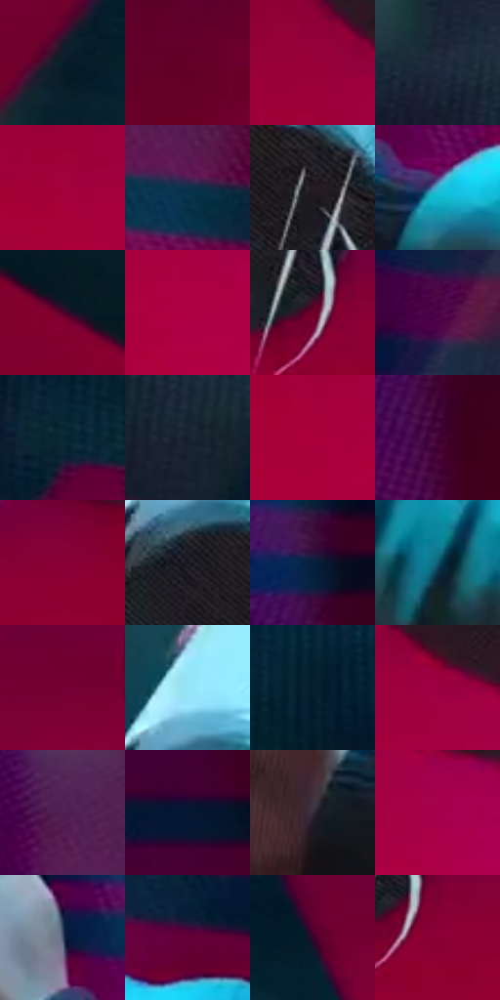

# 电影参考 552

- 状态：常规／活跃；来源世界：miles-home。
- 视角：high-angle；景别：detail；场景：detail。
- 时段：interior-time-unknown（外观依据，中置信度；具体时间／晨昏未知）；光照：cool-interior。
- 材质候选：skin, fabric, metal, paint（帧级，不是像素分割）。
- 明暗组：dark；L* P5/P50/P95：8.73026 / 20.07007 / 65.8274。
- 资格门禁：无附加门禁。
- 原截图 SHA-256：`d94d8e95ea12cd118d4571f8f088ac33bd44db0453c4f452a7947aa528972bb5`；尺寸：2880 × 1200。
- sRGB 像素 SHA-256：`61d9d7d64844f4b2cf87c95e9bfcde2c8cdcefc7b320928daf9f3800036274eb`。

## 观察与迁移

喷罐的窄亮边、手掌软体和衣袖区分。

喷罐近景：白青罐顶最亮，手中调、绿蓝袖较暗、洋红地面陪衬；罐的曲面高光不等于哑光衣袖亮面。

本公开版保存32个128×128原像素色卡上下文；图集格子并非原场景相邻位置。原rect、图集tile和像素SHA见 `data/palette-crops.json`。上下文不足时不得批准替色，不能以小样推断完整构图。

## 实测色卡

颜色比例分母为保留采样像素，不是材料面积；全部 32 色参与全库匹配。表内四舍五入仅用于阅读，原精度在 JSON。

| ID | HEX | Lab | 原图 xy | 像素数 | 比例 | 明度角色 |
| --- | --- | --- | --- | ---: | ---: | --- |
| 552-S01 | #072028 | [10.786201, -6.374913, -8.22875] | [572, 684] | 10149 | 5.268157% | deep-shadow |
| 552-S02 | #630027 | [19.224244, 41.710246, 6.514264] | [372, 612] | 9309 | 4.832129% | deep-shadow |
| 552-S03 | #990038 | [31.943038, 56.473912, 14.165456] | [1956, 676] | 8529 | 4.427246% | shadow |
| 552-S04 | #1D2B3B | [17.010771, -0.669432, -12.066286] | [576, 188] | 8400 | 4.360284% | deep-shadow |
| 552-S05 | #A3003D | [34.243739, 59.210769, 14.333957] | [1944, 764] | 8204 | 4.258544% | shadow |
| 552-S06 | #0C324B | [19.503372, -3.122117, -19.185508] | [2496, 292] | 7950 | 4.126697% | deep-shadow |
| 552-S07 | #251C24 | [11.629148, 6.229822, -3.785033] | [1544, 440] | 7873 | 4.086728% | deep-shadow |
| 552-S08 | #39B3D1 | [67.806344, -23.430231, -24.800473] | [2000, 360] | 7794 | 4.045721% | light |
| 552-S09 | #50012B | [14.964822, 36.82888, -3.108096] | [580, 1064] | 7784 | 4.040530% | deep-shadow |
| 552-S10 | #AE0042 | [36.733672, 62.156257, 14.832958] | [2068, 868] | 7378 | 3.829783% | shadow |
| 552-S11 | #710128 | [22.607492, 45.194196, 10.966019] | [1576, 572] | 7328 | 3.803829% | shadow |
| 552-S12 | #4E0448 | [16.378821, 39.352465, -21.609691] | [360, 108] | 6665 | 3.459678% | deep-shadow |
| 552-S13 | #062833 | [14.373234, -7.45173, -10.625614] | [864, 420] | 6662 | 3.458121% | deep-shadow |
| 552-S14 | #18222F | [12.881311, -0.151405, -9.997122] | [712, 328] | 6572 | 3.411403% | deep-shadow |
| 552-S15 | #A9003A | [35.485069, 60.498105, 18.176221] | [1960, 824] | 6268 | 3.253602% | shadow |
| 552-S16 | #410234 | [12.060011, 33.868706, -14.430439] | [76, 336] | 6040 | 3.135252% | deep-shadow |
| 552-S17 | #890035 | [28.319353, 52.336115, 10.674251] | [1692, 564] | 5851 | 3.037145% | shadow |
| 552-S18 | #191720 | [8.33929, 3.466755, -5.910112] | [1408, 396] | 5509 | 2.859620% | deep-shadow |
| 552-S19 | #07203D | [12.056676, 2.960778, -21.336084] | [64, 200] | 5401 | 2.803559% | deep-shadow |
| 552-S20 | #13596E | [34.81886, -12.974762, -17.964829] | [2684, 632] | 5389 | 2.797330% | shadow |
| 552-S21 | #760035 | [24.031064, 47.6154, 4.04548] | [1240, 552] | 5351 | 2.777605% | shadow |
| 552-S22 | #96E5F6 | [86.589471, -19.996361, -15.894049] | [1408, 280] | 5180 | 2.688842% | highlight |
| 552-S23 | #051D2D | [9.800799, -2.555369, -13.423582] | [1000, 316] | 5134 | 2.664964% | deep-shadow |
| 552-S24 | #9B0042 | [32.621751, 57.602528, 8.532619] | [2052, 712] | 5074 | 2.633819% | shadow |
| 552-S25 | #511F52 | [21.352532, 31.285282, -20.536626] | [2420, 92] | 5016 | 2.603712% | shadow |
| 552-S26 | #061632 | [7.612114, 5.452597, -20.55619] | [2708, 176] | 3588 | 1.862464% | deep-shadow |
| 552-S27 | #372E3C | [20.410532, 7.285571, -7.34729] | [1844, 412] | 3544 | 1.839625% | shadow |
| 552-S28 | #A7004B | [35.451335, 61.083478, 6.970077] | [2136, 784] | 3405 | 1.767472% | shadow |
| 552-S29 | #49526D | [35.112681, 3.495068, -16.674971] | [1920, 260] | 3059 | 1.587870% | shadow |
| 552-S30 | #650038 | [20.255023, 43.706591, -4.02932] | [2624, 368] | 2912 | 1.511565% | shadow |
| 552-S31 | #33062B | [9.063111, 26.863101, -12.717644] | [1112, 556] | 2699 | 1.401001% | deep-shadow |
| 552-S32 | #890135 | [28.376779, 52.168899, 10.752764] | [1616, 596] | 2631 | 1.365703% | shadow |

## 色阶与空间分布

- 采样 ROI：`[0.01, 0.02, 0.98, 0.94]`；步长：4；样本数：192648。
- 排除区：`[]`。
- 深暗、暗、中、亮、高光五段计数：`[95365, 81868, 4295, 6028, 5092]`。
- RGB 各 256 箱、L* 100 箱、13×5 色相明度表和 3×3 空间统计全部保存在 [总数据](../film-library.json)。
- [可视化档案](../../references/library.html)按需绘制直方图，不存 2,094 张重复图表图片。

## 纹理特征占比

**这是分块图像特征的面积占比，不是波点／排线／丝网／错版的精确语义覆盖率。** 窗格、发丝、织物也会产生方向或周期特征。
原图 ROI 像素 3084576；已测块覆盖 3084576（100.0000%）；未测 0。

| 特征 | 块覆盖像素 | 占已测面积 | 阈值敏感范围 |
| --- | ---: | ---: | --- |
| low-contrast | 1234976 | 40.0371% | 33.9537% ~ 48.5357% |
| directional-structure | 360448 | 11.6855% | 5.3116% ~ 25.7529% |
| periodic-structure | 1396992 | 45.2896% | 39.7622% ~ 45.2896% |
| mixed-detail | 92160 | 2.9878% | 0.5312% ~ 4.5812% |

阈值敏感范围不是统计置信区间。逐块坐标、尺度、对比、方向一致性、频谱集中度、频率与角度见 [全量特征记录](../texture-features.jsonl)，以帧号定位。
四种印刷层的真实像素覆盖仍标为 `null`，不能填 0，也不能拿上表代替。不得据这些代理测量删除唯一证据。

[测量方法与保留策略](../../references/library-retention.md) · [分类索引](../archive/README.md)
