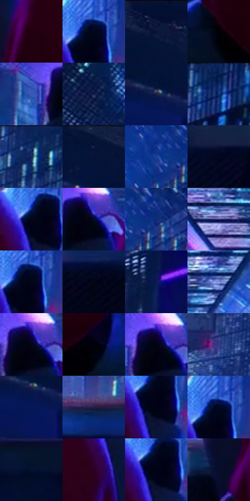

# 电影参考 553

- 状态：常规／活跃；来源世界：miles-home。
- 视角：high-angle；景别：environment-wide；场景：city。
- 时段：night-appearance（外观依据，中置信度；具体时间／晨昏未知）；光照：night-mixed。
- 材质候选：skin, fabric, glass, stone, metal, sky（帧级，不是像素分割）。
- 明暗组：very-dark；L* P5/P50/P95：0.33353 / 6.34499 / 38.55947。
- 资格门禁：无附加门禁。
- 原截图 SHA-256：`eb14a880bb3c888944f00f716d855b23a77d790db76d8602805f5215e4735df0`；尺寸：2880 × 1200。
- sRGB 像素 SHA-256：`17c53b084e8da7af39961785bf4219dc7563ffc1cbce0fab8270d48a9f2c06e7`。

## 观察与迁移

夜城人物与玻璃立面；倾斜视角不授权更改原照建筑透视。

俯视屋檐：红帽暗主体与黑水平屋沿占前景，楼下青白窗组较亮；大黑块是实体而非可自动裁掉的黑边。

本公开版保存32个128×128原像素色卡上下文；图集格子并非原场景相邻位置。原rect、图集tile和像素SHA见 `data/palette-crops.json`。上下文不足时不得批准替色，不能以小样推断完整构图。

## 实测色卡

颜色比例分母为保留采样像素，不是材料面积；全部 32 色参与全库匹配。表内四舍五入仅用于阅读，原精度在 JSON。

| ID | HEX | Lab | 原图 xy | 像素数 | 比例 | 明度角色 |
| --- | --- | --- | --- | ---: | ---: | --- |
| 553-S01 | #22000F | [3.38436, 15.969669, -1.099859] | [1300, 484] | 9986 | 5.183547% | deep-shadow |
| 553-S02 | #02071D | [2.290115, 3.347439, -12.898832] | [1716, 344] | 9837 | 5.106204% | deep-shadow |
| 553-S03 | #0C163A | [8.630823, 10.32121, -24.695179] | [332, 52] | 7880 | 4.090362% | deep-shadow |
| 553-S04 | #000106 | [0.314799, 0.433702, -1.984223] | [1268, 752] | 7831 | 4.064927% | deep-shadow |
| 553-S05 | #3A55B4 | [39.053968, 21.812158, -53.538576] | [1128, 364] | 7792 | 4.044683% | shadow |
| 553-S06 | #0F1D47 | [12.188778, 11.107017, -28.106246] | [856, 104] | 7659 | 3.975645% | deep-shadow |
| 553-S07 | #061644 | [9.236395, 13.931757, -30.830563] | [36, 104] | 7191 | 3.732715% | deep-shadow |
| 553-S08 | #0E265C | [16.757353, 13.321268, -34.971355] | [2772, 40] | 7147 | 3.709875% | deep-shadow |
| 553-S09 | #172A63 | [18.964717, 14.559757, -35.999789] | [2592, 60] | 7079 | 3.674577% | deep-shadow |
| 553-S10 | #061335 | [6.87749, 9.105564, -23.929257] | [184, 36] | 6914 | 3.588929% | deep-shadow |
| 553-S11 | #163B94 | [27.941352, 22.527877, -52.4385] | [2120, 76] | 6768 | 3.513143% | shadow |
| 553-S12 | #04071F | [2.499015, 4.518912, -14.16181] | [612, 648] | 6766 | 3.512105% | deep-shadow |
| 553-S13 | #01051B | [1.753183, 3.279447, -12.097845] | [1684, 372] | 6619 | 3.435800% | deep-shadow |
| 553-S14 | #030C27 | [3.872549, 5.226724, -18.272434] | [1232, 352] | 6522 | 3.385449% | deep-shadow |
| 553-S15 | #0F2B78 | [20.769043, 21.716299, -46.663776] | [2192, 68] | 6438 | 3.341846% | shadow |
| 553-S16 | #2C3171 | [23.418235, 18.884371, -37.810157] | [1192, 120] | 6173 | 3.204290% | shadow |
| 553-S17 | #010616 | [1.757806, 1.533511, -8.192903] | [1720, 356] | 5671 | 2.943711% | deep-shadow |
| 553-S18 | #020718 | [2.084609, 1.90333, -9.199423] | [2328, 668] | 5584 | 2.898551% | deep-shadow |
| 553-S19 | #0A1B53 | [12.433046, 17.248846, -35.96917] | [2396, 240] | 5580 | 2.896474% | deep-shadow |
| 553-S20 | #7F91DD | [61.638183, 12.912287, -40.779495] | [1736, 108] | 5314 | 2.758399% | light |
| 553-S21 | #040519 | [1.847348, 3.496424, -10.319824] | [1216, 344] | 5184 | 2.690918% | deep-shadow |
| 553-S22 | #00000A | [0.197868, 1.390438, -3.784235] | [1648, 808] | 4895 | 2.540904% | deep-shadow |
| 553-S23 | #000311 | [0.953647, 1.366113, -6.129592] | [1208, 340] | 4776 | 2.479133% | deep-shadow |
| 553-S24 | #36408C | [30.263674, 20.496374, -43.678756] | [2016, 428] | 4756 | 2.468751% | shadow |
| 553-S25 | #06175A | [11.886626, 22.856298, -41.613092] | [60, 144] | 4753 | 2.467194% | deep-shadow |
| 553-S26 | #241F4C | [14.826355, 16.251527, -27.218255] | [1872, 572] | 4527 | 2.349882% | deep-shadow |
| 553-S27 | #000217 | [0.950709, 3.123884, -10.109711] | [1704, 400] | 4507 | 2.339500% | deep-shadow |
| 553-S28 | #020722 | [2.531956, 5.046877, -16.483522] | [1716, 336] | 4365 | 2.265790% | deep-shadow |
| 553-S29 | #05122F | [6.052164, 6.346723, -20.844098] | [200, 624] | 4323 | 2.243989% | deep-shadow |
| 553-S30 | #2F0022 | [6.50355, 27.323259, -9.93126] | [1664, 512] | 3498 | 1.815747% | deep-shadow |
| 553-S31 | #020315 | [1.193711, 2.756577, -8.306219] | [1696, 388] | 3212 | 1.667290% | deep-shadow |
| 553-S32 | #060C2D | [4.435527, 8.738098, -21.919006] | [1188, 616] | 3101 | 1.609672% | deep-shadow |

## 色阶与空间分布

- 采样 ROI：`[0.01, 0.02, 0.98, 0.94]`；步长：4；样本数：192648。
- 排除区：`[]`。
- 深暗、暗、中、亮、高光五段计数：`[156614, 27268, 6359, 1856, 551]`。
- RGB 各 256 箱、L* 100 箱、13×5 色相明度表和 3×3 空间统计全部保存在 [总数据](../film-library.json)。
- [可视化档案](../../references/library.html)按需绘制直方图，不存 2,094 张重复图表图片。

## 纹理特征占比

**这是分块图像特征的面积占比，不是波点／排线／丝网／错版的精确语义覆盖率。** 窗格、发丝、织物也会产生方向或周期特征。
原图 ROI 像素 3084576；已测块覆盖 3084576（100.0000%）；未测 0。

| 特征 | 块覆盖像素 | 占已测面积 | 阈值敏感范围 |
| --- | ---: | ---: | --- |
| low-contrast | 1230880 | 39.9044% | 35.6551% ~ 41.4978% |
| directional-structure | 374016 | 12.1254% | 6.2826% ~ 18.9391% |
| periodic-structure | 1135616 | 36.8160% | 36.8160% ~ 39.0319% |
| mixed-detail | 344064 | 11.1543% | 6.3739% ~ 15.4036% |

阈值敏感范围不是统计置信区间。逐块坐标、尺度、对比、方向一致性、频谱集中度、频率与角度见 [全量特征记录](../texture-features.jsonl)，以帧号定位。
四种印刷层的真实像素覆盖仍标为 `null`，不能填 0，也不能拿上表代替。不得据这些代理测量删除唯一证据。

[测量方法与保留策略](../../references/library-retention.md) · [分类索引](../archive/README.md)
