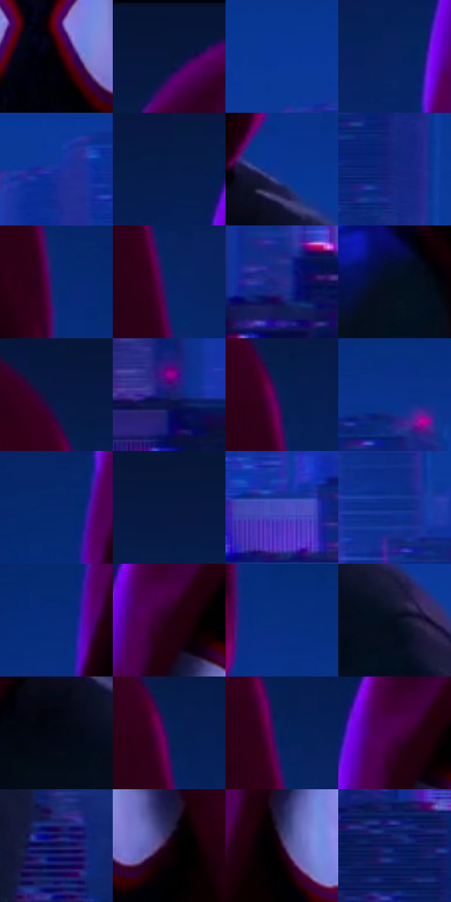

# 电影参考 554

- 状态：常规／活跃；来源世界：miles-home。
- 视角：near-level；景别：medium；场景：city。
- 时段：night-appearance（外观依据，中置信度；具体时间／晨昏未知）；光照：night-mixed。
- 材质候选：skin, fabric, glass, stone, metal, sky（帧级，不是像素分割）。
- 明暗组：very-dark；L* P5/P50/P95：0.77316 / 16.21213 / 27.63513。
- 资格门禁：无附加门禁。
- 原截图 SHA-256：`f471f511b2e1006f0d9bf990ff064d83cf96dbfd2613ed1829c733312f1701c4`；尺寸：2880 × 1206。
- sRGB 像素 SHA-256：`58bc9a7bdd0318dd23b92eaf7ce18a82c532bf022c1b48c56e81c2d5703f5e60`。

## 观察与迁移

夜城人物与玻璃立面；倾斜视角不授权更改原照建筑透视。

面罩正面：白蓝镜片局部亮，黑脸与红帽低亮分层，绿衣保持暗；镜片亮不直接证明自发光，织网与衣褶不同。

本公开版保存32个128×128原像素色卡上下文；图集格子并非原场景相邻位置。原rect、图集tile和像素SHA见 `data/palette-crops.json`。上下文不足时不得批准替色，不能以小样推断完整构图。

## 实测色卡

颜色比例分母为保留采样像素，不是材料面积；全部 32 色参与全库匹配。表内四舍五入仅用于阅读，原精度在 JSON。

| ID | HEX | Lab | 原图 xy | 像素数 | 比例 | 明度角色 |
| --- | --- | --- | --- | ---: | ---: | --- |
| 554-S01 | #060105 | [0.644865, 1.863654, -1.052969] | [1476, 400] | 11701 | 6.051845% | deep-shadow |
| 554-S02 | #061639 | [8.198464, 8.801499, -24.692505] | [1300, 36] | 11282 | 5.835135% | deep-shadow |
| 554-S03 | #083899 | [27.23807, 25.790833, -56.662297] | [2180, 680] | 10991 | 5.684628% | shadow |
| 554-S04 | #092361 | [16.118873, 17.262665, -39.337608] | [1184, 280] | 9546 | 4.937263% | deep-shadow |
| 554-S05 | #14309E | [25.95162, 33.769688, -61.816053] | [2248, 736] | 9366 | 4.844165% | shadow |
| 554-S06 | #071D4C | [12.256945, 12.236517, -31.47014] | [1184, 156] | 8680 | 4.489361% | deep-shadow |
| 554-S07 | #0B3592 | [25.837626, 25.148493, -54.660773] | [1724, 624] | 7831 | 4.050252% | shadow |
| 554-S08 | #11267E | [20.08818, 27.821185, -51.5954] | [236, 700] | 7556 | 3.908020% | shadow |
| 554-S09 | #062A74 | [19.862687, 20.11737, -45.597447] | [1716, 416] | 7510 | 3.884228% | deep-shadow |
| 554-S10 | #062467 | [16.889424, 18.893397, -42.033313] | [1700, 304] | 7379 | 3.816474% | deep-shadow |
| 554-S11 | #292887 | [22.784239, 32.405029, -52.788243] | [2124, 1096] | 7018 | 3.629762% | shadow |
| 554-S12 | #040E1D | [3.871051, 0.879033, -10.520075] | [1260, 720] | 6808 | 3.521149% | deep-shadow |
| 554-S13 | #071845 | [10.014493, 12.948736, -30.26055] | [1648, 108] | 6532 | 3.378399% | deep-shadow |
| 554-S14 | #161B6B | [15.568551, 28.279386, -46.797344] | [436, 1016] | 6341 | 3.279613% | deep-shadow |
| 554-S15 | #062056 | [14.077948, 14.356306, -35.322044] | [1676, 184] | 6139 | 3.175137% | deep-shadow |
| 554-S16 | #0A328A | [24.257221, 23.904221, -52.297222] | [220, 576] | 6117 | 3.163758% | shadow |
| 554-S17 | #08286E | [18.77612, 19.13338, -43.504803] | [1172, 392] | 5864 | 3.032905% | deep-shadow |
| 554-S18 | #091840 | [9.651413, 10.947983, -27.325947] | [108, 116] | 5666 | 2.930498% | deep-shadow |
| 554-S19 | #4A4ABC | [37.811719, 34.270617, -60.208231] | [2376, 928] | 5597 | 2.894810% | shadow |
| 554-S20 | #0A2D85 | [22.422372, 25.352125, -52.182143] | [2568, 796] | 5412 | 2.799127% | shadow |
| 554-S21 | #062C7A | [20.997751, 21.235648, -47.573094] | [1172, 464] | 5274 | 2.727752% | shadow |
| 554-S22 | #240015 | [3.87795, 18.627431, -3.994066] | [1300, 244] | 4856 | 2.511560% | deep-shadow |
| 554-S23 | #062F80 | [22.406662, 21.628628, -49.066669] | [1764, 508] | 4534 | 2.345019% | shadow |
| 554-S24 | #060E1F | [4.079951, 2.050507, -11.75928] | [1808, 768] | 4368 | 2.259162% | deep-shadow |
| 554-S25 | #020713 | [1.913684, 0.702223, -5.930473] | [1680, 724] | 4265 | 2.205890% | deep-shadow |
| 554-S26 | #0A1E53 | [13.335209, 14.964152, -34.49539] | [1676, 192] | 3811 | 1.971078% | deep-shadow |
| 554-S27 | #07215C | [14.981743, 16.382633, -37.873951] | [1688, 232] | 3080 | 1.592999% | deep-shadow |
| 554-S28 | #4B0049 | [15.367071, 40.210792, -23.951758] | [1288, 224] | 2563 | 1.325603% | deep-shadow |
| 554-S29 | #0F1154 | [10.124595, 25.363879, -40.435806] | [1932, 984] | 2543 | 1.315259% | deep-shadow |
| 554-S30 | #18010D | [2.213137, 9.312454, -1.958784] | [1592, 420] | 2478 | 1.281640% | deep-shadow |
| 554-S31 | #280F32 | [9.182298, 20.170098, -17.841216] | [1304, 396] | 1829 | 0.945973% | deep-shadow |
| 554-S32 | #041458 | [10.779638, 23.996642, -42.091975] | [84, 992] | 409 | 0.211538% | deep-shadow |

## 色阶与空间分布

- 采样 ROI：`[0.01, 0.02, 0.98, 0.94]`；步长：4；样本数：193346。
- 排除区：`[]`。
- 深暗、暗、中、亮、高光五段计数：`[125351, 66558, 1096, 341, 0]`。
- RGB 各 256 箱、L* 100 箱、13×5 色相明度表和 3×3 空间统计全部保存在 [总数据](../film-library.json)。
- [可视化档案](../../references/library.html)按需绘制直方图，不存 2,094 张重复图表图片。

## 纹理特征占比

**这是分块图像特征的面积占比，不是波点／排线／丝网／错版的精确语义覆盖率。** 窗格、发丝、织物也会产生方向或周期特征。
原图 ROI 像素 3098546；已测块覆盖 3098546（100.0000%）；未测 0。

| 特征 | 块覆盖像素 | 占已测面积 | 阈值敏感范围 |
| --- | ---: | ---: | --- |
| low-contrast | 1602304 | 51.7115% | 41.8426% ~ 56.4704% |
| directional-structure | 609330 | 19.6650% | 8.1272% ~ 33.1361% |
| periodic-structure | 788736 | 25.4550% | 24.6702% ~ 25.4550% |
| mixed-detail | 98176 | 3.1685% | 0.3511% ~ 10.1250% |

阈值敏感范围不是统计置信区间。逐块坐标、尺度、对比、方向一致性、频谱集中度、频率与角度见 [全量特征记录](../texture-features.jsonl)，以帧号定位。
四种印刷层的真实像素覆盖仍标为 `null`，不能填 0，也不能拿上表代替。不得据这些代理测量删除唯一证据。

[测量方法与保留策略](../../references/library-retention.md) · [分类索引](../archive/README.md)
