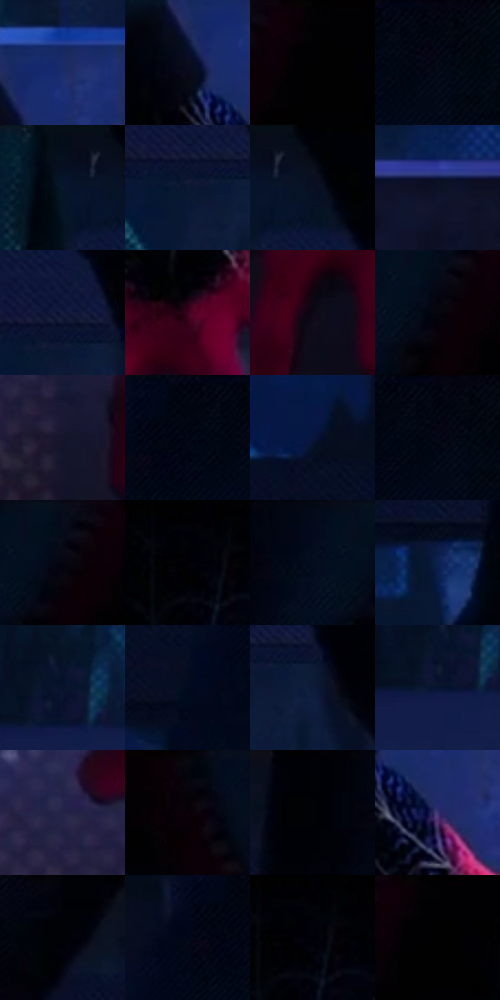

# 电影参考 555

- 状态：常规／活跃；来源世界：miles-home。
- 视角：high-angle；景别：detail；场景：city。
- 时段：night-appearance（外观依据，中置信度；具体时间／晨昏未知）；光照：night-mixed。
- 材质候选：skin, fabric, glass, stone, metal, sky（帧级，不是像素分割）。
- 明暗组：very-dark；L* P5/P50/P95：0.31375 / 4.03308 / 19.77563。
- 资格门禁：无附加门禁。
- 原截图 SHA-256：`a1d627ed7f5021d23cad6532744505b1bbc25acb4ca6f4ad5b81a825cf25788b`；尺寸：2880 × 1214。
- sRGB 像素 SHA-256：`b8a1dacb9d291fb0a4bacd1796b87c8831e1a98ec6eefe3595a48309a92b9ab7`。

## 观察与迁移

夜城人物与玻璃立面；倾斜视角不授权更改原照建筑透视。

手膝特写：黑布膝部仅局部蓝细纹可见，酒红手套与灰短裤用宽面区分；材质微纹不自动当排线。

本公开版保存32个128×128原像素色卡上下文；图集格子并非原场景相邻位置。原rect、图集tile和像素SHA见 `data/palette-crops.json`。上下文不足时不得批准替色，不能以小样推断完整构图。

## 实测色卡

颜色比例分母为保留采样像素，不是材料面积；全部 32 色参与全库匹配。表内四舍五入仅用于阅读，原精度在 JSON。

| ID | HEX | Lab | 原图 xy | 像素数 | 比例 | 明度角色 |
| --- | --- | --- | --- | ---: | ---: | --- |
| 555-S01 | #1B2B67 | [19.800356, 16.101089, -37.253364] | [2600, 584] | 10155 | 5.214592% | deep-shadow |
| 555-S02 | #0B0D1D | [4.043796, 3.200158, -10.219208] | [2540, 636] | 9348 | 4.800197% | deep-shadow |
| 555-S03 | #010103 | [0.313747, 0.27807, -0.756814] | [1316, 28] | 8821 | 4.529583% | deep-shadow |
| 555-S04 | #020610 | [1.630866, 0.493256, -4.557893] | [668, 28] | 8039 | 4.128026% | deep-shadow |
| 555-S05 | #061025 | [4.903127, 3.205852, -15.12711] | [1896, 48] | 7903 | 4.058190% | deep-shadow |
| 555-S06 | #0B1831 | [8.533751, 4.494189, -18.333056] | [1988, 244] | 7620 | 3.912869% | deep-shadow |
| 555-S07 | #00030A | [0.786102, 0.188757, -2.925281] | [1964, 28] | 7430 | 3.815304% | deep-shadow |
| 555-S08 | #0D1125 | [5.600261, 4.544912, -14.012123] | [184, 576] | 7411 | 3.805548% | deep-shadow |
| 555-S09 | #161D40 | [12.085649, 9.579569, -23.356944] | [2008, 204] | 7216 | 3.705415% | deep-shadow |
| 555-S10 | #3D031D | [10.154573, 29.303396, -0.245914] | [2560, 884] | 7113 | 3.652525% | deep-shadow |
| 555-S11 | #0D0815 | [2.830647, 3.698213, -5.837164] | [384, 960] | 6875 | 3.530312% | deep-shadow |
| 555-S12 | #05050D | [1.534303, 1.148392, -3.12555] | [1220, 88] | 6874 | 3.529798% | deep-shadow |
| 555-S13 | #15162D | [8.329709, 7.178477, -15.67184] | [2376, 1076] | 6567 | 3.372154% | deep-shadow |
| 555-S14 | #020714 | [1.945191, 0.923629, -6.533054] | [596, 60] | 6488 | 3.331587% | deep-shadow |
| 555-S15 | #08163D | [8.67254, 11.009251, -26.785935] | [116, 76] | 6234 | 3.201158% | deep-shadow |
| 555-S16 | #00030D | [0.850604, 0.642016, -4.158879] | [652, 32] | 6215 | 3.191402% | deep-shadow |
| 555-S17 | #050A18 | [2.847769, 1.486147, -8.064053] | [1228, 32] | 6141 | 3.153403% | deep-shadow |
| 555-S18 | #02030A | [0.90272, 0.711755, -2.741004] | [1500, 28] | 6057 | 3.110269% | deep-shadow |
| 555-S19 | #040D1E | [3.679555, 1.682078, -11.592836] | [1144, 52] | 5994 | 3.077918% | deep-shadow |
| 555-S20 | #0D204F | [13.726114, 12.019732, -31.129465] | [924, 248] | 5693 | 2.923355% | deep-shadow |
| 555-S21 | #0A142C | [6.744034, 4.921186, -17.498449] | [2780, 72] | 5574 | 2.862249% | deep-shadow |
| 555-S22 | #020A1E | [2.923756, 2.464839, -12.742172] | [464, 188] | 5479 | 2.813466% | deep-shadow |
| 555-S23 | #0D1B3A | [10.369953, 6.560574, -21.889843] | [2056, 260] | 5411 | 2.778548% | deep-shadow |
| 555-S24 | #06152F | [7.047299, 4.691269, -19.254398] | [2764, 108] | 5387 | 2.766224% | deep-shadow |
| 555-S25 | #232347 | [15.561471, 11.277342, -22.611025] | [2296, 964] | 5332 | 2.737982% | deep-shadow |
| 555-S26 | #050208 | [0.841994, 1.618726, -1.99406] | [1700, 48] | 4523 | 2.322560% | deep-shadow |
| 555-S27 | #010206 | [0.569186, 0.294641, -1.605767] | [1036, 28] | 4285 | 2.200347% | deep-shadow |
| 555-S28 | #3D3674 | [26.422028, 20.50726, -34.817053] | [2620, 716] | 3943 | 2.024730% | shadow |
| 555-S29 | #000106 | [0.314799, 0.433702, -1.984223] | [900, 28] | 3802 | 1.952327% | deep-shadow |
| 555-S30 | #020819 | [2.318964, 1.771743, -9.645147] | [536, 80] | 3334 | 1.712009% | deep-shadow |
| 555-S31 | #010006 | [0.17703, 1.095762, -2.178403] | [1520, 28] | 2506 | 1.286831% | deep-shadow |
| 555-S32 | #010101 | [0.274173, -1.7e-05, 3.3e-05] | [1332, 44] | 972 | 0.499122% | deep-shadow |

## 色阶与空间分布

- 采样 ROI：`[0.01, 0.02, 0.98, 0.94]`；步长：4；样本数：194742。
- 排除区：`[]`。
- 深暗、暗、中、亮、高光五段计数：`[185634, 8766, 342, 0, 0]`。
- RGB 各 256 箱、L* 100 箱、13×5 色相明度表和 3×3 空间统计全部保存在 [总数据](../film-library.json)。
- [可视化档案](../../references/library.html)按需绘制直方图，不存 2,094 张重复图表图片。

## 纹理特征占比

**这是分块图像特征的面积占比，不是波点／排线／丝网／错版的精确语义覆盖率。** 窗格、发丝、织物也会产生方向或周期特征。
原图 ROI 像素 3120898；已测块覆盖 3120898（100.0000%）；未测 0。

| 特征 | 块覆盖像素 | 占已测面积 | 阈值敏感范围 |
| --- | ---: | ---: | --- |
| low-contrast | 1020160 | 32.6880% | 24.3376% ~ 39.2790% |
| directional-structure | 392192 | 12.5666% | 4.4910% ~ 22.8324% |
| periodic-structure | 1563906 | 50.1108% | 49.0608% ~ 50.8203% |
| mixed-detail | 144640 | 4.6346% | 2.0097% ~ 7.1692% |

阈值敏感范围不是统计置信区间。逐块坐标、尺度、对比、方向一致性、频谱集中度、频率与角度见 [全量特征记录](../texture-features.jsonl)，以帧号定位。
四种印刷层的真实像素覆盖仍标为 `null`，不能填 0，也不能拿上表代替。不得据这些代理测量删除唯一证据。

[测量方法与保留策略](../../references/library-retention.md) · [分类索引](../archive/README.md)
