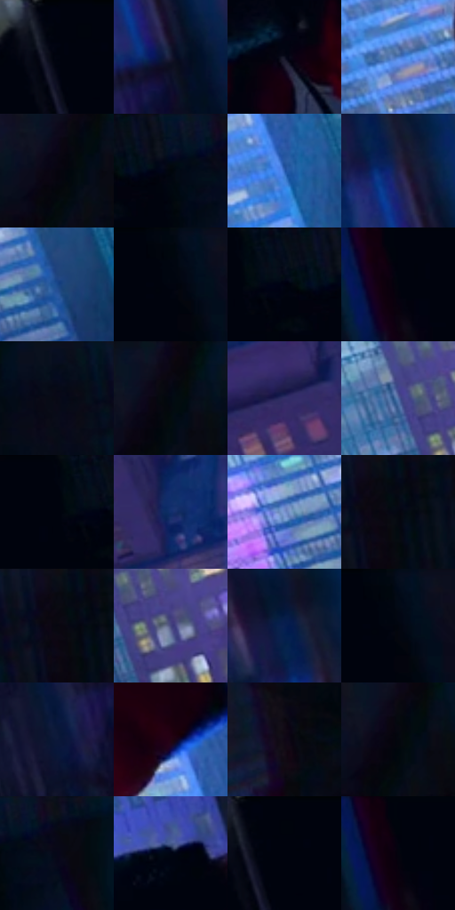

# 电影参考 556

- 状态：常规／活跃；来源世界：miles-home。
- 视角：rolled-or-dutch；景别：full-body；场景：city。
- 时段：night-appearance（外观依据，中置信度；具体时间／晨昏未知）；光照：night-mixed。
- 材质候选：skin, fabric, glass, stone, metal, sky（帧级，不是像素分割）。
- 明暗组：very-dark；L* P5/P50/P95：0.8506 / 3.67121 / 51.98342。
- 资格门禁：无附加门禁。
- 原截图 SHA-256：`03a794b0a972caa99ebbb8a885875da15a85d20188505ade67e3d78422b9258b`；尺寸：2880 × 1208。
- sRGB 像素 SHA-256：`c399d19e0c638c502ff602005e8534a8e9540054c0ef4a2ed0de04d04d56ed01`。

## 观察与迁移

夜城人物与玻璃立面；倾斜视角不授权更改原照建筑透视。

玻璃楼边蹲姿：右幕墙暗倒影、左远城较亮、近人物深暗；反射剪影服从玻璃范围，窗格结构不能当丝网。

本公开版保存32个128×128原像素色卡上下文；图集格子并非原场景相邻位置。原rect、图集tile和像素SHA见 `data/palette-crops.json`。上下文不足时不得批准替色，不能以小样推断完整构图。

## 实测色卡

颜色比例分母为保留采样像素，不是材料面积；全部 32 色参与全库匹配。表内四舍五入仅用于阅读，原精度在 JSON。

| ID | HEX | Lab | 原图 xy | 像素数 | 比例 | 明度角色 |
| --- | --- | --- | --- | ---: | ---: | --- |
| 556-S01 | #00030D | [0.850604, 0.642016, -4.158879] | [1112, 28] | 25578 | 13.229133% | deep-shadow |
| 556-S02 | #191A34 | [10.507975, 8.01098, -17.307372] | [1524, 708] | 8060 | 4.168692% | deep-shadow |
| 556-S03 | #111223 | [6.080022, 4.546034, -11.72166] | [980, 292] | 7956 | 4.114903% | deep-shadow |
| 556-S04 | #4A7CC9 | [51.934379, 7.372249, -45.030831] | [164, 512] | 7403 | 3.828887% | midtone |
| 556-S05 | #05040D | [1.338225, 1.548952, -3.411868] | [2292, 100] | 6997 | 3.618901% | deep-shadow |
| 556-S06 | #061229 | [5.702897, 3.74415, -16.910927] | [1916, 32] | 6903 | 3.570283% | deep-shadow |
| 556-S07 | #2A5FB3 | [41.104077, 12.661631, -49.680568] | [524, 656] | 6890 | 3.563560% | midtone |
| 556-S08 | #22234C | [15.818405, 12.821526, -25.635903] | [1480, 588] | 6707 | 3.468911% | deep-shadow |
| 556-S09 | #1A498A | [31.390552, 9.173815, -40.70206] | [608, 872] | 6545 | 3.385123% | shadow |
| 556-S10 | #01060D | [1.497146, -0.298166, -3.207786] | [1360, 32] | 6495 | 3.359263% | deep-shadow |
| 556-S11 | #080F1C | [4.309372, 1.107409, -9.055494] | [1840, 44] | 6424 | 3.322541% | deep-shadow |
| 556-S12 | #02030D | [0.967221, 1.165015, -3.974602] | [1548, 68] | 6409 | 3.314783% | deep-shadow |
| 556-S13 | #060C19 | [3.358593, 1.170387, -8.098917] | [2528, 28] | 6263 | 3.239271% | deep-shadow |
| 556-S14 | #020810 | [2.023022, -0.307865, -3.985257] | [2320, 64] | 6225 | 3.219617% | deep-shadow |
| 556-S15 | #322E67 | [22.341573, 18.771803, -33.06702] | [340, 1076] | 6182 | 3.197377% | shadow |
| 556-S16 | #506AA1 | [45.06136, 6.360163, -32.683286] | [864, 764] | 6019 | 3.113072% | midtone |
| 556-S17 | #00040F | [1.09572, 0.58605, -4.810415] | [1788, 32] | 5607 | 2.899982% | deep-shadow |
| 556-S18 | #122F6C | [20.99498, 14.043501, -38.583003] | [456, 1132] | 5466 | 2.827056% | shadow |
| 556-S19 | #7B95D1 | [61.918659, 6.157443, -33.671372] | [460, 868] | 5411 | 2.798610% | light |
| 556-S20 | #040710 | [1.943562, 0.615694, -4.087298] | [2676, 64] | 5184 | 2.681204% | deep-shadow |
| 556-S21 | #080912 | [2.625493, 1.257882, -4.227438] | [2652, 32] | 5024 | 2.598450% | deep-shadow |
| 556-S22 | #46477F | [32.569601, 15.190101, -31.879136] | [940, 808] | 4921 | 2.545178% | shadow |
| 556-S23 | #081E4F | [12.887626, 12.947262, -32.501094] | [1444, 528] | 4819 | 2.492423% | deep-shadow |
| 556-S24 | #020A17 | [2.63595, 0.442398, -7.634889] | [1372, 36] | 4774 | 2.469149% | deep-shadow |
| 556-S25 | #0D183A | [9.354213, 8.924829, -23.523415] | [1436, 796] | 4323 | 2.235888% | deep-shadow |
| 556-S26 | #240312 | [4.371645, 16.756488, -1.32707] | [468, 548] | 3965 | 2.050728% | deep-shadow |
| 556-S27 | #0F0715 | [2.779077, 4.746852, -5.895134] | [1728, 392] | 3731 | 1.929701% | deep-shadow |
| 556-S28 | #03070F | [1.85888, 0.168867, -3.675045] | [2308, 88] | 3395 | 1.755919% | deep-shadow |
| 556-S29 | #060A16 | [2.833661, 1.238765, -6.586938] | [1984, 36] | 3127 | 1.617308% | deep-shadow |
| 556-S30 | #000513 | [1.404911, 0.980346, -6.687387] | [780, 80] | 2882 | 1.490592% | deep-shadow |
| 556-S31 | #00040C | [1.023982, 0.081943, -3.438429] | [1140, 28] | 2800 | 1.448181% | deep-shadow |
| 556-S32 | #01020D | [0.712835, 1.304076, -4.353058] | [1544, 48] | 861 | 0.445316% | deep-shadow |

## 色阶与空间分布

- 采样 ROI：`[0.01, 0.02, 0.98, 0.94]`；步长：4；样本数：193346。
- 排除区：`[]`。
- 深暗、暗、中、亮、高光五段计数：`[148250, 23321, 18542, 3091, 142]`。
- RGB 各 256 箱、L* 100 箱、13×5 色相明度表和 3×3 空间统计全部保存在 [总数据](../film-library.json)。
- [可视化档案](../../references/library.html)按需绘制直方图，不存 2,094 张重复图表图片。

## 纹理特征占比

**这是分块图像特征的面积占比，不是波点／排线／丝网／错版的精确语义覆盖率。** 窗格、发丝、织物也会产生方向或周期特征。
原图 ROI 像素 3104134；已测块覆盖 3104134（100.0000%）；未测 0。

| 特征 | 块覆盖像素 | 占已测面积 | 阈值敏感范围 |
| --- | ---: | ---: | --- |
| low-contrast | 938630 | 30.2381% | 25.5785% ~ 35.4255% |
| directional-structure | 190976 | 6.1523% | 3.1669% ~ 16.8075% |
| periodic-structure | 1925376 | 62.0262% | 54.8842% ~ 62.0262% |
| mixed-detail | 49152 | 1.5834% | 0.5278% ~ 6.5234% |

阈值敏感范围不是统计置信区间。逐块坐标、尺度、对比、方向一致性、频谱集中度、频率与角度见 [全量特征记录](../texture-features.jsonl)，以帧号定位。
四种印刷层的真实像素覆盖仍标为 `null`，不能填 0，也不能拿上表代替。不得据这些代理测量删除唯一证据。

[测量方法与保留策略](../../references/library-retention.md) · [分类索引](../archive/README.md)
