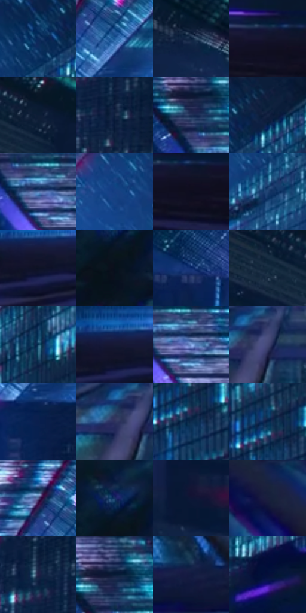

# 电影参考 557

- 状态：常规／活跃；来源世界：miles-home。
- 视角：overhead；景别：environment-wide；场景：city。
- 时段：night-appearance（外观依据，中置信度；具体时间／晨昏未知）；光照：night-mixed。
- 材质候选：skin, fabric, glass, stone, metal, sky（帧级，不是像素分割）。
- 明暗组：very-dark；L* P5/P50/P95：4.90461 / 14.98439 / 48.50398。
- 资格门禁：无附加门禁。
- 原截图 SHA-256：`e35a759674f654136702a620531f85855f08ecf4fa0d5b1ad36338b141c682a8`；尺寸：2880 × 1200。
- sRGB 像素 SHA-256：`bf02246e53313e3d3e577ba8cba00134d89b701f0d940a6298a95905bea99847`。

## 观察与迁移

夜城人物与玻璃立面；倾斜视角不授权更改原照建筑透视。

顺玻璃立面向下看：暗竖框汇聚，青白亮区在远端，蓝紫反射片区连续；亮窗可能包含映光，不一律当室内灯。

本公开版保存32个128×128原像素色卡上下文；图集格子并非原场景相邻位置。原rect、图集tile和像素SHA见 `data/palette-crops.json`。上下文不足时不得批准替色，不能以小样推断完整构图。

## 实测色卡

颜色比例分母为保留采样像素，不是材料面积；全部 32 色参与全库匹配。表内四舍五入仅用于阅读，原精度在 JSON。

| ID | HEX | Lab | 原图 xy | 像素数 | 比例 | 明度角色 |
| --- | --- | --- | --- | ---: | ---: | --- |
| 557-S01 | #0A2A5A | [17.728758, 8.998936, -32.073658] | [2200, 104] | 9019 | 4.681595% | deep-shadow |
| 557-S02 | #1D5A9A | [37.671947, 4.642728, -40.362501] | [1832, 200] | 8871 | 4.604771% | shadow |
| 557-S03 | #091D3B | [10.938492, 4.707089, -21.702363] | [576, 212] | 8679 | 4.505108% | deep-shadow |
| 557-S04 | #12142A | [7.190389, 6.497808, -15.264367] | [2524, 680] | 8504 | 4.414269% | deep-shadow |
| 557-S05 | #07182C | [7.950671, 1.302979, -15.59817] | [244, 44] | 7780 | 4.038454% | deep-shadow |
| 557-S06 | #162744 | [15.689367, 3.695134, -20.399231] | [2252, 540] | 7649 | 3.970454% | deep-shadow |
| 557-S07 | #1B2C53 | [18.621295, 7.248834, -25.922083] | [1056, 96] | 7483 | 3.884286% | deep-shadow |
| 557-S08 | #0F213E | [12.840719, 4.096208, -20.768789] | [2296, 40] | 7445 | 3.864561% | deep-shadow |
| 557-S09 | #5576AD | [49.379361, 4.066396, -32.915544] | [1112, 172] | 6991 | 3.628898% | midtone |
| 557-S10 | #163F84 | [27.819994, 13.164524, -42.748718] | [2016, 140] | 6985 | 3.625784% | shadow |
| 557-S11 | #0D0D1E | [4.219484, 4.103518, -10.726053] | [2560, 708] | 6892 | 3.577509% | deep-shadow |
| 557-S12 | #1E4172 | [27.492958, 5.47456, -31.950672] | [2128, 248] | 6825 | 3.542731% | shadow |
| 557-S13 | #0D1225 | [5.886724, 3.959708, -13.567452] | [708, 724] | 6517 | 3.382854% | deep-shadow |
| 557-S14 | #07101C | [4.512411, 0.312013, -8.758767] | [956, 1100] | 6148 | 3.191313% | deep-shadow |
| 557-S15 | #0F2E6F | [20.837972, 15.739767, -40.779674] | [988, 400] | 6146 | 3.190274% | shadow |
| 557-S16 | #0A1D33 | [10.425, 1.277204, -16.783612] | [112, 32] | 5886 | 3.055313% | deep-shadow |
| 557-S17 | #133D64 | [24.938071, 0.822911, -27.08012] | [2536, 40] | 5720 | 2.969146% | shadow |
| 557-S18 | #161A35 | [10.306466, 7.477271, -18.365925] | [704, 696] | 5660 | 2.938001% | deep-shadow |
| 557-S19 | #84A6E2 | [67.774252, 3.571804, -33.946676] | [1148, 184] | 5324 | 2.763590% | light |
| 557-S20 | #424674 | [31.345164, 11.221791, -26.966907] | [1388, 760] | 5258 | 2.729330% | shadow |
| 557-S21 | #0A1F4D | [13.108242, 11.50863, -30.768743] | [1816, 320] | 5255 | 2.727773% | deep-shadow |
| 557-S22 | #2E325D | [22.4862, 11.472542, -26.322677] | [1344, 764] | 5157 | 2.676903% | shadow |
| 557-S23 | #0D2C4E | [17.629789, 2.566369, -24.173951] | [2792, 104] | 5052 | 2.622399% | deep-shadow |
| 557-S24 | #0D2448 | [14.48456, 5.853907, -25.104905] | [2780, 24] | 4939 | 2.563743% | deep-shadow |
| 557-S25 | #585E8B | [41.126403, 9.287805, -25.675121] | [1772, 132] | 4912 | 2.549728% | midtone |
| 557-S26 | #152E61 | [19.947766, 10.490905, -33.101929] | [952, 1028] | 4791 | 2.486919% | deep-shadow |
| 557-S27 | #0F1535 | [8.082626, 9.550229, -21.957844] | [148, 348] | 4782 | 2.482247% | deep-shadow |
| 557-S28 | #181E3C | [12.279139, 7.735193, -20.217098] | [1872, 1000] | 4335 | 2.250218% | deep-shadow |
| 557-S29 | #232045 | [14.512203, 12.755292, -22.901743] | [2200, 444] | 4206 | 2.183257% | deep-shadow |
| 557-S30 | #061734 | [8.122857, 5.622264, -21.195102] | [1072, 60] | 3393 | 1.761243% | deep-shadow |
| 557-S31 | #121A40 | [10.83042, 10.979202, -25.391898] | [1580, 876] | 3342 | 1.734770% | deep-shadow |
| 557-S32 | #060F3A | [6.194024, 14.236868, -28.666209] | [2412, 292] | 2702 | 1.402558% | deep-shadow |

## 色阶与空间分布

- 采样 ROI：`[0.01, 0.02, 0.98, 0.94]`；步长：4；样本数：192648。
- 排除区：`[]`。
- 深暗、暗、中、亮、高光五段计数：`[127187, 47952, 13514, 2770, 1225]`。
- RGB 各 256 箱、L* 100 箱、13×5 色相明度表和 3×3 空间统计全部保存在 [总数据](../film-library.json)。
- [可视化档案](../../references/library.html)按需绘制直方图，不存 2,094 张重复图表图片。

## 纹理特征占比

**这是分块图像特征的面积占比，不是波点／排线／丝网／错版的精确语义覆盖率。** 窗格、发丝、织物也会产生方向或周期特征。
原图 ROI 像素 3084576；已测块覆盖 3084576（100.0000%）；未测 0。

| 特征 | 块覆盖像素 | 占已测面积 | 阈值敏感范围 |
| --- | ---: | ---: | --- |
| low-contrast | 10240 | 0.3320% | 0.0000% ~ 2.4566% |
| directional-structure | 914688 | 29.6536% | 19.5616% ~ 45.2979% |
| periodic-structure | 1909792 | 61.9142% | 52.5775% ~ 61.9142% |
| mixed-detail | 249856 | 8.1002% | 2.1246% ~ 16.3082% |

阈值敏感范围不是统计置信区间。逐块坐标、尺度、对比、方向一致性、频谱集中度、频率与角度见 [全量特征记录](../texture-features.jsonl)，以帧号定位。
四种印刷层的真实像素覆盖仍标为 `null`，不能填 0，也不能拿上表代替。不得据这些代理测量删除唯一证据。

[测量方法与保留策略](../../references/library-retention.md) · [分类索引](../archive/README.md)
