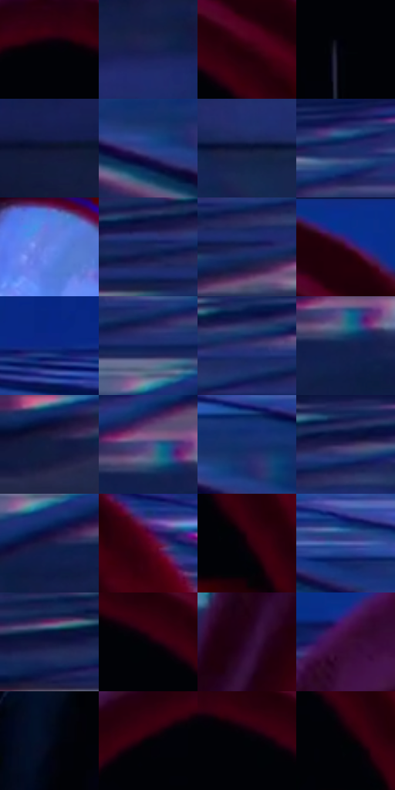

# 电影参考 558

- 状态：常规／活跃；来源世界：miles-home。
- 视角：near-level；景别：close-up；场景：city。
- 时段：night-appearance（外观依据，中置信度；具体时间／晨昏未知）；光照：night-mixed。
- 材质候选：skin, fabric, glass, stone, metal, sky（帧级，不是像素分割）。
- 明暗组：very-dark；L* P5/P50/P95：0.56919 / 14.1174 / 48.38635。
- 资格门禁：无附加门禁。
- 原截图 SHA-256：`8c08efa12baf43db0cc8b2eb2de6d107bbfd39799ec301539d60f9f7f776ae77`；尺寸：2880 × 1206。
- sRGB 像素 SHA-256：`ada71df8500ab1122b88044438e7e695065b2e23e7d134048897f70cd727b580`。

## 观察与迁移

夜城人物与玻璃立面；倾斜视角不授权更改原照建筑透视。

面罩镜片近景：白蓝片中有微弱城市映像、红帽边与黑面微网；背景窗块错色不允许转移成原照没有的新倒影。

本公开版保存32个128×128原像素色卡上下文；图集格子并非原场景相邻位置。原rect、图集tile和像素SHA见 `data/palette-crops.json`。上下文不足时不得批准替色，不能以小样推断完整构图。

## 实测色卡

颜色比例分母为保留采样像素，不是材料面积；全部 32 色参与全库匹配。表内四舍五入仅用于阅读，原精度在 JSON。

| ID | HEX | Lab | 原图 xy | 像素数 | 比例 | 明度角色 |
| --- | --- | --- | --- | ---: | ---: | --- |
| 558-S01 | #010206 | [0.569186, 0.294641, -1.605767] | [1456, 160] | 12481 | 6.455267% | deep-shadow |
| 558-S02 | #192250 | [15.113756, 12.989297, -29.532714] | [732, 540] | 11951 | 6.181147% | deep-shadow |
| 558-S03 | #2C020E | [5.516929, 21.699749, 2.743299] | [1636, 164] | 11565 | 5.981505% | deep-shadow |
| 558-S04 | #010209 | [0.628546, 0.711773, -2.741037] | [1456, 328] | 10906 | 5.640665% | deep-shadow |
| 558-S05 | #0D122F | [6.533785, 8.462168, -20.047957] | [368, 696] | 10167 | 5.258449% | deep-shadow |
| 558-S06 | #26418A | [29.479925, 16.25952, -43.75621] | [2368, 340] | 8595 | 4.445398% | shadow |
| 558-S07 | #0A1636 | [8.169704, 8.147125, -22.560184] | [2260, 684] | 8455 | 4.372989% | deep-shadow |
| 558-S08 | #1F2E69 | [21.074509, 15.419981, -36.48087] | [696, 180] | 7970 | 4.122144% | shadow |
| 558-S09 | #6785E8 | [57.542394, 17.826947, -53.475227] | [1204, 488] | 7896 | 4.083870% | midtone |
| 558-S10 | #19265D | [17.38037, 15.335597, -34.600542] | [240, 228] | 7493 | 3.875436% | deep-shadow |
| 558-S11 | #1C2559 | [16.945674, 14.998305, -32.630084] | [316, 276] | 6995 | 3.617866% | deep-shadow |
| 558-S12 | #0C2F8D | [23.781447, 27.323757, -54.941052] | [1648, 44] | 6790 | 3.511839% | shadow |
| 558-S13 | #0B2781 | [20.465179, 27.948572, -52.880734] | [2324, 92] | 6259 | 3.237202% | shadow |
| 558-S14 | #10235C | [15.92493, 15.80919, -36.321079] | [616, 268] | 6215 | 3.214445% | deep-shadow |
| 558-S15 | #313371 | [24.361708, 18.596875, -36.269195] | [532, 204] | 5863 | 3.032388% | shadow |
| 558-S16 | #12204C | [13.728204, 11.489989, -29.06012] | [816, 376] | 5624 | 2.908775% | deep-shadow |
| 558-S17 | #101D42 | [11.837684, 9.107699, -25.181237] | [56, 380] | 5300 | 2.741200% | deep-shadow |
| 558-S18 | #534C88 | [35.567041, 18.355545, -32.610608] | [804, 332] | 5200 | 2.689479% | shadow |
| 558-S19 | #16306C | [21.456265, 13.812026, -37.828089] | [2416, 296] | 5069 | 2.621725% | shadow |
| 558-S20 | #312559 | [18.787995, 19.975739, -29.566609] | [348, 196] | 5030 | 2.601554% | deep-shadow |
| 558-S21 | #171B46 | [12.01112, 13.767878, -27.672472] | [636, 368] | 4896 | 2.532248% | deep-shadow |
| 558-S22 | #58021E | [16.565155, 37.531036, 8.964329] | [1784, 184] | 4808 | 2.486734% | deep-shadow |
| 558-S23 | #17000A | [1.84384, 8.772184, -1.183299] | [1728, 348] | 4479 | 2.316572% | deep-shadow |
| 558-S24 | #596BB8 | [47.103537, 15.270925, -42.876669] | [2204, 240] | 4237 | 2.191408% | midtone |
| 558-S25 | #141640 | [9.739916, 14.480737, -27.149442] | [60, 224] | 4078 | 2.109172% | deep-shadow |
| 558-S26 | #090109 | [0.898938, 3.204328, -2.290247] | [1560, 188] | 3870 | 2.001593% | deep-shadow |
| 558-S27 | #2C092B | [8.17676, 23.191876, -14.210933] | [1000, 400] | 3372 | 1.744024% | deep-shadow |
| 558-S28 | #3C0D35 | [12.644519, 28.145505, -14.314878] | [1144, 128] | 2931 | 1.515935% | deep-shadow |
| 558-S29 | #04091C | [2.754935, 2.76045, -11.395968] | [1680, 1124] | 2478 | 1.281640% | deep-shadow |
| 558-S30 | #030206 | [0.685803, 0.81764, -1.42149] | [1340, 192] | 1151 | 0.595306% | deep-shadow |
| 558-S31 | #000306 | [0.706955, -0.367419, -1.411587] | [1524, 180] | 816 | 0.422041% | deep-shadow |
| 558-S32 | #020204 | [0.587921, 0.278053, -0.756781] | [1696, 324] | 406 | 0.209986% | deep-shadow |

## 色阶与空间分布

- 采样 ROI：`[0.01, 0.02, 0.98, 0.94]`；步长：4；样本数：193346。
- 排除区：`[]`。
- 深暗、暗、中、亮、高光五段计数：`[138254, 42315, 11469, 1025, 283]`。
- RGB 各 256 箱、L* 100 箱、13×5 色相明度表和 3×3 空间统计全部保存在 [总数据](../film-library.json)。
- [可视化档案](../../references/library.html)按需绘制直方图，不存 2,094 张重复图表图片。

## 纹理特征占比

**这是分块图像特征的面积占比，不是波点／排线／丝网／错版的精确语义覆盖率。** 窗格、发丝、织物也会产生方向或周期特征。
原图 ROI 像素 3098546；已测块覆盖 3098546（100.0000%）；未测 0。

| 特征 | 块覆盖像素 | 占已测面积 | 阈值敏感范围 |
| --- | ---: | ---: | --- |
| low-contrast | 428288 | 13.8222% | 10.2985% ~ 20.3409% |
| directional-structure | 1569536 | 50.6540% | 34.7910% ~ 61.2292% |
| periodic-structure | 1057074 | 34.1152% | 28.4723% ~ 43.4594% |
| mixed-detail | 43648 | 1.4087% | 0.0000% ~ 1.4087% |

阈值敏感范围不是统计置信区间。逐块坐标、尺度、对比、方向一致性、频谱集中度、频率与角度见 [全量特征记录](../texture-features.jsonl)，以帧号定位。
四种印刷层的真实像素覆盖仍标为 `null`，不能填 0，也不能拿上表代替。不得据这些代理测量删除唯一证据。

[测量方法与保留策略](../../references/library-retention.md) · [分类索引](../archive/README.md)
