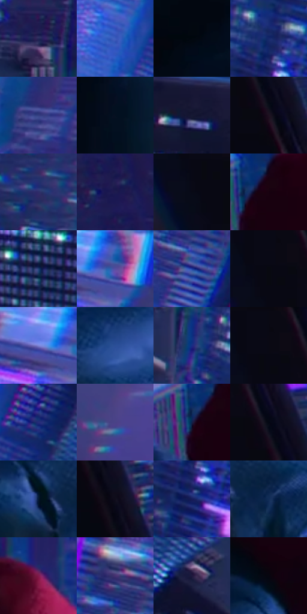

# 电影参考 559

- 状态：常规／活跃；来源世界：miles-home。
- 视角：high-angle；景别：environment-wide；场景：city。
- 时段：night-appearance（外观依据，中置信度；具体时间／晨昏未知）；光照：night-mixed。
- 材质候选：skin, fabric, glass, stone, metal, sky（帧级，不是像素分割）。
- 明暗组：very-dark；L* P5/P50/P95：1.9064 / 17.13705 / 42.81562。
- 资格门禁：无附加门禁。
- 原截图 SHA-256：`e80ac22023498fc4f9842eece925f97e66a5c3c0ba199135dfacaaaf2bdb3a14`；尺寸：2880 × 1206。
- sRGB 像素 SHA-256：`4464a61582d6059663299e32242c65836dc0e051f6958dc39f89c04434206683`。

## 观察与迁移

夜城人物与玻璃立面；倾斜视角不授权更改原照建筑透视。

背面蹲姿：青蓝衣褶比暗城市骨架亮，红帽集中对比；下方窗组高频而人物宽面安静，纹理密度有主次。

本公开版保存32个128×128原像素色卡上下文；图集格子并非原场景相邻位置。原rect、图集tile和像素SHA见 `data/palette-crops.json`。上下文不足时不得批准替色，不能以小样推断完整构图。

## 实测色卡

颜色比例分母为保留采样像素，不是材料面积；全部 32 色参与全库匹配。表内四舍五入仅用于阅读，原精度在 JSON。

| ID | HEX | Lab | 原图 xy | 像素数 | 比例 | 明度角色 |
| --- | --- | --- | --- | ---: | ---: | --- |
| 559-S01 | #262959 | [18.881239, 14.311378, -29.472622] | [1740, 520] | 11626 | 6.013054% | deep-shadow |
| 559-S02 | #3C5BBC | [41.330345, 21.139337, -54.544184] | [2284, 928] | 9180 | 4.747965% | midtone |
| 559-S03 | #02070F | [1.800571, -0.092633, -3.767184] | [880, 400] | 9088 | 4.700382% | deep-shadow |
| 559-S04 | #16296B | [19.297658, 18.471503, -40.686314] | [1976, 692] | 8828 | 4.565908% | deep-shadow |
| 559-S05 | #333E80 | [28.66073, 16.905935, -38.826391] | [2288, 108] | 8586 | 4.440744% | shadow |
| 559-S06 | #051020 | [4.580384, 1.086152, -11.78246] | [948, 788] | 8486 | 4.389023% | deep-shadow |
| 559-S07 | #151933 | [9.748188, 7.169719, -17.811935] | [1640, 808] | 8334 | 4.310407% | deep-shadow |
| 559-S08 | #1F1221 | [7.531199, 10.136105, -7.835245] | [340, 216] | 7779 | 4.023357% | deep-shadow |
| 559-S09 | #2E2E6A | [22.213764, 18.862964, -35.236882] | [2056, 172] | 7675 | 3.969568% | shadow |
| 559-S10 | #1D1C4F | [13.567463, 17.857198, -31.338798] | [708, 148] | 6997 | 3.618901% | deep-shadow |
| 559-S11 | #080A16 | [2.950279, 1.761764, -6.402661] | [184, 132] | 6704 | 3.467359% | deep-shadow |
| 559-S12 | #180110 | [2.288549, 9.842377, -3.401029] | [1300, 260] | 6351 | 3.284785% | deep-shadow |
| 559-S13 | #1E3E72 | [26.550357, 7.542593, -33.456024] | [1468, 984] | 6253 | 3.234098% | shadow |
| 559-S14 | #574D9F | [37.547374, 25.746751, -43.381412] | [2576, 232] | 6194 | 3.203583% | shadow |
| 559-S15 | #1D3A9B | [28.519002, 26.622458, -55.762544] | [2376, 660] | 6160 | 3.185998% | shadow |
| 559-S16 | #080910 | [2.568953, 0.86057, -3.146107] | [204, 84] | 6145 | 3.178240% | deep-shadow |
| 559-S17 | #7F85D7 | [58.218699, 18.243594, -42.80459] | [2504, 232] | 5997 | 3.101693% | midtone |
| 559-S18 | #2A4F97 | [34.635482, 12.42798, -43.391201] | [1220, 600] | 5796 | 2.997735% | shadow |
| 559-S19 | #182D85 | [22.874165, 26.381915, -51.423776] | [1808, 688] | 5751 | 2.974460% | shadow |
| 559-S20 | #090913 | [2.714001, 1.731597, -4.712868] | [216, 28] | 5669 | 2.932049% | deep-shadow |
| 559-S21 | #262C7A | [22.366114, 24.580201, -45.280859] | [2412, 904] | 5396 | 2.790852% | shadow |
| 559-S22 | #4A4287 | [32.035881, 22.052984, -37.662697] | [2724, 180] | 5257 | 2.718960% | shadow |
| 559-S23 | #11224B | [14.236357, 9.361037, -27.55639] | [1260, 276] | 5239 | 2.709650% | deep-shadow |
| 559-S24 | #030813 | [2.168071, 0.563162, -5.552017] | [328, 160] | 5066 | 2.620173% | deep-shadow |
| 559-S25 | #061934 | [8.838733, 4.021146, -20.046105] | [1076, 688] | 4340 | 2.244681% | deep-shadow |
| 559-S26 | #100D1B | [4.309836, 4.173446, -8.21134] | [440, 396] | 4112 | 2.126757% | deep-shadow |
| 559-S27 | #161D5B | [14.424886, 20.62045, -38.087085] | [1976, 784] | 4065 | 2.102448% | deep-shadow |
| 559-S28 | #132D58 | [18.883315, 7.085195, -28.867138] | [1172, 716] | 3846 | 1.989180% | deep-shadow |
| 559-S29 | #811B4B | [29.312057, 46.234737, -2.904734] | [1532, 172] | 2955 | 1.528348% | shadow |
| 559-S30 | #473271 | [26.194812, 24.863882, -33.21355] | [2368, 472] | 2771 | 1.433182% | shadow |
| 559-S31 | #1F193D | [11.438187, 13.879296, -22.231138] | [2612, 1040] | 1625 | 0.840462% | deep-shadow |
| 559-S32 | #06050F | [1.64165, 1.754486, -3.971266] | [1352, 452] | 1075 | 0.555998% | deep-shadow |

## 色阶与空间分布

- 采样 ROI：`[0.01, 0.02, 0.98, 0.94]`；步长：4；样本数：193346。
- 排除区：`[]`。
- 深暗、暗、中、亮、高光五段计数：`[111200, 68029, 11981, 2042, 94]`。
- RGB 各 256 箱、L* 100 箱、13×5 色相明度表和 3×3 空间统计全部保存在 [总数据](../film-library.json)。
- [可视化档案](../../references/library.html)按需绘制直方图，不存 2,094 张重复图表图片。

## 纹理特征占比

**这是分块图像特征的面积占比，不是波点／排线／丝网／错版的精确语义覆盖率。** 窗格、发丝、织物也会产生方向或周期特征。
原图 ROI 像素 3098546；已测块覆盖 3098546（100.0000%）；未测 0。

| 特征 | 块覆盖像素 | 占已测面积 | 阈值敏感范围 |
| --- | ---: | ---: | --- |
| low-contrast | 376704 | 12.1574% | 9.5136% ~ 14.8013% |
| directional-structure | 327680 | 10.5753% | 2.1151% ~ 29.3299% |
| periodic-structure | 2243200 | 72.3952% | 58.7507% ~ 72.5770% |
| mixed-detail | 150962 | 4.8720% | 2.4058% ~ 10.5067% |

阈值敏感范围不是统计置信区间。逐块坐标、尺度、对比、方向一致性、频谱集中度、频率与角度见 [全量特征记录](../texture-features.jsonl)，以帧号定位。
四种印刷层的真实像素覆盖仍标为 `null`，不能填 0，也不能拿上表代替。不得据这些代理测量删除唯一证据。

[测量方法与保留策略](../../references/library-retention.md) · [分类索引](../archive/README.md)
