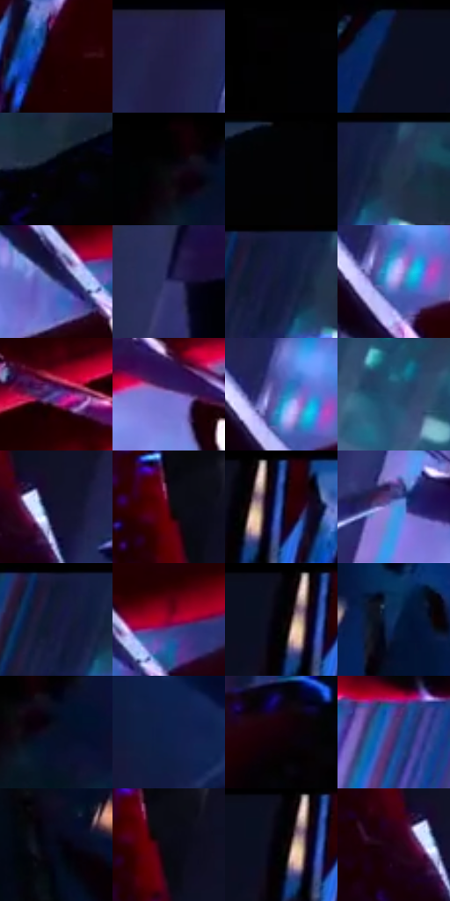

# 电影参考 560

- 状态：条件／活跃；来源世界：miles-home。
- 视角：high-angle；景别：detail；场景：detail。
- 时段：night-appearance（外观依据，中置信度；具体时间／晨昏未知）；光照：night-mixed。
- 材质候选：fabric, glass（帧级，不是像素分割）。
- 明暗组：very-dark；L* P5/P50/P95：0.3148 / 9.52197 / 58.58048。
- 资格门禁：impact。
- 原截图 SHA-256：`05a4aec33878434a30b2475c7e780748cf1a4b96d8a5d0913e5c60f9f0ae0095`；尺寸：2880 × 1220。
- sRGB 像素 SHA-256：`0a4170974663804e900ac9554724fa39d13fa18a729d3cf4feb718227272dffb`。

## 观察与迁移

玻璃真实碎片与手部脱离，不能默认加破损。

手离玻璃：冷白紫碎玻璃面与红手套、黑缝形成尖锐对比；玻璃碎片是实体破损，不能作为普通照片的漫画爆点。

本公开版保存32个128×128原像素色卡上下文；图集格子并非原场景相邻位置。原rect、图集tile和像素SHA见 `data/palette-crops.json`。上下文不足时不得批准替色，不能以小样推断完整构图。

## 实测色卡

颜色比例分母为保留采样像素，不是材料面积；全部 32 色参与全库匹配。表内四舍五入仅用于阅读，原精度在 JSON。

| ID | HEX | Lab | 原图 xy | 像素数 | 比例 | 明度角色 |
| --- | --- | --- | --- | ---: | ---: | --- |
| 560-S01 | #1F0002 | [2.671799, 12.08292, 3.402551] | [816, 124] | 12329 | 6.308330% | deep-shadow |
| 560-S02 | #232048 | [14.724169, 13.82516, -24.637317] | [1324, 32] | 9810 | 5.019443% | deep-shadow |
| 560-S03 | #020202 | [0.548347, -3.5e-05, 6.6e-05] | [56, 28] | 8544 | 4.371674% | deep-shadow |
| 560-S04 | #0D0E20 | [4.551618, 4.288744, -11.781905] | [580, 36] | 8483 | 4.340463% | deep-shadow |
| 560-S05 | #03030C | [1.00283, 1.267001, -3.448331] | [2520, 132] | 8305 | 4.249386% | deep-shadow |
| 560-S06 | #020101 | [0.332482, 0.261482, 0.092172] | [188, 28] | 8033 | 4.110213% | deep-shadow |
| 560-S07 | #020204 | [0.587921, 0.278053, -0.756781] | [2700, 28] | 7726 | 3.953131% | deep-shadow |
| 560-S08 | #243350 | [21.288597, 3.351197, -19.655394] | [2424, 56] | 7517 | 3.846193% | shadow |
| 560-S09 | #464E93 | [35.706876, 17.149314, -39.16083] | [1404, 484] | 7128 | 3.647155% | shadow |
| 560-S10 | #2F3065 | [22.505232, 15.940678, -31.517732] | [940, 996] | 7077 | 3.621060% | shadow |
| 560-S11 | #10183C | [9.716069, 10.410024, -24.359562] | [2372, 68] | 7054 | 3.609292% | deep-shadow |
| 560-S12 | #A69DE9 | [68.096429, 19.816455, -37.105077] | [1356, 340] | 6979 | 3.570917% | light |
| 560-S13 | #694DA2 | [39.444104, 31.212091, -42.046969] | [1644, 588] | 6929 | 3.545334% | shadow |
| 560-S14 | #7871C9 | [51.858949, 24.364221, -44.971206] | [1432, 780] | 6283 | 3.214797% | midtone |
| 560-S15 | #376BB0 | [44.88629, 5.741663, -41.85015] | [1348, 308] | 6032 | 3.086369% | midtone |
| 560-S16 | #264B6E | [30.805788, -1.250231, -24.160141] | [2596, 1048] | 5921 | 3.029574% | shadow |
| 560-S17 | #13102D | [6.308907, 10.681109, -18.89083] | [1124, 244] | 5867 | 3.001944% | deep-shadow |
| 560-S18 | #360412 | [8.262404, 25.511896, 4.797113] | [1044, 92] | 5762 | 2.948219% | deep-shadow |
| 560-S19 | #2C4995 | [32.852619, 15.998523, -45.041683] | [736, 56] | 5657 | 2.894494% | shadow |
| 560-S20 | #5891DA | [59.328866, 3.174271, -42.88791] | [1228, 704] | 5558 | 2.843840% | midtone |
| 560-S21 | #0D172E | [8.088908, 4.448027, -16.832499] | [2344, 28] | 5403 | 2.764531% | deep-shadow |
| 560-S22 | #8C002C | [28.796327, 52.559578, 17.504859] | [1476, 448] | 5091 | 2.604892% | shadow |
| 560-S23 | #020106 | [0.431416, 0.956701, -1.799946] | [688, 56] | 4759 | 2.435018% | deep-shadow |
| 560-S24 | #102E5C | [19.37663, 7.635957, -30.736071] | [308, 356] | 4381 | 2.241609% | deep-shadow |
| 560-S25 | #060F24 | [4.58583, 3.346583, -14.853039] | [236, 92] | 4355 | 2.228305% | deep-shadow |
| 560-S26 | #0D204A | [13.307667, 9.799232, -28.377122] | [620, 800] | 4086 | 2.090667% | deep-shadow |
| 560-S27 | #120007 | [1.300513, 6.184592, -0.812784] | [2092, 232] | 4057 | 2.075829% | deep-shadow |
| 560-S28 | #4D3472 | [27.431423, 25.57199, -31.837075] | [2040, 768] | 3809 | 1.948936% | shadow |
| 560-S29 | #040718 | [2.201227, 2.426329, -9.015146] | [92, 376] | 3443 | 1.761666% | deep-shadow |
| 560-S30 | #0A0914 | [2.803817, 2.214502, -5.22331] | [1068, 112] | 3418 | 1.748874% | deep-shadow |
| 560-S31 | #040306 | [0.94019, 0.678579, -1.043033] | [688, 68] | 3185 | 1.629656% | deep-shadow |
| 560-S32 | #1E0213 | [3.31077, 13.367372, -3.605217] | [1064, 252] | 2459 | 1.258187% | deep-shadow |

## 色阶与空间分布

- 采样 ROI：`[0.01, 0.02, 0.98, 0.94]`；步长：4；样本数：195440。
- 排除区：`[]`。
- 深暗、暗、中、亮、高光五段计数：`[124385, 41607, 20851, 7660, 937]`。
- RGB 各 256 箱、L* 100 箱、13×5 色相明度表和 3×3 空间统计全部保存在 [总数据](../film-library.json)。
- [可视化档案](../../references/library.html)按需绘制直方图，不存 2,094 张重复图表图片。

## 纹理特征占比

**这是分块图像特征的面积占比，不是波点／排线／丝网／错版的精确语义覆盖率。** 窗格、发丝、织物也会产生方向或周期特征。
原图 ROI 像素 3134868；已测块覆盖 3134868（100.0000%）；未测 0。

| 特征 | 块覆盖像素 | 占已测面积 | 阈值敏感范围 |
| --- | ---: | ---: | --- |
| low-contrast | 436736 | 13.9316% | 12.3636% ~ 14.9768% |
| directional-structure | 873216 | 27.8550% | 13.3436% ~ 49.0136% |
| periodic-structure | 1808532 | 57.6909% | 38.6227% ~ 69.0664% |
| mixed-detail | 16384 | 0.5226% | 0.0000% ~ 2.6132% |

阈值敏感范围不是统计置信区间。逐块坐标、尺度、对比、方向一致性、频谱集中度、频率与角度见 [全量特征记录](../texture-features.jsonl)，以帧号定位。
四种印刷层的真实像素覆盖仍标为 `null`，不能填 0，也不能拿上表代替。不得据这些代理测量删除唯一证据。

[测量方法与保留策略](../../references/library-retention.md) · [分类索引](../archive/README.md)
