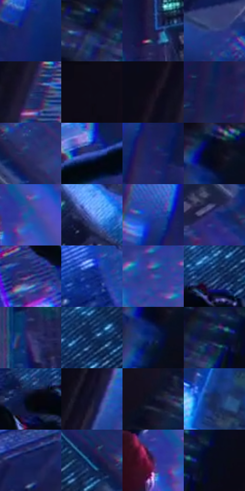

# 电影参考 561

- 状态：常规／活跃；来源世界：miles-home。
- 视角：rolled-or-dutch；景别：environment-wide；场景：city。
- 时段：night-appearance（外观依据，中置信度；具体时间／晨昏未知）；光照：night-mixed。
- 材质候选：skin, fabric, glass, stone, metal, sky（帧级，不是像素分割）。
- 明暗组：very-dark；L* P5/P50/P95：3.2228 / 18.25307 / 43.92102。
- 资格门禁：无附加门禁。
- 原截图 SHA-256：`9dc6b3745e6e5f077755e39845b3d33cf87022d646b2072357b1c3c44e3d7e18`；尺寸：2878 × 1202。
- sRGB 像素 SHA-256：`736308524c4e95c23788797f3b84034f6510f97f329f73b5dc9277dcdf9dbd9c`。

## 观察与迁移

夜城人物与玻璃立面；倾斜视角不授权更改原照建筑透视。

蓝城俯坠：右侧人物暗剪影与青边，楼面网格和白青转角形成纵深；碎片与窗列、印刷分色分开。

本公开版保存32个128×128原像素色卡上下文；图集格子并非原场景相邻位置。原rect、图集tile和像素SHA见 `data/palette-crops.json`。上下文不足时不得批准替色，不能以小样推断完整构图。

## 实测色卡

颜色比例分母为保留采样像素，不是材料面积；全部 32 色参与全库匹配。表内四舍五入仅用于阅读，原精度在 JSON。

| ID | HEX | Lab | 原图 xy | 像素数 | 比例 | 明度角色 |
| --- | --- | --- | --- | ---: | ---: | --- |
| 561-S01 | #152A6C | [19.628892, 18.036642, -40.797805] | [896, 312] | 10668 | 5.537561% | deep-shadow |
| 561-S02 | #181C3F | [11.847004, 10.441299, -23.026862] | [348, 356] | 9840 | 5.107761% | deep-shadow |
| 561-S03 | #1E204E | [14.728637, 14.775428, -28.772175] | [1148, 564] | 9630 | 4.998754% | deep-shadow |
| 561-S04 | #314082 | [29.237169, 15.861489, -39.154345] | [2200, 216] | 9369 | 4.863274% | shadow |
| 561-S05 | #242C5A | [19.69746, 12.048402, -28.836946] | [468, 960] | 8902 | 4.620863% | deep-shadow |
| 561-S06 | #0D0B17 | [3.493574, 2.976063, -6.303807] | [112, 28] | 8629 | 4.479154% | deep-shadow |
| 561-S07 | #150E1D | [5.078411, 6.293719, -8.586338] | [488, 624] | 8099 | 4.204041% | deep-shadow |
| 561-S08 | #141D4E | [13.091121, 14.963205, -31.458603] | [792, 1108] | 7983 | 4.143827% | deep-shadow |
| 561-S09 | #29306A | [22.392656, 16.354038, -34.968429] | [2380, 444] | 7778 | 4.037415% | shadow |
| 561-S10 | #435FC0 | [43.035887, 21.136176, -54.102972] | [1964, 936] | 7226 | 3.750882% | midtone |
| 561-S11 | #1B205E | [15.870179, 20.433264, -37.715705] | [812, 644] | 6930 | 3.597234% | deep-shadow |
| 561-S12 | #080C1B | [3.555973, 2.260907, -9.386583] | [576, 64] | 6809 | 3.534425% | deep-shadow |
| 561-S13 | #2651A4 | [35.937895, 15.582368, -49.124032] | [2380, 952] | 6534 | 3.391678% | shadow |
| 561-S14 | #6789E5 | [58.442561, 14.476527, -50.373402] | [1984, 192] | 6099 | 3.165878% | midtone |
| 561-S15 | #223EA0 | [30.211281, 26.362825, -56.023307] | [756, 564] | 6068 | 3.149786% | shadow |
| 561-S16 | #202E7B | [22.620684, 22.688542, -45.516106] | [2308, 560] | 5881 | 3.052718% | shadow |
| 561-S17 | #4B4688 | [33.250019, 20.033903, -36.335155] | [1836, 692] | 5728 | 2.973298% | shadow |
| 561-S18 | #132F86 | [23.310804, 24.95784, -51.341869] | [1580, 328] | 5625 | 2.919833% | shadow |
| 561-S19 | #574FA6 | [38.499437, 26.651427, -46.040408] | [2768, 556] | 5587 | 2.900108% | shadow |
| 561-S20 | #1E4172 | [27.492958, 5.47456, -31.950672] | [2020, 516] | 4984 | 2.587102% | shadow |
| 561-S21 | #3C3873 | [26.809964, 18.582048, -33.565375] | [1148, 728] | 4579 | 2.376874% | shadow |
| 561-S22 | #16305D | [20.339394, 7.507619, -29.837806] | [2092, 460] | 4233 | 2.197272% | shadow |
| 561-S23 | #0C215D | [15.253638, 17.288153, -38.0898] | [568, 128] | 4092 | 2.124081% | deep-shadow |
| 561-S24 | #091536 | [7.773952, 8.756102, -23.201919] | [428, 344] | 4031 | 2.092417% | deep-shadow |
| 561-S25 | #030712 | [1.941793, 0.751507, -5.260766] | [1924, 564] | 3878 | 2.012998% | deep-shadow |
| 561-S26 | #15162E | [8.398007, 7.560188, -16.301167] | [728, 176] | 3875 | 2.011441% | deep-shadow |
| 561-S27 | #0A0F25 | [4.875015, 4.785746, -15.152418] | [380, 136] | 3658 | 1.898800% | deep-shadow |
| 561-S28 | #142955 | [17.414376, 8.917623, -29.21839] | [964, 56] | 3604 | 1.870769% | deep-shadow |
| 561-S29 | #13215A | [15.297249, 16.847205, -36.000469] | [2640, 96] | 3514 | 1.824052% | deep-shadow |
| 561-S30 | #0A1A4E | [11.642049, 15.812666, -33.842943] | [2268, 396] | 3147 | 1.633549% | deep-shadow |
| 561-S31 | #451E51 | [19.173838, 27.966344, -23.430389] | [2312, 960] | 2942 | 1.527138% | deep-shadow |
| 561-S32 | #060B19 | [3.145432, 1.605846, -8.410365] | [508, 332] | 2726 | 1.415016% | deep-shadow |

## 色阶与空间分布

- 采样 ROI：`[0.01, 0.02, 0.98, 0.94]`；步长：4；样本数：192648。
- 排除区：`[]`。
- 深暗、暗、中、亮、高光五段计数：`[108101, 70348, 11926, 2143, 130]`。
- RGB 各 256 箱、L* 100 箱、13×5 色相明度表和 3×3 空间统计全部保存在 [总数据](../film-library.json)。
- [可视化档案](../../references/library.html)按需绘制直方图，不存 2,094 张重复图表图片。

## 纹理特征占比

**这是分块图像特征的面积占比，不是波点／排线／丝网／错版的精确语义覆盖率。** 窗格、发丝、织物也会产生方向或周期特征。
原图 ROI 像素 3085160；已测块覆盖 3085160（100.0000%）；未测 0。

| 特征 | 块覆盖像素 | 占已测面积 | 阈值敏感范围 |
| --- | ---: | ---: | --- |
| low-contrast | 141440 | 4.5845% | 4.2485% ~ 6.1777% |
| directional-structure | 332032 | 10.7622% | 1.0621% ~ 27.6441% |
| periodic-structure | 2394344 | 77.6084% | 67.0453% ~ 77.6084% |
| mixed-detail | 217344 | 7.0448% | 1.0621% ~ 15.9732% |

阈值敏感范围不是统计置信区间。逐块坐标、尺度、对比、方向一致性、频谱集中度、频率与角度见 [全量特征记录](../texture-features.jsonl)，以帧号定位。
四种印刷层的真实像素覆盖仍标为 `null`，不能填 0，也不能拿上表代替。不得据这些代理测量删除唯一证据。

[测量方法与保留策略](../../references/library-retention.md) · [分类索引](../archive/README.md)
