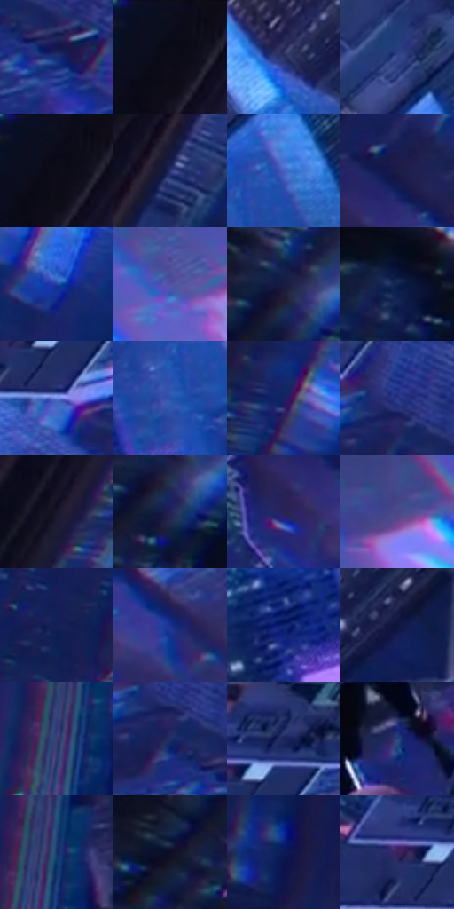

# 电影参考 562

- 状态：常规／活跃；来源世界：miles-home。
- 视角：rolled-or-dutch；景别：environment-wide；场景：city。
- 时段：night-appearance（外观依据，中置信度；具体时间／晨昏未知）；光照：night-mixed。
- 材质候选：skin, fabric, glass, stone, metal, sky（帧级，不是像素分割）。
- 明暗组：dark；L* P5/P50/P95：3.65162 / 20.20749 / 44.7944。
- 资格门禁：无附加门禁。
- 原截图 SHA-256：`8fc9e126e793406059c5725f807705526b26b0428a8dda31579c560e1b07ed58`；尺寸：2876 × 1208。
- sRGB 像素 SHA-256：`226120d3dec232a41fb5cfbec76c350be813e05549fd036390931211deca7712`。

## 观察与迁移

夜城人物与玻璃立面；倾斜视角不授权更改原照建筑透视。

同段坠落转身：白眼小亮点、暗躯干与蓝青楼群分离；姿态与取景变化不作材质变化，窗格亮暗不均匀。

本公开版保存32个128×128原像素色卡上下文；图集格子并非原场景相邻位置。原rect、图集tile和像素SHA见 `data/palette-crops.json`。上下文不足时不得批准替色，不能以小样推断完整构图。

## 实测色卡

颜色比例分母为保留采样像素，不是材料面积；全部 32 色参与全库匹配。表内四舍五入仅用于阅读，原精度在 JSON。

| ID | HEX | Lab | 原图 xy | 像素数 | 比例 | 明度角色 |
| --- | --- | --- | --- | ---: | ---: | --- |
| 562-S01 | #172F74 | [21.855802, 17.989692, -42.321849] | [2716, 236] | 9104 | 4.715413% | shadow |
| 562-S02 | #0D0D1D | [4.174077, 3.784435, -10.010595] | [632, 28] | 8818 | 4.567279% | deep-shadow |
| 562-S03 | #293261 | [22.35671, 11.604864, -29.172645] | [1948, 296] | 8394 | 4.347668% | shadow |
| 562-S04 | #324389 | [30.635129, 16.60176, -41.243148] | [1628, 248] | 7948 | 4.116663% | shadow |
| 562-S05 | #0A0A17 | [3.10242, 2.534393, -6.897781] | [632, 48] | 7875 | 4.078853% | deep-shadow |
| 562-S06 | #2C3571 | [24.555627, 16.107518, -35.976518] | [576, 360] | 7704 | 3.990283% | shadow |
| 562-S07 | #4461BE | [43.498895, 19.322543, -52.19326] | [1664, 380] | 7608 | 3.940560% | midtone |
| 562-S08 | #1D1D48 | [13.276723, 14.449064, -26.992564] | [2496, 400] | 7255 | 3.757724% | deep-shadow |
| 562-S09 | #2240A2 | [30.912208, 25.789059, -56.087244] | [796, 284] | 7065 | 3.659314% | shadow |
| 562-S10 | #5553A6 | [39.360816, 23.661076, -44.668196] | [2724, 1084] | 6982 | 3.616324% | shadow |
| 562-S11 | #171C42 | [11.996598, 11.393772, -24.900437] | [344, 144] | 6510 | 3.371852% | deep-shadow |
| 562-S12 | #0F214E | [14.053614, 11.102886, -29.911262] | [88, 480] | 6445 | 3.338185% | deep-shadow |
| 562-S13 | #708DE2 | [59.873568, 13.122074, -46.404016] | [2460, 180] | 6434 | 3.332487% | midtone |
| 562-S14 | #2953A9 | [36.968799, 16.568167, -50.436299] | [1608, 460] | 6433 | 3.331969% | shadow |
| 562-S15 | #152362 | [16.713777, 18.983132, -39.006541] | [524, 592] | 6206 | 3.214395% | deep-shadow |
| 562-S16 | #263382 | [24.923295, 22.81128, -46.165035] | [2644, 132] | 6129 | 3.174513% | shadow |
| 562-S17 | #1A1529 | [8.271233, 8.28402, -12.761247] | [296, 792] | 6054 | 3.135667% | deep-shadow |
| 562-S18 | #1F2353 | [16.093007, 14.732967, -29.964016] | [356, 192] | 5871 | 3.040882% | deep-shadow |
| 562-S19 | #272558 | [17.731332, 17.044108, -30.649971] | [2448, 484] | 5751 | 2.978728% | deep-shadow |
| 562-S20 | #494888 | [33.622543, 18.210167, -35.75145] | [2544, 1056] | 5704 | 2.954384% | shadow |
| 562-S21 | #161E57 | [14.326948, 18.269478, -35.558644] | [520, 780] | 5664 | 2.933666% | deep-shadow |
| 562-S22 | #18328C | [24.852423, 25.71357, -52.549417] | [2660, 564] | 5469 | 2.832666% | shadow |
| 562-S23 | #0E236E | [17.556091, 23.205798, -45.496561] | [1476, 516] | 5397 | 2.795374% | deep-shadow |
| 562-S24 | #0C163D | [8.897392, 11.656498, -26.410556] | [2104, 276] | 5184 | 2.685050% | deep-shadow |
| 562-S25 | #3E3A74 | [27.602575, 18.09718, -32.923363] | [952, 812] | 5059 | 2.620307% | shadow |
| 562-S26 | #1D2E61 | [20.353119, 11.847787, -32.428113] | [2644, 184] | 4998 | 2.588712% | shadow |
| 562-S27 | #1A245B | [16.681813, 16.162938, -34.399391] | [2480, 76] | 4721 | 2.445240% | deep-shadow |
| 562-S28 | #224377 | [28.605033, 6.769569, -33.324713] | [2068, 792] | 4137 | 2.142757% | shadow |
| 562-S29 | #123060 | [20.387409, 8.175353, -31.743743] | [980, 772] | 3671 | 1.901393% | shadow |
| 562-S30 | #0B0F27 | [5.051392, 5.873142, -16.397656] | [256, 236] | 2984 | 1.545561% | deep-shadow |
| 562-S31 | #0C1A56 | [12.534977, 19.499127, -37.83564] | [900, 564] | 2816 | 1.458546% | deep-shadow |
| 562-S32 | #3D225F | [19.892238, 26.992614, -31.700014] | [2404, 112] | 2679 | 1.387587% | deep-shadow |

## 色阶与空间分布

- 采样 ROI：`[0.01, 0.02, 0.98, 0.94]`；步长：4；样本数：193069。
- 排除区：`[]`。
- 深暗、暗、中、亮、高光五段计数：`[95101, 81954, 13280, 2480, 254]`。
- RGB 各 256 箱、L* 100 箱、13×5 色相明度表和 3×3 空间统计全部保存在 [总数据](../film-library.json)。
- [可视化档案](../../references/library.html)按需绘制直方图，不存 2,094 张重复图表图片。

## 纹理特征占比

**这是分块图像特征的面积占比，不是波点／排线／丝网／错版的精确语义覆盖率。** 窗格、发丝、织物也会产生方向或周期特征。
原图 ROI 像素 3099690；已测块覆盖 3099690（100.0000%）；未测 0。

| 特征 | 块覆盖像素 | 占已测面积 | 阈值敏感范围 |
| --- | ---: | ---: | --- |
| low-contrast | 49152 | 1.5857% | 1.0571% ~ 3.1714% |
| directional-structure | 379392 | 12.2397% | 1.0571% ~ 29.8366% |
| periodic-structure | 2401194 | 77.4656% | 66.9920% ~ 77.4656% |
| mixed-detail | 269952 | 8.7090% | 2.1143% ~ 23.2529% |

阈值敏感范围不是统计置信区间。逐块坐标、尺度、对比、方向一致性、频谱集中度、频率与角度见 [全量特征记录](../texture-features.jsonl)，以帧号定位。
四种印刷层的真实像素覆盖仍标为 `null`，不能填 0，也不能拿上表代替。不得据这些代理测量删除唯一证据。

[测量方法与保留策略](../../references/library-retention.md) · [分类索引](../archive/README.md)
