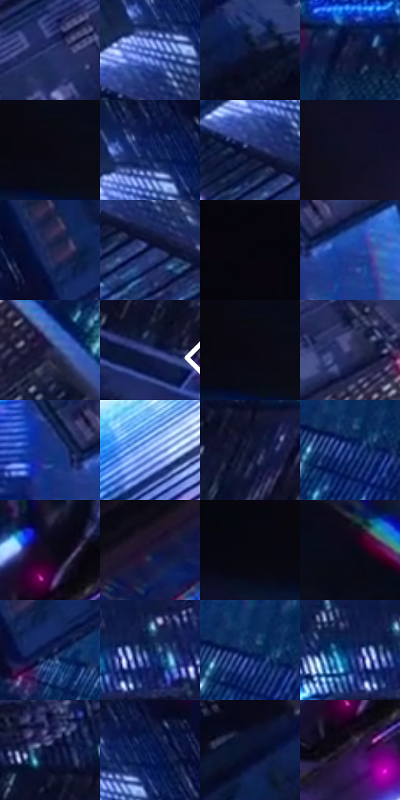

# 电影参考 563

- 状态：常规／活跃；来源世界：miles-home。
- 视角：low-angle；景别：environment-wide；场景：city。
- 时段：night-appearance（外观依据，中置信度；具体时间／晨昏未知）；光照：night-mixed。
- 材质候选：skin, fabric, glass, stone, metal, sky（帧级，不是像素分割）。
- 明暗组：very-dark；L* P5/P50/P95：2.1768 / 12.77511 / 43.55929。
- 资格门禁：无附加门禁。
- 原截图 SHA-256：`356f5b864b4e86e5e7a8439cf78415cfcdd28f92e59f94dc02f5d622b1e57a8e`；尺寸：2878 × 1204。
- sRGB 像素 SHA-256：`197e7d0d1e8139bee534e22b3b31e3b7557c88f98624b65d3e5b6771a60999f9`。

## 观察与迁移

夜城人物与玻璃立面；倾斜视角不授权更改原照建筑透视。

极远小人物：巨大建筑峡谷、左上黑近面、远处白青亮端；叙事焦点未必最大或最亮区域，远窗合并成节奏。

本公开版保存32个128×128原像素色卡上下文；图集格子并非原场景相邻位置。原rect、图集tile和像素SHA见 `data/palette-crops.json`。上下文不足时不得批准替色，不能以小样推断完整构图。

## 实测色卡

颜色比例分母为保留采样像素，不是材料面积；全部 32 色参与全库匹配。表内四舍五入仅用于阅读，原精度在 JSON。

| ID | HEX | Lab | 原图 xy | 像素数 | 比例 | 明度角色 |
| --- | --- | --- | --- | ---: | ---: | --- |
| 563-S01 | #243269 | [22.569152, 13.515042, -34.054666] | [1716, 700] | 8562 | 4.444375% | shadow |
| 563-S02 | #4160B9 | [42.749298, 17.667078, -50.495423] | [1756, 268] | 8472 | 4.397658% | midtone |
| 563-S03 | #0D1330 | [6.906765, 8.288445, -20.191885] | [2096, 96] | 8419 | 4.370147% | deep-shadow |
| 563-S04 | #191F43 | [13.179744, 10.009412, -23.691636] | [2352, 236] | 8355 | 4.336925% | deep-shadow |
| 563-S05 | #0A0914 | [2.803817, 2.214502, -5.22331] | [1056, 48] | 8296 | 4.306300% | deep-shadow |
| 563-S06 | #0C2158 | [14.790334, 15.106395, -35.498529] | [1780, 220] | 8279 | 4.297475% | deep-shadow |
| 563-S07 | #0F173D | [9.410298, 11.421899, -25.570135] | [1724, 332] | 7814 | 4.056102% | deep-shadow |
| 563-S08 | #111024 | [5.574143, 6.072935, -13.266065] | [800, 176] | 7265 | 3.771127% | deep-shadow |
| 563-S09 | #1E2550 | [16.395501, 11.870723, -27.450588] | [1980, 292] | 6927 | 3.595677% | deep-shadow |
| 563-S10 | #19265C | [17.297988, 14.926163, -34.069393] | [1784, 376] | 6334 | 3.287862% | deep-shadow |
| 563-S11 | #06040D | [1.396534, 1.810451, -3.31973] | [56, 28] | 6312 | 3.276442% | deep-shadow |
| 563-S12 | #1F449C | [31.404425, 20.403431, -51.662573] | [1608, 1024] | 6268 | 3.253602% | shadow |
| 563-S13 | #2B2B52 | [19.434335, 11.730345, -23.885406] | [2112, 924] | 6255 | 3.246854% | deep-shadow |
| 563-S14 | #404B89 | [33.83163, 14.31414, -36.073705] | [2788, 588] | 6233 | 3.235435% | shadow |
| 563-S15 | #090912 | [2.683802, 1.519382, -4.135299] | [1056, 40] | 6152 | 3.193389% | deep-shadow |
| 563-S16 | #38396A | [26.178517, 13.844778, -28.843849] | [1924, 784] | 6106 | 3.169511% | shadow |
| 563-S17 | #183480 | [24.347316, 19.4755, -45.876449] | [1516, 1008] | 6067 | 3.149267% | shadow |
| 563-S18 | #83AAEA | [69.121042, 3.306401, -36.241357] | [1496, 388] | 5760 | 2.989909% | light |
| 563-S19 | #121534 | [8.242548, 9.865213, -20.960339] | [2808, 268] | 5692 | 2.954612% | deep-shadow |
| 563-S20 | #0D266B | [18.066407, 19.694863, -42.711676] | [2208, 424] | 5628 | 2.921390% | deep-shadow |
| 563-S21 | #0D0C1A | [3.82158, 3.347627, -8.166466] | [1456, 84] | 5479 | 2.844047% | deep-shadow |
| 563-S22 | #1A1835 | [10.029429, 10.223177, -18.784452] | [408, 872] | 5456 | 2.832108% | deep-shadow |
| 563-S23 | #070710 | [2.118488, 1.400192, -3.810882] | [900, 36] | 5195 | 2.696628% | deep-shadow |
| 563-S24 | #080A17 | [2.985803, 2.011394, -7.082058] | [1196, 60] | 5019 | 2.605270% | deep-shadow |
| 563-S25 | #0E1B48 | [11.585912, 12.928867, -29.780742] | [2032, 356] | 4855 | 2.520140% | deep-shadow |
| 563-S26 | #0D224D | [14.203277, 9.600834, -28.989942] | [2684, 52] | 4733 | 2.456812% | deep-shadow |
| 563-S27 | #143162 | [20.929993, 8.586006, -32.178482] | [2204, 404] | 4672 | 2.425148% | shadow |
| 563-S28 | #0C1743 | [9.767021, 13.529802, -29.248258] | [2628, 28] | 4573 | 2.373759% | deep-shadow |
| 563-S29 | #061033 | [5.855193, 9.892212, -24.109281] | [2756, 184] | 4180 | 2.169760% | deep-shadow |
| 563-S30 | #06174D | [10.461721, 17.223351, -35.093564] | [1820, 216] | 3743 | 1.942922% | deep-shadow |
| 563-S31 | #070B20 | [3.511607, 4.030751, -13.397177] | [1988, 32] | 3447 | 1.789274% | deep-shadow |
| 563-S32 | #2E1A40 | [13.767036, 18.813391, -20.52443] | [1448, 180] | 2100 | 1.090071% | deep-shadow |

## 色阶与空间分布

- 采样 ROI：`[0.01, 0.02, 0.98, 0.94]`；步长：4；样本数：192648。
- 排除区：`[]`。
- 深暗、暗、中、亮、高光五段计数：`[140629, 40150, 7761, 2800, 1308]`。
- RGB 各 256 箱、L* 100 箱、13×5 色相明度表和 3×3 空间统计全部保存在 [总数据](../film-library.json)。
- [可视化档案](../../references/library.html)按需绘制直方图，不存 2,094 张重复图表图片。

## 纹理特征占比

**这是分块图像特征的面积占比，不是波点／排线／丝网／错版的精确语义覆盖率。** 窗格、发丝、织物也会产生方向或周期特征。
原图 ROI 像素 3090744；已测块覆盖 3090744（100.0000%）；未测 0。

| 特征 | 块覆盖像素 | 占已测面积 | 阈值敏感范围 |
| --- | ---: | ---: | --- |
| low-contrast | 360448 | 11.6622% | 9.5418% ~ 12.5360% |
| directional-structure | 378624 | 12.2503% | 3.7107% ~ 24.3431% |
| periodic-structure | 2020608 | 65.3761% | 63.6864% ~ 65.3761% |
| mixed-detail | 331064 | 10.7115% | 2.3647% ~ 20.0669% |

阈值敏感范围不是统计置信区间。逐块坐标、尺度、对比、方向一致性、频谱集中度、频率与角度见 [全量特征记录](../texture-features.jsonl)，以帧号定位。
四种印刷层的真实像素覆盖仍标为 `null`，不能填 0，也不能拿上表代替。不得据这些代理测量删除唯一证据。

[测量方法与保留策略](../../references/library-retention.md) · [分类索引](../archive/README.md)
