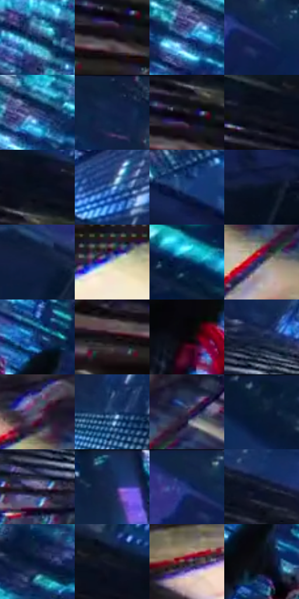

# 电影参考 564

- 状态：常规／活跃；来源世界：miles-home。
- 视角：high-angle；景别：environment-wide；场景：city。
- 时段：night-appearance（外观依据，中置信度；具体时间／晨昏未知）；光照：night-mixed。
- 材质候选：skin, fabric, glass, stone, metal, sky（帧级，不是像素分割）。
- 明暗组：very-dark；L* P5/P50/P95：3.37033 / 15.33046 / 56.48845。
- 资格门禁：无附加门禁。
- 原截图 SHA-256：`d9a99bc983225608038556b1e587dea2ea0734c70a3e640de2b80006ab86fa08`；尺寸：2880 × 1208。
- sRGB 像素 SHA-256：`63fd3499d7a8a20e329d0746316925ed6d661c67f4c5a2e28e7ba93bf3e0489b`。

## 观察与迁移

夜城人物与玻璃立面；倾斜视角不授权更改原照建筑透视。

近楼面坠落：人物黑红、左近窗乳白黄亮条与远蓝青玻璃对置；透视窗框与动作拖线不同，色边局部强化速度。

本公开版保存32个128×128原像素色卡上下文；图集格子并非原场景相邻位置。原rect、图集tile和像素SHA见 `data/palette-crops.json`。上下文不足时不得批准替色，不能以小样推断完整构图。

## 实测色卡

颜色比例分母为保留采样像素，不是材料面积；全部 32 色参与全库匹配。表内四舍五入仅用于阅读，原精度在 JSON。

| ID | HEX | Lab | 原图 xy | 像素数 | 比例 | 明度角色 |
| --- | --- | --- | --- | ---: | ---: | --- |
| 564-S01 | #102A57 | [17.708625, 8.409796, -30.093926] | [1576, 80] | 9234 | 4.775894% | deep-shadow |
| 564-S02 | #191219 | [6.408744, 4.845839, -3.45102] | [304, 560] | 9154 | 4.734517% | deep-shadow |
| 564-S03 | #2C64A2 | [41.621697, 3.259079, -38.820465] | [1728, 304] | 8299 | 4.292305% | midtone |
| 564-S04 | #1D2E5F | [20.207543, 11.042249, -31.347592] | [428, 92] | 8108 | 4.193518% | shadow |
| 564-S05 | #2E4274 | [28.740717, 8.707135, -31.180104] | [1764, 272] | 7317 | 3.784407% | shadow |
| 564-S06 | #122143 | [13.35971, 6.87222, -23.429867] | [824, 40] | 7285 | 3.767857% | deep-shadow |
| 564-S07 | #211D27 | [11.610831, 4.498943, -6.061987] | [312, 516] | 7203 | 3.725446% | deep-shadow |
| 564-S08 | #0B111C | [5.020955, 0.805296, -7.975037] | [180, 404] | 6999 | 3.619935% | deep-shadow |
| 564-S09 | #070E1B | [3.95951, 1.055918, -8.795169] | [348, 428] | 6910 | 3.573904% | deep-shadow |
| 564-S10 | #598AC9 | [56.600501, 1.979413, -37.623746] | [1860, 584] | 6910 | 3.573904% | midtone |
| 564-S11 | #1C457F | [29.499622, 7.677935, -36.919438] | [2344, 424] | 6609 | 3.418224% | shadow |
| 564-S12 | #091427 | [6.366407, 2.415808, -14.352209] | [2424, 572] | 6335 | 3.276509% | deep-shadow |
| 564-S13 | #101D3E | [11.52859, 7.373924, -22.862887] | [152, 124] | 6283 | 3.249615% | deep-shadow |
| 564-S14 | #BCBEC9 | [77.122124, 1.409013, -5.757374] | [696, 1124] | 6257 | 3.236167% | light |
| 564-S15 | #061F49 | [12.604765, 9.162876, -28.838064] | [2332, 80] | 6044 | 3.126002% | deep-shadow |
| 564-S16 | #292D47 | [19.236917, 5.951276, -16.777725] | [1168, 984] | 5887 | 3.044801% | deep-shadow |
| 564-S17 | #0D3066 | [20.666949, 10.181142, -35.226911] | [1504, 276] | 5787 | 2.993080% | shadow |
| 564-S18 | #120C13 | [3.961544, 3.342595, -2.814734] | [208, 580] | 5781 | 2.989977% | deep-shadow |
| 564-S19 | #0A060C | [1.999225, 1.895815, -1.944408] | [1388, 512] | 5655 | 2.924808% | deep-shadow |
| 564-S20 | #1B2847 | [16.52986, 5.398533, -21.111401] | [1032, 616] | 5506 | 2.847744% | deep-shadow |
| 564-S21 | #554961 | [33.048025, 10.28898, -12.191262] | [1108, 876] | 5306 | 2.744303% | shadow |
| 564-S22 | #1A3B67 | [24.722078, 4.508409, -29.34458] | [1824, 752] | 5301 | 2.741717% | shadow |
| 564-S23 | #3C354C | [23.76584, 8.679204, -12.979799] | [1240, 900] | 5199 | 2.688962% | shadow |
| 564-S24 | #0A1B34 | [9.768431, 3.270205, -18.549033] | [596, 36] | 5176 | 2.677066% | deep-shadow |
| 564-S25 | #6D6388 | [44.164428, 12.13371, -19.025699] | [964, 712] | 5094 | 2.634655% | midtone |
| 564-S26 | #11294F | [16.841272, 5.835692, -26.100602] | [1236, 40] | 4928 | 2.548799% | deep-shadow |
| 564-S27 | #10244A | [14.76814, 7.235104, -26.017482] | [380, 44] | 4622 | 2.390533% | deep-shadow |
| 564-S28 | #191E32 | [11.725592, 4.23396, -13.945573] | [676, 492] | 4615 | 2.386913% | deep-shadow |
| 564-S29 | #081637 | [8.1392, 8.23294, -23.339269] | [1956, 128] | 4385 | 2.267955% | deep-shadow |
| 564-S30 | #121522 | [7.04916, 2.642714, -9.461634] | [276, 372] | 4348 | 2.248818% | deep-shadow |
| 564-S31 | #471E2D | [17.7272, 21.547762, -0.671813] | [796, 900] | 3809 | 1.970043% | deep-shadow |
| 564-S32 | #080B15 | [3.117186, 1.110875, -5.455543] | [1520, 384] | 3000 | 1.551622% | deep-shadow |

## 色阶与空间分布

- 采样 ROI：`[0.01, 0.02, 0.98, 0.94]`；步长：4；样本数：193346。
- 排除区：`[]`。
- 深暗、暗、中、亮、高光五段计数：`[125522, 46193, 13495, 6260, 1876]`。
- RGB 各 256 箱、L* 100 箱、13×5 色相明度表和 3×3 空间统计全部保存在 [总数据](../film-library.json)。
- [可视化档案](../../references/library.html)按需绘制直方图，不存 2,094 张重复图表图片。

## 纹理特征占比

**这是分块图像特征的面积占比，不是波点／排线／丝网／错版的精确语义覆盖率。** 窗格、发丝、织物也会产生方向或周期特征。
原图 ROI 像素 3104134；已测块覆盖 3104134（100.0000%）；未测 0。

| 特征 | 块覆盖像素 | 占已测面积 | 阈值敏感范围 |
| --- | ---: | ---: | --- |
| low-contrast | 11136 | 0.3587% | 0.3587% ~ 0.3587% |
| directional-structure | 585216 | 18.8528% | 3.6947% ~ 35.9325% |
| periodic-structure | 2414726 | 77.7906% | 62.8222% ~ 87.9304% |
| mixed-detail | 93056 | 2.9978% | 0.8866% ~ 8.0161% |

阈值敏感范围不是统计置信区间。逐块坐标、尺度、对比、方向一致性、频谱集中度、频率与角度见 [全量特征记录](../texture-features.jsonl)，以帧号定位。
四种印刷层的真实像素覆盖仍标为 `null`，不能填 0，也不能拿上表代替。不得据这些代理测量删除唯一证据。

[测量方法与保留策略](../../references/library-retention.md) · [分类索引](../archive/README.md)
