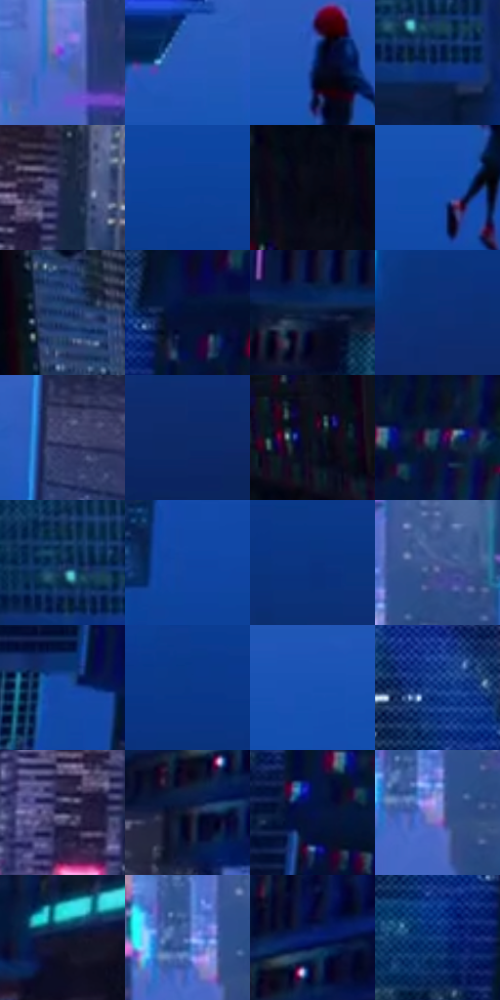

# 电影参考 565

- 状态：常规／活跃；来源世界：miles-home。
- 视角：rolled-or-dutch；景别：environment-wide；场景：city。
- 时段：night-appearance（外观依据，中置信度；具体时间／晨昏未知）；光照：night-mixed。
- 材质候选：skin, fabric, glass, stone, metal, sky（帧级，不是像素分割）。
- 明暗组：dark；L* P5/P50/P95：4.03851 / 24.26582 / 43.86469。
- 资格门禁：无附加门禁。
- 原截图 SHA-256：`0b805d1f13bb78dd0707294f40fefd06a5c6ca349aa8a6e6539568b60ec6e946`；尺寸：2880 × 1210。
- sRGB 像素 SHA-256：`93ff9f77dfeb9c56505ba5c39053d683283bef40fdf22b73d4a89af6800c483f`。

## 观察与迁移

夜城人物与玻璃立面；倾斜视角不授权更改原照建筑透视。

倒置城市：大蓝色负空间包围极小黑红人影，周边暗楼和青窗框景；开放天空不强铺纹，倒置镜头不是原照旋转授权。

本公开版保存32个128×128原像素色卡上下文；图集格子并非原场景相邻位置。原rect、图集tile和像素SHA见 `data/palette-crops.json`。上下文不足时不得批准替色，不能以小样推断完整构图。

## 实测色卡

颜色比例分母为保留采样像素，不是材料面积；全部 32 色参与全库匹配。表内四舍五入仅用于阅读，原精度在 JSON。

| ID | HEX | Lab | 原图 xy | 像素数 | 比例 | 明度角色 |
| --- | --- | --- | --- | ---: | ---: | --- |
| 565-S01 | #3C63C3 | [43.977436, 18.536276, -54.342227] | [1132, 228] | 11488 | 5.920307% | midtone |
| 565-S02 | #2658BA | [39.470628, 19.492384, -56.426415] | [1924, 536] | 10275 | 5.295191% | shadow |
| 565-S03 | #0D3B90 | [27.369449, 20.24091, -50.92276] | [1416, 556] | 9952 | 5.128734% | shadow |
| 565-S04 | #0F2D6C | [20.284597, 15.182673, -39.741147] | [924, 324] | 8331 | 4.293356% | shadow |
| 565-S05 | #1D2645 | [15.885913, 6.625876, -20.747969] | [1944, 120] | 7927 | 4.085156% | deep-shadow |
| 565-S06 | #0B419A | [29.871138, 20.102278, -52.96669] | [796, 824] | 7811 | 4.025376% | shadow |
| 565-S07 | #080718 | [2.434462, 3.472326, -8.646592] | [44, 172] | 7530 | 3.880563% | deep-shadow |
| 565-S08 | #134DAF | [35.08264, 20.918099, -57.088872] | [1372, 672] | 7496 | 3.863041% | shadow |
| 565-S09 | #233E71 | [26.718357, 8.026728, -32.538699] | [228, 256] | 7341 | 3.783163% | shadow |
| 565-S10 | #031033 | [5.680266, 9.111606, -24.399583] | [2740, 332] | 7084 | 3.650718% | deep-shadow |
| 565-S11 | #071B3E | [10.384056, 7.324181, -24.728501] | [2456, 168] | 7023 | 3.619282% | deep-shadow |
| 565-S12 | #0E2F75 | [21.616718, 17.487316, -43.364853] | [2592, 1036] | 6993 | 3.603822% | shadow |
| 565-S13 | #3D436E | [29.742634, 9.840539, -25.732177] | [2032, 500] | 6977 | 3.595576% | shadow |
| 565-S14 | #0D2967 | [18.584862, 15.771425, -39.256324] | [2664, 1104] | 6801 | 3.504875% | deep-shadow |
| 565-S15 | #0B1021 | [4.981572, 3.012107, -11.911731] | [184, 72] | 6608 | 3.405413% | deep-shadow |
| 565-S16 | #132F5B | [19.746762, 6.907472, -29.473897] | [2812, 472] | 6533 | 3.366762% | deep-shadow |
| 565-S17 | #08244F | [14.831303, 8.330401, -29.350195] | [888, 272] | 5889 | 3.034879% | deep-shadow |
| 565-S18 | #0F45A3 | [31.808744, 21.25818, -55.25124] | [2272, 772] | 5883 | 3.031787% | shadow |
| 565-S19 | #0A317D | [22.796324, 19.161705, -46.531548] | [2308, 988] | 5811 | 2.994682% | shadow |
| 565-S20 | #40538D | [36.364234, 10.439964, -34.492629] | [1436, 160] | 5448 | 2.807611% | shadow |
| 565-S21 | #1249A6 | [33.233314, 19.925423, -54.731047] | [2676, 712] | 5190 | 2.674651% | shadow |
| 565-S22 | #093787 | [25.378325, 19.059221, -48.597021] | [644, 936] | 5188 | 2.673620% | shadow |
| 565-S23 | #1851B1 | [36.464544, 19.364393, -56.023136] | [1764, 612] | 5057 | 2.606110% | shadow |
| 565-S24 | #0A3483 | [24.188299, 19.55912, -48.03727] | [2624, 300] | 4771 | 2.458721% | shadow |
| 565-S25 | #302F51 | [21.038754, 10.112943, -20.649866] | [1876, 176] | 4642 | 2.392241% | shadow |
| 565-S26 | #191B33 | [10.773074, 6.875769, -16.165311] | [2228, 264] | 4494 | 2.315970% | deep-shadow |
| 565-S27 | #051249 | [8.530626, 19.148432, -35.492601] | [2728, 524] | 4014 | 2.068603% | deep-shadow |
| 565-S28 | #828BD1 | [59.719499, 13.839256, -37.066231] | [1376, 232] | 4008 | 2.065511% | midtone |
| 565-S29 | #0C162F | [7.742325, 5.419365, -18.12521] | [2620, 124] | 3140 | 1.618190% | deep-shadow |
| 565-S30 | #445EA8 | [41.311722, 13.530854, -42.801548] | [1352, 200] | 1753 | 0.903403% | midtone |
| 565-S31 | #07216D | [16.682382, 23.722427, -46.290633] | [2272, 176] | 1609 | 0.829193% | deep-shadow |
| 565-S32 | #174187 | [28.671625, 13.117003, -43.234712] | [2644, 408] | 977 | 0.503494% | shadow |

## 色阶与空间分布

- 采样 ROI：`[0.01, 0.02, 0.98, 0.94]`；步长：4；样本数：194044。
- 排除区：`[]`。
- 深暗、暗、中、亮、高光五段计数：`[70454, 102311, 19883, 1236, 160]`。
- RGB 各 256 箱、L* 100 箱、13×5 色相明度表和 3×3 空间统计全部保存在 [总数据](../film-library.json)。
- [可视化档案](../../references/library.html)按需绘制直方图，不存 2,094 张重复图表图片。

## 纹理特征占比

**这是分块图像特征的面积占比，不是波点／排线／丝网／错版的精确语义覆盖率。** 窗格、发丝、织物也会产生方向或周期特征。
原图 ROI 像素 3109722；已测块覆盖 3109722（100.0000%）；未测 0。

| 特征 | 块覆盖像素 | 占已测面积 | 阈值敏感范围 |
| --- | ---: | ---: | --- |
| low-contrast | 663808 | 21.3462% | 7.1209% ~ 31.3566% |
| directional-structure | 393216 | 12.6447% | 1.5806% ~ 34.7730% |
| periodic-structure | 1774170 | 57.0524% | 48.7831% ~ 57.0524% |
| mixed-detail | 278528 | 8.9567% | 4.7418% ~ 18.2797% |

阈值敏感范围不是统计置信区间。逐块坐标、尺度、对比、方向一致性、频谱集中度、频率与角度见 [全量特征记录](../texture-features.jsonl)，以帧号定位。
四种印刷层的真实像素覆盖仍标为 `null`，不能填 0，也不能拿上表代替。不得据这些代理测量删除唯一证据。

[测量方法与保留策略](../../references/library-retention.md) · [分类索引](../archive/README.md)
