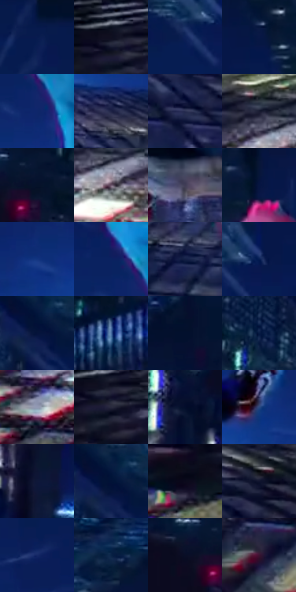

# 电影参考 566

- 状态：常规／活跃；来源世界：miles-home。
- 视角：rolled-or-dutch；景别：environment-wide；场景：city。
- 时段：night-appearance（外观依据，中置信度；具体时间／晨昏未知）；光照：night-mixed。
- 材质候选：skin, fabric, glass, stone, metal, sky（帧级，不是像素分割）。
- 明暗组：very-dark；L* P5/P50/P95：4.22017 / 13.13964 / 45.26046。
- 资格门禁：无附加门禁。
- 原截图 SHA-256：`4ed9ab380975bade7371660aaf86ecc658c745ef685edf229e72ac039dc04f46`；尺寸：2856 × 1186。
- sRGB 像素 SHA-256：`4ab82b381cabd143838536128a3ba67343e2e0643979da7b6c847cbffac3acad`。

## 观察与迁移

夜城人物与玻璃立面；倾斜视角不授权更改原照建筑透视。

较近坠落：青衣亮面、红粉手与帽、蓝楼背景有值差；空域有白色方向线，人物衣褶保持清楚而不是整幅径向模糊。

本公开版保存32个128×128原像素色卡上下文；图集格子并非原场景相邻位置。原rect、图集tile和像素SHA见 `data/palette-crops.json`。上下文不足时不得批准替色，不能以小样推断完整构图。

## 实测色卡

颜色比例分母为保留采样像素，不是材料面积；全部 32 色参与全库匹配。表内四舍五入仅用于阅读，原精度在 JSON。

| ID | HEX | Lab | 原图 xy | 像素数 | 比例 | 明度角色 |
| --- | --- | --- | --- | ---: | ---: | --- |
| 566-S01 | #071B4F | [11.912839, 15.151445, -34.092374] | [1632, 148] | 10914 | 5.777171% | deep-shadow |
| 566-S02 | #0F1020 | [5.206512, 3.894171, -10.771909] | [316, 768] | 9736 | 5.153613% | deep-shadow |
| 566-S03 | #0D2059 | [14.621474, 16.408205, -36.443941] | [988, 184] | 8513 | 4.506236% | deep-shadow |
| 566-S04 | #081845 | [10.064027, 13.085038, -30.177695] | [1144, 72] | 8261 | 4.372843% | deep-shadow |
| 566-S05 | #0E266A | [18.007479, 19.359147, -42.155199] | [1204, 416] | 7506 | 3.973194% | deep-shadow |
| 566-S06 | #1D2245 | [14.59513, 9.585389, -22.800681] | [1712, 728] | 7463 | 3.950433% | deep-shadow |
| 566-S07 | #292F52 | [20.492545, 8.308798, -22.220145] | [1816, 896] | 7239 | 3.831862% | shadow |
| 566-S08 | #191C31 | [10.984666, 5.379673, -14.384954] | [644, 812] | 7152 | 3.785810% | deep-shadow |
| 566-S09 | #061630 | [7.459622, 4.476011, -19.333067] | [312, 24] | 7021 | 3.716467% | deep-shadow |
| 566-S10 | #6B5469 | [38.701994, 13.527462, -8.435757] | [692, 876] | 6867 | 3.634949% | shadow |
| 566-S11 | #403C55 | [26.670524, 7.926921, -14.413201] | [1412, 680] | 6766 | 3.581486% | shadow |
| 566-S12 | #081637 | [8.1392, 8.23294, -23.339269] | [1364, 24] | 6683 | 3.537551% | deep-shadow |
| 566-S13 | #123480 | [24.136506, 18.880879, -46.22895] | [1128, 488] | 6602 | 3.494675% | shadow |
| 566-S14 | #0B2260 | [15.79556, 17.747352, -39.200697] | [1164, 344] | 6398 | 3.386690% | deep-shadow |
| 566-S15 | #132045 | [13.235927, 8.693461, -25.016621] | [1244, 776] | 6235 | 3.300409% | deep-shadow |
| 566-S16 | #061D53 | [12.870595, 15.303462, -35.260394] | [1052, 152] | 6082 | 3.219420% | deep-shadow |
| 566-S17 | #06133A | [7.314919, 11.612727, -26.846505] | [824, 84] | 5469 | 2.894937% | deep-shadow |
| 566-S18 | #4C71A4 | [47.008309, 2.073911, -31.411363] | [2736, 224] | 5340 | 2.826653% | midtone |
| 566-S19 | #06122C | [5.899312, 5.124375, -18.850888] | [2244, 28] | 5142 | 2.721845% | deep-shadow |
| 566-S20 | #192D54 | [18.899509, 6.504629, -26.154706] | [664, 36] | 5069 | 2.683203% | deep-shadow |
| 566-S21 | #949AB4 | [63.918712, 3.372647, -14.205491] | [544, 972] | 5013 | 2.653560% | light |
| 566-S22 | #2A2B3E | [18.222115, 4.824707, -12.184461] | [340, 804] | 4991 | 2.641915% | deep-shadow |
| 566-S23 | #030D2B | [4.349715, 6.539593, -20.561065] | [68, 216] | 4764 | 2.521756% | deep-shadow |
| 566-S24 | #2A4981 | [31.443379, 8.020083, -35.022456] | [1684, 560] | 4582 | 2.425417% | shadow |
| 566-S25 | #0F1839 | [9.402051, 8.901415, -22.722438] | [276, 468] | 4573 | 2.420653% | deep-shadow |
| 566-S26 | #051840 | [9.445594, 10.329852, -27.669576] | [824, 44] | 4528 | 2.396832% | deep-shadow |
| 566-S27 | #05081A | [2.533565, 2.83504, -10.115976] | [36, 952] | 4503 | 2.383599% | deep-shadow |
| 566-S28 | #12152F | [7.859452, 7.821846, -17.911604] | [2236, 924] | 4227 | 2.237502% | deep-shadow |
| 566-S29 | #142967 | [18.857526, 16.549588, -38.800598] | [1844, 408] | 3745 | 1.982363% | deep-shadow |
| 566-S30 | #092347 | [13.913345, 5.573229, -25.340124] | [2060, 76] | 3204 | 1.695992% | deep-shadow |
| 566-S31 | #090E27 | [4.684248, 5.85223, -16.979598] | [236, 72] | 2382 | 1.260878% | deep-shadow |
| 566-S32 | #3D1432 | [13.960229, 24.364863, -10.09313] | [724, 1084] | 1946 | 1.030087% | deep-shadow |

## 色阶与空间分布

- 采样 ROI：`[0.01, 0.02, 0.98, 0.94]`；步长：4；样本数：188916。
- 排除区：`[]`。
- 深暗、暗、中、亮、高光五段计数：`[145788, 30755, 9764, 2151, 458]`。
- RGB 各 256 箱、L* 100 箱、13×5 色相明度表和 3×3 空间统计全部保存在 [总数据](../film-library.json)。
- [可视化档案](../../references/library.html)按需绘制直方图，不存 2,094 张重复图表图片。

## 纹理特征占比

**这是分块图像特征的面积占比，不是波点／排线／丝网／错版的精确语义覆盖率。** 窗格、发丝、织物也会产生方向或周期特征。
原图 ROI 像素 3022070；已测块覆盖 3022070（100.0000%）；未测 0。

| 特征 | 块覆盖像素 | 占已测面积 | 阈值敏感范围 |
| --- | ---: | ---: | --- |
| low-contrast | 321792 | 10.6481% | 7.0479% ~ 12.8166% |
| directional-structure | 1207926 | 39.9702% | 14.5320% ~ 58.9961% |
| periodic-structure | 1410432 | 46.6711% | 32.8718% ~ 65.0613% |
| mixed-detail | 81920 | 2.7107% | 1.0843% ~ 7.5900% |

阈值敏感范围不是统计置信区间。逐块坐标、尺度、对比、方向一致性、频谱集中度、频率与角度见 [全量特征记录](../texture-features.jsonl)，以帧号定位。
四种印刷层的真实像素覆盖仍标为 `null`，不能填 0，也不能拿上表代替。不得据这些代理测量删除唯一证据。

[测量方法与保留策略](../../references/library-retention.md) · [分类索引](../archive/README.md)
