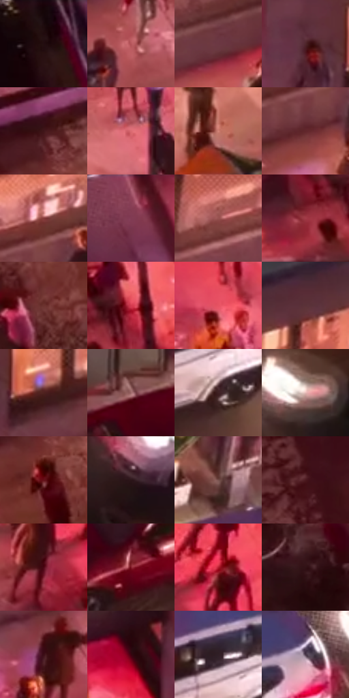

# 电影参考 567

- 状态：常规／活跃；来源世界：miles-home。
- 视角：high-angle；景别：environment-wide；场景：city。
- 时段：night-appearance（外观依据，中置信度；具体时间／晨昏未知）；光照：night-mixed。
- 材质候选：skin, fabric, asphalt, glass, painted-metal, screen（帧级，不是像素分割）。
- 明暗组：dark；L* P5/P50/P95：7.44044 / 28.46351 / 64.33273。
- 资格门禁：无附加门禁。
- 原截图 SHA-256：`4455c21156ef8462d4d30967938656d48d22a0153eb05fb2fc7bc93879295cbf`；尺寸：2880 × 1208。
- sRGB 像素 SHA-256：`3fec66123a5343b8c9faeac4063c943743930694e2a939c4936a993e83faee36`。

## 观察与迁移

暖霓虹街面和冷楼体，不将全图只保留一个蓝紫色族。

俯视街角：暖红粉人行道较亮，深路面托白车灯与车漆映光；黄路缘为实体边界，路人小色团不需逐脸刻画。

本公开版保存32个128×128原像素色卡上下文；图集格子并非原场景相邻位置。原rect、图集tile和像素SHA见 `data/palette-crops.json`。上下文不足时不得批准替色，不能以小样推断完整构图。

## 实测色卡

颜色比例分母为保留采样像素，不是材料面积；全部 32 色参与全库匹配。表内四舍五入仅用于阅读，原精度在 JSON。

| ID | HEX | Lab | 原图 xy | 像素数 | 比例 | 明度角色 |
| --- | --- | --- | --- | ---: | ---: | --- |
| 567-S01 | #210A0E | [5.168673, 11.108764, 2.004821] | [160, 48] | 9041 | 4.676073% | deep-shadow |
| 567-S02 | #B5555A | [48.337485, 39.376323, 15.866386] | [1880, 388] | 8827 | 4.565391% | midtone |
| 567-S03 | #6B3743 | [30.069323, 24.519986, 3.014552] | [2428, 108] | 8185 | 4.233343% | shadow |
| 567-S04 | #4F262C | [20.945253, 19.908413, 4.838137] | [1492, 264] | 8066 | 4.171796% | shadow |
| 567-S05 | #401519 | [13.808201, 21.358365, 7.998089] | [568, 616] | 8018 | 4.146970% | deep-shadow |
| 567-S06 | #DB6C73 | [58.999214, 44.009117, 16.675721] | [1428, 644] | 7584 | 3.922502% | midtone |
| 567-S07 | #D4867A | [63.717578, 28.540351, 19.01427] | [2228, 312] | 7380 | 3.816991% | light |
| 567-S08 | #61262B | [24.008189, 27.291096, 10.245528] | [2012, 260] | 7007 | 3.624073% | shadow |
| 567-S09 | #833937 | [34.042614, 31.696085, 16.842569] | [2040, 160] | 6907 | 3.572352% | shadow |
| 567-S10 | #833C51 | [35.30598, 32.862252, 2.000192] | [536, 52] | 6846 | 3.540802% | shadow |
| 567-S11 | #975250 | [43.055148, 28.422107, 13.972408] | [2184, 112] | 6752 | 3.492185% | midtone |
| 567-S12 | #A23B48 | [40.04709, 43.597026, 15.09703] | [788, 216] | 6452 | 3.337023% | midtone |
| 567-S13 | #6C332F | [28.803576, 24.918915, 14.356314] | [480, 868] | 6394 | 3.307025% | shadow |
| 567-S14 | #D33A4F | [48.814331, 60.268208, 24.008183] | [876, 164] | 6157 | 3.184447% | midtone |
| 567-S15 | #E65363 | [56.002836, 57.925822, 22.204918] | [1244, 432] | 6059 | 3.133760% | midtone |
| 567-S16 | #5B3238 | [26.131909, 19.334766, 4.32125] | [1880, 92] | 5900 | 3.051524% | shadow |
| 567-S17 | #4F221E | [19.640956, 20.742539, 12.713819] | [1600, 296] | 5765 | 2.981701% | deep-shadow |
| 567-S18 | #9F6A6B | [50.383938, 21.351397, 8.13132] | [1676, 816] | 5569 | 2.880329% | midtone |
| 567-S19 | #3F2123 | [16.825804, 14.698892, 4.954337] | [2448, 824] | 5551 | 2.871019% | deep-shadow |
| 567-S20 | #E5B9B6 | [78.888673, 15.351501, 7.523735] | [2732, 748] | 5500 | 2.844641% | light |
| 567-S21 | #640F17 | [20.493593, 37.046648, 19.456475] | [580, 728] | 5355 | 2.769646% | shadow |
| 567-S22 | #2B1519 | [9.955287, 11.843186, 2.047847] | [2064, 924] | 5316 | 2.749475% | deep-shadow |
| 567-S23 | #77524D | [38.713241, 14.75458, 9.144204] | [2372, 528] | 5297 | 2.739648% | shadow |
| 567-S24 | #4B181F | [16.740644, 24.839476, 8.009986] | [200, 652] | 5174 | 2.676032% | deep-shadow |
| 567-S25 | #4C0613 | [13.909986, 31.912171, 12.822717] | [2640, 244] | 5051 | 2.612415% | deep-shadow |
| 567-S26 | #7E1925 | [27.479094, 42.881388, 19.860814] | [1572, 1084] | 4974 | 2.572590% | shadow |
| 567-S27 | #B41E2E | [39.296412, 57.963992, 30.949959] | [2728, 180] | 4761 | 2.462425% | shadow |
| 567-S28 | #311215 | [10.106349, 16.105107, 5.351826] | [220, 988] | 4683 | 2.422083% | deep-shadow |
| 567-S29 | #3B0E15 | [11.263555, 22.701775, 7.26947] | [1672, 424] | 4466 | 2.309849% | deep-shadow |
| 567-S30 | #39030F | [8.736805, 26.806125, 7.284139] | [1360, 280] | 3823 | 1.977284% | deep-shadow |
| 567-S31 | #311F26 | [14.247743, 10.067143, -1.179646] | [2404, 740] | 3522 | 1.821605% | deep-shadow |
| 567-S32 | #473647 | [25.054053, 11.072102, -7.57806] | [2532, 676] | 2964 | 1.533003% | shadow |

## 色阶与空间分布

- 采样 ROI：`[0.01, 0.02, 0.98, 0.94]`；步长：4；样本数：193346。
- 排除区：`[]`。
- 深暗、暗、中、亮、高光五段计数：`[62839, 70917, 44858, 12442, 2290]`。
- RGB 各 256 箱、L* 100 箱、13×5 色相明度表和 3×3 空间统计全部保存在 [总数据](../film-library.json)。
- [可视化档案](../../references/library.html)按需绘制直方图，不存 2,094 张重复图表图片。

## 纹理特征占比

**这是分块图像特征的面积占比，不是波点／排线／丝网／错版的精确语义覆盖率。** 窗格、发丝、织物也会产生方向或周期特征。
原图 ROI 像素 3104134；已测块覆盖 3104134（100.0000%）；未测 0。

| 特征 | 块覆盖像素 | 占已测面积 | 阈值敏感范围 |
| --- | ---: | ---: | --- |
| low-contrast | 27520 | 0.8866% | 0.5278% ~ 0.8866% |
| directional-structure | 275712 | 8.8821% | 2.6391% ~ 21.2898% |
| periodic-structure | 2696710 | 86.8748% | 76.4093% ~ 87.4810% |
| mixed-detail | 104192 | 3.3566% | 1.7731% ~ 8.9934% |

阈值敏感范围不是统计置信区间。逐块坐标、尺度、对比、方向一致性、频谱集中度、频率与角度见 [全量特征记录](../texture-features.jsonl)，以帧号定位。
四种印刷层的真实像素覆盖仍标为 `null`，不能填 0，也不能拿上表代替。不得据这些代理测量删除唯一证据。

[测量方法与保留策略](../../references/library-retention.md) · [分类索引](../archive/README.md)
