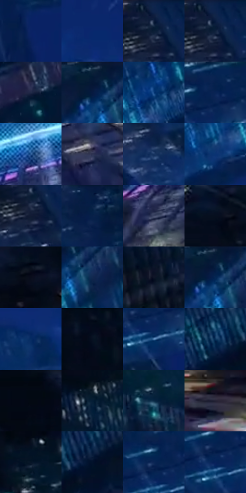

# 电影参考 568

- 状态：常规／活跃；来源世界：miles-home。
- 视角：rolled-or-dutch；景别：environment-wide；场景：city。
- 时段：night-appearance（外观依据，中置信度；具体时间／晨昏未知）；光照：night-mixed。
- 材质候选：skin, fabric, glass, stone, metal, sky（帧级，不是像素分割）。
- 明暗组：very-dark；L* P5/P50/P95：3.31445 / 15.20758 / 37.44924。
- 资格门禁：无附加门禁。
- 原截图 SHA-256：`fcb2deef6bb6a270ef714d9f6e487e6ab9180dfe7b8c3bce31a0f3a7d3456abd`；尺寸：2878 × 1206。
- sRGB 像素 SHA-256：`1bbf2c002a16b92620c879f95aa5aa5d217ad9a656eef407f1bbe608a2383db7`。

## 观察与迁移

夜城人物与玻璃立面；倾斜视角不授权更改原照建筑透视。

宽景坠落：青色楼沿强亮带与深楼体、蓝天空分层，人物黑剪影和白眼可读；方向线在空域，窗格服从楼面。

本公开版保存32个128×128原像素色卡上下文；图集格子并非原场景相邻位置。原rect、图集tile和像素SHA见 `data/palette-crops.json`。上下文不足时不得批准替色，不能以小样推断完整构图。

## 实测色卡

颜色比例分母为保留采样像素，不是材料面积；全部 32 色参与全库匹配。表内四舍五入仅用于阅读，原精度在 JSON。

| ID | HEX | Lab | 原图 xy | 像素数 | 比例 | 明度角色 |
| --- | --- | --- | --- | ---: | ---: | --- |
| 568-S01 | #0A2364 | [16.435812, 18.650918, -40.799096] | [1388, 244] | 9915 | 5.128112% | deep-shadow |
| 568-S02 | #08286D | [18.682714, 18.701302, -43.009423] | [1620, 508] | 9548 | 4.938297% | deep-shadow |
| 568-S03 | #0D2044 | [12.833465, 7.126089, -24.985023] | [880, 28] | 8134 | 4.206966% | deep-shadow |
| 568-S04 | #091D3C | [11.013372, 5.165542, -22.292826] | [888, 48] | 7992 | 4.133522% | deep-shadow |
| 568-S05 | #202947 | [17.215367, 6.031355, -20.003875] | [2756, 316] | 7490 | 3.873884% | deep-shadow |
| 568-S06 | #041734 | [8.006867, 5.200739, -21.387792] | [2156, 44] | 7216 | 3.732169% | deep-shadow |
| 568-S07 | #0F4280 | [28.262527, 8.738059, -39.550218] | [2288, 320] | 7155 | 3.700620% | shadow |
| 568-S08 | #05204C | [13.149688, 9.648059, -30.024286] | [1080, 52] | 6913 | 3.575455% | deep-shadow |
| 568-S09 | #2C5995 | [37.570054, 5.400713, -37.486815] | [1476, 900] | 6809 | 3.521666% | shadow |
| 568-S10 | #2E3352 | [22.151001, 7.018317, -19.582209] | [1708, 1016] | 6792 | 3.512873% | shadow |
| 568-S11 | #173461 | [21.947122, 6.470288, -29.886442] | [972, 244] | 6789 | 3.511322% | shadow |
| 568-S12 | #0A3373 | [22.546727, 13.411267, -40.578522] | [2168, 436] | 6780 | 3.506667% | shadow |
| 568-S13 | #111B34 | [10.189794, 4.903346, -17.853214] | [876, 100] | 6633 | 3.430637% | deep-shadow |
| 568-S14 | #051D43 | [11.387133, 7.774619, -26.63566] | [1308, 28] | 6599 | 3.413052% | deep-shadow |
| 568-S15 | #3D4665 | [30.185585, 5.001877, -19.319726] | [1232, 1064] | 6509 | 3.366504% | shadow |
| 568-S16 | #051020 | [4.580384, 1.086152, -11.78246] | [32, 88] | 6404 | 3.312197% | deep-shadow |
| 568-S17 | #090D1C | [3.881738, 2.361625, -9.686884] | [228, 132] | 6185 | 3.198928% | deep-shadow |
| 568-S18 | #112950 | [16.911877, 6.267616, -26.664346] | [2224, 104] | 6022 | 3.114624% | deep-shadow |
| 568-S19 | #101527 | [7.162357, 3.861309, -13.073649] | [548, 1044] | 5880 | 3.041180% | deep-shadow |
| 568-S20 | #042653 | [15.676262, 8.16596, -30.704577] | [2172, 68] | 5679 | 2.937221% | deep-shadow |
| 568-S21 | #062C63 | [18.972967, 11.156789, -36.015126] | [1104, 700] | 5520 | 2.854985% | deep-shadow |
| 568-S22 | #040C1A | [3.28165, 0.926187, -9.023015] | [380, 32] | 5463 | 2.825505% | deep-shadow |
| 568-S23 | #5F8FC1 | [57.96687, -2.077784, -30.94531] | [1068, 144] | 5288 | 2.734993% | midtone |
| 568-S24 | #09315A | [20.013704, 3.753455, -28.402622] | [2672, 164] | 4826 | 2.496043% | shadow |
| 568-S25 | #030914 | [2.395656, 0.384007, -5.868279] | [580, 40] | 4674 | 2.417428% | deep-shadow |
| 568-S26 | #051E36 | [10.755059, 0.856848, -18.434474] | [348, 332] | 4563 | 2.360018% | deep-shadow |
| 568-S27 | #082844 | [15.415267, 0.331775, -20.873004] | [488, 528] | 4544 | 2.350191% | deep-shadow |
| 568-S28 | #242134 | [13.889152, 6.652378, -11.927702] | [2752, 852] | 4445 | 2.298987% | deep-shadow |
| 568-S29 | #061427 | [6.191481, 1.63131, -14.638402] | [212, 380] | 4152 | 2.147446% | deep-shadow |
| 568-S30 | #02122B | [5.598982, 3.606895, -18.592712] | [2780, 152] | 3433 | 1.775573% | deep-shadow |
| 568-S31 | #0B2655 | [16.068997, 9.873884, -31.406809] | [1032, 84] | 2810 | 1.453353% | deep-shadow |
| 568-S32 | #08235A | [15.442604, 14.072181, -35.783621] | [1040, 120] | 2184 | 1.129581% | deep-shadow |

## 色阶与空间分布

- 采样 ROI：`[0.01, 0.02, 0.98, 0.94]`；步长：4；样本数：193346。
- 排除区：`[]`。
- 深暗、暗、中、亮、高光五段计数：`[144880, 40406, 5907, 1530, 623]`。
- RGB 各 256 箱、L* 100 箱、13×5 色相明度表和 3×3 空间统计全部保存在 [总数据](../film-library.json)。
- [可视化档案](../../references/library.html)按需绘制直方图，不存 2,094 张重复图表图片。

## 纹理特征占比

**这是分块图像特征的面积占比，不是波点／排线／丝网／错版的精确语义覆盖率。** 窗格、发丝、织物也会产生方向或周期特征。
原图 ROI 像素 3096328；已测块覆盖 3096328（100.0000%）；未测 0。

| 特征 | 块覆盖像素 | 占已测面积 | 阈值敏感范围 |
| --- | ---: | ---: | --- |
| low-contrast | 212992 | 6.8789% | 3.1749% ~ 9.3468% |
| directional-structure | 335488 | 10.8350% | 2.0174% ~ 30.8143% |
| periodic-structure | 2220168 | 71.7033% | 61.2486% ~ 71.7033% |
| mixed-detail | 327680 | 10.5829% | 4.7623% ~ 19.4749% |

阈值敏感范围不是统计置信区间。逐块坐标、尺度、对比、方向一致性、频谱集中度、频率与角度见 [全量特征记录](../texture-features.jsonl)，以帧号定位。
四种印刷层的真实像素覆盖仍标为 `null`，不能填 0，也不能拿上表代替。不得据这些代理测量删除唯一证据。

[测量方法与保留策略](../../references/library-retention.md) · [分类索引](../archive/README.md)
