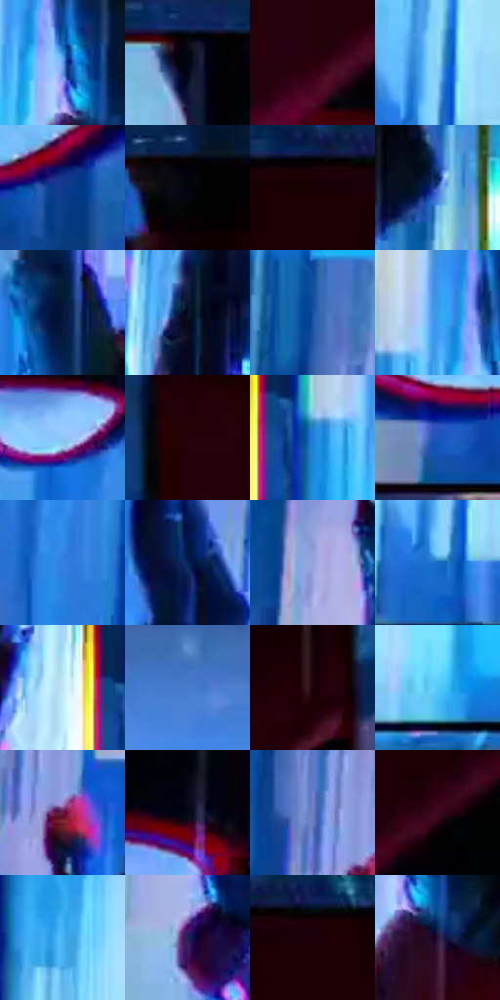

# 电影参考 569

- 状态：条件／活跃；来源世界：miles-home。
- 视角：rolled-or-dutch；景别：graphic-or-multipanel；场景：graphic。
- 时段：night-appearance（外观依据，中置信度；具体时间／晨昏未知）；光照：night-mixed。
- 材质候选：fabric, glass, metal（帧级，不是像素分割）。
- 明暗组：dark；L* P5/P50/P95：0.62855 / 32.84876 / 83.04298。
- 资格门禁：panel。
- 原截图 SHA-256：`550e2d1c81f6f8b4f284de5458d26a91beeb31bac1d374cdaf4c9953163ee954`；尺寸：2880 × 1202。
- sRGB 像素 SHA-256：`fdddd4b0effb0fa0bc75542873127f114a469376247557a3e958feec5a86d2e7`。

## 观察与迁移

竖格局部身体与玻璃高亮，分格沟槽排除。

六格连续放大：白青竖带、黑身体与红帽控制节奏；黑格缝为版式不计环境深暗，不能当六个人或默认六分镜。

本公开版保存32个128×128原像素色卡上下文；图集格子并非原场景相邻位置。原rect、图集tile和像素SHA见 `data/palette-crops.json`。上下文不足时不得批准替色，不能以小样推断完整构图。

## 实测色卡

颜色比例分母为保留采样像素，不是材料面积；全部 32 色参与全库匹配。表内四舍五入仅用于阅读，原精度在 JSON。

| ID | HEX | Lab | 原图 xy | 像素数 | 比例 | 明度角色 |
| --- | --- | --- | --- | ---: | ---: | --- |
| 569-S01 | #63A1F2 | [65.396723, 3.776731, -46.563506] | [1124, 668] | 9419 | 5.504324% | light |
| 569-S02 | #010103 | [0.313747, 0.27807, -0.756814] | [1288, 36] | 8885 | 5.192263% | deep-shadow |
| 569-S03 | #2A010B | [4.862092, 20.587103, 3.142436] | [2488, 512] | 8607 | 5.029804% | deep-shadow |
| 569-S04 | #8DD8FA | [82.73909, -14.604458, -23.867095] | [704, 1008] | 8116 | 4.742871% | highlight |
| 569-S05 | #0F3B89 | [26.833436, 17.448358, -47.465634] | [2228, 1068] | 7606 | 4.444834% | shadow |
| 569-S06 | #03050A | [1.353184, 0.172133, -2.07623] | [1824, 64] | 7490 | 4.377045% | deep-shadow |
| 569-S07 | #180005 | [1.853623, 8.564536, 0.880613] | [2516, 56] | 7115 | 4.157901% | deep-shadow |
| 569-S08 | #3869B7 | [44.746329, 9.71396, -46.153809] | [1844, 884] | 7093 | 4.145044% | midtone |
| 569-S09 | #041639 | [8.083202, 8.433723, -24.884714] | [1152, 448] | 6612 | 3.863955% | deep-shadow |
| 569-S10 | #081123 | [5.183211, 2.393988, -13.154729] | [808, 464] | 6563 | 3.835320% | deep-shadow |
| 569-S11 | #17529E | [35.368684, 10.945128, -46.467263] | [144, 236] | 6525 | 3.813114% | shadow |
| 569-S12 | #399FEE | [63.206636, -2.835148, -47.919801] | [1072, 600] | 6197 | 3.621435% | light |
| 569-S13 | #8EC5F6 | [77.480092, -5.453486, -29.769585] | [1708, 944] | 5882 | 3.437354% | light |
| 569-S14 | #230008 | [3.387059, 15.592504, 2.074651] | [1980, 272] | 5857 | 3.422744% | deep-shadow |
| 569-S15 | #1F7ED9 | [52.084908, 6.601055, -53.940022] | [1008, 660] | 5497 | 3.212366% | midtone |
| 569-S16 | #1C54BC | [38.228281, 22.025307, -59.626514] | [2072, 1100] | 5442 | 3.180224% | shadow |
| 569-S17 | #3081E0 | [53.71552, 8.886585, -55.248289] | [272, 920] | 5014 | 2.930108% | midtone |
| 569-S18 | #092257 | [14.898578, 13.59056, -34.654517] | [860, 260] | 5009 | 2.927186% | deep-shadow |
| 569-S19 | #94A5DA | [68.216608, 6.365013, -28.781273] | [176, 568] | 4931 | 2.881604% | light |
| 569-S20 | #196CC4 | [45.517663, 9.311045, -52.498397] | [692, 1084] | 4624 | 2.702197% | midtone |
| 569-S21 | #C4E6F5 | [89.355455, -7.943022, -10.969446] | [920, 624] | 4588 | 2.681159% | highlight |
| 569-S22 | #487BCB | [51.670884, 8.315812, -46.593656] | [2592, 740] | 4175 | 2.439808% | midtone |
| 569-S23 | #1D020A | [2.950308, 11.174565, 0.518082] | [2328, 472] | 3960 | 2.314165% | deep-shadow |
| 569-S24 | #55CCF9 | [77.252051, -19.815079, -31.919457] | [1152, 1112] | 3700 | 2.162225% | light |
| 569-S25 | #681741 | [23.466364, 39.167368, -5.402475] | [232, 444] | 3597 | 2.102034% | shadow |
| 569-S26 | #050819 | [2.49389, 2.556241, -9.368732] | [2304, 856] | 3489 | 2.038920% | deep-shadow |
| 569-S27 | #6E7FC0 | [54.341913, 10.757455, -35.967181] | [180, 384] | 3485 | 2.036583% | midtone |
| 569-S28 | #3B081C | [10.465414, 26.23141, 0.913835] | [2672, 404] | 3462 | 2.023142% | deep-shadow |
| 569-S29 | #4BB3F8 | [69.830645, -8.339399, -42.928951] | [584, 296] | 2619 | 1.530505% | light |
| 569-S30 | #1F2158 | [15.918633, 18.112295, -33.613639] | [216, 712] | 2152 | 1.257597% | deep-shadow |
| 569-S31 | #120003 | [1.221366, 5.628417, 0.700911] | [2584, 44] | 1931 | 1.128448% | deep-shadow |
| 569-S32 | #26153A | [10.948931, 17.875795, -20.829137] | [1160, 748] | 1478 | 0.863721% | deep-shadow |

## 色阶与空间分布

- 采样 ROI：`[0.01, 0.02, 0.98, 0.94]`；步长：4；样本数：171120。
- 排除区：`[{"label": "panel gutter", "rect": [0.163, 0, 0.181, 1]}, {"label": "panel gutter", "rect": [0.326, 0, 0.347, 1]}, {"label": "panel gutter", "rect": [0.49, 0, 0.511, 1]}, {"label": "panel gutter", "rect": [0.652, 0, 0.678, 1]}, {"label": "panel gutter", "rect": [0.817, 0, 0.839, 1]}]`。
- 深暗、暗、中、亮、高光五段计数：`[73301, 20394, 33962, 30137, 13326]`。
- RGB 各 256 箱、L* 100 箱、13×5 色相明度表和 3×3 空间统计全部保存在 [总数据](../film-library.json)。
- [可视化档案](../../references/library.html)按需绘制直方图，不存 2,094 张重复图表图片。

## 纹理特征占比

**这是分块图像特征的面积占比，不是波点／排线／丝网／错版的精确语义覆盖率。** 窗格、发丝、织物也会产生方向或周期特征。
原图 ROI 像素 2742610；已测块覆盖 2234310（81.4666%）；未测 508300。

| 特征 | 块覆盖像素 | 占已测面积 | 阈值敏感范围 |
| --- | ---: | ---: | --- |
| low-contrast | 221696 | 9.9223% | 8.4558% ~ 10.6556% |
| directional-structure | 1029120 | 46.0599% | 29.8587% ~ 61.3902% |
| periodic-structure | 983494 | 44.0178% | 30.1540% ~ 59.4857% |
| mixed-detail | 0 | 0.0000% | 0.0000% ~ 0.0000% |

阈值敏感范围不是统计置信区间。逐块坐标、尺度、对比、方向一致性、频谱集中度、频率与角度见 [全量特征记录](../texture-features.jsonl)，以帧号定位。
四种印刷层的真实像素覆盖仍标为 `null`，不能填 0，也不能拿上表代替。不得据这些代理测量删除唯一证据。

[测量方法与保留策略](../../references/library-retention.md) · [分类索引](../archive/README.md)
