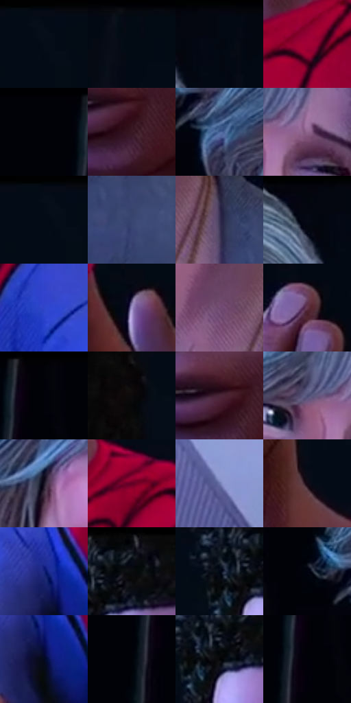

# 电影参考 570

- 状态：常规／活跃；来源世界：miles-home。
- 视角：near-level；景别：medium；场景：portrait。
- 时段：interior-time-unknown（外观依据，中置信度；具体时间／晨昏未知）；光照：cool-interior。
- 材质候选：skin, hair, fabric, metal（帧级，不是像素分割）。
- 明暗组：very-dark；L* P5/P50/P95：0.60876 / 9.30368 / 51.33612。
- 资格门禁：无附加门禁。
- 原截图 SHA-256：`0e06802d7fc73b13026064646c7b66ed05cad5a0cb645f38556b03ed823a29ae`；尺寸：2880 × 1224。
- sRGB 像素 SHA-256：`1afc9db0070a13fde398c139f2e9cf1bc06889881e6549098182c6c399af4082`。

## 观察与迁移

近景手掌和两张脸，轻接触无须大冲击符号。

暗背景双人：浅灰发和冷粉脸较亮，红衣强彩却不是最高明度；皮肤细排线、发束、织纹分工，留净眼神。

本公开版保存32个128×128原像素色卡上下文；图集格子并非原场景相邻位置。原rect、图集tile和像素SHA见 `data/palette-crops.json`。上下文不足时不得批准替色，不能以小样推断完整构图。

## 实测色卡

颜色比例分母为保留采样像素，不是材料面积；全部 32 色参与全库匹配。表内四舍五入仅用于阅读，原精度在 JSON。

| ID | HEX | Lab | 原图 xy | 像素数 | 比例 | 明度角色 |
| --- | --- | --- | --- | ---: | ---: | --- |
| 570-S01 | #040C17 | [3.166806, 0.119164, -6.845731] | [2360, 36] | 21040 | 10.727141% | deep-shadow |
| 570-S02 | #020B13 | [2.702995, -0.910232, -4.777901] | [1392, 28] | 14728 | 7.508999% | deep-shadow |
| 570-S03 | #030912 | [2.333949, -0.049614, -4.68813] | [1092, 28] | 13420 | 6.842121% | deep-shadow |
| 570-S04 | #A20136 | [33.924257, 58.441285, 18.459995] | [2040, 804] | 10949 | 5.582294% | shadow |
| 570-S05 | #010208 | [0.608759, 0.572729, -2.362614] | [32, 28] | 10769 | 5.490522% | deep-shadow |
| 570-S06 | #391724 | [13.292308, 18.61774, -0.982763] | [1852, 592] | 10131 | 5.165241% | deep-shadow |
| 570-S07 | #486498 | [42.39638, 5.210147, -31.56475] | [400, 416] | 9027 | 4.602372% | midtone |
| 570-S08 | #91668E | [48.854431, 24.206779, -15.114115] | [876, 312] | 8988 | 4.582488% | midtone |
| 570-S09 | #040D18 | [3.428642, -0.081113, -7.222843] | [2344, 28] | 8848 | 4.511110% | deep-shadow |
| 570-S10 | #394671 | [30.50119, 7.709685, -26.45445] | [852, 904] | 8738 | 4.455027% | shadow |
| 570-S11 | #393253 | [22.914884, 11.642313, -18.977601] | [764, 812] | 7566 | 3.857488% | shadow |
| 570-S12 | #050913 | [2.480766, 0.6856, -5.081422] | [1020, 64] | 6533 | 3.330818% | deep-shadow |
| 570-S13 | #3146CA | [36.547488, 38.268731, -70.506323] | [2276, 888] | 6263 | 3.193160% | shadow |
| 570-S14 | #A292CA | [63.756451, 17.437619, -26.681912] | [1348, 1028] | 6059 | 3.089152% | light |
| 570-S15 | #724B72 | [37.526242, 23.499979, -15.730665] | [660, 796] | 5912 | 3.014204% | shadow |
| 570-S16 | #62364B | [28.755903, 22.741832, -4.311633] | [1140, 308] | 5597 | 2.853603% | shadow |
| 570-S17 | #02030A | [0.90272, 0.711755, -2.741004] | [172, 28] | 5118 | 2.609387% | deep-shadow |
| 570-S18 | #0C090B | [2.689133, 1.095424, -0.479406] | [2172, 84] | 5003 | 2.550755% | deep-shadow |
| 570-S19 | #4B2739 | [20.990381, 19.622874, -4.150283] | [1828, 556] | 4863 | 2.479377% | shadow |
| 570-S20 | #4C4B72 | [33.527377, 10.402696, -22.234259] | [788, 296] | 4787 | 2.440629% | shadow |
| 570-S21 | #1A1525 | [8.034774, 6.976086, -10.136737] | [576, 372] | 4611 | 2.350896% | deep-shadow |
| 570-S22 | #640125 | [19.496783, 41.56626, 8.361607] | [2172, 724] | 4383 | 2.234651% | deep-shadow |
| 570-S23 | #6E75AA | [50.615769, 10.479953, -29.119741] | [496, 1140] | 2848 | 1.452039% | midtone |
| 570-S24 | #130815 | [3.308482, 5.841174, -5.082098] | [2048, 600] | 2703 | 1.378111% | deep-shadow |
| 570-S25 | #17247C | [19.632781, 28.896106, -51.065003] | [1600, 1040] | 2299 | 1.172134% | deep-shadow |
| 570-S26 | #070C15 | [3.272038, 0.413917, -5.236418] | [1688, 48] | 1817 | 0.926389% | deep-shadow |
| 570-S27 | #020915 | [2.370178, 0.353214, -6.588311] | [1604, 88] | 1355 | 0.690840% | deep-shadow |
| 570-S28 | #010410 | [1.180402, 1.032878, -5.222667] | [296, 364] | 569 | 0.290102% | deep-shadow |
| 570-S29 | #040A1F | [3.087249, 3.317231, -13.272586] | [1620, 1104] | 487 | 0.248295% | deep-shadow |
| 570-S30 | #000409 | [0.962393, -0.350848, -2.26054] | [100, 176] | 343 | 0.174877% | deep-shadow |
| 570-S31 | #040406 | [1.136268, 0.278018, -0.756715] | [1644, 108] | 260 | 0.132560% | deep-shadow |
| 570-S32 | #010109 | [0.432468, 1.112333, -3.027355] | [148, 112] | 124 | 0.063221% | deep-shadow |

## 色阶与空间分布

- 采样 ROI：`[0.01, 0.02, 0.98, 0.94]`；步长：4；样本数：196138。
- 排除区：`[]`。
- 深暗、暗、中、亮、高光五段计数：`[114667, 54160, 22770, 4515, 26]`。
- RGB 各 256 箱、L* 100 箱、13×5 色相明度表和 3×3 空间统计全部保存在 [总数据](../film-library.json)。
- [可视化档案](../../references/library.html)按需绘制直方图，不存 2,094 张重复图表图片。

## 纹理特征占比

**这是分块图像特征的面积占比，不是波点／排线／丝网／错版的精确语义覆盖率。** 窗格、发丝、织物也会产生方向或周期特征。
原图 ROI 像素 3146044；已测块覆盖 3146044（100.0000%）；未测 0。

| 特征 | 块覆盖像素 | 占已测面积 | 阈值敏感范围 |
| --- | ---: | ---: | --- |
| low-contrast | 793404 | 25.2191% | 24.1775% ~ 26.2607% |
| directional-structure | 1205760 | 38.3262% | 24.6720% ~ 48.9616% |
| periodic-structure | 1146880 | 36.4547% | 26.8609% ~ 45.6334% |
| mixed-detail | 0 | 0.0000% | 0.0000% ~ 3.4339% |

阈值敏感范围不是统计置信区间。逐块坐标、尺度、对比、方向一致性、频谱集中度、频率与角度见 [全量特征记录](../texture-features.jsonl)，以帧号定位。
四种印刷层的真实像素覆盖仍标为 `null`，不能填 0，也不能拿上表代替。不得据这些代理测量删除唯一证据。

[测量方法与保留策略](../../references/library-retention.md) · [分类索引](../archive/README.md)
