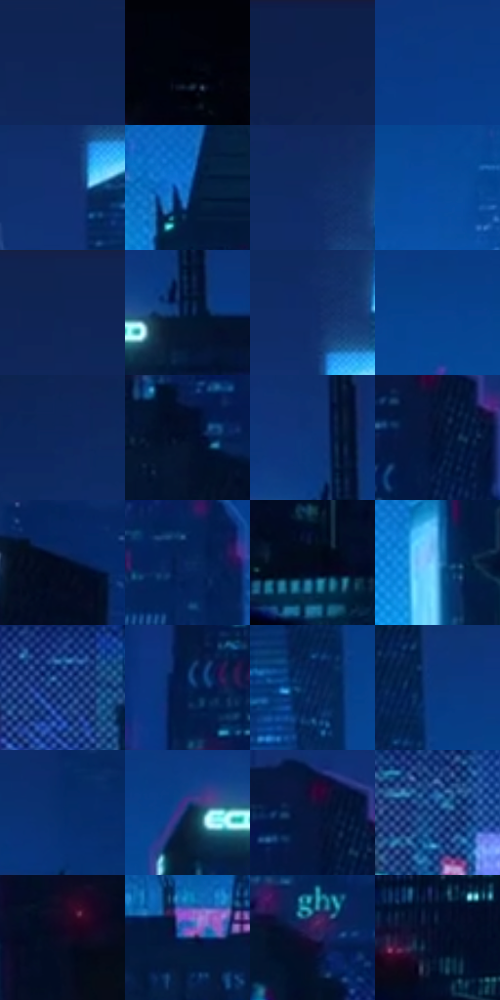

# 电影参考 571

- 状态：常规／活跃；来源世界：miles-home。
- 视角：near-level；景别：environment-wide；场景：city。
- 时段：night-appearance（外观依据，中置信度；具体时间／晨昏未知）；光照：night-mixed。
- 材质候选：glass, stone, metal, sky, screen（帧级，不是像素分割）。
- 明暗组：very-dark；L* P5/P50/P95：1.99314 / 17.19092 / 43.22254。
- 资格门禁：无附加门禁。
- 原截图 SHA-256：`918e9523adabb01b83597d3ae6257dccc7b79f804d6d4d3094019a17cd956f0c`；尺寸：2880 × 1208。
- sRGB 像素 SHA-256：`22a29609742b71e5489525d30903b4b68e7443daa1be269ed1d6ab93fe154e6d`。

## 观察与迁移

蓝色夜城、楼体正侧面与窗组节奏，发光窗不是满铺LED。

广域夜城：近屋顶黑、深蓝楼群、下部青白城市亮心与少量洋红点；远楼随空气减少对比，细白蛛丝是实体。

本公开版保存32个128×128原像素色卡上下文；图集格子并非原场景相邻位置。原rect、图集tile和像素SHA见 `data/palette-crops.json`。上下文不足时不得批准替色，不能以小样推断完整构图。

## 实测色卡

颜色比例分母为保留采样像素，不是材料面积；全部 32 色参与全库匹配。表内四舍五入仅用于阅读，原精度在 JSON。

| ID | HEX | Lab | 原图 xy | 像素数 | 比例 | 明度角色 |
| --- | --- | --- | --- | ---: | ---: | --- |
| 571-S01 | #0F2658 | [16.464304, 11.696889, -32.773983] | [1192, 80] | 10476 | 5.418266% | deep-shadow |
| 571-S02 | #01040F | [1.154028, 0.84755, -4.718276] | [80, 924] | 9601 | 4.965709% | deep-shadow |
| 571-S03 | #0D204B | [13.389707, 10.244194, -28.932892] | [504, 28] | 9455 | 4.890197% | deep-shadow |
| 571-S04 | #0A3985 | [25.812952, 16.847523, -46.640953] | [1476, 512] | 9053 | 4.682279% | shadow |
| 571-S05 | #113071 | [21.670424, 15.338144, -40.710449] | [1676, 332] | 8875 | 4.590217% | shadow |
| 571-S06 | #1368BC | [43.752772, 8.325626, -50.708541] | [2008, 872] | 8377 | 4.332647% | midtone |
| 571-S07 | #0F2B64 | [19.009063, 13.199018, -36.60004] | [1684, 204] | 8150 | 4.215241% | deep-shadow |
| 571-S08 | #094C9E | [33.337839, 14.095967, -49.759455] | [2088, 604] | 7903 | 4.087491% | shadow |
| 571-S09 | #0F2452 | [15.340718, 10.577086, -30.551092] | [1124, 28] | 7894 | 4.082836% | deep-shadow |
| 571-S10 | #031A3F | [9.929154, 7.925752, -26.181833] | [2420, 484] | 7565 | 3.912675% | deep-shadow |
| 571-S11 | #0F2D69 | [20.034853, 13.890217, -38.200139] | [1688, 244] | 7536 | 3.897676% | shadow |
| 571-S12 | #0A418F | [28.972386, 15.448846, -47.701928] | [1960, 508] | 7518 | 3.888366% | shadow |
| 571-S13 | #0C265D | [16.768959, 13.537207, -35.620982] | [548, 212] | 7323 | 3.787510% | deep-shadow |
| 571-S14 | #04132D | [6.150691, 4.473018, -19.205399] | [568, 688] | 7245 | 3.747168% | deep-shadow |
| 571-S15 | #0A3377 | [22.873336, 15.145536, -42.599963] | [2392, 404] | 6690 | 3.460118% | shadow |
| 571-S16 | #021435 | [6.956479, 7.511525, -23.813878] | [676, 468] | 6551 | 3.388226% | deep-shadow |
| 571-S17 | #020C24 | [3.641708, 3.75283, -16.330972] | [300, 416] | 6225 | 3.219617% | deep-shadow |
| 571-S18 | #0D2C5F | [18.85459, 10.052035, -33.564799] | [1208, 704] | 5805 | 3.002389% | deep-shadow |
| 571-S19 | #03091B | [2.654113, 2.200204, -10.753577] | [240, 804] | 5548 | 2.869467% | deep-shadow |
| 571-S20 | #52A8E2 | [65.971321, -8.399121, -36.931295] | [2252, 952] | 5495 | 2.842055% | light |
| 571-S21 | #183B7E | [26.238197, 13.706021, -41.550849] | [1284, 988] | 5118 | 2.647068% | shadow |
| 571-S22 | #021F4F | [12.966549, 11.451272, -32.383272] | [496, 524] | 4892 | 2.530179% | deep-shadow |
| 571-S23 | #062459 | [15.599005, 12.660491, -34.862549] | [1816, 520] | 4442 | 2.297436% | deep-shadow |
| 571-S24 | #0A397C | [25.091959, 12.993029, -42.166368] | [1860, 432] | 3930 | 2.032625% | shadow |
| 571-S25 | #062D6A | [19.865029, 13.540251, -39.137306] | [2808, 460] | 3795 | 1.962802% | deep-shadow |
| 571-S26 | #072147 | [13.154309, 6.822792, -26.564961] | [2300, 496] | 3496 | 1.808157% | deep-shadow |
| 571-S27 | #07183B | [9.107931, 8.310004, -24.653546] | [660, 428] | 3388 | 1.752299% | deep-shadow |
| 571-S28 | #275394 | [35.507938, 8.160331, -40.182711] | [816, 996] | 3338 | 1.726439% | shadow |
| 571-S29 | #0F0B24 | [4.229602, 7.780806, -15.357465] | [2388, 964] | 3148 | 1.628169% | deep-shadow |
| 571-S30 | #1F336C | [22.796608, 13.043621, -35.6414] | [1500, 996] | 1972 | 1.019933% | shadow |
| 571-S31 | #291F4E | [15.494142, 18.286223, -27.485044] | [1160, 860] | 1336 | 0.690989% | deep-shadow |
| 571-S32 | #1A1436 | [8.87592, 13.617803, -21.353567] | [32, 532] | 1206 | 0.623752% | deep-shadow |

## 色阶与空间分布

- 采样 ROI：`[0.01, 0.02, 0.98, 0.94]`；步长：4；样本数：193346。
- 排除区：`[]`。
- 深暗、暗、中、亮、高光五段计数：`[117571, 63733, 8006, 3153, 883]`。
- RGB 各 256 箱、L* 100 箱、13×5 色相明度表和 3×3 空间统计全部保存在 [总数据](../film-library.json)。
- [可视化档案](../../references/library.html)按需绘制直方图，不存 2,094 张重复图表图片。

## 纹理特征占比

**这是分块图像特征的面积占比，不是波点／排线／丝网／错版的精确语义覆盖率。** 窗格、发丝、织物也会产生方向或周期特征。
原图 ROI 像素 3104134；已测块覆盖 3104134（100.0000%）；未测 0。

| 特征 | 块覆盖像素 | 占已测面积 | 阈值敏感范围 |
| --- | ---: | ---: | --- |
| low-contrast | 1103488 | 35.5490% | 31.8543% ~ 40.1302% |
| directional-structure | 158592 | 5.1091% | 2.6391% ~ 9.2408% |
| periodic-structure | 1576838 | 50.7980% | 40.4108% ~ 54.6824% |
| mixed-detail | 265216 | 8.5440% | 4.2225% ~ 16.8199% |

阈值敏感范围不是统计置信区间。逐块坐标、尺度、对比、方向一致性、频谱集中度、频率与角度见 [全量特征记录](../texture-features.jsonl)，以帧号定位。
四种印刷层的真实像素覆盖仍标为 `null`，不能填 0，也不能拿上表代替。不得据这些代理测量删除唯一证据。

[测量方法与保留策略](../../references/library-retention.md) · [分类索引](../archive/README.md)
