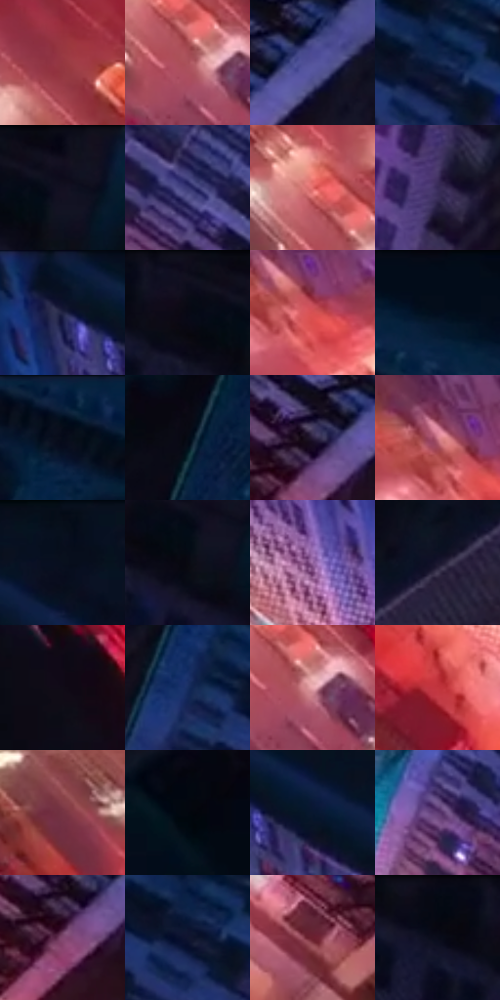

# 电影参考 572

- 状态：常规／活跃；来源世界：miles-home。
- 视角：overhead；景别：environment-wide；场景：city。
- 时段：night-appearance（外观依据，中置信度；具体时间／晨昏未知）；光照：night-mixed。
- 材质候选：skin, fabric, asphalt, glass, painted-metal, screen（帧级，不是像素分割）。
- 明暗组：very-dark；L* P5/P50/P95：2.51933 / 18.85794 / 63.20636。
- 资格门禁：无附加门禁。
- 原截图 SHA-256：`f9f60130d3dfef6a30bddef8df5b3a66224648a679fd1878c9008720c734de14`；尺寸：2880 × 1212。
- sRGB 像素 SHA-256：`b18c97110d1ac16de5ffa00fac7c51f289129fe7bfe890c131eee10c09d12af8`。

## 观察与迁移

暖霓虹街面和冷楼体，不将全图只保留一个蓝紫色族。

俯视大道：橙红亮街带斜穿冷蓝紫立面，近左黑楼留大面；暖冷依附城市空间，窗列、墙排线、车灯拖痕不混作一层。

本公开版保存32个128×128原像素色卡上下文；图集格子并非原场景相邻位置。原rect、图集tile和像素SHA见 `data/palette-crops.json`。上下文不足时不得批准替色，不能以小样推断完整构图。

## 实测色卡

颜色比例分母为保留采样像素，不是材料面积；全部 32 色参与全库匹配。表内四舍五入仅用于阅读，原精度在 JSON。

| ID | HEX | Lab | 原图 xy | 像素数 | 比例 | 明度角色 |
| --- | --- | --- | --- | ---: | ---: | --- |
| 572-S01 | #953740 | [36.918386, 40.213208, 15.521299] | [1228, 800] | 10481 | 5.401352% | shadow |
| 572-S02 | #A9515A | [45.716583, 36.975439, 11.97044] | [1048, 776] | 9407 | 4.847870% | midtone |
| 572-S03 | #54539A | [38.557445, 19.648862, -38.78033] | [2264, 952] | 9379 | 4.833440% | shadow |
| 572-S04 | #13244A | [14.922885, 7.787423, -25.760758] | [2128, 464] | 8581 | 4.422193% | deep-shadow |
| 572-S05 | #130F1E | [5.183262, 5.253762, -9.22613] | [1920, 36] | 8065 | 4.156274% | deep-shadow |
| 572-S06 | #383773 | [26.188005, 18.23613, -34.58055] | [2028, 856] | 7796 | 4.017645% | shadow |
| 572-S07 | #E16B69 | [59.477421, 45.77132, 23.223135] | [1016, 708] | 7690 | 3.963019% | midtone |
| 572-S08 | #362A57 | [20.550147, 17.36833, -25.387277] | [1828, 484] | 7668 | 3.951681% | shadow |
| 572-S09 | #061224 | [5.407462, 1.668101, -13.582488] | [1124, 36] | 7219 | 3.720290% | deep-shadow |
| 572-S10 | #0A0B16 | [3.267973, 1.873989, -5.924766] | [1840, 48] | 7123 | 3.670817% | deep-shadow |
| 572-S11 | #D75152 | [52.889645, 52.672869, 27.610369] | [736, 168] | 7095 | 3.656387% | midtone |
| 572-S12 | #040D1B | [3.54768, 0.755382, -9.424634] | [2620, 60] | 6895 | 3.553318% | deep-shadow |
| 572-S13 | #081E3C | [11.319053, 4.214101, -21.805609] | [2332, 32] | 6702 | 3.453856% | deep-shadow |
| 572-S14 | #040B15 | [2.883951, 0.064878, -5.824097] | [2060, 136] | 6680 | 3.442518% | deep-shadow |
| 572-S15 | #291E3C | [13.979158, 13.146034, -17.415572] | [2152, 1008] | 6584 | 3.393045% | deep-shadow |
| 572-S16 | #D57F8E | [62.744055, 35.009917, 6.322247] | [696, 132] | 6429 | 3.313166% | light |
| 572-S17 | #090E1C | [4.118641, 1.877663, -9.333742] | [1332, 52] | 6010 | 3.097236% | deep-shadow |
| 572-S18 | #090912 | [2.683802, 1.519382, -4.135299] | [1896, 108] | 5977 | 3.080229% | deep-shadow |
| 572-S19 | #9766A1 | [50.282078, 30.09158, -24.078534] | [1084, 340] | 5965 | 3.074045% | midtone |
| 572-S20 | #1A162E | [8.91326, 9.231429, -15.452119] | [2576, 920] | 5963 | 3.073014% | deep-shadow |
| 572-S21 | #100B16 | [3.680276, 3.723057, -5.273252] | [304, 388] | 5671 | 2.922533% | deep-shadow |
| 572-S22 | #182D60 | [19.700574, 11.275647, -32.835789] | [1992, 444] | 5500 | 2.834409% | deep-shadow |
| 572-S23 | #EBABB1 | [76.047908, 24.29566, 6.237646] | [1072, 780] | 5048 | 2.601472% | light |
| 572-S24 | #C2353E | [44.754549, 55.872776, 28.452885] | [1380, 744] | 4622 | 2.381934% | midtone |
| 572-S25 | #753443 | [30.98254, 30.160898, 4.532048] | [348, 208] | 4473 | 2.305147% | shadow |
| 572-S26 | #02070F | [1.800571, -0.092633, -3.767184] | [492, 924] | 3605 | 1.857826% | deep-shadow |
| 572-S27 | #08172F | [7.854549, 3.713702, -17.960366] | [1228, 92] | 3548 | 1.828451% | deep-shadow |
| 572-S28 | #5E3A72 | [30.927589, 27.012098, -26.169135] | [1852, 824] | 3400 | 1.752180% | shadow |
| 572-S29 | #81486F | [38.638875, 30.044306, -11.994231] | [2132, 1060] | 3170 | 1.633650% | shadow |
| 572-S30 | #10152F | [7.692837, 7.244382, -18.18709] | [2120, 484] | 2905 | 1.497083% | deep-shadow |
| 572-S31 | #6C202F | [25.036635, 34.820339, 9.270149] | [2004, 1124] | 2293 | 1.181691% | shadow |
| 572-S32 | #040812 | [2.19618, 0.612446, -4.88231] | [1744, 40] | 2100 | 1.082229% | deep-shadow |

## 色阶与空间分布

- 采样 ROI：`[0.01, 0.02, 0.98, 0.94]`；步长：4；样本数：194044。
- 排除区：`[]`。
- 深暗、暗、中、亮、高光五段计数：`[99561, 43696, 37152, 12426, 1209]`。
- RGB 各 256 箱、L* 100 箱、13×5 色相明度表和 3×3 空间统计全部保存在 [总数据](../film-library.json)。
- [可视化档案](../../references/library.html)按需绘制直方图，不存 2,094 张重复图表图片。

## 纹理特征占比

**这是分块图像特征的面积占比，不是波点／排线／丝网／错版的精确语义覆盖率。** 窗格、发丝、织物也会产生方向或周期特征。
原图 ROI 像素 3115310；已测块覆盖 3115310（100.0000%）；未测 0。

| 特征 | 块覆盖像素 | 占已测面积 | 阈值敏感范围 |
| --- | ---: | ---: | --- |
| low-contrast | 304000 | 9.7583% | 6.6027% ~ 10.8101% |
| directional-structure | 393216 | 12.6221% | 4.2073% ~ 28.1572% |
| periodic-structure | 2401710 | 77.0938% | 65.2401% ~ 81.4531% |
| mixed-detail | 16384 | 0.5259% | 0.0000% ~ 3.5294% |

阈值敏感范围不是统计置信区间。逐块坐标、尺度、对比、方向一致性、频谱集中度、频率与角度见 [全量特征记录](../texture-features.jsonl)，以帧号定位。
四种印刷层的真实像素覆盖仍标为 `null`，不能填 0，也不能拿上表代替。不得据这些代理测量删除唯一证据。

[测量方法与保留策略](../../references/library-retention.md) · [分类索引](../archive/README.md)
