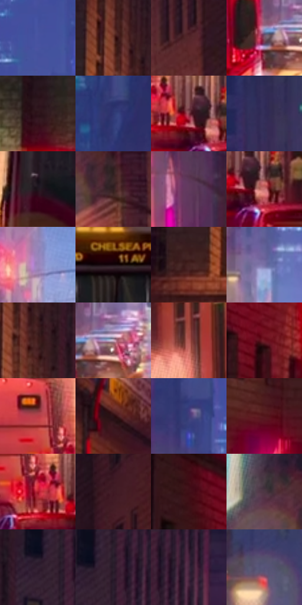

# 电影参考 573

- 状态：常规／活跃；来源世界：miles-home。
- 视角：near-level；景别：environment-wide；场景：city。
- 时段：night-appearance（外观依据，中置信度；具体时间／晨昏未知）；光照：night-mixed。
- 材质候选：skin, fabric, asphalt, glass, painted-metal, screen（帧级，不是像素分割）。
- 明暗组：dark；L* P5/P50/P95：7.54364 / 25.34423 / 62.12593。
- 资格门禁：无附加门禁。
- 原截图 SHA-256：`1fd53bcf0486c492841f507ab288b0e444c02c5d67144efd3032631ed9c7d169`；尺寸：2880 × 1208。
- sRGB 像素 SHA-256：`89871481153fd5406e7703085769e3b43d27f4917ee28dd01abbcfecb07480f1`。

## 观察与迁移

暖霓虹街面和冷楼体，不将全图只保留一个蓝紫色族。

街平视：近砖墙暖红棕、远处蓝紫空气层，绿信号与粉招牌小面积跳色；巴士黑窗和暖白灯明确，人群概括为暗群。

本公开版保存32个128×128原像素色卡上下文；图集格子并非原场景相邻位置。原rect、图集tile和像素SHA见 `data/palette-crops.json`。上下文不足时不得批准替色，不能以小样推断完整构图。

## 实测色卡

颜色比例分母为保留采样像素，不是材料面积；全部 32 色参与全库匹配。表内四舍五入仅用于阅读，原精度在 JSON。

| ID | HEX | Lab | 原图 xy | 像素数 | 比例 | 明度角色 |
| --- | --- | --- | --- | ---: | ---: | --- |
| 573-S01 | #4752A0 | [37.6827, 19.151975, -43.832867] | [1440, 308] | 10102 | 5.224830% | shadow |
| 573-S02 | #6D392E | [30.340859, 21.757036, 17.045117] | [612, 216] | 8130 | 4.204897% | shadow |
| 573-S03 | #54272A | [21.957012, 21.205366, 7.752143] | [2468, 384] | 8071 | 4.174382% | shadow |
| 573-S04 | #805569 | [41.385432, 21.038531, -4.176991] | [1272, 1064] | 7942 | 4.107662% | midtone |
| 573-S05 | #30151C | [10.911831, 14.676731, 1.28258] | [268, 156] | 7628 | 3.945259% | deep-shadow |
| 573-S06 | #2E3773 | [25.413832, 15.891558, -35.865045] | [1760, 112] | 7445 | 3.850610% | shadow |
| 573-S07 | #833B46 | [34.795702, 32.095837, 8.307285] | [2280, 1092] | 7393 | 3.823715% | shadow |
| 573-S08 | #332E58 | [21.439718, 14.020608, -24.657815] | [2012, 204] | 7067 | 3.655105% | shadow |
| 573-S09 | #1F161D | [8.601011, 6.151049, -3.173838] | [816, 1076] | 6980 | 3.610108% | deep-shadow |
| 573-S10 | #312020 | [14.346411, 8.237064, 3.292977] | [2336, 436] | 6934 | 3.586317% | deep-shadow |
| 573-S11 | #633A5D | [30.567238, 24.045148, -13.272628] | [2044, 648] | 6783 | 3.508218% | shadow |
| 573-S12 | #CA7374 | [58.114749, 34.224707, 14.511471] | [2324, 1116] | 6687 | 3.458567% | midtone |
| 573-S13 | #9C86BA | [59.583205, 18.738371, -24.130748] | [1352, 868] | 6361 | 3.289957% | midtone |
| 573-S14 | #180A10 | [4.05325, 6.237332, -0.824167] | [1004, 912] | 6329 | 3.273406% | deep-shadow |
| 573-S15 | #442322 | [18.128923, 15.575399, 7.593031] | [528, 384] | 6266 | 3.240822% | deep-shadow |
| 573-S16 | #7670A5 | [49.684747, 14.541881, -27.605039] | [1336, 656] | 6106 | 3.158069% | midtone |
| 573-S17 | #3E1B1A | [14.860026, 16.960767, 8.633127] | [656, 292] | 6078 | 3.143587% | deep-shadow |
| 573-S18 | #CCB0C4 | [74.74564, 13.526502, -6.406172] | [1336, 1052] | 5802 | 3.000838% | light |
| 573-S19 | #B45A52 | [49.041022, 35.693913, 21.548639] | [2620, 756] | 5709 | 2.952738% | midtone |
| 573-S20 | #6E1623 | [23.708393, 38.63944, 15.744027] | [224, 456] | 5620 | 2.906706% | shadow |
| 573-S21 | #B93E48 | [44.561651, 50.092488, 21.817781] | [2164, 996] | 5583 | 2.887569% | midtone |
| 573-S22 | #2A0F14 | [7.989787, 14.679843, 2.812985] | [760, 484] | 5423 | 2.804816% | deep-shadow |
| 573-S23 | #403C79 | [28.647241, 18.920567, -34.40282] | [1300, 400] | 5362 | 2.773267% | shadow |
| 573-S24 | #53151B | [17.713919, 29.085208, 12.438561] | [368, 772] | 5340 | 2.761888% | deep-shadow |
| 573-S25 | #AE1827 | [37.483476, 57.397493, 32.79508] | [2212, 1076] | 5037 | 2.605174% | shadow |
| 573-S26 | #3F1A24 | [15.078841, 19.310396, 1.748799] | [2588, 120] | 4909 | 2.538972% | deep-shadow |
| 573-S27 | #3F0F17 | [12.355215, 23.967624, 7.467696] | [120, 356] | 4791 | 2.477941% | deep-shadow |
| 573-S28 | #4D3744 | [25.944483, 12.247518, -4.175046] | [2232, 364] | 4711 | 2.436565% | shadow |
| 573-S29 | #342133 | [15.782927, 12.832952, -8.140939] | [768, 80] | 4204 | 2.174340% | deep-shadow |
| 573-S30 | #271D29 | [12.417253, 7.65875, -6.232659] | [808, 44] | 3149 | 1.628686% | deep-shadow |
| 573-S31 | #43243D | [19.191481, 19.099167, -9.745758] | [880, 60] | 2912 | 1.506108% | deep-shadow |
| 573-S32 | #565277 | [36.639629, 10.58451, -20.442355] | [1092, 236] | 2492 | 1.288881% | shadow |

## 色阶与空间分布

- 采样 ROI：`[0.01, 0.02, 0.98, 0.94]`；步长：4；样本数：193346。
- 排除区：`[]`。
- 深暗、暗、中、亮、高光五段计数：`[70675, 78578, 32308, 10714, 1071]`。
- RGB 各 256 箱、L* 100 箱、13×5 色相明度表和 3×3 空间统计全部保存在 [总数据](../film-library.json)。
- [可视化档案](../../references/library.html)按需绘制直方图，不存 2,094 张重复图表图片。

## 纹理特征占比

**这是分块图像特征的面积占比，不是波点／排线／丝网／错版的精确语义覆盖率。** 窗格、发丝、织物也会产生方向或周期特征。
原图 ROI 像素 3104134；已测块覆盖 3104134（100.0000%）；未测 0。

| 特征 | 块覆盖像素 | 占已测面积 | 阈值敏感范围 |
| --- | ---: | ---: | --- |
| low-contrast | 0 | 0.0000% | 0.0000% ~ 1.0556% |
| directional-structure | 480640 | 15.4839% | 6.6925% ~ 29.6938% |
| periodic-structure | 2393478 | 77.1061% | 68.7228% ~ 78.6566% |
| mixed-detail | 230016 | 7.4100% | 1.5834% ~ 13.5953% |

阈值敏感范围不是统计置信区间。逐块坐标、尺度、对比、方向一致性、频谱集中度、频率与角度见 [全量特征记录](../texture-features.jsonl)，以帧号定位。
四种印刷层的真实像素覆盖仍标为 `null`，不能填 0，也不能拿上表代替。不得据这些代理测量删除唯一证据。

[测量方法与保留策略](../../references/library-retention.md) · [分类索引](../archive/README.md)
