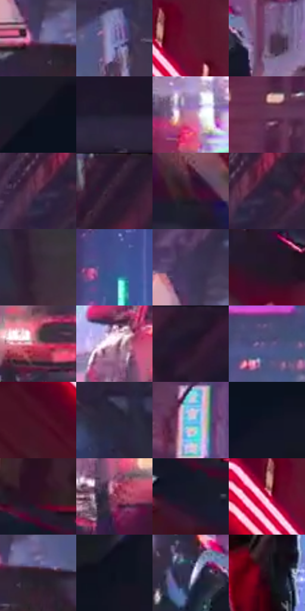

# 电影参考 574

- 状态：条件／活跃；来源世界：miles-home。
- 视角：low-angle；景别：environment-wide；场景：street。
- 时段：night-appearance（外观依据，中置信度；具体时间／晨昏未知）；光照：night-mixed。
- 材质候选：fabric, brick, glass, asphalt, painted-metal, metal（帧级，不是像素分割）。
- 明暗组：dark；L* P5/P50/P95：5.94365 / 21.46154 / 68.74153。
- 资格门禁：motion。
- 原截图 SHA-256：`d949a413bb9aac5bc7eac06fd0422d8112d6da69408fc4e9f2cf35df62ece5c7`；尺寸：2880 × 1210。
- sRGB 像素 SHA-256：`ac0bc049139dfcc00e41e6f6ff68629c48747976eb240e93c55b971fc1625549`。

## 观察与迁移

街道腾跃、车漆映色与原有动模糊，主角剪影保持稳定。

低机位穿车流：近车黑漆承粉红条反射，右车灯白芯、远城青白，人物暗红绿；车灯线束有源，非随意速度线。

本公开版保存32个128×128原像素色卡上下文；图集格子并非原场景相邻位置。原rect、图集tile和像素SHA见 `data/palette-crops.json`。上下文不足时不得批准替色，不能以小样推断完整构图。

## 实测色卡

颜色比例分母为保留采样像素，不是材料面积；全部 32 色参与全库匹配。表内四舍五入仅用于阅读，原精度在 JSON。

| ID | HEX | Lab | 原图 xy | 像素数 | 比例 | 明度角色 |
| --- | --- | --- | --- | ---: | ---: | --- |
| 574-S01 | #4F3E69 | [29.731533, 17.303209, -22.453606] | [1888, 748] | 9306 | 4.795820% | shadow |
| 574-S02 | #7276AD | [51.325233, 11.874721, -29.73324] | [2044, 688] | 8377 | 4.317062% | midtone |
| 574-S03 | #5F1730 | [21.055602, 34.368113, 2.609541] | [708, 80] | 7938 | 4.090825% | shadow |
| 574-S04 | #75577C | [41.301484, 19.446885, -16.079511] | [1120, 856] | 7878 | 4.059904% | midtone |
| 574-S05 | #0F121F | [5.718442, 2.40979, -9.222484] | [80, 620] | 7816 | 4.027952% | deep-shadow |
| 574-S06 | #211D30 | [12.059988, 7.192608, -11.92247] | [2600, 176] | 7810 | 4.024860% | deep-shadow |
| 574-S07 | #C382A0 | [61.746713, 29.418035, -5.669133] | [1428, 1060] | 7709 | 3.972810% | light |
| 574-S08 | #643656 | [29.4629, 25.459412, -10.410861] | [1032, 404] | 7686 | 3.960957% | shadow |
| 574-S09 | #4E2D47 | [23.510939, 19.719111, -9.831876] | [1988, 340] | 7484 | 3.856857% | shadow |
| 574-S10 | #2C1C31 | [13.155493, 12.557022, -10.838899] | [2132, 36] | 7313 | 3.768733% | deep-shadow |
| 574-S11 | #411C2F | [16.304471, 20.651294, -4.315483] | [1824, 1096] | 6993 | 3.603822% | deep-shadow |
| 574-S12 | #2D203C | [15.046285, 13.15386, -15.705087] | [2028, 328] | 6612 | 3.407475% | deep-shadow |
| 574-S13 | #392B3B | [19.693831, 9.92683, -7.724036] | [2304, 608] | 6416 | 3.306467% | deep-shadow |
| 574-S14 | #40538F | [36.477946, 11.124263, -35.528283] | [1380, 204] | 6183 | 3.186391% | shadow |
| 574-S15 | #3F3557 | [24.611053, 12.832105, -18.925024] | [1876, 648] | 6066 | 3.126095% | shadow |
| 574-S16 | #1F1925 | [9.954668, 6.038913, -7.128692] | [504, 448] | 5962 | 3.072499% | deep-shadow |
| 574-S17 | #BC5872 | [50.556356, 42.88376, 4.733199] | [1172, 992] | 5918 | 3.049824% | midtone |
| 574-S18 | #ECC8D9 | [84.045194, 15.454524, -3.697002] | [1604, 904] | 5886 | 3.033333% | highlight |
| 574-S19 | #21172B | [9.880323, 10.115841, -11.665105] | [2308, 44] | 5752 | 2.964276% | deep-shadow |
| 574-S20 | #575381 | [37.476293, 13.048809, -25.292481] | [1728, 284] | 5620 | 2.896250% | shadow |
| 574-S21 | #470D21 | [14.04534, 28.810021, 2.662936] | [428, 72] | 5558 | 2.864299% | deep-shadow |
| 574-S22 | #2B283A | [17.16301, 6.120105, -11.036912] | [2176, 504] | 5450 | 2.808641% | deep-shadow |
| 574-S23 | #87BFE8 | [74.973431, -7.749241, -26.109834] | [1160, 500] | 5409 | 2.787512% | light |
| 574-S24 | #131523 | [7.191028, 3.413379, -9.993505] | [116, 732] | 4978 | 2.565398% | deep-shadow |
| 574-S25 | #2E1223 | [10.068334, 17.00701, -5.256618] | [68, 128] | 4896 | 2.523139% | deep-shadow |
| 574-S26 | #8D3C58 | [37.115527, 37.371072, 0.371381] | [1656, 1004] | 4683 | 2.413370% | shadow |
| 574-S27 | #171928 | [9.243612, 3.732917, -10.523349] | [116, 248] | 4677 | 2.410278% | deep-shadow |
| 574-S28 | #9C1038 | [33.406122, 54.88684, 16.228364] | [652, 96] | 4536 | 2.337614% | shadow |
| 574-S29 | #2B1C29 | [12.635059, 10.13565, -5.852667] | [1940, 768] | 4153 | 2.140236% | deep-shadow |
| 574-S30 | #0B111D | [5.064909, 1.114163, -8.68763] | [352, 1108] | 3763 | 1.939251% | deep-shadow |
| 574-S31 | #2F2F50 | [20.89049, 9.466699, -20.220257] | [1008, 848] | 3026 | 1.559440% | shadow |
| 574-S32 | #1F0D18 | [5.827632, 10.661541, -3.431999] | [1416, 620] | 2190 | 1.128610% | deep-shadow |

## 色阶与空间分布

- 采样 ROI：`[0.01, 0.02, 0.98, 0.94]`；步长：4；样本数：194044。
- 排除区：`[]`。
- 深暗、暗、中、亮、高光五段计数：`[91732, 59673, 26543, 11060, 5036]`。
- RGB 各 256 箱、L* 100 箱、13×5 色相明度表和 3×3 空间统计全部保存在 [总数据](../film-library.json)。
- [可视化档案](../../references/library.html)按需绘制直方图，不存 2,094 张重复图表图片。

## 纹理特征占比

**这是分块图像特征的面积占比，不是波点／排线／丝网／错版的精确语义覆盖率。** 窗格、发丝、织物也会产生方向或周期特征。
原图 ROI 像素 3109722；已测块覆盖 3109722（100.0000%）；未测 0。

| 特征 | 块覆盖像素 | 占已测面积 | 阈值敏感范围 |
| --- | ---: | ---: | --- |
| low-contrast | 263552 | 8.4751% | 5.3139% ~ 10.2615% |
| directional-structure | 570752 | 18.3538% | 8.7756% ~ 34.2050% |
| periodic-structure | 2160730 | 69.4831% | 59.4274% ~ 72.8542% |
| mixed-detail | 114688 | 3.6880% | 1.0537% ~ 8.1088% |

阈值敏感范围不是统计置信区间。逐块坐标、尺度、对比、方向一致性、频谱集中度、频率与角度见 [全量特征记录](../texture-features.jsonl)，以帧号定位。
四种印刷层的真实像素覆盖仍标为 `null`，不能填 0，也不能拿上表代替。不得据这些代理测量删除唯一证据。

[测量方法与保留策略](../../references/library-retention.md) · [分类索引](../archive/README.md)
