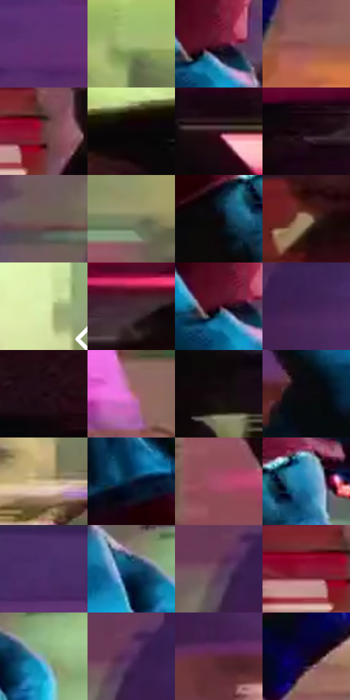

# 电影参考 575

- 状态：条件／活跃；来源世界：miles-home。
- 视角：near-level；景别：full-body；场景：street。
- 时段：night-appearance（外观依据，中置信度；具体时间／晨昏未知）；光照：night-mixed。
- 材质候选：fabric, brick, glass, asphalt, painted-metal, metal（帧级，不是像素分割）。
- 明暗组：dark；L* P5/P50/P95：2.10793 / 27.78113 / 79.77769。
- 资格门禁：motion。
- 原截图 SHA-256：`93cdf3d2fd4382425ae0dc4a7d7c4a81d5951b4eeb7cfe6c9202470e57855fd1`；尺寸：2880 × 1200。
- sRGB 像素 SHA-256：`0252a5c88d6e62033602bafe00da0683ceae90e72f005a5385c4443b40004538`。

## 观察与迁移

街道腾跃、车漆映色与原有动模糊，主角剪影保持稳定。

侧向动作：青衣较清楚，车体深红黑与浅绿橱窗横向色块拖动；速度通过边缘与背景笔触表达，不是全图故障。

本公开版保存32个128×128原像素色卡上下文；图集格子并非原场景相邻位置。原rect、图集tile和像素SHA见 `data/palette-crops.json`。上下文不足时不得批准替色，不能以小样推断完整构图。

## 实测色卡

颜色比例分母为保留采样像素，不是材料面积；全部 32 色参与全库匹配。表内四舍五入仅用于阅读，原精度在 JSON。

| ID | HEX | Lab | 原图 xy | 像素数 | 比例 | 明度角色 |
| --- | --- | --- | --- | ---: | ---: | --- |
| 575-S01 | #5E306F | [28.489282, 32.195751, -28.111611] | [2452, 80] | 17631 | 9.151925% | shadow |
| 575-S02 | #A4B978 | [72.192801, -18.215469, 30.663016] | [2456, 452] | 9338 | 4.847182% | light |
| 575-S03 | #58122A | [18.692621, 33.451045, 3.268315] | [1824, 224] | 9164 | 4.756862% | deep-shadow |
| 575-S04 | #8C524F | [41.494221, 23.841168, 12.193222] | [1660, 1084] | 8732 | 4.532619% | midtone |
| 575-S05 | #6A3B3D | [30.71141, 20.934309, 7.815915] | [1580, 836] | 8581 | 4.454238% | shadow |
| 575-S06 | #090607 | [1.839754, 0.923437, -0.10181] | [224, 408] | 8506 | 4.415307% | deep-shadow |
| 575-S07 | #300E18 | [9.062599, 18.51788, 1.645336] | [1132, 492] | 8342 | 4.330177% | deep-shadow |
| 575-S08 | #1E0C17 | [5.427663, 10.258512, -3.273161] | [760, 1056] | 8037 | 4.171857% | deep-shadow |
| 575-S09 | #6E5B55 | [40.333939, 6.690953, 6.352618] | [1972, 172] | 7733 | 4.014057% | midtone |
| 575-S10 | #7B8061 | [52.411815, -7.508029, 16.255321] | [2264, 712] | 6754 | 3.505876% | midtone |
| 575-S11 | #0C070A | [2.276686, 1.753956, -0.66397] | [1880, 712] | 6740 | 3.498609% | deep-shadow |
| 575-S12 | #9F846C | [57.033734, 6.649825, 16.828925] | [72, 532] | 6702 | 3.478884% | midtone |
| 575-S13 | #DFEFB1 | [91.951495, -15.431003, 28.311116] | [2788, 552] | 6461 | 3.353785% | highlight |
| 575-S14 | #432933 | [20.117403, 13.857457, -1.43212] | [980, 1020] | 5901 | 3.063100% | shadow |
| 575-S15 | #3F0D24 | [12.43065, 26.3967, -2.122777] | [1800, 232] | 5751 | 2.985237% | deep-shadow |
| 575-S16 | #412255 | [19.736019, 25.378056, -25.264396] | [904, 124] | 5731 | 2.974856% | deep-shadow |
| 575-S17 | #19050D | [3.110244, 8.21607, -0.635274] | [276, 988] | 5723 | 2.970703% | deep-shadow |
| 575-S18 | #CC739D | [59.466945, 40.183807, -7.212639] | [2760, 1100] | 5402 | 2.804078% | midtone |
| 575-S19 | #170C10 | [4.35877, 4.903528, -0.39108] | [328, 500] | 5160 | 2.678460% | deep-shadow |
| 575-S20 | #0C0910 | [2.808754, 1.936018, -2.767177] | [1656, 284] | 5079 | 2.636415% | deep-shadow |
| 575-S21 | #D2BF97 | [77.992426, 0.615651, 22.663769] | [2820, 816] | 4950 | 2.569453% | light |
| 575-S22 | #0F1E39 | [11.451753, 4.223277, -19.441435] | [1768, 576] | 4912 | 2.549728% | deep-shadow |
| 575-S23 | #AB4F6B | [46.060694, 40.628792, 2.146868] | [1924, 960] | 4868 | 2.526888% | midtone |
| 575-S24 | #2084B4 | [51.953079, -10.740152, -33.070552] | [1972, 672] | 4193 | 2.176508% | midtone |
| 575-S25 | #4A2E67 | [24.918088, 25.426224, -28.800562] | [228, 32] | 3698 | 1.919563% | shadow |
| 575-S26 | #124771 | [28.970729, -0.656206, -28.993165] | [2016, 320] | 3565 | 1.850525% | shadow |
| 575-S27 | #613C58 | [30.58786, 21.079518, -10.039741] | [2084, 80] | 3446 | 1.788755% | shadow |
| 575-S28 | #8D1837 | [30.863131, 48.849249, 12.933362] | [1516, 840] | 3363 | 1.745671% | shadow |
| 575-S29 | #87A79F | [65.974317, -12.654747, 0.499972] | [2084, 336] | 2514 | 1.304971% | light |
| 575-S30 | #522D5D | [25.140663, 26.014987, -21.868206] | [2112, 64] | 2358 | 1.223994% | shadow |
| 575-S31 | #5A273E | [23.581957, 26.368252, -3.455758] | [920, 268] | 1890 | 0.981064% | shadow |
| 575-S32 | #0A0527 | [2.886082, 9.906255, -19.780646] | [2212, 996] | 1423 | 0.738653% | deep-shadow |

## 色阶与空间分布

- 采样 ROI：`[0.01, 0.02, 0.98, 0.94]`；步长：4；样本数：192648。
- 排除区：`[]`。
- 深暗、暗、中、亮、高光五段计数：`[73186, 57980, 30844, 21119, 9519]`。
- RGB 各 256 箱、L* 100 箱、13×5 色相明度表和 3×3 空间统计全部保存在 [总数据](../film-library.json)。
- [可视化档案](../../references/library.html)按需绘制直方图，不存 2,094 张重复图表图片。

## 纹理特征占比

**这是分块图像特征的面积占比，不是波点／排线／丝网／错版的精确语义覆盖率。** 窗格、发丝、织物也会产生方向或周期特征。
原图 ROI 像素 3084576；已测块覆盖 3084576（100.0000%）；未测 0。

| 特征 | 块覆盖像素 | 占已测面积 | 阈值敏感范围 |
| --- | ---: | ---: | --- |
| low-contrast | 163072 | 5.2867% | 3.6932% ~ 6.8802% |
| directional-structure | 1417728 | 45.9618% | 30.4918% ~ 61.1663% |
| periodic-structure | 1503776 | 48.7515% | 35.1405% ~ 62.0968% |
| mixed-detail | 0 | 0.0000% | 0.0000% ~ 0.5312% |

阈值敏感范围不是统计置信区间。逐块坐标、尺度、对比、方向一致性、频谱集中度、频率与角度见 [全量特征记录](../texture-features.jsonl)，以帧号定位。
四种印刷层的真实像素覆盖仍标为 `null`，不能填 0，也不能拿上表代替。不得据这些代理测量删除唯一证据。

[测量方法与保留策略](../../references/library-retention.md) · [分类索引](../archive/README.md)
