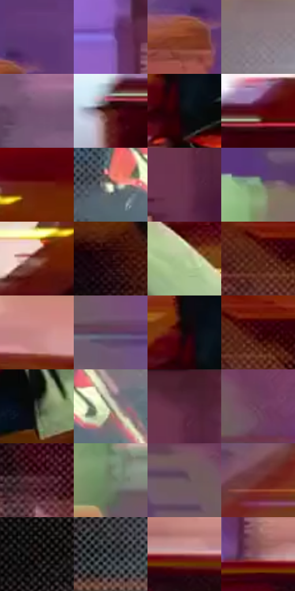

# 电影参考 576

- 状态：条件／活跃；来源世界：miles-home。
- 视角：near-level；景别：full-body；场景：street。
- 时段：night-appearance（外观依据，中置信度；具体时间／晨昏未知）；光照：night-mixed。
- 材质候选：fabric, brick, glass, asphalt, painted-metal, metal（帧级，不是像素分割）。
- 明暗组：dark；L* P5/P50/P95：3.36474 / 30.80244 / 77.86733。
- 资格门禁：motion。
- 原截图 SHA-256：`1fea412f85cdb687bd2c4562592b537054170afdfe262b84c4f9e9ca6cac5fc4`；尺寸：2880 × 1208。
- sRGB 像素 SHA-256：`d1434ac84ec37643fee41df9ed4848c28eca0926bf5dfbbab019b079494e32a2`。

## 观察与迁移

街道腾跃、车漆映色与原有动模糊，主角剪影保持稳定。

同动作换受光：衣服偏亮绿，短裤浅灰绿，对橙车红衣；底部白雾带粗网点，材质本色与灯色不可混淆。

本公开版保存32个128×128原像素色卡上下文；图集格子并非原场景相邻位置。原rect、图集tile和像素SHA见 `data/palette-crops.json`。上下文不足时不得批准替色，不能以小样推断完整构图。

## 实测色卡

颜色比例分母为保留采样像素，不是材料面积；全部 32 色参与全库匹配。表内四舍五入仅用于阅读，原精度在 JSON。

| ID | HEX | Lab | 原图 xy | 像素数 | 比例 | 明度角色 |
| --- | --- | --- | --- | ---: | ---: | --- |
| 576-S01 | #5E3774 | [30.334936, 29.30128, -28.367937] | [828, 436] | 11853 | 6.130460% | shadow |
| 576-S02 | #9271CF | [54.475783, 32.901984, -44.094932] | [1964, 196] | 9343 | 4.832270% | midtone |
| 576-S03 | #80381B | [32.914775, 29.188099, 32.187356] | [764, 512] | 9124 | 4.719001% | shadow |
| 576-S04 | #887883 | [52.18162, 8.220521, -3.729186] | [2600, 812] | 8307 | 4.296443% | midtone |
| 576-S05 | #765172 | [39.499089, 21.33654, -12.678698] | [1120, 400] | 7998 | 4.136626% | shadow |
| 576-S06 | #4C1C12 | [17.511824, 21.981777, 17.993169] | [100, 1028] | 7769 | 4.018185% | deep-shadow |
| 576-S07 | #0B0E12 | [3.874069, -0.141235, -2.383073] | [1448, 560] | 7491 | 3.874401% | deep-shadow |
| 576-S08 | #5C0610 | [17.66209, 36.756824, 20.139293] | [184, 984] | 7081 | 3.662346% | deep-shadow |
| 576-S09 | #6B1D11 | [23.822863, 33.910692, 27.29472] | [508, 784] | 6985 | 3.612694% | shadow |
| 576-S10 | #ECEAD5 | [92.346283, -2.881061, 10.444967] | [2268, 1052] | 6607 | 3.417190% | highlight |
| 576-S11 | #69324E | [28.992718, 28.263467, -5.816997] | [2716, 152] | 6336 | 3.277027% | shadow |
| 576-S12 | #829F7E | [62.548141, -16.642588, 13.965092] | [388, 268] | 6276 | 3.245994% | light |
| 576-S13 | #7F4A3F | [37.425603, 21.237797, 16.218568] | [408, 856] | 6159 | 3.185481% | shadow |
| 576-S14 | #24060A | [4.763426, 14.185878, 3.289057] | [1616, 884] | 6092 | 3.150828% | deep-shadow |
| 576-S15 | #B2CB98 | [78.719717, -17.476377, 22.727289] | [1792, 732] | 5990 | 3.098073% | light |
| 576-S16 | #5C2619 | [22.766193, 23.717486, 20.415085] | [2704, 472] | 5707 | 2.951703% | shadow |
| 576-S17 | #C68685 | [62.297503, 24.435432, 10.565366] | [2388, 280] | 5638 | 2.916016% | light |
| 576-S18 | #573F5D | [30.331513, 16.487604, -13.766202] | [576, 384] | 5165 | 2.671377% | shadow |
| 576-S19 | #0E0607 | [2.158589, 2.353327, 0.402008] | [1420, 508] | 5158 | 2.667756% | deep-shadow |
| 576-S20 | #3D0710 | [10.422236, 26.28317, 9.274193] | [2744, 460] | 5139 | 2.657929% | deep-shadow |
| 576-S21 | #474945 | [30.722428, -1.697233, 2.107453] | [1400, 760] | 4853 | 2.510008% | shadow |
| 576-S22 | #A3A891 | [67.899779, -5.948404, 11.29486] | [2384, 1032] | 4830 | 2.498112% | light |
| 576-S23 | #4B2231 | [19.482534, 21.382945, -0.832388] | [2732, 40] | 4821 | 2.493457% | deep-shadow |
| 576-S24 | #6A3C58 | [31.809207, 24.501127, -8.076341] | [564, 124] | 4796 | 2.480527% | shadow |
| 576-S25 | #5B2F3C | [25.514839, 21.7519, 0.755103] | [2396, 524] | 4663 | 2.411739% | shadow |
| 576-S26 | #6D7E64 | [50.795689, -11.449344, 12.119936] | [380, 540] | 4591 | 2.374500% | midtone |
| 576-S27 | #6C5763 | [39.421162, 10.858956, -3.635702] | [444, 96] | 4393 | 2.272093% | shadow |
| 576-S28 | #713232 | [29.470795, 27.836924, 13.441178] | [1168, 568] | 4388 | 2.269506% | shadow |
| 576-S29 | #1F1718 | [8.739677, 4.235625, 0.819156] | [1704, 1108] | 4217 | 2.181064% | deep-shadow |
| 576-S30 | #272D31 | [18.052853, -1.546775, -3.458111] | [2068, 1128] | 4077 | 2.108655% | deep-shadow |
| 576-S31 | #A9625E | [49.472466, 28.24152, 14.758662] | [2160, 312] | 4019 | 2.078657% | midtone |
| 576-S32 | #875868 | [42.959552, 21.826747, -1.145108] | [2040, 300] | 3480 | 1.799882% | midtone |

## 色阶与空间分布

- 采样 ROI：`[0.01, 0.02, 0.98, 0.94]`；步长：4；样本数：193346。
- 排除区：`[]`。
- 深暗、暗、中、亮、高光五段计数：`[47763, 78955, 37666, 20456, 8506]`。
- RGB 各 256 箱、L* 100 箱、13×5 色相明度表和 3×3 空间统计全部保存在 [总数据](../film-library.json)。
- [可视化档案](../../references/library.html)按需绘制直方图，不存 2,094 张重复图表图片。

## 纹理特征占比

**这是分块图像特征的面积占比，不是波点／排线／丝网／错版的精确语义覆盖率。** 窗格、发丝、织物也会产生方向或周期特征。
原图 ROI 像素 3104134；已测块覆盖 3104134（100.0000%）；未测 0。

| 特征 | 块覆盖像素 | 占已测面积 | 阈值敏感范围 |
| --- | ---: | ---: | --- |
| low-contrast | 60288 | 1.9422% | 1.5834% ~ 2.4700% |
| directional-structure | 1334790 | 43.0004% | 32.5349% ~ 53.0495% |
| periodic-structure | 1709056 | 55.0574% | 45.3671% ~ 63.5024% |
| mixed-detail | 0 | 0.0000% | 0.0000% ~ 1.4927% |

阈值敏感范围不是统计置信区间。逐块坐标、尺度、对比、方向一致性、频谱集中度、频率与角度见 [全量特征记录](../texture-features.jsonl)，以帧号定位。
四种印刷层的真实像素覆盖仍标为 `null`，不能填 0，也不能拿上表代替。不得据这些代理测量删除唯一证据。

[测量方法与保留策略](../../references/library-retention.md) · [分类索引](../archive/README.md)
