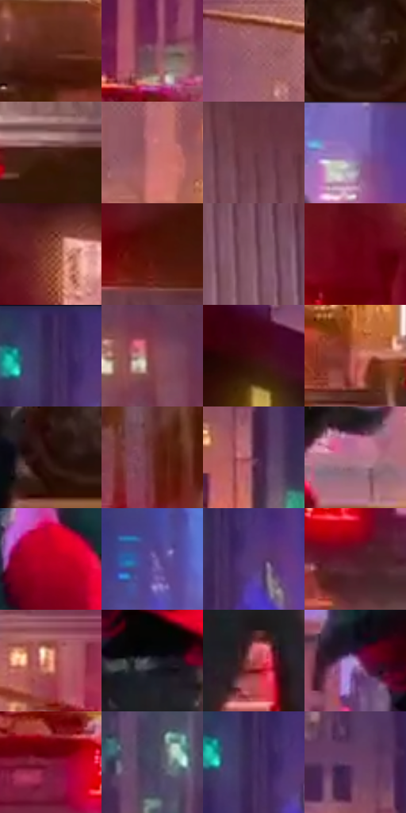

# 电影参考 577

- 状态：条件／活跃；来源世界：miles-home。
- 视角：low-angle；景别：environment-wide；场景：street。
- 时段：night-appearance（外观依据，中置信度；具体时间／晨昏未知）；光照：night-mixed。
- 材质候选：fabric, brick, glass, asphalt, painted-metal, metal（帧级，不是像素分割）。
- 明暗组：dark；L* P5/P50/P95：11.44099 / 31.1262 / 59.95442。
- 资格门禁：motion。
- 原截图 SHA-256：`f54273692d7b1ee088ba0d310097aae3f2127688734edf6c1f9661375551ce5a`；尺寸：2880 × 1212。
- sRGB 像素 SHA-256：`a166e516ce9ab286618ea985da7d55533cff120df0eaed25d93838b34b3c7533`。

## 观察与迁移

街道腾跃、车漆映色与原有动模糊，主角剪影保持稳定。

后方穿行：红帽集中、绿衣中调、右货车暖金、远楼蓝紫，车流红点居下；雾中点纹不等于路面颗粒。

本公开版保存32个128×128原像素色卡上下文；图集格子并非原场景相邻位置。原rect、图集tile和像素SHA见 `data/palette-crops.json`。上下文不足时不得批准替色，不能以小样推断完整构图。

## 实测色卡

颜色比例分母为保留采样像素，不是材料面积；全部 32 色参与全库匹配。表内四舍五入仅用于阅读，原精度在 JSON。

| ID | HEX | Lab | 原图 xy | 像素数 | 比例 | 明度角色 |
| --- | --- | --- | --- | ---: | ---: | --- |
| 577-S01 | #59271D | [22.528644, 22.114851, 17.416276] | [1936, 916] | 10004 | 5.155532% | shadow |
| 577-S02 | #7C4A5E | [37.827363, 24.148727, -2.660906] | [512, 668] | 9987 | 5.146771% | shadow |
| 577-S03 | #9D5F6B | [47.515003, 26.816428, 3.997792] | [1756, 264] | 8500 | 4.380450% | midtone |
| 577-S04 | #301A16 | [12.124652, 10.378649, 7.421377] | [1624, 980] | 8152 | 4.201109% | deep-shadow |
| 577-S05 | #431E14 | [16.3685, 16.818408, 14.948111] | [2416, 804] | 7642 | 3.938282% | deep-shadow |
| 577-S06 | #C27174 | [56.627576, 32.255664, 12.280622] | [1928, 480] | 7380 | 3.803261% | midtone |
| 577-S07 | #6A3B45 | [30.931443, 22.023651, 2.932238] | [2504, 424] | 7338 | 3.781617% | shadow |
| 577-S08 | #8767B3 | [49.624236, 28.606941, -35.741646] | [1544, 56] | 6989 | 3.601760% | midtone |
| 577-S09 | #86422E | [36.297028, 27.308062, 25.349583] | [132, 524] | 6856 | 3.533219% | shadow |
| 577-S10 | #52150B | [17.249224, 27.783438, 21.57975] | [2456, 288] | 6804 | 3.506421% | deep-shadow |
| 577-S11 | #895E6D | [44.841642, 19.902819, -1.402937] | [2692, 648] | 6789 | 3.498691% | midtone |
| 577-S12 | #6F061B | [22.266773, 42.820623, 19.453992] | [36, 636] | 6676 | 3.440457% | shadow |
| 577-S13 | #372753 | [19.588493, 18.494015, -24.235417] | [984, 44] | 6542 | 3.371400% | deep-shadow |
| 577-S14 | #8C464D | [38.713044, 30.381599, 9.568918] | [2112, 100] | 6034 | 3.109604% | shadow |
| 577-S15 | #410D12 | [12.323469, 25.279375, 10.878105] | [260, 308] | 6012 | 3.098266% | deep-shadow |
| 577-S16 | #BE6358 | [52.484808, 35.34778, 22.842956] | [2212, 792] | 5957 | 3.069922% | midtone |
| 577-S17 | #260D0A | [6.521258, 12.417864, 5.895995] | [1580, 1008] | 5853 | 3.016326% | deep-shadow |
| 577-S18 | #682F2D | [27.203494, 25.334327, 13.418586] | [2300, 132] | 5791 | 2.984375% | shadow |
| 577-S19 | #582943 | [23.8893, 25.257935, -6.41893] | [452, 332] | 5536 | 2.852961% | shadow |
| 577-S20 | #B1748C | [55.819424, 27.467312, -3.131199] | [1640, 628] | 5512 | 2.840593% | midtone |
| 577-S21 | #B60222 | [38.034255, 62.513963, 36.840573] | [1448, 268] | 5328 | 2.745769% | shadow |
| 577-S22 | #615099 | [38.860697, 24.705428, -37.627337] | [1188, 84] | 4964 | 2.558183% | shadow |
| 577-S23 | #563A76 | [30.187525, 25.557448, -29.92647] | [1036, 108] | 4845 | 2.496856% | shadow |
| 577-S24 | #531928 | [18.748247, 28.359342, 4.629078] | [452, 968] | 4842 | 2.495310% | deep-shadow |
| 577-S25 | #F09D83 | [72.416607, 28.071352, 26.373818] | [2112, 252] | 4786 | 2.466451% | light |
| 577-S26 | #272831 | [16.358384, 1.924306, -5.997961] | [1456, 688] | 4562 | 2.351013% | deep-shadow |
| 577-S27 | #AA494E | [44.036599, 40.276121, 17.005404] | [1460, 876] | 4467 | 2.302055% | midtone |
| 577-S28 | #B490C6 | [64.74562, 23.460274, -22.785439] | [1340, 620] | 4333 | 2.232999% | light |
| 577-S29 | #801C38 | [28.659809, 43.79475, 8.820027] | [152, 864] | 4183 | 2.155697% | shadow |
| 577-S30 | #48465F | [30.840754, 6.957803, -14.402795] | [828, 416] | 4170 | 2.148997% | shadow |
| 577-S31 | #412E5F | [23.351303, 20.460633, -26.14529] | [988, 84] | 3717 | 1.915545% | shadow |
| 577-S32 | #6B4068 | [33.546902, 25.547075, -15.638421] | [400, 204] | 3493 | 1.800107% | shadow |

## 色阶与空间分布

- 采样 ROI：`[0.01, 0.02, 0.98, 0.94]`；步长：4；样本数：194044。
- 排除区：`[]`。
- 深暗、暗、中、亮、高光五段计数：`[48630, 81221, 54529, 8944, 720]`。
- RGB 各 256 箱、L* 100 箱、13×5 色相明度表和 3×3 空间统计全部保存在 [总数据](../film-library.json)。
- [可视化档案](../../references/library.html)按需绘制直方图，不存 2,094 张重复图表图片。

## 纹理特征占比

**这是分块图像特征的面积占比，不是波点／排线／丝网／错版的精确语义覆盖率。** 窗格、发丝、织物也会产生方向或周期特征。
原图 ROI 像素 3115310；已测块覆盖 3115310（100.0000%）；未测 0。

| 特征 | 块覆盖像素 | 占已测面积 | 阈值敏感范围 |
| --- | ---: | ---: | --- |
| low-contrast | 79104 | 2.5392% | 0.0000% ~ 2.5392% |
| directional-structure | 993280 | 31.8838% | 22.3474% ~ 39.9657% |
| periodic-structure | 1928238 | 61.8955% | 60.0343% ~ 65.9509% |
| mixed-detail | 114688 | 3.6814% | 0.0000% ~ 9.1625% |

阈值敏感范围不是统计置信区间。逐块坐标、尺度、对比、方向一致性、频谱集中度、频率与角度见 [全量特征记录](../texture-features.jsonl)，以帧号定位。
四种印刷层的真实像素覆盖仍标为 `null`，不能填 0，也不能拿上表代替。不得据这些代理测量删除唯一证据。

[测量方法与保留策略](../../references/library-retention.md) · [分类索引](../archive/README.md)
