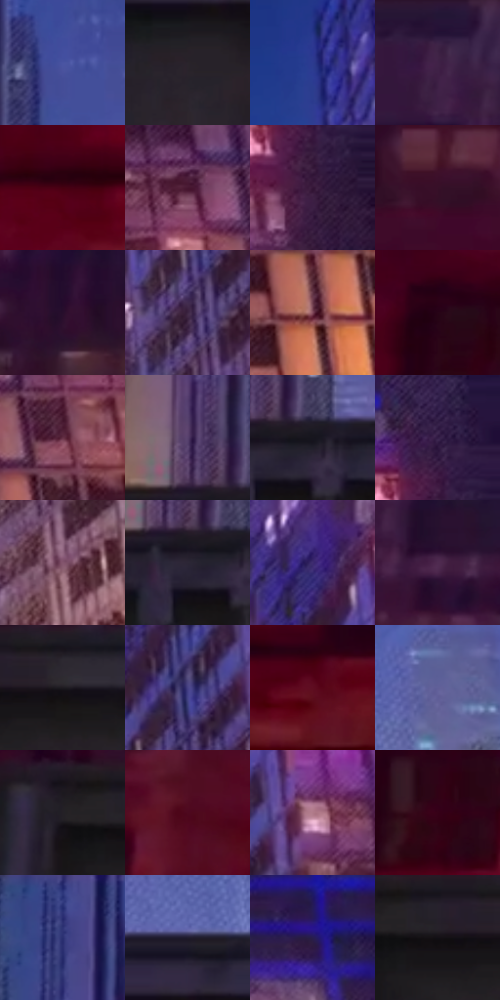

# 电影参考 578

- 状态：条件／活跃；来源世界：miles-home。
- 视角：low-angle；景别：environment-wide；场景：street。
- 时段：night-appearance（外观依据，中置信度；具体时间／晨昏未知）；光照：night-mixed。
- 材质候选：fabric, brick, glass, asphalt, painted-metal, metal（帧级，不是像素分割）。
- 明暗组：very-dark；L* P5/P50/P95：6.36573 / 16.13983 / 43.98013。
- 资格门禁：motion。
- 原截图 SHA-256：`382fdb2523818d51a1b003cb1b4f9e6f35ff987e8dea872d673e2f70d6bf5e59`；尺寸：2880 × 1202。
- sRGB 像素 SHA-256：`b9f5a4053d3addbb3c93195515302ce37a0124030c70904cc08ebbd5ba9dd3b3`。

## 观察与迁移

街道腾跃、车漆映色与原有动模糊，主角剪影保持稳定。

跃过货车：下方大暗车厢、上方蓝空隙托黑红人物；左墙暗红、右窗粉紫与暖底区分立面，窗格不平均锐化。

本公开版保存32个128×128原像素色卡上下文；图集格子并非原场景相邻位置。原rect、图集tile和像素SHA见 `data/palette-crops.json`。上下文不足时不得批准替色，不能以小样推断完整构图。

## 实测色卡

颜色比例分母为保留采样像素，不是材料面积；全部 32 色参与全库匹配。表内四舍五入仅用于阅读，原精度在 JSON。

| ID | HEX | Lab | 原图 xy | 像素数 | 比例 | 明度角色 |
| --- | --- | --- | --- | ---: | ---: | --- |
| 578-S01 | #4954A2 | [38.48926, 18.973593, -43.729226] | [1396, 364] | 10861 | 5.637743% | shadow |
| 578-S02 | #29232B | [14.667983, 4.722324, -4.260883] | [1656, 784] | 9692 | 5.030937% | deep-shadow |
| 578-S03 | #2C3B8E | [28.421073, 22.82784, -47.925171] | [2048, 132] | 9587 | 4.976434% | shadow |
| 578-S04 | #251236 | [9.737533, 18.393986, -19.894804] | [148, 28] | 9164 | 4.756862% | deep-shadow |
| 578-S05 | #470111 | [11.972293, 32.195504, 11.229074] | [420, 952] | 8371 | 4.345231% | deep-shadow |
| 578-S06 | #471730 | [16.335876, 25.987783, -4.87248] | [2596, 580] | 7713 | 4.003675% | deep-shadow |
| 578-S07 | #341537 | [12.874649, 21.692482, -15.494958] | [2816, 360] | 7029 | 3.648623% | deep-shadow |
| 578-S08 | #371027 | [11.480105, 22.453784, -5.943113] | [72, 408] | 6732 | 3.494456% | deep-shadow |
| 578-S09 | #260D2B | [7.898218, 18.945629, -14.723996] | [452, 308] | 6698 | 3.476807% | deep-shadow |
| 578-S10 | #3D2543 | [18.888136, 17.519241, -14.420379] | [2232, 696] | 6680 | 3.467464% | deep-shadow |
| 578-S11 | #7E4658 | [36.969481, 26.331863, -0.114842] | [2684, 840] | 6624 | 3.438395% | shadow |
| 578-S12 | #270317 | [5.044302, 19.721139, -3.664605] | [240, 756] | 6277 | 3.258274% | deep-shadow |
| 578-S13 | #663147 | [28.052572, 26.609947, -2.652531] | [2752, 672] | 6240 | 3.239068% | shadow |
| 578-S14 | #58426E | [32.026532, 19.068389, -21.970534] | [1276, 612] | 6148 | 3.191313% | shadow |
| 578-S15 | #17161E | [7.6753, 2.724226, -5.423446] | [1348, 680] | 6098 | 3.165359% | deep-shadow |
| 578-S16 | #331C45 | [15.297125, 20.5139, -21.538802] | [2812, 252] | 6030 | 3.130061% | deep-shadow |
| 578-S17 | #84556E | [42.044994, 23.437535, -6.216439] | [2284, 976] | 5811 | 3.016382% | midtone |
| 578-S18 | #2C2636 | [16.444589, 6.789266, -9.334127] | [1304, 696] | 5804 | 3.012749% | deep-shadow |
| 578-S19 | #3E2C70 | [23.655197, 26.04438, -36.704674] | [2240, 392] | 5774 | 2.997176% | shadow |
| 578-S20 | #4F2B50 | [23.570072, 23.255662, -15.757997] | [320, 240] | 5766 | 2.993024% | shadow |
| 578-S21 | #1E1A21 | [9.989201, 3.72918, -4.110653] | [1024, 724] | 5110 | 2.652506% | deep-shadow |
| 578-S22 | #474285 | [31.644681, 20.649164, -37.066645] | [2240, 552] | 5055 | 2.623957% | shadow |
| 578-S23 | #5F0D20 | [19.332207, 36.594681, 11.508248] | [620, 980] | 4759 | 2.470309% | deep-shadow |
| 578-S24 | #615F99 | [42.801065, 15.35855, -31.402525] | [1824, 552] | 4648 | 2.412691% | midtone |
| 578-S25 | #242026 | [12.910261, 3.365636, -3.343784] | [856, 712] | 4622 | 2.399194% | deep-shadow |
| 578-S26 | #4E081E | [14.885951, 32.634733, 6.286564] | [576, 708] | 4593 | 2.384141% | deep-shadow |
| 578-S27 | #B17B89 | [57.38659, 23.085751, 0.90656] | [2340, 516] | 4526 | 2.349363% | midtone |
| 578-S28 | #370118 | [8.13007, 28.055537, 0.494544] | [444, 808] | 3979 | 2.065425% | deep-shadow |
| 578-S29 | #24286C | [19.943241, 21.729513, -40.247748] | [1292, 44] | 3387 | 1.758129% | deep-shadow |
| 578-S30 | #1F1B2C | [10.971351, 6.643484, -10.722214] | [1688, 664] | 3178 | 1.649641% | deep-shadow |
| 578-S31 | #281D4F | [14.922029, 19.750224, -29.094704] | [2508, 180] | 3081 | 1.599290% | deep-shadow |
| 578-S32 | #131015 | [5.087109, 2.207679, -2.4849] | [932, 728] | 2611 | 1.355322% | deep-shadow |

## 色阶与空间分布

- 采样 ROI：`[0.01, 0.02, 0.98, 0.94]`；步长：4；样本数：192648。
- 排除区：`[]`。
- 深暗、暗、中、亮、高光五段计数：`[116160, 59157, 15814, 1426, 91]`。
- RGB 各 256 箱、L* 100 箱、13×5 色相明度表和 3×3 空间统计全部保存在 [总数据](../film-library.json)。
- [可视化档案](../../references/library.html)按需绘制直方图，不存 2,094 张重复图表图片。

## 纹理特征占比

**这是分块图像特征的面积占比，不是波点／排线／丝网／错版的精确语义覆盖率。** 窗格、发丝、织物也会产生方向或周期特征。
原图 ROI 像素 3087370；已测块覆盖 3087370（100.0000%）；未测 0。

| 特征 | 块覆盖像素 | 占已测面积 | 阈值敏感范围 |
| --- | ---: | ---: | --- |
| low-contrast | 270848 | 8.7728% | 5.2529% ~ 11.4262% |
| directional-structure | 564096 | 18.2711% | 6.9859% ~ 31.4841% |
| periodic-structure | 2072202 | 67.1187% | 61.1403% ~ 68.2712% |
| mixed-detail | 180224 | 5.8375% | 2.1227% ~ 13.3167% |

阈值敏感范围不是统计置信区间。逐块坐标、尺度、对比、方向一致性、频谱集中度、频率与角度见 [全量特征记录](../texture-features.jsonl)，以帧号定位。
四种印刷层的真实像素覆盖仍标为 `null`，不能填 0，也不能拿上表代替。不得据这些代理测量删除唯一证据。

[测量方法与保留策略](../../references/library-retention.md) · [分类索引](../archive/README.md)
