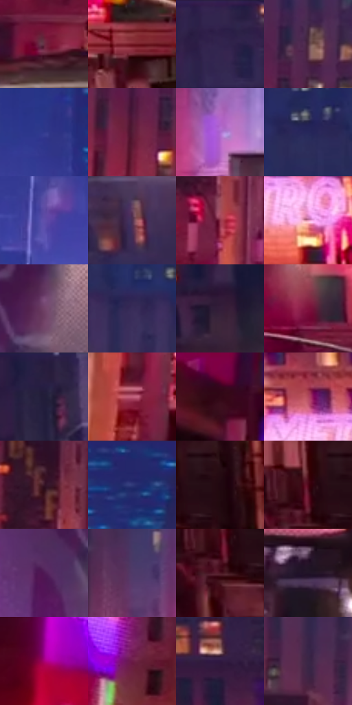

# 电影参考 579

- 状态：常规／活跃；来源世界：miles-home。
- 视角：near-level；景别：environment-wide；场景：city。
- 时段：night-appearance（外观依据，中置信度；具体时间／晨昏未知）；光照：night-mixed。
- 材质候选：skin, fabric, asphalt, glass, painted-metal, screen（帧级，不是像素分割）。
- 明暗组：dark；L* P5/P50/P95：8.71916 / 23.41843 / 58.66897。
- 资格门禁：无附加门禁。
- 原截图 SHA-256：`4718a3ef20375c19dda9ef07b101775b0670bc1af9963311bb9689d65db6be4d`；尺寸：2880 × 1208。
- sRGB 像素 SHA-256：`2e3049f1ac7ae7feb5c5958fa45ae2c2b03bb3ff80cf03b89eff9d591eec34e1`。

## 观察与迁移

暖霓虹街面和冷楼体，不将全图只保留一个蓝紫色族。

宽街景：左大粉广告、右暖窗与中央蓝紫深处构成分区，灰货厢为安静中间面；小人物不是亮度最高点。

本公开版保存32个128×128原像素色卡上下文；图集格子并非原场景相邻位置。原rect、图集tile和像素SHA见 `data/palette-crops.json`。上下文不足时不得批准替色，不能以小样推断完整构图。

## 实测色卡

颜色比例分母为保留采样像素，不是材料面积；全部 32 色参与全库匹配。表内四舍五入仅用于阅读，原精度在 JSON。

| ID | HEX | Lab | 原图 xy | 像素数 | 比例 | 明度角色 |
| --- | --- | --- | --- | ---: | ---: | --- |
| 579-S01 | #6A2C42 | [27.46202, 30.206432, -0.125753] | [900, 1000] | 9963 | 5.152938% | shadow |
| 579-S02 | #711722 | [24.44978, 39.205965, 17.491527] | [2552, 768] | 9343 | 4.832270% | shadow |
| 579-S03 | #33234C | [17.588046, 17.84967, -22.709631] | [1916, 56] | 9320 | 4.820374% | deep-shadow |
| 579-S04 | #4C2D3F | [22.904292, 17.329744, -5.373014] | [896, 480] | 8674 | 4.486258% | shadow |
| 579-S05 | #32398D | [28.185489, 24.804587, -47.6735] | [1472, 188] | 8067 | 4.172313% | shadow |
| 579-S06 | #541B36 | [19.783696, 29.466086, -3.705113] | [812, 580] | 7827 | 4.048183% | deep-shadow |
| 579-S07 | #AA68CD | [54.922526, 44.09663, -42.086409] | [1284, 756] | 7785 | 4.026460% | midtone |
| 579-S08 | #26275B | [18.444822, 16.478231, -31.505354] | [960, 104] | 7624 | 3.943190% | deep-shadow |
| 579-S09 | #604FAB | [39.611259, 30.304628, -47.18508] | [1404, 324] | 7441 | 3.848541% | shadow |
| 579-S10 | #4C3051 | [24.464214, 19.241524, -15.072047] | [2728, 168] | 7239 | 3.744065% | shadow |
| 579-S11 | #913349 | [35.732991, 41.475574, 8.04618] | [1040, 880] | 7205 | 3.726480% | shadow |
| 579-S12 | #EA9DBE | [73.106671, 33.288464, -5.202034] | [2292, 672] | 7007 | 3.624073% | light |
| 579-S13 | #714368 | [35.053209, 25.913546, -13.263656] | [604, 84] | 6686 | 3.458049% | shadow |
| 579-S14 | #382C59 | [21.443633, 17.23646, -25.282543] | [1072, 268] | 6539 | 3.382020% | shadow |
| 579-S15 | #341E3A | [15.298025, 16.594119, -13.836811] | [2500, 324] | 6513 | 3.368572% | deep-shadow |
| 579-S16 | #7F103C | [27.325416, 47.344072, 4.215302] | [1900, 716] | 6501 | 3.362366% | shadow |
| 579-S17 | #251E41 | [13.846916, 13.433076, -21.164746] | [2552, 52] | 6344 | 3.281164% | deep-shadow |
| 579-S18 | #BF5D78 | [52.134181, 42.116471, 3.4824] | [84, 1072] | 5606 | 2.899465% | midtone |
| 579-S19 | #330816 | [8.443023, 22.70571, 2.322746] | [124, 384] | 5517 | 2.853434% | deep-shadow |
| 579-S20 | #B1475E | [45.170881, 45.206427, 8.950023] | [2176, 584] | 5416 | 2.801196% | midtone |
| 579-S21 | #381627 | [12.992209, 19.319928, -3.648302] | [1016, 756] | 5369 | 2.776887% | deep-shadow |
| 579-S22 | #292F70 | [22.562463, 19.293347, -38.562838] | [1608, 60] | 5094 | 2.634655% | shadow |
| 579-S23 | #200710 | [4.485047, 12.013583, -0.071285] | [2640, 992] | 4784 | 2.474321% | deep-shadow |
| 579-S24 | #4D0518 | [14.132302, 32.905134, 9.660616] | [2564, 992] | 4385 | 2.267955% | deep-shadow |
| 579-S25 | #4F1954 | [20.035328, 34.146897, -23.983788] | [500, 172] | 3989 | 2.063141% | shadow |
| 579-S26 | #4F3A68 | [28.610765, 19.619515, -23.570537] | [1160, 608] | 3796 | 1.963320% | shadow |
| 579-S27 | #4E1725 | [17.303845, 27.154807, 4.585793] | [2556, 1048] | 3678 | 1.902289% | deep-shadow |
| 579-S28 | #211427 | [8.740221, 11.176705, -10.469586] | [1364, 1120] | 3363 | 1.739369% | deep-shadow |
| 579-S29 | #A90075 | [37.338129, 65.361752, -17.129762] | [280, 736] | 3363 | 1.739369% | shadow |
| 579-S30 | #6B1B47 | [24.844422, 39.287689, -7.350275] | [416, 736] | 3362 | 1.738852% | shadow |
| 579-S31 | #2F1741 | [13.222783, 21.387745, -22.085267] | [2016, 376] | 3005 | 1.554209% | deep-shadow |
| 579-S32 | #3B2646 | [19.048577, 16.874715, -16.24687] | [1040, 608] | 2541 | 1.314224% | deep-shadow |

## 色阶与空间分布

- 采样 ROI：`[0.01, 0.02, 0.98, 0.94]`；步长：4；样本数：193346。
- 排除区：`[]`。
- 深暗、暗、中、亮、高光五段计数：`[69274, 93094, 22076, 7513, 1389]`。
- RGB 各 256 箱、L* 100 箱、13×5 色相明度表和 3×3 空间统计全部保存在 [总数据](../film-library.json)。
- [可视化档案](../../references/library.html)按需绘制直方图，不存 2,094 张重复图表图片。

## 纹理特征占比

**这是分块图像特征的面积占比，不是波点／排线／丝网／错版的精确语义覆盖率。** 窗格、发丝、织物也会产生方向或周期特征。
原图 ROI 像素 3104134；已测块覆盖 3104134（100.0000%）；未测 0。

| 特征 | 块覆盖像素 | 占已测面积 | 阈值敏感范围 |
| --- | ---: | ---: | --- |
| low-contrast | 65536 | 2.1112% | 1.5834% ~ 5.8059% |
| directional-structure | 371584 | 11.9706% | 5.2781% ~ 23.6031% |
| periodic-structure | 2562822 | 82.5616% | 74.4547% ~ 82.5616% |
| mixed-detail | 104192 | 3.3566% | 0.3587% ~ 9.2615% |

阈值敏感范围不是统计置信区间。逐块坐标、尺度、对比、方向一致性、频谱集中度、频率与角度见 [全量特征记录](../texture-features.jsonl)，以帧号定位。
四种印刷层的真实像素覆盖仍标为 `null`，不能填 0，也不能拿上表代替。不得据这些代理测量删除唯一证据。

[测量方法与保留策略](../../references/library-retention.md) · [分类索引](../archive/README.md)
