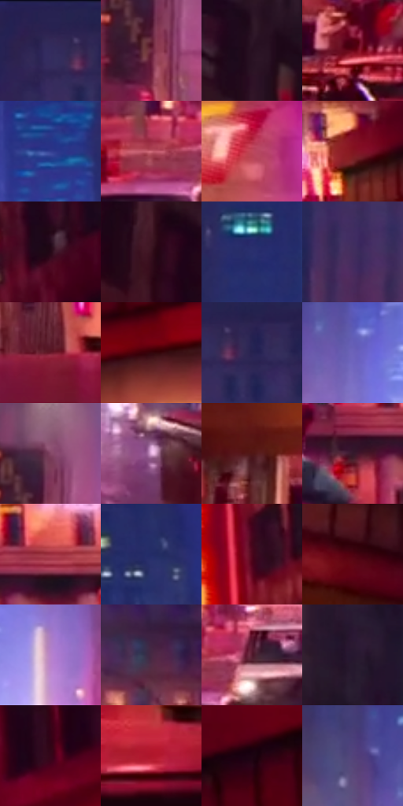

# 电影参考 580

- 状态：常规／活跃；来源世界：miles-home。
- 视角：near-level；景别：environment-wide；场景：city。
- 时段：night-appearance（外观依据，中置信度；具体时间／晨昏未知）；光照：night-mixed。
- 材质候选：skin, fabric, asphalt, glass, painted-metal, screen（帧级，不是像素分割）。
- 明暗组：dark；L* P5/P50/P95：5.84817 / 21.26819 / 63.23896。
- 资格门禁：无附加门禁。
- 原截图 SHA-256：`7b370b22f82289e76eddf253c558ea79487e9ad933210b2b578aa837c44548e0`；尺寸：2880 × 1202。
- sRGB 像素 SHA-256：`e33dbc9ebcfe41600e480d05960f58232e1fff4929df3045c430393264723675`。

## 观察与迁移

暖霓虹街面和冷楼体，不将全图只保留一个蓝紫色族。

霓虹街廊：红色近墙与蓝色中央深处，暖窗和白灯点串出距离；中上楼面窗纹稀疏，近招牌大字仍归建筑内容。

本公开版保存32个128×128原像素色卡上下文；图集格子并非原场景相邻位置。原rect、图集tile和像素SHA见 `data/palette-crops.json`。上下文不足时不得批准替色，不能以小样推断完整构图。

## 实测色卡

颜色比例分母为保留采样像素，不是材料面积；全部 32 色参与全库匹配。表内四舍五入仅用于阅读，原精度在 JSON。

| ID | HEX | Lab | 原图 xy | 像素数 | 比例 | 明度角色 |
| --- | --- | --- | --- | ---: | ---: | --- |
| 580-S01 | #322654 | [18.81848, 17.963258, -26.166446] | [1716, 48] | 9911 | 5.144616% | deep-shadow |
| 580-S02 | #6F2A42 | [27.925356, 33.092218, 0.65381] | [1068, 844] | 8466 | 4.394543% | shadow |
| 580-S03 | #260F20 | [7.750923, 15.040737, -6.639575] | [88, 100] | 8103 | 4.206117% | deep-shadow |
| 580-S04 | #6A0617 | [21.046115, 41.205795, 20.447521] | [788, 1088] | 7665 | 3.978759% | shadow |
| 580-S05 | #323D90 | [29.483974, 23.217948, -47.414542] | [1500, 288] | 7312 | 3.795523% | shadow |
| 580-S06 | #CD6777 | [56.10257, 41.902358, 10.010432] | [1024, 1088] | 7048 | 3.658486% | midtone |
| 580-S07 | #BD475A | [47.061644, 48.911897, 14.325038] | [2740, 872] | 6840 | 3.550517% | midtone |
| 580-S08 | #831620 | [28.127432, 45.118223, 24.143332] | [2108, 728] | 6793 | 3.526120% | shadow |
| 580-S09 | #260817 | [5.850606, 16.849587, -2.508101] | [2672, 228] | 6781 | 3.519891% | deep-shadow |
| 580-S10 | #38101E | [11.312445, 21.467452, 0.551362] | [92, 328] | 6775 | 3.516777% | deep-shadow |
| 580-S11 | #2A306F | [22.838828, 18.426001, -37.46974] | [848, 240] | 6704 | 3.479922% | shadow |
| 580-S12 | #422E5D | [23.346432, 20.20295, -24.833751] | [852, 464] | 6354 | 3.298243% | shadow |
| 580-S13 | #69192A | [23.22536, 36.352633, 10.117904] | [2088, 1016] | 6323 | 3.282152% | shadow |
| 580-S14 | #35050D | [8.081675, 24.216948, 7.220464] | [2628, 744] | 6299 | 3.269694% | deep-shadow |
| 580-S15 | #282351 | [16.733926, 16.228125, -27.538443] | [1780, 80] | 6260 | 3.249450% | deep-shadow |
| 580-S16 | #6C62BA | [46.268283, 26.05244, -45.281465] | [1284, 596] | 6234 | 3.235954% | midtone |
| 580-S17 | #834665 | [38.103484, 30.218856, -6.532561] | [1080, 752] | 6209 | 3.222977% | shadow |
| 580-S18 | #E4B1DE | [78.000984, 25.874066, -15.457802] | [1536, 1080] | 6001 | 3.115008% | light |
| 580-S19 | #511616 | [17.374479, 27.494353, 15.421261] | [668, 1012] | 5770 | 2.995100% | deep-shadow |
| 580-S20 | #36192B | [13.555956, 17.329681, -5.754847] | [1788, 864] | 5444 | 2.825879% | deep-shadow |
| 580-S21 | #9F3141 | [37.755033, 46.383749, 16.323492] | [1880, 816] | 5316 | 2.759437% | shadow |
| 580-S22 | #242B67 | [20.36818, 17.716177, -36.306643] | [1140, 80] | 5180 | 2.688842% | shadow |
| 580-S23 | #4D061D | [14.384941, 32.929025, 6.29649] | [2400, 352] | 5149 | 2.672750% | deep-shadow |
| 580-S24 | #4E0310 | [13.959373, 33.456866, 14.763334] | [188, 692] | 5029 | 2.610461% | deep-shadow |
| 580-S25 | #B883CA | [62.243262, 32.828912, -28.842086] | [1508, 768] | 5006 | 2.598522% | light |
| 580-S26 | #472943 | [21.323176, 18.716534, -10.552584] | [1988, 572] | 4891 | 2.538827% | shadow |
| 580-S27 | #52192C | [18.676823, 28.445528, 1.665726] | [1116, 1080] | 4841 | 2.512873% | deep-shadow |
| 580-S28 | #271730 | [10.975277, 13.880483, -13.559407] | [624, 216] | 4613 | 2.394523% | deep-shadow |
| 580-S29 | #35061A | [8.670174, 24.930397, -0.332166] | [2712, 404] | 4364 | 2.265271% | deep-shadow |
| 580-S30 | #B0162B | [37.808881, 58.506208, 30.858062] | [2468, 1072] | 4250 | 2.206096% | shadow |
| 580-S31 | #1C0412 | [3.409392, 11.173053, -2.871128] | [2676, 584] | 3885 | 2.016631% | deep-shadow |
| 580-S32 | #53427B | [32.180231, 20.975977, -29.929329] | [1180, 516] | 2832 | 1.470039% | shadow |

## 色阶与空间分布

- 采样 ROI：`[0.01, 0.02, 0.98, 0.94]`；步长：4；样本数：192648。
- 排除区：`[]`。
- 深暗、暗、中、亮、高光五段计数：`[86878, 71340, 22688, 9849, 1893]`。
- RGB 各 256 箱、L* 100 箱、13×5 色相明度表和 3×3 空间统计全部保存在 [总数据](../film-library.json)。
- [可视化档案](../../references/library.html)按需绘制直方图，不存 2,094 张重复图表图片。

## 纹理特征占比

**这是分块图像特征的面积占比，不是波点／排线／丝网／错版的精确语义覆盖率。** 窗格、发丝、织物也会产生方向或周期特征。
原图 ROI 像素 3087370；已测块覆盖 3087370（100.0000%）；未测 0。

| 特征 | 块覆盖像素 | 占已测面积 | 阈值敏感范围 |
| --- | ---: | ---: | --- |
| low-contrast | 81920 | 2.6534% | 1.0614% ~ 4.2454% |
| directional-structure | 341642 | 11.0658% | 5.6181% ~ 24.6271% |
| periodic-structure | 2541568 | 82.3215% | 73.3414% ~ 82.3215% |
| mixed-detail | 122240 | 3.9594% | 0.9701% ~ 10.3275% |

阈值敏感范围不是统计置信区间。逐块坐标、尺度、对比、方向一致性、频谱集中度、频率与角度见 [全量特征记录](../texture-features.jsonl)，以帧号定位。
四种印刷层的真实像素覆盖仍标为 `null`，不能填 0，也不能拿上表代替。不得据这些代理测量删除唯一证据。

[测量方法与保留策略](../../references/library-retention.md) · [分类索引](../archive/README.md)
