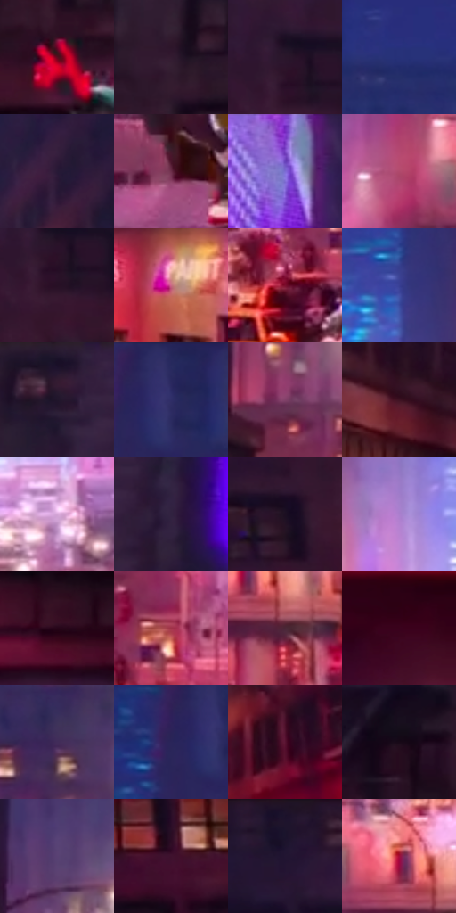

# 电影参考 581

- 状态：条件／活跃；来源世界：miles-home。
- 视角：near-level；景别：environment-wide；场景：street。
- 时段：night-appearance（外观依据，中置信度；具体时间／晨昏未知）；光照：night-mixed。
- 材质候选：fabric, brick, glass, asphalt, painted-metal, metal（帧级，不是像素分割）。
- 明暗组：dark；L* P5/P50/P95：6.27498 / 20.40839 / 61.24155。
- 资格门禁：motion。
- 原截图 SHA-256：`f25851fc87ee3fa98db622750918be546d7d92e7c21e5d8d2e68aaac3605459b`；尺寸：2880 × 1210。
- sRGB 像素 SHA-256：`65942ad0f9999302675418cc8c85029f4cc966ad677bd5c666d1b2dca27fab54`。

## 观察与迁移

街道腾跃、车漆映色与原有动模糊，主角剪影保持稳定。

落到车顶：浅紫车顶托暗人体、白眼和红帽，街廊暖红、远处蓝；足底接触暗部使人物落地，纹理不能抹平接触。

本公开版保存32个128×128原像素色卡上下文；图集格子并非原场景相邻位置。原rect、图集tile和像素SHA见 `data/palette-crops.json`。上下文不足时不得批准替色，不能以小样推断完整构图。

## 实测色卡

颜色比例分母为保留采样像素，不是材料面积；全部 32 色参与全库匹配。表内四舍五入仅用于阅读，原精度在 JSON。

| ID | HEX | Lab | 原图 xy | 像素数 | 比例 | 明度角色 |
| --- | --- | --- | --- | ---: | ---: | --- |
| 581-S01 | #5D0C1D | [18.711843, 36.062815, 12.73872] | [368, 676] | 10206 | 5.259632% | deep-shadow |
| 581-S02 | #331B31 | [13.882442, 16.057939, -9.634923] | [368, 488] | 9229 | 4.756138% | deep-shadow |
| 581-S03 | #2A162B | [10.853093, 14.439737, -10.056365] | [2788, 140] | 8297 | 4.275834% | deep-shadow |
| 581-S04 | #273178 | [23.616703, 20.545192, -41.972214] | [1220, 100] | 8130 | 4.189771% | shadow |
| 581-S05 | #281936 | [12.042046, 14.550089, -16.2109] | [2112, 220] | 8091 | 4.169673% | deep-shadow |
| 581-S06 | #6C2D49 | [28.23878, 31.37114, -3.592749] | [660, 1012] | 8089 | 4.168642% | shadow |
| 581-S07 | #7353C6 | [44.100254, 40.081396, -55.682059] | [924, 56] | 7883 | 4.062481% | midtone |
| 581-S08 | #B1486C | [45.725757, 46.224242, 1.165964] | [1720, 816] | 7589 | 3.910969% | midtone |
| 581-S09 | #271025 | [8.442616, 15.907488, -9.356393] | [2800, 188] | 7440 | 3.834182% | deep-shadow |
| 581-S10 | #C96883 | [56.047442, 41.352709, 2.828617] | [2112, 964] | 7268 | 3.745542% | midtone |
| 581-S11 | #7B102E | [26.098839, 45.142856, 11.905007] | [1144, 1072] | 7126 | 3.672363% | shadow |
| 581-S12 | #383F94 | [30.719332, 24.403335, -47.845463] | [1640, 460] | 6477 | 3.337903% | shadow |
| 581-S13 | #231630 | [10.141766, 13.108492, -14.906589] | [564, 32] | 6359 | 3.277092% | deep-shadow |
| 581-S14 | #2F2E68 | [22.150916, 18.386738, -34.037002] | [1772, 64] | 6287 | 3.239987% | shadow |
| 581-S15 | #814169 | [36.871199, 32.940526, -10.923379] | [1096, 788] | 6158 | 3.173507% | shadow |
| 581-S16 | #3C1221 | [12.62919, 22.351436, 0.326342] | [872, 748] | 6094 | 3.140525% | deep-shadow |
| 581-S17 | #DAACDD | [75.842839, 25.067183, -18.263786] | [1576, 1004] | 6015 | 3.099812% | light |
| 581-S18 | #30223F | [16.161771, 13.704935, -16.030067] | [680, 112] | 5872 | 3.026118% | deep-shadow |
| 581-S19 | #1C0F22 | [6.359456, 10.885878, -10.430367] | [2684, 276] | 5630 | 2.901404% | deep-shadow |
| 581-S20 | #AA7ECD | [59.77624, 31.947775, -34.473043] | [1380, 748] | 5435 | 2.800911% | midtone |
| 581-S21 | #270618 | [5.669428, 18.543268, -3.511231] | [184, 800] | 5412 | 2.789058% | deep-shadow |
| 581-S22 | #9F3248 | [38.060764, 46.519515, 12.301021] | [1228, 992] | 5007 | 2.580343% | shadow |
| 581-S23 | #4A2735 | [20.68993, 18.513753, -1.853791] | [1892, 884] | 4987 | 2.570036% | shadow |
| 581-S24 | #3A021B | [9.176283, 28.700834, -0.224095] | [2684, 896] | 4950 | 2.550968% | deep-shadow |
| 581-S25 | #422C5A | [22.646004, 20.674162, -23.96627] | [1880, 580] | 4821 | 2.484488% | shadow |
| 581-S26 | #292559 | [17.988988, 17.894525, -30.89375] | [1716, 80] | 4820 | 2.483973% | deep-shadow |
| 581-S27 | #571231 | [18.718858, 33.890946, -1.697814] | [2164, 692] | 4585 | 2.362866% | deep-shadow |
| 581-S28 | #180918 | [4.114837, 8.448528, -6.038333] | [240, 548] | 3867 | 1.992847% | deep-shadow |
| 581-S29 | #594174 | [32.180409, 21.578318, -25.50162] | [1096, 580] | 3641 | 1.876379% | shadow |
| 581-S30 | #3F112E | [13.562295, 25.953414, -7.774265] | [2616, 476] | 3595 | 1.852673% | deep-shadow |
| 581-S31 | #1B142C | [8.263559, 10.421868, -14.995011] | [2592, 36] | 2844 | 1.465647% | deep-shadow |
| 581-S32 | #A30D39 | [34.746403, 57.275489, 17.615975] | [1844, 816] | 1840 | 0.948239% | shadow |

## 色阶与空间分布

- 采样 ROI：`[0.01, 0.02, 0.98, 0.94]`；步长：4；样本数：194044。
- 排除区：`[]`。
- 深暗、暗、中、亮、高光五段计数：`[95365, 63436, 24783, 8786, 1674]`。
- RGB 各 256 箱、L* 100 箱、13×5 色相明度表和 3×3 空间统计全部保存在 [总数据](../film-library.json)。
- [可视化档案](../../references/library.html)按需绘制直方图，不存 2,094 张重复图表图片。

## 纹理特征占比

**这是分块图像特征的面积占比，不是波点／排线／丝网／错版的精确语义覆盖率。** 窗格、发丝、织物也会产生方向或周期特征。
原图 ROI 像素 3109722；已测块覆盖 3109722（100.0000%）；未测 0。

| 特征 | 块覆盖像素 | 占已测面积 | 阈值敏感范围 |
| --- | ---: | ---: | --- |
| low-contrast | 196608 | 6.3224% | 4.2149% ~ 8.9567% |
| directional-structure | 474496 | 15.2585% | 3.5975% ~ 23.5730% |
| periodic-structure | 2299520 | 73.9462% | 70.8825% ~ 79.0090% |
| mixed-detail | 139098 | 4.4730% | 1.3295% ~ 8.4368% |

阈值敏感范围不是统计置信区间。逐块坐标、尺度、对比、方向一致性、频谱集中度、频率与角度见 [全量特征记录](../texture-features.jsonl)，以帧号定位。
四种印刷层的真实像素覆盖仍标为 `null`，不能填 0，也不能拿上表代替。不得据这些代理测量删除唯一证据。

[测量方法与保留策略](../../references/library-retention.md) · [分类索引](../archive/README.md)
