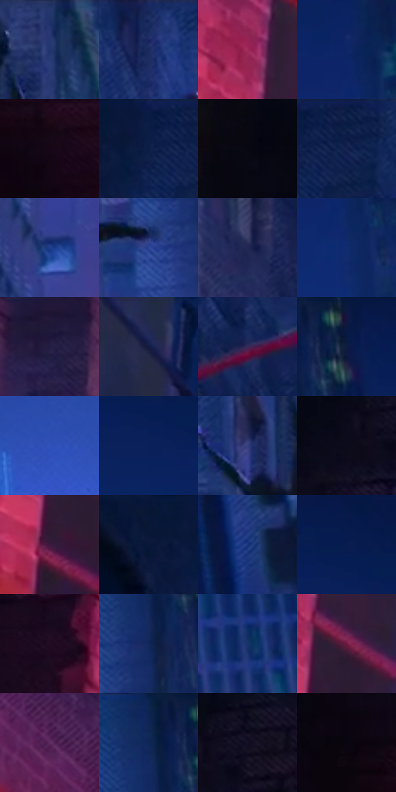

# 电影参考 582

- 状态：条件／活跃；来源世界：miles-home。
- 视角：low-angle；景别：environment-wide；场景：street。
- 时段：night-appearance（外观依据，中置信度；具体时间／晨昏未知）；光照：night-mixed。
- 材质候选：fabric, brick, glass, asphalt, painted-metal, metal（帧级，不是像素分割）。
- 明暗组：very-dark；L* P5/P50/P95：2.32185 / 16.85461 / 35.63687。
- 资格门禁：motion。
- 原截图 SHA-256：`295092af19a4eadb3b37603339a15b893adc8243062c22c4d1e082086157988f`；尺寸：2880 × 1212。
- sRGB 像素 SHA-256：`bbdcac316569a07751a5e1fa6f0dfb22ee74267b43f0dfc15fcd08eb392c4f89`。

## 观察与迁移

街道腾跃、车漆映色与原有动模糊，主角剪影保持稳定。

墙面跃起：左近砖墙局部洋红受光，主体墙体冷蓝、楼间蓝空隙；红旗杆是实体斜线，砖缝与斜排线分开。

本公开版保存32个128×128原像素色卡上下文；图集格子并非原场景相邻位置。原rect、图集tile和像素SHA见 `data/palette-crops.json`。上下文不足时不得批准替色，不能以小样推断完整构图。

## 实测色卡

颜色比例分母为保留采样像素，不是材料面积；全部 32 色参与全库匹配。表内四舍五入仅用于阅读，原精度在 JSON。

| ID | HEX | Lab | 原图 xy | 像素数 | 比例 | 明度角色 |
| --- | --- | --- | --- | ---: | ---: | --- |
| 582-S01 | #263772 | [24.823863, 13.866022, -36.203798] | [1580, 56] | 8728 | 4.497949% | shadow |
| 582-S02 | #1D2C61 | [19.742045, 13.295779, -33.412767] | [1324, 60] | 8481 | 4.370658% | deep-shadow |
| 582-S03 | #9F2B5A | [37.551758, 50.932914, 0.113218] | [616, 788] | 8195 | 4.223269% | shadow |
| 582-S04 | #0D2664 | [17.420399, 16.69385, -39.186812] | [2224, 284] | 8092 | 4.170188% | deep-shadow |
| 582-S05 | #160616 | [3.240784, 8.184278, -5.849525] | [244, 872] | 7912 | 4.077426% | deep-shadow |
| 582-S06 | #0B1E46 | [12.232338, 9.255258, -27.350498] | [988, 56] | 7884 | 4.062996% | deep-shadow |
| 582-S07 | #080712 | [2.233337, 2.059003, -4.800074] | [180, 80] | 7841 | 4.040836% | deep-shadow |
| 582-S08 | #12204E | [13.893561, 12.3472, -30.162806] | [1052, 56] | 7661 | 3.948074% | deep-shadow |
| 582-S09 | #1F3D8A | [28.014819, 18.044882, -46.142902] | [1696, 872] | 7298 | 3.761003% | shadow |
| 582-S10 | #2E4595 | [31.820647, 19.016754, -46.702599] | [1728, 296] | 7051 | 3.633712% | shadow |
| 582-S11 | #212752 | [17.382552, 11.900368, -27.207335] | [1288, 996] | 7016 | 3.615675% | deep-shadow |
| 582-S12 | #102D70 | [20.658955, 16.991403, -41.713879] | [2244, 392] | 6522 | 3.361093% | shadow |
| 582-S13 | #241D42 | [13.513936, 14.190098, -22.401164] | [1004, 944] | 6469 | 3.333780% | deep-shadow |
| 582-S14 | #141B42 | [11.454552, 11.475477, -25.785498] | [764, 288] | 6190 | 3.189998% | deep-shadow |
| 582-S15 | #3A2857 | [20.460239, 19.941692, -25.502873] | [1328, 556] | 6075 | 3.130733% | shadow |
| 582-S16 | #0A1940 | [10.028912, 10.30781, -26.711354] | [1868, 40] | 5885 | 3.032817% | deep-shadow |
| 582-S17 | #3254BC | [38.981019, 24.268528, -58.369642] | [2188, 908] | 5686 | 2.930263% | shadow |
| 582-S18 | #092159 | [14.7716, 15.242001, -36.20544] | [2124, 172] | 5579 | 2.875121% | deep-shadow |
| 582-S19 | #36407E | [29.303287, 15.492394, -36.534177] | [1472, 156] | 5550 | 2.860176% | shadow |
| 582-S20 | #0C0B19 | [3.501851, 3.204292, -7.846995] | [344, 136] | 5505 | 2.836985% | deep-shadow |
| 582-S21 | #3B193C | [15.230339, 22.815071, -15.272761] | [636, 996] | 5447 | 2.807095% | deep-shadow |
| 582-S22 | #091738 | [8.621583, 8.075363, -23.279535] | [896, 40] | 5343 | 2.753499% | deep-shadow |
| 582-S23 | #17347D | [24.058086, 18.133836, -44.458657] | [2584, 76] | 5301 | 2.731855% | shadow |
| 582-S24 | #091D4F | [12.614718, 13.835593, -32.943723] | [2128, 104] | 5022 | 2.588073% | deep-shadow |
| 582-S25 | #230D23 | [6.924392, 15.653394, -10.241454] | [412, 676] | 4692 | 2.418008% | deep-shadow |
| 582-S26 | #11295A | [17.658226, 10.597643, -32.175087] | [1792, 168] | 4681 | 2.412339% | deep-shadow |
| 582-S27 | #17346A | [22.577799, 10.229002, -34.722643] | [2500, 928] | 4584 | 2.362351% | shadow |
| 582-S28 | #6E1A40 | [25.029016, 39.73915, -2.268073] | [676, 904] | 4410 | 2.272680% | shadow |
| 582-S29 | #5D2C60 | [26.65874, 30.831071, -21.335021] | [752, 604] | 4013 | 2.068088% | shadow |
| 582-S30 | #102454 | [15.548506, 11.596071, -31.565043] | [1784, 40] | 4012 | 2.067572% | deep-shadow |
| 582-S31 | #130F24 | [5.486976, 7.387985, -13.386818] | [420, 100] | 3984 | 2.053143% | deep-shadow |
| 582-S32 | #0A050F | [1.874885, 2.800483, -3.602712] | [124, 780] | 2935 | 1.512544% | deep-shadow |

## 色阶与空间分布

- 采样 ROI：`[0.01, 0.02, 0.98, 0.94]`；步长：4；样本数：194044。
- 排除区：`[]`。
- 深暗、暗、中、亮、高光五段计数：`[122012, 67535, 4479, 18, 0]`。
- RGB 各 256 箱、L* 100 箱、13×5 色相明度表和 3×3 空间统计全部保存在 [总数据](../film-library.json)。
- [可视化档案](../../references/library.html)按需绘制直方图，不存 2,094 张重复图表图片。

## 纹理特征占比

**这是分块图像特征的面积占比，不是波点／排线／丝网／错版的精确语义覆盖率。** 窗格、发丝、织物也会产生方向或周期特征。
原图 ROI 像素 3115310；已测块覆盖 3115310（100.0000%）；未测 0。

| 特征 | 块覆盖像素 | 占已测面积 | 阈值敏感范围 |
| --- | ---: | ---: | --- |
| low-contrast | 498432 | 15.9994% | 13.3698% ~ 19.4385% |
| directional-structure | 241024 | 7.7368% | 1.9517% ~ 17.3348% |
| periodic-structure | 2293934 | 73.6342% | 67.7176% ~ 73.6342% |
| mixed-detail | 81920 | 2.6296% | 1.5778% ~ 9.8404% |

阈值敏感范围不是统计置信区间。逐块坐标、尺度、对比、方向一致性、频谱集中度、频率与角度见 [全量特征记录](../texture-features.jsonl)，以帧号定位。
四种印刷层的真实像素覆盖仍标为 `null`，不能填 0，也不能拿上表代替。不得据这些代理测量删除唯一证据。

[测量方法与保留策略](../../references/library-retention.md) · [分类索引](../archive/README.md)
