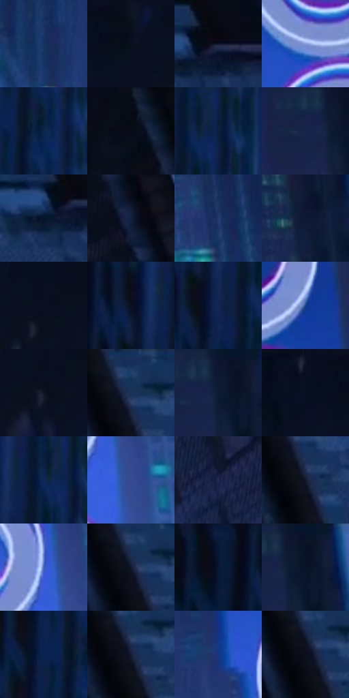

# 电影参考 583

- 状态：条件／活跃；来源世界：miles-home。
- 视角：low-angle；景别：environment-wide；场景：city。
- 时段：night-appearance（外观依据，中置信度；具体时间／晨昏未知）；光照：night-mixed。
- 材质候选：fabric, brick, glass, sky（帧级，不是像素分割）。
- 明暗组：very-dark；L* P5/P50/P95：3.9711 / 11.7737 / 43.74986。
- 资格门禁：caption。
- 原截图 SHA-256：`0e61ae227973c0268f1e1f3b5c1c82be885149578074bbee99d2e6a03038b12d`；尺寸：2880 × 1208。
- sRGB 像素 SHA-256：`1b79c40efdb63c28dab5aa471be2211c15aa8c0cb9a92f6505b490ff11bec54d`。

## 观察与迁移

楼间运动拟声字与实体立面分开，不默认增加文字。

蓝色楼巷巨字：白字及青红边占高明度，建筑保持低亮；拟声字会影响直方图，不误当楼体灯光，也不默认移植。

本公开版保存32个128×128原像素色卡上下文；图集格子并非原场景相邻位置。原rect、图集tile和像素SHA见 `data/palette-crops.json`。上下文不足时不得批准替色，不能以小样推断完整构图。

## 实测色卡

颜色比例分母为保留采样像素，不是材料面积；全部 32 色参与全库匹配。表内四舍五入仅用于阅读，原精度在 JSON。

| ID | HEX | Lab | 原图 xy | 像素数 | 比例 | 明度角色 |
| --- | --- | --- | --- | ---: | ---: | --- |
| 583-S01 | #183466 | [22.334241, 8.711611, -32.52101] | [548, 1012] | 9954 | 5.148283% | shadow |
| 583-S02 | #0A0F1D | [4.469944, 1.939275, -9.586407] | [1684, 44] | 8452 | 4.371438% | deep-shadow |
| 583-S03 | #0E1428 | [6.745897, 4.27193, -14.487482] | [2812, 76] | 8272 | 4.278340% | deep-shadow |
| 583-S04 | #879BDA | [64.686819, 8.407246, -34.313536] | [820, 864] | 7818 | 4.043528% | light |
| 583-S05 | #0A2448 | [14.366288, 5.407376, -25.301053] | [308, 344] | 7562 | 3.911123% | deep-shadow |
| 583-S06 | #060A15 | [2.799491, 0.99865, -5.933438] | [2400, 36] | 7114 | 3.679414% | deep-shadow |
| 583-S07 | #0B1E3F | [11.6779, 6.089921, -23.343401] | [340, 64] | 7113 | 3.678897% | deep-shadow |
| 583-S08 | #17264A | [15.812229, 7.121089, -24.324107] | [1016, 76] | 7108 | 3.676311% | deep-shadow |
| 583-S09 | #09162E | [7.488788, 4.240714, -17.802446] | [2764, 104] | 6703 | 3.466842% | deep-shadow |
| 583-S10 | #15203E | [12.86075, 6.229243, -20.715266] | [2692, 712] | 6558 | 3.391847% | deep-shadow |
| 583-S11 | #243A6E | [25.340618, 9.825564, -32.825238] | [1160, 876] | 6433 | 3.327196% | shadow |
| 583-S12 | #0D1A36 | [9.724231, 5.57651, -20.054055] | [1092, 312] | 6411 | 3.315817% | deep-shadow |
| 583-S13 | #0B1020 | [4.931724, 2.661816, -11.215434] | [1780, 76] | 6384 | 3.301853% | deep-shadow |
| 583-S14 | #0A1123 | [5.299828, 2.916986, -12.965309] | [220, 80] | 6295 | 3.255821% | deep-shadow |
| 583-S15 | #152A56 | [17.85933, 8.774389, -29.170748] | [248, 180] | 6100 | 3.154966% | deep-shadow |
| 583-S16 | #194492 | [30.436673, 15.759368, -47.151934] | [924, 556] | 6069 | 3.138932% | shadow |
| 583-S17 | #101424 | [6.664487, 3.313981, -11.585427] | [1768, 104] | 5965 | 3.085143% | deep-shadow |
| 583-S18 | #11325A | [20.58891, 4.015617, -27.469619] | [2616, 44] | 5595 | 2.893776% | shadow |
| 583-S19 | #0E1730 | [8.301641, 5.566501, -17.959775] | [1052, 28] | 5506 | 2.847744% | deep-shadow |
| 583-S20 | #080F21 | [4.543812, 2.754838, -12.59651] | [1588, 40] | 5398 | 2.791886% | deep-shadow |
| 583-S21 | #0D2759 | [16.784449, 11.133961, -32.928405] | [304, 72] | 5397 | 2.791369% | deep-shadow |
| 583-S22 | #344B92 | [33.640268, 14.924929, -41.926285] | [1044, 1124] | 5389 | 2.787231% | shadow |
| 583-S23 | #202A4F | [18.041558, 8.320119, -24.133956] | [1888, 964] | 5236 | 2.708098% | deep-shadow |
| 583-S24 | #131A30 | [9.724077, 4.608978, -15.67836] | [2632, 140] | 5181 | 2.679652% | deep-shadow |
| 583-S25 | #415DBE | [42.259552, 21.373015, -54.19738] | [1000, 1036] | 5028 | 2.600519% | midtone |
| 583-S26 | #10182C | [8.526314, 3.65265, -14.650366] | [2604, 76] | 4997 | 2.584486% | deep-shadow |
| 583-S27 | #071A37 | [9.478796, 4.840668, -21.185415] | [120, 40] | 4995 | 2.583451% | deep-shadow |
| 583-S28 | #0A1225 | [5.696647, 3.107264, -13.877363] | [1076, 36] | 4733 | 2.447943% | deep-shadow |
| 583-S29 | #0B2250 | [14.367351, 10.674445, -30.775967] | [240, 332] | 4267 | 2.206924% | deep-shadow |
| 583-S30 | #161D36 | [11.383721, 5.568537, -17.375684] | [2616, 100] | 4015 | 2.076588% | deep-shadow |
| 583-S31 | #153583 | [24.776111, 19.692068, -47.065891] | [704, 988] | 3818 | 1.974698% | shadow |
| 583-S32 | #0C0F1A | [4.465574, 1.595387, -7.225438] | [2600, 92] | 3480 | 1.799882% | deep-shadow |

## 色阶与空间分布

- 采样 ROI：`[0.01, 0.02, 0.98, 0.94]`；步长：4；样本数：193346。
- 排除区：`[]`。
- 深暗、暗、中、亮、高光五段计数：`[146295, 35415, 7619, 3069, 948]`。
- RGB 各 256 箱、L* 100 箱、13×5 色相明度表和 3×3 空间统计全部保存在 [总数据](../film-library.json)。
- [可视化档案](../../references/library.html)按需绘制直方图，不存 2,094 张重复图表图片。

## 纹理特征占比

**这是分块图像特征的面积占比，不是波点／排线／丝网／错版的精确语义覆盖率。** 窗格、发丝、织物也会产生方向或周期特征。
原图 ROI 像素 3104134；已测块覆盖 3104134（100.0000%）；未测 0。

| 特征 | 块覆盖像素 | 占已测面积 | 阈值敏感范围 |
| --- | ---: | ---: | --- |
| low-contrast | 311296 | 10.0284% | 6.8616% ~ 16.3622% |
| directional-structure | 986112 | 31.7677% | 6.6925% ~ 55.6388% |
| periodic-structure | 1768070 | 56.9586% | 37.4996% ~ 73.5888% |
| mixed-detail | 38656 | 1.2453% | 0.0000% ~ 3.3566% |

阈值敏感范围不是统计置信区间。逐块坐标、尺度、对比、方向一致性、频谱集中度、频率与角度见 [全量特征记录](../texture-features.jsonl)，以帧号定位。
四种印刷层的真实像素覆盖仍标为 `null`，不能填 0，也不能拿上表代替。不得据这些代理测量删除唯一证据。

[测量方法与保留策略](../../references/library-retention.md) · [分类索引](../archive/README.md)
