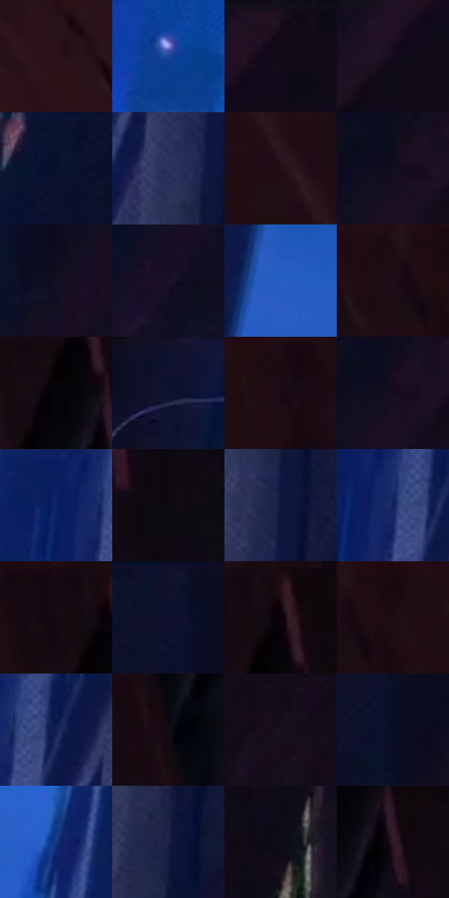

# 电影参考 584

- 状态：条件／活跃；来源世界：miles-home。
- 视角：low-angle；景别：environment-wide；场景：street。
- 时段：night-appearance（外观依据，中置信度；具体时间／晨昏未知）；光照：night-mixed。
- 材质候选：fabric, brick, glass, asphalt, painted-metal, metal（帧级，不是像素分割）。
- 明暗组：very-dark；L* P5/P50/P95：3.0715 / 5.99067 / 34.39177。
- 资格门禁：motion。
- 原截图 SHA-256：`40095461af6668eff9e4924dbef55d35b0288462b4cbd720745612519d8150fb`；尺寸：2880 × 1208。
- sRGB 像素 SHA-256：`244608330ed64694135d7c7985944ff1a11341a22b43be272684906187f867b7`。

## 观察与迁移

街道腾跃、车漆映色与原有动模糊，主角剪影保持稳定。

窄巷：左红棕暗墙、右蓝紫暗墙与中央较亮蓝天构成三大面；人物低亮，墙纹服从立面但允许低对比概括。

本公开版保存32个128×128原像素色卡上下文；图集格子并非原场景相邻位置。原rect、图集tile和像素SHA见 `data/palette-crops.json`。上下文不足时不得批准替色，不能以小样推断完整构图。

## 实测色卡

颜色比例分母为保留采样像素，不是材料面积；全部 32 色参与全库匹配。表内四舍五入仅用于阅读，原精度在 JSON。

| ID | HEX | Lab | 原图 xy | 像素数 | 比例 | 明度角色 |
| --- | --- | --- | --- | ---: | ---: | --- |
| 584-S01 | #2C131A | [9.608526, 13.855225, 0.814051] | [252, 672] | 10087 | 5.217072% | deep-shadow |
| 584-S02 | #1B479D | [32.196628, 18.352152, -50.987483] | [1332, 1100] | 9675 | 5.003982% | shadow |
| 584-S03 | #110B17 | [3.797228, 4.337871, -5.823978] | [2804, 48] | 9609 | 4.969847% | deep-shadow |
| 584-S04 | #150B1A | [4.275848, 6.776332, -7.421244] | [2724, 136] | 9060 | 4.685900% | deep-shadow |
| 584-S05 | #0A112E | [5.985201, 7.733162, -20.190699] | [2192, 28] | 8798 | 4.550392% | deep-shadow |
| 584-S06 | #2F355E | [23.533462, 10.008579, -25.31167] | [1968, 200] | 7962 | 4.118006% | shadow |
| 584-S07 | #230D14 | [6.284753, 12.151332, 0.177012] | [64, 208] | 7727 | 3.996462% | deep-shadow |
| 584-S08 | #100D1D | [4.396303, 4.781059, -9.65473] | [2516, 80] | 7342 | 3.797337% | deep-shadow |
| 584-S09 | #141124 | [6.114993, 6.711103, -12.407892] | [2428, 192] | 7271 | 3.760616% | deep-shadow |
| 584-S10 | #191228 | [7.158281, 9.744358, -13.76817] | [2288, 484] | 7164 | 3.705274% | deep-shadow |
| 584-S11 | #285DC4 | [41.631634, 20.272812, -58.74862] | [1408, 428] | 7080 | 3.661829% | midtone |
| 584-S12 | #1F0D13 | [5.656707, 9.476615, -0.163049] | [388, 28] | 6966 | 3.602867% | deep-shadow |
| 584-S13 | #050509 | [1.450015, 0.556088, -1.513529] | [752, 140] | 6902 | 3.569766% | deep-shadow |
| 584-S14 | #11122E | [6.765394, 9.21409, -18.919854] | [1304, 40] | 6877 | 3.556836% | deep-shadow |
| 584-S15 | #1B0C14 | [4.936524, 7.795227, -1.926454] | [556, 28] | 6843 | 3.539251% | deep-shadow |
| 584-S16 | #150E1E | [5.123818, 6.612802, -9.297158] | [2524, 84] | 6593 | 3.409949% | deep-shadow |
| 584-S17 | #0A2061 | [15.277053, 19.578346, -40.713652] | [1792, 40] | 6360 | 3.289440% | deep-shadow |
| 584-S18 | #0F0A12 | [3.272773, 2.880843, -3.228138] | [972, 80] | 5965 | 3.085143% | deep-shadow |
| 584-S19 | #10163D | [9.163198, 12.403037, -25.96709] | [2004, 308] | 5844 | 3.022561% | deep-shadow |
| 584-S20 | #10215A | [15.146211, 16.446205, -36.253093] | [1840, 76] | 5757 | 2.977564% | deep-shadow |
| 584-S21 | #160A12 | [3.896388, 5.677594, -2.242711] | [720, 28] | 5391 | 2.788266% | deep-shadow |
| 584-S22 | #0F1026 | [5.528453, 6.156475, -14.873213] | [2356, 28] | 5389 | 2.787231% | deep-shadow |
| 584-S23 | #241017 | [7.294895, 11.564529, -0.439221] | [780, 36] | 4928 | 2.548799% | deep-shadow |
| 584-S24 | #1A0A10 | [4.282961, 7.267526, -0.461181] | [452, 28] | 4895 | 2.531731% | deep-shadow |
| 584-S25 | #0C1A4D | [11.63801, 15.610024, -33.157791] | [1892, 44] | 4718 | 2.440185% | deep-shadow |
| 584-S26 | #160B15 | [4.192004, 5.931148, -3.757134] | [700, 420] | 3667 | 1.896600% | deep-shadow |
| 584-S27 | #19101E | [6.061096, 7.484642, -7.841292] | [2720, 460] | 3244 | 1.677821% | deep-shadow |
| 584-S28 | #0B0E25 | [4.685771, 5.562667, -15.441285] | [2384, 124] | 2768 | 1.431630% | deep-shadow |
| 584-S29 | #17367F | [24.802746, 17.539855, -44.508265] | [1548, 736] | 2670 | 1.380944% | shadow |
| 584-S30 | #1B2044 | [13.728472, 10.162198, -23.500716] | [1976, 720] | 2655 | 1.373186% | deep-shadow |
| 584-S31 | #0D0C17 | [3.706735, 2.540604, -5.992544] | [1100, 164] | 2259 | 1.168372% | deep-shadow |
| 584-S32 | #301D27 | [13.553525, 11.213471, -2.947382] | [816, 200] | 880 | 0.455143% | deep-shadow |

## 色阶与空间分布

- 采样 ROI：`[0.01, 0.02, 0.98, 0.94]`；步长：4；样本数：193346。
- 排除区：`[]`。
- 深暗、暗、中、亮、高光五段计数：`[168093, 19318, 5907, 28, 0]`。
- RGB 各 256 箱、L* 100 箱、13×5 色相明度表和 3×3 空间统计全部保存在 [总数据](../film-library.json)。
- [可视化档案](../../references/library.html)按需绘制直方图，不存 2,094 张重复图表图片。

## 纹理特征占比

**这是分块图像特征的面积占比，不是波点／排线／丝网／错版的精确语义覆盖率。** 窗格、发丝、织物也会产生方向或周期特征。
原图 ROI 像素 3104134；已测块覆盖 3104134（100.0000%）；未测 0。

| 特征 | 块覆盖像素 | 占已测面积 | 阈值敏感范围 |
| --- | ---: | ---: | --- |
| low-contrast | 1411590 | 45.4745% | 35.7842% ~ 56.4679% |
| directional-structure | 666496 | 21.4712% | 10.0284% ~ 36.1015% |
| periodic-structure | 1009664 | 32.5264% | 28.1143% ~ 32.5264% |
| mixed-detail | 16384 | 0.5278% | 0.0000% ~ 1.0556% |

阈值敏感范围不是统计置信区间。逐块坐标、尺度、对比、方向一致性、频谱集中度、频率与角度见 [全量特征记录](../texture-features.jsonl)，以帧号定位。
四种印刷层的真实像素覆盖仍标为 `null`，不能填 0，也不能拿上表代替。不得据这些代理测量删除唯一证据。

[测量方法与保留策略](../../references/library-retention.md) · [分类索引](../archive/README.md)
