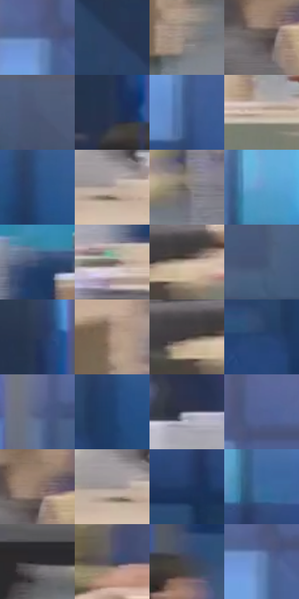

# 电影参考 585

- 状态：常规／活跃；来源世界：miles-home。
- 视角：near-level；景别：environment-wide；场景：interior。
- 时段：interior-time-unknown（外观依据，中置信度；具体时间／晨昏未知）；光照：cool-interior。
- 材质候选：skin, fabric, glass, wood, plastic（帧级，不是像素分割）。
- 明暗组：dark；L* P5/P50/P95：22.49083 / 39.9952 / 74.28079。
- 资格门禁：无附加门禁。
- 原截图 SHA-256：`e486e0bb84cd6ab0a84c81a57cddf9c04eb3ac51ea6198da9898cc2fe50ded1c`；尺寸：2880 × 1200。
- sRGB 像素 SHA-256：`dd9f2ee6475eb57295b8a99623468da144e235206f03bb5bcfcec557b87b34fe`。

## 观察与迁移

近处非焦点人群可软化，远窗外关键人物仍可清楚。

办公室隔窗：前景浅暖桌椅与人物横向模糊，窗外蓝色小人物较明确；近处不必清楚，窗框、映像和运动拖影各自判断。

本公开版保存32个128×128原像素色卡上下文；图集格子并非原场景相邻位置。原rect、图集tile和像素SHA见 `data/palette-crops.json`。上下文不足时不得批准替色，不能以小样推断完整构图。

## 实测色卡

颜色比例分母为保留采样像素，不是材料面积；全部 32 色参与全库匹配。表内四舍五入仅用于阅读，原精度在 JSON。

| ID | HEX | Lab | 原图 xy | 像素数 | 比例 | 明度角色 |
| --- | --- | --- | --- | ---: | ---: | --- |
| 585-S01 | #5A6FA2 | [47.170859, 6.183383, -29.922844] | [1160, 136] | 9968 | 5.174204% | midtone |
| 585-S02 | #2E4263 | [27.784851, 2.607267, -21.862944] | [636, 376] | 9484 | 4.922968% | shadow |
| 585-S03 | #8C837C | [55.342838, 2.106989, 5.000588] | [364, 1060] | 9354 | 4.855488% | midtone |
| 585-S04 | #5E5652 | [37.1969, 2.472186, 3.503714] | [752, 724] | 8872 | 4.605290% | shadow |
| 585-S05 | #505B79 | [38.842578, 3.517051, -18.313608] | [860, 52] | 8365 | 4.342116% | shadow |
| 585-S06 | #283550 | [22.218008, 3.11397, -18.180223] | [968, 496] | 7595 | 3.942423% | shadow |
| 585-S07 | #3D598A | [37.790294, 4.834383, -30.426347] | [1188, 308] | 7395 | 3.838607% | shadow |
| 585-S08 | #D4C0B1 | [78.967395, 4.609585, 10.125667] | [2008, 960] | 7151 | 3.711951% | light |
| 585-S09 | #2B4E80 | [32.962714, 4.505712, -31.98428] | [2588, 372] | 7148 | 3.710394% | shadow |
| 585-S10 | #B7A6A1 | [69.407989, 5.292915, 4.82365] | [1864, 900] | 7119 | 3.695341% | light |
| 585-S11 | #79746B | [49.028815, 0.217697, 5.658338] | [2724, 988] | 6838 | 3.549479% | midtone |
| 585-S12 | #619DCE | [62.599664, -5.614449, -31.050764] | [1744, 292] | 6825 | 3.542731% | light |
| 585-S13 | #394D6E | [32.486778, 2.119828, -21.456554] | [1560, 720] | 6799 | 3.529235% | shadow |
| 585-S14 | #6D615A | [42.060372, 3.510485, 5.741814] | [1480, 828] | 6782 | 3.520410% | midtone |
| 585-S15 | #C6B2A4 | [73.886822, 4.861689, 9.766307] | [904, 964] | 6346 | 3.294091% | light |
| 585-S16 | #445474 | [35.65502, 2.731419, -20.223578] | [328, 200] | 6259 | 3.248931% | shadow |
| 585-S17 | #2B3A59 | [24.515118, 3.689472, -20.512862] | [976, 364] | 6224 | 3.230763% | shadow |
| 585-S18 | #B09584 | [63.665641, 7.383478, 12.724869] | [316, 876] | 6092 | 3.162244% | light |
| 585-S19 | #433C3C | [26.014231, 3.024548, 1.102174] | [852, 960] | 5704 | 2.960840% | shadow |
| 585-S20 | #284672 | [29.527528, 3.959698, -28.690371] | [2292, 376] | 5304 | 2.753208% | shadow |
| 585-S21 | #566286 | [41.898457, 4.753889, -21.470934] | [2108, 136] | 5178 | 2.687804% | midtone |
| 585-S22 | #1F406C | [26.849088, 3.943621, -29.156296] | [2372, 332] | 5153 | 2.674827% | shadow |
| 585-S23 | #6E7282 | [48.210949, 2.015543, -9.291666] | [1348, 676] | 4583 | 2.378950% | midtone |
| 585-S24 | #506393 | [42.361066, 6.286637, -28.597684] | [1228, 88] | 4505 | 2.338462% | midtone |
| 585-S25 | #8E7568 | [51.236775, 7.657374, 10.832876] | [772, 688] | 4321 | 2.242951% | midtone |
| 585-S26 | #9A908E | [60.577995, 3.331379, 2.393713] | [1840, 896] | 4209 | 2.184814% | light |
| 585-S27 | #1E385F | [23.439226, 4.127505, -26.183537] | [1916, 464] | 4177 | 2.168203% | shadow |
| 585-S28 | #3C6B9C | [44.053204, -0.449015, -31.384214] | [1964, 336] | 3531 | 1.832877% | midtone |
| 585-S29 | #2D2B30 | [17.914267, 2.106414, -2.906189] | [2248, 1124] | 3524 | 1.829243% | deep-shadow |
| 585-S30 | #4D4F5C | [33.862499, 2.242598, -7.864933] | [1088, 780] | 3000 | 1.557244% | shadow |
| 585-S31 | #444552 | [29.649126, 2.703993, -7.892419] | [1092, 528] | 2620 | 1.359993% | shadow |
| 585-S32 | #6081B4 | [53.472096, 2.385462, -30.521587] | [1172, 156] | 2223 | 1.153918% | midtone |

## 色阶与空间分布

- 采样 ROI：`[0.01, 0.02, 0.98, 0.94]`；步长：4；样本数：192648。
- 排除区：`[]`。
- 深暗、暗、中、亮、高光五段计数：`[3534, 92822, 63968, 30498, 1826]`。
- RGB 各 256 箱、L* 100 箱、13×5 色相明度表和 3×3 空间统计全部保存在 [总数据](../film-library.json)。
- [可视化档案](../../references/library.html)按需绘制直方图，不存 2,094 张重复图表图片。

## 纹理特征占比

**这是分块图像特征的面积占比，不是波点／排线／丝网／错版的精确语义覆盖率。** 窗格、发丝、织物也会产生方向或周期特征。
原图 ROI 像素 3084576；已测块覆盖 3084576（100.0000%）；未测 0。

| 特征 | 块覆盖像素 | 占已测面积 | 阈值敏感范围 |
| --- | ---: | ---: | --- |
| low-contrast | 65536 | 2.1246% | 1.0623% ~ 3.1870% |
| directional-structure | 1312512 | 42.5508% | 29.5208% ~ 54.9003% |
| periodic-structure | 1706528 | 55.3246% | 44.0374% ~ 66.2299% |
| mixed-detail | 0 | 0.0000% | 0.0000% ~ 1.0623% |

阈值敏感范围不是统计置信区间。逐块坐标、尺度、对比、方向一致性、频谱集中度、频率与角度见 [全量特征记录](../texture-features.jsonl)，以帧号定位。
四种印刷层的真实像素覆盖仍标为 `null`，不能填 0，也不能拿上表代替。不得据这些代理测量删除唯一证据。

[测量方法与保留策略](../../references/library-retention.md) · [分类索引](../archive/README.md)
