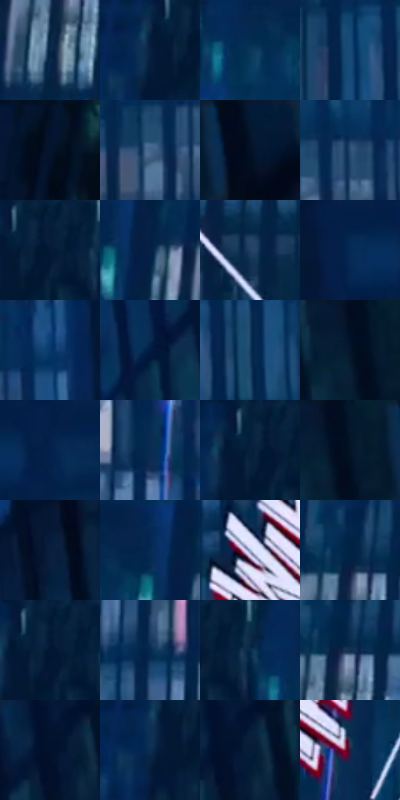

# 电影参考 586

- 状态：条件／活跃；来源世界：miles-home。
- 视角：low-angle；景别：environment-wide；场景：city。
- 时段：night-appearance（外观依据，中置信度；具体时间／晨昏未知）；光照：night-mixed。
- 材质候选：fabric, brick, glass, sky（帧级，不是像素分割）。
- 明暗组：very-dark；L* P5/P50/P95：4.16397 / 14.67352 / 40.04806。
- 资格门禁：caption。
- 原截图 SHA-256：`dac8c7ba6d953a14c646cffcb10a257d2a5037fec64ff3d662261fbb8f9dcf12`；尺寸：2880 × 1204。
- sRGB 像素 SHA-256：`89c3af53bbb1a716ad6a3fe23f7fbb1d5030b363837020efd3578ad4c8b9375e`。

## 观察与迁移

楼间运动拟声字与实体立面分开，不默认增加文字。

蓝幕墙与THWIP：深竖框、较浅蓝窗、白拟声字红错边与白方向线；文字另标条件层，不能据其亮度推断幕墙发光。

本公开版保存32个128×128原像素色卡上下文；图集格子并非原场景相邻位置。原rect、图集tile和像素SHA见 `data/palette-crops.json`。上下文不足时不得批准替色，不能以小样推断完整构图。

## 实测色卡

颜色比例分母为保留采样像素，不是材料面积；全部 32 色参与全库匹配。表内四舍五入仅用于阅读，原精度在 JSON。

| ID | HEX | Lab | 原图 xy | 像素数 | 比例 | 明度角色 |
| --- | --- | --- | --- | ---: | ---: | --- |
| 586-S01 | #082647 | [14.912824, 3.16576, -23.741313] | [712, 176] | 12335 | 6.402869% | deep-shadow |
| 586-S02 | #072040 | [12.274614, 4.349861, -23.099099] | [272, 84] | 12241 | 6.354076% | deep-shadow |
| 586-S03 | #0A3659 | [21.666599, -0.123734, -25.10669] | [476, 112] | 8614 | 4.471367% | shadow |
| 586-S04 | #154B77 | [30.694633, -0.499407, -30.029892] | [1580, 296] | 8142 | 4.226361% | shadow |
| 586-S05 | #020A1A | [2.750795, 1.249421, -9.817068] | [44, 60] | 8060 | 4.183796% | deep-shadow |
| 586-S06 | #44658C | [41.889716, -0.310206, -25.189987] | [1532, 148] | 8001 | 4.153171% | midtone |
| 586-S07 | #041429 | [6.197767, 1.971966, -16.14145] | [2808, 52] | 7912 | 4.106972% | deep-shadow |
| 586-S08 | #294C72 | [31.473473, 0.206949, -25.618632] | [1588, 104] | 7082 | 3.676135% | shadow |
| 586-S09 | #051935 | [8.861053, 4.287589, -20.738173] | [340, 68] | 6849 | 3.555189% | deep-shadow |
| 586-S10 | #052146 | [12.996501, 6.067343, -26.130264] | [604, 100] | 6666 | 3.460197% | deep-shadow |
| 586-S11 | #214063 | [26.420477, 0.828555, -24.055644] | [1120, 788] | 6642 | 3.447739% | shadow |
| 586-S12 | #05284F | [16.074711, 4.929541, -27.353183] | [1848, 48] | 6504 | 3.376106% | deep-shadow |
| 586-S13 | #083869 | [23.335742, 5.274884, -32.882362] | [1704, 64] | 6420 | 3.332503% | shadow |
| 586-S14 | #011C42 | [10.777553, 7.455967, -26.929071] | [2348, 232] | 6409 | 3.326793% | deep-shadow |
| 586-S15 | #133B5E | [23.914762, -0.300819, -24.806999] | [1672, 312] | 6402 | 3.323159% | shadow |
| 586-S16 | #020F22 | [4.245315, 1.546719, -13.857263] | [2672, 36] | 6053 | 3.142000% | deep-shadow |
| 586-S17 | #041F4B | [12.693758, 9.828697, -30.077595] | [1948, 40] | 5637 | 2.926062% | deep-shadow |
| 586-S18 | #062B55 | [17.562043, 5.563, -29.008081] | [1376, 32] | 5542 | 2.876749% | deep-shadow |
| 586-S19 | #06203C | [11.943005, 2.320908, -20.813484] | [308, 60] | 5539 | 2.875192% | deep-shadow |
| 586-S20 | #05172D | [7.537195, 2.021352, -17.000825] | [2700, 36] | 5533 | 2.872078% | deep-shadow |
| 586-S21 | #071D3C | [10.921006, 4.816819, -22.446018] | [2480, 460] | 5415 | 2.810826% | deep-shadow |
| 586-S22 | #062D58 | [18.451425, 5.448008, -29.583731] | [556, 32] | 5131 | 2.663407% | deep-shadow |
| 586-S23 | #A1ADCD | [70.781856, 2.675949, -17.631337] | [1384, 792] | 5036 | 2.614094% | light |
| 586-S24 | #022648 | [14.771767, 2.758857, -24.667077] | [728, 44] | 4827 | 2.505606% | deep-shadow |
| 586-S25 | #041B39 | [9.836602, 4.417421, -22.055453] | [328, 36] | 4279 | 2.221149% | deep-shadow |
| 586-S26 | #07294E | [16.408803, 3.980917, -26.13521] | [1176, 76] | 4250 | 2.206096% | deep-shadow |
| 586-S27 | #0A2C4B | [17.337034, 0.82849, -22.611695] | [404, 68] | 4187 | 2.173394% | deep-shadow |
| 586-S28 | #123051 | [19.375807, 1.773746, -23.407235] | [744, 88] | 3642 | 1.890495% | deep-shadow |
| 586-S29 | #021432 | [6.714933, 5.901517, -22.007659] | [2528, 28] | 2750 | 1.427474% | deep-shadow |
| 586-S30 | #0A2D51 | [18.07636, 2.764177, -25.491465] | [260, 112] | 2735 | 1.419688% | deep-shadow |
| 586-S31 | #021733 | [7.809701, 4.265042, -20.982353] | [2560, 32] | 2364 | 1.227109% | deep-shadow |
| 586-S32 | #28203D | [14.518424, 11.671607, -17.277255] | [1472, 1016] | 1449 | 0.752149% | deep-shadow |

## 色阶与空间分布

- 采样 ROI：`[0.01, 0.02, 0.98, 0.94]`；步长：4；样本数：192648。
- 排除区：`[]`。
- 深暗、暗、中、亮、高光五段计数：`[135516, 47480, 6392, 1581, 1679]`。
- RGB 各 256 箱、L* 100 箱、13×5 色相明度表和 3×3 空间统计全部保存在 [总数据](../film-library.json)。
- [可视化档案](../../references/library.html)按需绘制直方图，不存 2,094 张重复图表图片。

## 纹理特征占比

**这是分块图像特征的面积占比，不是波点／排线／丝网／错版的精确语义覆盖率。** 窗格、发丝、织物也会产生方向或周期特征。
原图 ROI 像素 3092958；已测块覆盖 3092958（100.0000%）；未测 0。

| 特征 | 块覆盖像素 | 占已测面积 | 阈值敏感范围 |
| --- | ---: | ---: | --- |
| low-contrast | 141696 | 4.5812% | 2.9921% ~ 6.3277% |
| directional-structure | 2068958 | 66.8925% | 42.4769% ~ 80.8887% |
| periodic-structure | 882304 | 28.5262% | 16.1192% ~ 51.1955% |
| mixed-detail | 0 | 0.0000% | 0.0000% ~ 0.0000% |

阈值敏感范围不是统计置信区间。逐块坐标、尺度、对比、方向一致性、频谱集中度、频率与角度见 [全量特征记录](../texture-features.jsonl)，以帧号定位。
四种印刷层的真实像素覆盖仍标为 `null`，不能填 0，也不能拿上表代替。不得据这些代理测量删除唯一证据。

[测量方法与保留策略](../../references/library-retention.md) · [分类索引](../archive/README.md)
