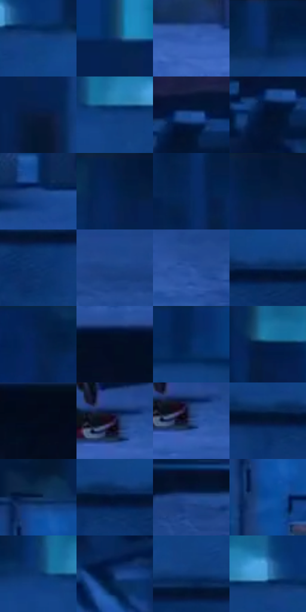

# 电影参考 587

- 状态：常规／活跃；来源世界：miles-home。
- 视角：near-level；景别：environment-wide；场景：city。
- 时段：night-appearance（外观依据，中置信度；具体时间／晨昏未知）；光照：night-mixed。
- 材质候选：fabric, stone, metal, glass, sky（帧级，不是像素分割）。
- 明暗组：dark；L* P5/P50/P95：4.14411 / 20.17948 / 40.16058。
- 资格门禁：无附加门禁。
- 原截图 SHA-256：`b88944c0b45557c7dc614eb9d4b07587491e97014e56febb18ff3d9876a30207`；尺寸：2880 × 1208。
- sRGB 像素 SHA-256：`aa6ceed536b58fca554f3e69e6940eabebe564aa1fc59e32a8dcffa8fa94b1eb`。

## 观察与迁移

蓝冷屋顶、设备和河岸远光，楼顶物件保位且不添造。

夜屋顶：蓝色混凝土宽面、金属箱体折面、稀疏青窗，红帽小重点；百叶、实体管线、微颗粒与印刷排线分开。

本公开版保存32个128×128原像素色卡上下文；图集格子并非原场景相邻位置。原rect、图集tile和像素SHA见 `data/palette-crops.json`。上下文不足时不得批准替色，不能以小样推断完整构图。

## 实测色卡

颜色比例分母为保留采样像素，不是材料面积；全部 32 色参与全库匹配。表内四舍五入仅用于阅读，原精度在 JSON。

| ID | HEX | Lab | 原图 xy | 像素数 | 比例 | 明度角色 |
| --- | --- | --- | --- | ---: | ---: | --- |
| 587-S01 | #134081 | [27.816487, 10.912405, -40.888217] | [1032, 108] | 12315 | 6.369410% | shadow |
| 587-S02 | #0F3063 | [20.501992, 9.090764, -33.531242] | [528, 408] | 10098 | 5.222761% | shadow |
| 587-S03 | #335DB0 | [40.679549, 14.049053, -48.581423] | [888, 848] | 8645 | 4.471259% | midtone |
| 587-S04 | #062352 | [14.677651, 10.229846, -31.640666] | [688, 36] | 7540 | 3.899744% | deep-shadow |
| 587-S05 | #0B1B3D | [10.496521, 7.529879, -23.828074] | [576, 516] | 6983 | 3.611660% | deep-shadow |
| 587-S06 | #0F3C7C | [26.121275, 11.24188, -40.495663] | [888, 104] | 6902 | 3.569766% | shadow |
| 587-S07 | #1F5199 | [34.952879, 10.402312, -44.112235] | [2628, 268] | 6790 | 3.511839% | shadow |
| 587-S08 | #02102A | [4.973229, 4.291432, -18.827947] | [2604, 304] | 6767 | 3.499943% | deep-shadow |
| 587-S09 | #1F468A | [30.653968, 11.834788, -41.877808] | [2000, 724] | 6755 | 3.493737% | shadow |
| 587-S10 | #061F48 | [12.520875, 8.697672, -28.282034] | [2048, 40] | 6561 | 3.393398% | deep-shadow |
| 587-S11 | #07295F | [17.722291, 11.692071, -35.406384] | [508, 72] | 6493 | 3.358228% | deep-shadow |
| 587-S12 | #03183A | [8.806422, 7.110754, -24.435251] | [2100, 40] | 6417 | 3.318920% | deep-shadow |
| 587-S13 | #09316D | [21.425051, 12.16788, -38.544172] | [1476, 288] | 6299 | 3.257890% | shadow |
| 587-S14 | #1A4385 | [29.226264, 11.243583, -41.094493] | [2132, 892] | 6155 | 3.183412% | shadow |
| 587-S15 | #2D55A1 | [37.164148, 12.728135, -45.340976] | [1932, 960] | 6079 | 3.144104% | shadow |
| 587-S16 | #0D2B5A | [18.148235, 8.589284, -31.392169] | [1064, 224] | 5991 | 3.098590% | deep-shadow |
| 587-S17 | #04214D | [13.52595, 9.209911, -30.102463] | [1896, 40] | 5814 | 3.007044% | deep-shadow |
| 587-S18 | #030D21 | [3.766325, 2.440058, -13.810262] | [1352, 1088] | 5583 | 2.887569% | deep-shadow |
| 587-S19 | #042658 | [16.085845, 10.472823, -33.405073] | [1384, 32] | 5531 | 2.860675% | deep-shadow |
| 587-S20 | #021A43 | [10.234262, 9.693119, -28.510575] | [172, 88] | 5215 | 2.697237% | deep-shadow |
| 587-S21 | #040B1B | [3.109576, 1.650369, -10.073284] | [2720, 1120] | 5163 | 2.670342% | deep-shadow |
| 587-S22 | #2A2346 | [16.187411, 13.08432, -20.885161] | [1744, 884] | 4939 | 2.554488% | deep-shadow |
| 587-S23 | #223F70 | [26.917343, 6.757891, -31.588126] | [1756, 904] | 4763 | 2.463459% | shadow |
| 587-S24 | #061633 | [7.690911, 5.938064, -21.160755] | [952, 240] | 4734 | 2.448460% | deep-shadow |
| 587-S25 | #0F274F | [16.088736, 7.000331, -27.311832] | [48, 368] | 4713 | 2.437599% | deep-shadow |
| 587-S26 | #011333 | [6.423198, 6.832818, -23.212761] | [1008, 232] | 4546 | 2.351225% | deep-shadow |
| 587-S27 | #264B8D | [32.626752, 10.624082, -40.535666] | [132, 840] | 4543 | 2.349674% | shadow |
| 587-S28 | #0D468F | [30.515676, 12.151813, -45.199928] | [52, 464] | 4457 | 2.305194% | shadow |
| 587-S29 | #0D3670 | [23.31494, 10.186079, -37.411265] | [828, 88] | 4373 | 2.261748% | shadow |
| 587-S30 | #17386F | [24.185803, 9.464765, -35.351024] | [2364, 332] | 4186 | 2.165031% | shadow |
| 587-S31 | #0F3874 | [24.290502, 10.662303, -38.388362] | [1284, 204] | 4156 | 2.149514% | shadow |
| 587-S32 | #317FB8 | [51.025112, -4.432697, -36.797228] | [976, 76] | 3840 | 1.986077% | midtone |

## 色阶与空间分布

- 采样 ROI：`[0.01, 0.02, 0.98, 0.94]`；步长：4；样本数：193346。
- 排除区：`[]`。
- 深暗、暗、中、亮、高光五段计数：`[95569, 87780, 9269, 728, 0]`。
- RGB 各 256 箱、L* 100 箱、13×5 色相明度表和 3×3 空间统计全部保存在 [总数据](../film-library.json)。
- [可视化档案](../../references/library.html)按需绘制直方图，不存 2,094 张重复图表图片。

## 纹理特征占比

**这是分块图像特征的面积占比，不是波点／排线／丝网／错版的精确语义覆盖率。** 窗格、发丝、织物也会产生方向或周期特征。
原图 ROI 像素 3104134；已测块覆盖 3104134（100.0000%）；未测 0。

| 特征 | 块覆盖像素 | 占已测面积 | 阈值敏感范围 |
| --- | ---: | ---: | --- |
| low-contrast | 177408 | 5.7152% | 2.1112% ~ 8.8821% |
| directional-structure | 1220102 | 39.3057% | 21.3601% ~ 59.6306% |
| periodic-structure | 1657472 | 53.3956% | 37.7303% ~ 65.5353% |
| mixed-detail | 49152 | 1.5834% | 0.5278% ~ 4.2225% |

阈值敏感范围不是统计置信区间。逐块坐标、尺度、对比、方向一致性、频谱集中度、频率与角度见 [全量特征记录](../texture-features.jsonl)，以帧号定位。
四种印刷层的真实像素覆盖仍标为 `null`，不能填 0，也不能拿上表代替。不得据这些代理测量删除唯一证据。

[测量方法与保留策略](../../references/library-retention.md) · [分类索引](../archive/README.md)
