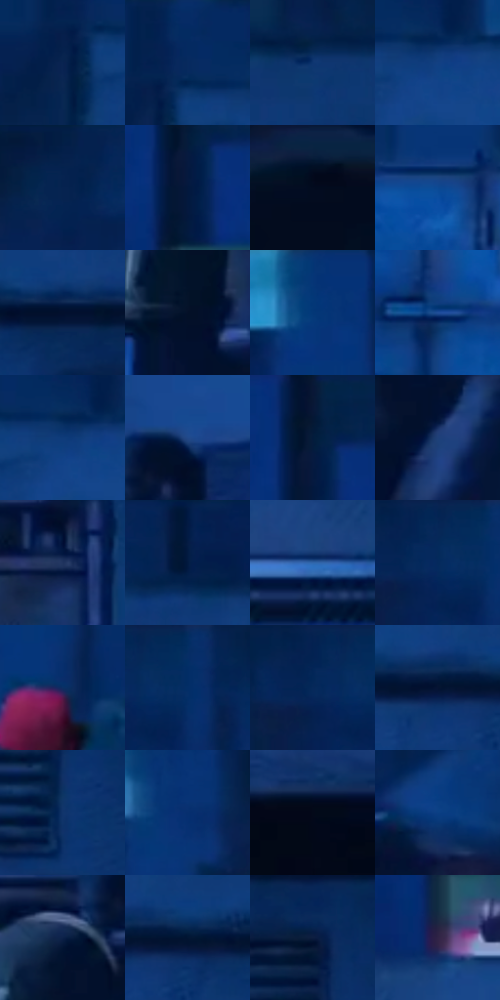

# 电影参考 588

- 状态：常规／活跃；来源世界：miles-home。
- 视角：near-level；景别：environment-wide；场景：city。
- 时段：night-appearance（外观依据，中置信度；具体时间／晨昏未知）；光照：night-mixed。
- 材质候选：fabric, stone, metal, glass, sky（帧级，不是像素分割）。
- 明暗组：very-dark；L* P5/P50/P95：3.54037 / 18.16035 / 35.20594。
- 资格门禁：无附加门禁。
- 原截图 SHA-256：`ffb45040f3330801ed45d0909b2ca0da2a25b0d02ad68e39698dec6e7cc3371a`；尺寸：2880 × 1208。
- sRGB 像素 SHA-256：`516fcbb6518e5f27cb01e2841a81312eead67ad07a12125ea96a56330d93a049`。

## 观察与迁移

蓝冷屋顶、设备和河岸远光，楼顶物件保位且不添造。

屋顶侧跳：近弯管大暗蓝配细亮弧边，中景箱体明暗分组、人物小红帽；同为蓝色仍有不同曲率和光泽。

本公开版保存32个128×128原像素色卡上下文；图集格子并非原场景相邻位置。原rect、图集tile和像素SHA见 `data/palette-crops.json`。上下文不足时不得批准替色，不能以小样推断完整构图。

## 实测色卡

颜色比例分母为保留采样像素，不是材料面积；全部 32 色参与全库匹配。表内四舍五入仅用于阅读，原精度在 JSON。

| ID | HEX | Lab | 原图 xy | 像素数 | 比例 | 明度角色 |
| --- | --- | --- | --- | ---: | ---: | --- |
| 588-S01 | #082451 | [14.992234, 9.242495, -30.449635] | [1952, 120] | 9634 | 4.982777% | deep-shadow |
| 588-S02 | #082A5E | [17.98758, 10.590957, -34.313392] | [1992, 64] | 9343 | 4.832270% | deep-shadow |
| 588-S03 | #0D3570 | [23.002361, 10.905541, -37.916203] | [2628, 108] | 8609 | 4.452639% | shadow |
| 588-S04 | #134082 | [27.888767, 11.331777, -41.395615] | [2088, 112] | 8461 | 4.376093% | shadow |
| 588-S05 | #05204B | [13.064959, 9.182093, -29.474064] | [1784, 32] | 8287 | 4.286098% | deep-shadow |
| 588-S06 | #03183D | [9.06929, 8.566513, -26.154367] | [284, 116] | 8091 | 4.184726% | deep-shadow |
| 588-S07 | #030B1F | [3.230017, 2.644958, -13.062271] | [760, 1052] | 7981 | 4.127833% | deep-shadow |
| 588-S08 | #0D4994 | [31.778698, 12.184141, -46.216238] | [1620, 392] | 7352 | 3.802509% | shadow |
| 588-S09 | #02102D | [5.174525, 5.70596, -20.761534] | [2452, 232] | 7223 | 3.735790% | deep-shadow |
| 588-S10 | #051027 | [4.9614, 3.763582, -16.564157] | [164, 804] | 7045 | 3.643727% | deep-shadow |
| 588-S11 | #053577 | [23.370562, 13.351987, -41.797316] | [880, 28] | 6819 | 3.526838% | shadow |
| 588-S12 | #22509B | [34.888433, 12.222468, -45.417839] | [1676, 576] | 6807 | 3.520631% | shadow |
| 588-S13 | #0F3B79 | [25.591135, 10.669598, -39.45996] | [2064, 108] | 6798 | 3.515977% | shadow |
| 588-S14 | #21488A | [31.328861, 10.740892, -40.788331] | [304, 520] | 6261 | 3.238236% | shadow |
| 588-S15 | #071736 | [8.343079, 6.768395, -22.289355] | [284, 40] | 6090 | 3.149794% | deep-shadow |
| 588-S16 | #1F4078 | [27.609808, 8.730299, -35.553369] | [1216, 908] | 6012 | 3.109451% | shadow |
| 588-S17 | #1F335E | [21.823754, 7.461128, -28.095948] | [2544, 596] | 5918 | 3.060834% | shadow |
| 588-S18 | #021B44 | [10.659579, 9.376474, -28.52124] | [2404, 32] | 5787 | 2.993080% | deep-shadow |
| 588-S19 | #3268AD | [43.645319, 5.736032, -42.078524] | [160, 360] | 5682 | 2.938773% | midtone |
| 588-S20 | #062658 | [16.15096, 10.686417, -33.296457] | [1044, 28] | 5335 | 2.759302% | deep-shadow |
| 588-S21 | #0B2E64 | [19.821284, 10.574309, -35.290591] | [928, 304] | 5142 | 2.659481% | deep-shadow |
| 588-S22 | #062E65 | [19.768642, 10.571822, -36.036067] | [1096, 32] | 5083 | 2.628966% | deep-shadow |
| 588-S23 | #022251 | [14.120637, 10.060684, -31.871785] | [1016, 28] | 5030 | 2.601554% | deep-shadow |
| 588-S24 | #051433 | [6.968656, 7.168693, -22.324142] | [2252, 232] | 4918 | 2.543626% | deep-shadow |
| 588-S25 | #12346B | [22.463286, 9.99345, -35.562591] | [2564, 448] | 4912 | 2.540523% | shadow |
| 588-S26 | #062F6F | [20.899883, 14.278887, -40.689721] | [1640, 84] | 4795 | 2.480010% | shadow |
| 588-S27 | #030919 | [2.573351, 1.632682, -9.266691] | [2556, 1076] | 4345 | 2.247267% | deep-shadow |
| 588-S28 | #093F84 | [27.512923, 12.116642, -43.260244] | [780, 488] | 4273 | 2.210028% | shadow |
| 588-S29 | #0C2149 | [13.511672, 8.434667, -27.360708] | [208, 596] | 3636 | 1.880566% | deep-shadow |
| 588-S30 | #011533 | [7.06076, 5.509648, -22.18868] | [2316, 228] | 3619 | 1.871774% | deep-shadow |
| 588-S31 | #0D1E40 | [11.851375, 6.889123, -23.763583] | [2544, 304] | 2772 | 1.433699% | deep-shadow |
| 588-S32 | #2F2245 | [16.395032, 15.121539, -19.831054] | [264, 244] | 1286 | 0.665129% | deep-shadow |

## 色阶与空间分布

- 采样 ROI：`[0.01, 0.02, 0.98, 0.94]`；步长：4；样本数：193346。
- 排除区：`[]`。
- 深暗、暗、中、亮、高光五段计数：`[109059, 80715, 3381, 191, 0]`。
- RGB 各 256 箱、L* 100 箱、13×5 色相明度表和 3×3 空间统计全部保存在 [总数据](../film-library.json)。
- [可视化档案](../../references/library.html)按需绘制直方图，不存 2,094 张重复图表图片。

## 纹理特征占比

**这是分块图像特征的面积占比，不是波点／排线／丝网／错版的精确语义覆盖率。** 窗格、发丝、织物也会产生方向或周期特征。
原图 ROI 像素 3104134；已测块覆盖 3104134（100.0000%）；未测 0。

| 特征 | 块覆盖像素 | 占已测面积 | 阈值敏感范围 |
| --- | ---: | ---: | --- |
| low-contrast | 266112 | 8.5728% | 5.8348% ~ 9.8965% |
| directional-structure | 1051270 | 33.8668% | 20.9312% ~ 50.3279% |
| periodic-structure | 1770368 | 57.0326% | 43.8373% ~ 67.0610% |
| mixed-detail | 16384 | 0.5278% | 0.0000% ~ 2.1112% |

阈值敏感范围不是统计置信区间。逐块坐标、尺度、对比、方向一致性、频谱集中度、频率与角度见 [全量特征记录](../texture-features.jsonl)，以帧号定位。
四种印刷层的真实像素覆盖仍标为 `null`，不能填 0，也不能拿上表代替。不得据这些代理测量删除唯一证据。

[测量方法与保留策略](../../references/library-retention.md) · [分类索引](../archive/README.md)
