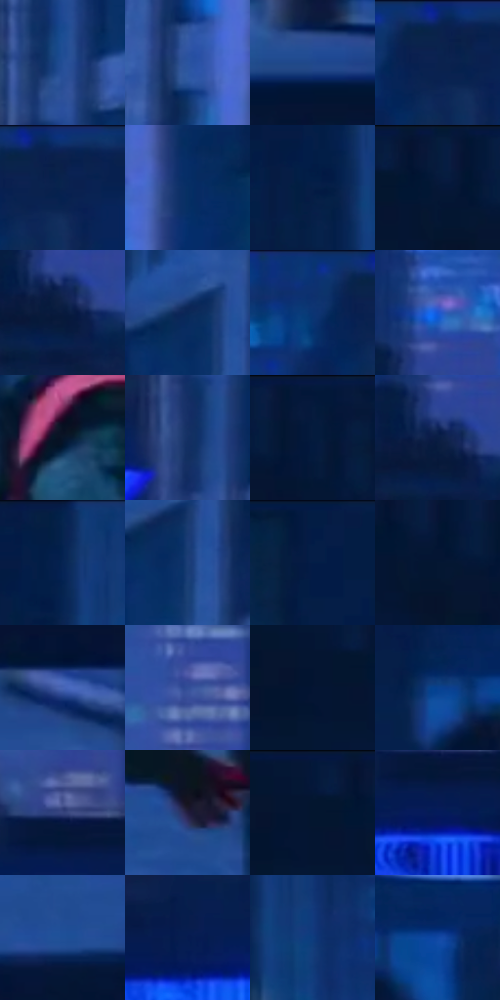

# 电影参考 589

- 状态：常规／活跃；来源世界：miles-home。
- 视角：near-level；景别：medium；场景：city。
- 时段：night-appearance（外观依据，中置信度；具体时间／晨昏未知）；光照：night-mixed。
- 材质候选：fabric, stone, metal, glass, sky（帧级，不是像素分割）。
- 明暗组：very-dark；L* P5/P50/P95：7.54072 / 16.35128 / 38.82493。
- 资格门禁：无附加门禁。
- 原截图 SHA-256：`78da5b4ba6a433ed814280bb111c52a7044cec94562fee6761cf729556532b69`；尺寸：2880 × 1210。
- sRGB 像素 SHA-256：`3c2d16691872827307ec396c22fc25acdafc09ba5869d299317edabd970e2002`。

## 观察与迁移

蓝冷屋顶、设备和河岸远光，楼顶物件保位且不添造。

背跑与蓝招牌：高彩蓝字并非白亮，青衣中调、红帽少量；屋面留宽静面，背景窗组与招牌印刷分开。

本公开版保存32个128×128原像素色卡上下文；图集格子并非原场景相邻位置。原rect、图集tile和像素SHA见 `data/palette-crops.json`。上下文不足时不得批准替色，不能以小样推断完整构图。

## 实测色卡

颜色比例分母为保留采样像素，不是材料面积；全部 32 色参与全库匹配。表内四舍五入仅用于阅读，原精度在 JSON。

| ID | HEX | Lab | 原图 xy | 像素数 | 比例 | 明度角色 |
| --- | --- | --- | --- | ---: | ---: | --- |
| 589-S01 | #244E96 | [34.034335, 11.847251, -43.7642] | [2072, 256] | 16024 | 8.257921% | shadow |
| 589-S02 | #2B54A0 | [36.726517, 12.711912, -45.449708] | [2272, 456] | 11107 | 5.723960% | shadow |
| 589-S03 | #20488C | [31.426641, 11.403141, -41.862867] | [2520, 856] | 10581 | 5.452887% | shadow |
| 589-S04 | #09224E | [14.127415, 9.528405, -29.803944] | [1656, 28] | 10179 | 5.245717% | deep-shadow |
| 589-S05 | #0A2049 | [13.097729, 8.924905, -28.032959] | [1688, 40] | 9743 | 5.021026% | deep-shadow |
| 589-S06 | #062F64 | [20.009231, 9.386482, -34.993118] | [2372, 268] | 8713 | 4.490219% | shadow |
| 589-S07 | #051F46 | [12.313882, 7.620041, -27.23123] | [576, 120] | 8053 | 4.150090% | deep-shadow |
| 589-S08 | #061737 | [8.369694, 7.046026, -22.972737] | [184, 64] | 7703 | 3.969718% | deep-shadow |
| 589-S09 | #081A3E | [10.092188, 8.281767, -25.197305] | [1068, 204] | 7523 | 3.876956% | deep-shadow |
| 589-S10 | #0A2757 | [16.520061, 9.904555, -32.022477] | [2176, 108] | 7493 | 3.861495% | deep-shadow |
| 589-S11 | #0A3374 | [22.627585, 13.845865, -41.086459] | [1584, 28] | 7435 | 3.831605% | shadow |
| 589-S12 | #1957D5 | [40.936277, 29.588673, -69.700528] | [1072, 96] | 7435 | 3.831605% | midtone |
| 589-S13 | #091529 | [6.814649, 2.614839, -15.151683] | [1376, 980] | 7159 | 3.689369% | deep-shadow |
| 589-S14 | #143063 | [20.685308, 9.736388, -33.226468] | [2044, 380] | 6974 | 3.594030% | shadow |
| 589-S15 | #05193C | [9.430229, 7.63115, -24.851948] | [300, 28] | 6710 | 3.457979% | deep-shadow |
| 589-S16 | #091D44 | [11.64771, 8.837685, -26.905385] | [1056, 184] | 6514 | 3.356971% | deep-shadow |
| 589-S17 | #052250 | [14.146295, 9.957661, -31.144566] | [608, 56] | 5896 | 3.038486% | deep-shadow |
| 589-S18 | #1B3E78 | [26.830361, 9.520257, -36.81286] | [2204, 148] | 5892 | 3.036425% | shadow |
| 589-S19 | #021B46 | [10.840129, 10.335491, -29.626045] | [2632, 32] | 5604 | 2.888005% | deep-shadow |
| 589-S20 | #041733 | [7.926319, 4.714497, -20.788757] | [208, 88] | 5389 | 2.777205% | deep-shadow |
| 589-S21 | #4765B6 | [44.265654, 14.529521, -46.298083] | [2792, 964] | 5086 | 2.621055% | midtone |
| 589-S22 | #334E97 | [34.774026, 14.589167, -43.145703] | [1416, 84] | 3914 | 2.017068% | shadow |
| 589-S23 | #041432 | [6.83155, 6.407538, -21.814275] | [88, 84] | 3615 | 1.862980% | deep-shadow |
| 589-S24 | #0A418F | [28.972386, 15.448846, -47.701928] | [2008, 660] | 3038 | 1.565624% | shadow |
| 589-S25 | #37447E | [30.525858, 13.026837, -34.576005] | [1412, 324] | 2817 | 1.451733% | shadow |
| 589-S26 | #221D3F | [13.093135, 12.543518, -20.981598] | [1240, 912] | 2798 | 1.441941% | deep-shadow |
| 589-S27 | #031839 | [8.72093, 6.623634, -23.855384] | [112, 28] | 2589 | 1.334233% | deep-shadow |
| 589-S28 | #041B5C | [13.12025, 20.615989, -40.929176] | [1416, 392] | 2181 | 1.123972% | deep-shadow |
| 589-S29 | #1E5097 | [34.491104, 10.157248, -43.646668] | [2212, 1068] | 1907 | 0.982767% | shadow |
| 589-S30 | #061B50 | [11.967574, 15.489992, -34.68974] | [1872, 372] | 1816 | 0.935870% | deep-shadow |
| 589-S31 | #0F3C7D | [26.195693, 11.667731, -41.004405] | [676, 148] | 1719 | 0.885882% | shadow |
| 589-S32 | #1247A4 | [32.511419, 20.476349, -54.705585] | [2172, 656] | 437 | 0.225207% | shadow |

## 色阶与空间分布

- 采样 ROI：`[0.01, 0.02, 0.98, 0.94]`；步长：4；样本数：194044。
- 排除区：`[]`。
- 深暗、暗、中、亮、高光五段计数：`[108758, 77933, 7315, 38, 0]`。
- RGB 各 256 箱、L* 100 箱、13×5 色相明度表和 3×3 空间统计全部保存在 [总数据](../film-library.json)。
- [可视化档案](../../references/library.html)按需绘制直方图，不存 2,094 张重复图表图片。

## 纹理特征占比

**这是分块图像特征的面积占比，不是波点／排线／丝网／错版的精确语义覆盖率。** 窗格、发丝、织物也会产生方向或周期特征。
原图 ROI 像素 3109722；已测块覆盖 3109722（100.0000%）；未测 0。

| 特征 | 块覆盖像素 | 占已测面积 | 阈值敏感范围 |
| --- | ---: | ---: | --- |
| low-contrast | 748672 | 24.0752% | 20.2719% ~ 27.6027% |
| directional-structure | 827226 | 26.6013% | 17.9657% ~ 39.5218% |
| periodic-structure | 1533824 | 49.3235% | 40.2063% ~ 53.9048% |
| mixed-detail | 0 | 0.0000% | 0.0000% ~ 0.5269% |

阈值敏感范围不是统计置信区间。逐块坐标、尺度、对比、方向一致性、频谱集中度、频率与角度见 [全量特征记录](../texture-features.jsonl)，以帧号定位。
四种印刷层的真实像素覆盖仍标为 `null`，不能填 0，也不能拿上表代替。不得据这些代理测量删除唯一证据。

[测量方法与保留策略](../../references/library-retention.md) · [分类索引](../archive/README.md)
