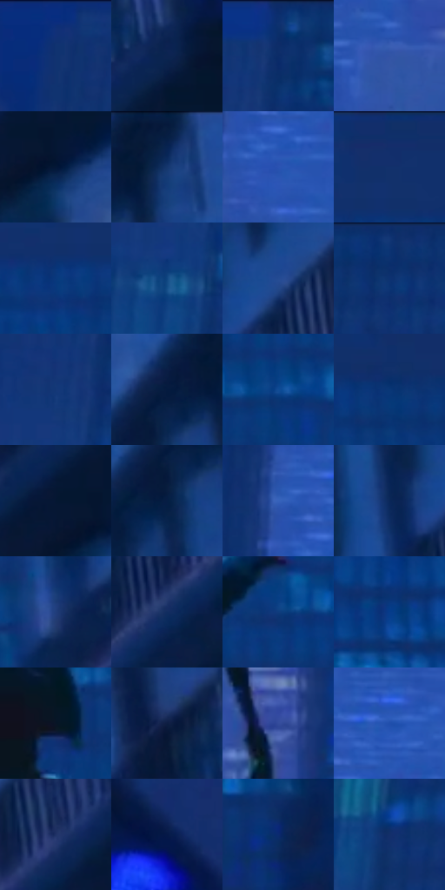

# 电影参考 590

- 状态：常规／活跃；来源世界：miles-home。
- 视角：low-angle；景别：environment-wide；场景：city。
- 时段：night-appearance（外观依据，中置信度；具体时间／晨昏未知）；光照：night-mixed。
- 材质候选：fabric, stone, metal, glass, sky（帧级，不是像素分割）。
- 明暗组：dark；L* P5/P50/P95：8.00687 / 22.51697 / 38.20272。
- 资格门禁：无附加门禁。
- 原截图 SHA-256：`8789395ff1adc109fbafd1692ad5dbfbc0a7cdec7afb95d361e00e3e9c84d5b1`；尺寸：2880 × 1206。
- sRGB 像素 SHA-256：`a9490e256005f2e260e8403e113a4aec131859d37d451de5676f3f31ba88b420`。

## 观察与迁移

蓝冷屋顶、设备和河岸远光，楼顶物件保位且不添造。

跃起剪影：暗人物衬较亮蓝色远楼，近楼边缘深暗；远窗低对比横竖节奏替代逐格写实，不必给人统一描白。

本公开版保存32个128×128原像素色卡上下文；图集格子并非原场景相邻位置。原rect、图集tile和像素SHA见 `data/palette-crops.json`。上下文不足时不得批准替色，不能以小样推断完整构图。

## 实测色卡

颜色比例分母为保留采样像素，不是材料面积；全部 32 色参与全库匹配。表内四舍五入仅用于阅读，原精度在 JSON。

| ID | HEX | Lab | 原图 xy | 像素数 | 比例 | 明度角色 |
| --- | --- | --- | --- | ---: | ---: | --- |
| 590-S01 | #103370 | [22.468555, 12.636134, -38.775577] | [300, 56] | 13980 | 7.230561% | shadow |
| 590-S02 | #0C2450 | [15.055265, 9.276732, -29.661617] | [2812, 156] | 10525 | 5.443609% | deep-shadow |
| 590-S03 | #0D316F | [21.687141, 13.36943, -39.403289] | [712, 28] | 9860 | 5.099666% | shadow |
| 590-S04 | #3353A5 | [37.125169, 16.485629, -47.77932] | [1220, 404] | 9770 | 5.053117% | shadow |
| 590-S05 | #041737 | [8.256058, 6.65529, -23.161854] | [2792, 312] | 8870 | 4.587630% | deep-shadow |
| 590-S06 | #07214C | [13.557859, 9.131755, -29.359618] | [2540, 36] | 8511 | 4.401953% | deep-shadow |
| 590-S07 | #2B52B2 | [37.409994, 20.937153, -55.053034] | [1120, 232] | 8191 | 4.236447% | shadow |
| 590-S08 | #0F306A | [21.039544, 12.127137, -37.220822] | [1840, 28] | 7482 | 3.869746% | shadow |
| 590-S09 | #07397C | [25.032201, 12.793981, -42.266023] | [1800, 140] | 7389 | 3.821646% | shadow |
| 590-S10 | #104681 | [29.599818, 6.487748, -38.023307] | [640, 248] | 7170 | 3.708378% | shadow |
| 590-S11 | #244B92 | [32.878834, 12.292777, -43.190456] | [2468, 288] | 6853 | 3.544423% | shadow |
| 590-S12 | #0A3373 | [22.546727, 13.411267, -40.578522] | [932, 32] | 6721 | 3.476152% | shadow |
| 590-S13 | #133877 | [24.633177, 12.341987, -39.735665] | [652, 132] | 6376 | 3.297715% | shadow |
| 590-S14 | #041A3F | [9.979014, 8.09272, -26.098728] | [2448, 88] | 6365 | 3.292026% | deep-shadow |
| 590-S15 | #104B95 | [32.504813, 11.430583, -45.649894] | [1756, 372] | 6331 | 3.274441% | shadow |
| 590-S16 | #093776 | [23.992048, 11.75812, -40.15021] | [1988, 132] | 5705 | 2.950669% | shadow |
| 590-S17 | #041733 | [7.926319, 4.714497, -20.788757] | [2736, 276] | 5539 | 2.864812% | deep-shadow |
| 590-S18 | #051E44 | [11.81007, 7.460933, -26.651669] | [2432, 164] | 5339 | 2.761371% | deep-shadow |
| 590-S19 | #3863BB | [43.28673, 15.005977, -50.820158] | [1068, 148] | 5230 | 2.704995% | midtone |
| 590-S20 | #0A2759 | [16.682267, 10.800667, -33.098724] | [2364, 332] | 4678 | 2.419497% | deep-shadow |
| 590-S21 | #223D7B | [27.037293, 12.491199, -38.354612] | [2264, 488] | 4461 | 2.307263% | shadow |
| 590-S22 | #102D60 | [19.35407, 10.10648, -33.412199] | [2468, 440] | 4356 | 2.252956% | deep-shadow |
| 590-S23 | #0F3B7C | [25.814699, 11.949399, -40.991126] | [1656, 268] | 4335 | 2.242094% | shadow |
| 590-S24 | #073C8B | [27.129964, 17.1029, -48.230042] | [1660, 644] | 4331 | 2.240026% | shadow |
| 590-S25 | #091526 | [6.632671, 1.336059, -13.182961] | [1548, 424] | 4093 | 2.116930% | deep-shadow |
| 590-S26 | #0D1E42 | [12.005942, 7.779774, -24.918868] | [2700, 92] | 4087 | 2.113827% | deep-shadow |
| 590-S27 | #344C9C | [34.596303, 17.946059, -46.450942] | [1456, 628] | 4000 | 2.068830% | shadow |
| 590-S28 | #214FAC | [35.776241, 19.497653, -54.163703] | [1164, 124] | 3958 | 2.047107% | shadow |
| 590-S29 | #1F3167 | [21.82386, 12.471319, -33.972727] | [2600, 300] | 2540 | 1.313707% | shadow |
| 590-S30 | #051947 | [10.425667, 12.810533, -30.992287] | [144, 172] | 2474 | 1.279571% | deep-shadow |
| 590-S31 | #0C2A70 | [19.652694, 18.82408, -43.360379] | [1580, 976] | 1971 | 1.019416% | deep-shadow |
| 590-S32 | #132F69 | [20.792735, 12.88494, -36.964918] | [664, 604] | 1855 | 0.959420% | shadow |

## 色阶与空间分布

- 采样 ROI：`[0.01, 0.02, 0.98, 0.94]`；步长：4；样本数：193346。
- 排除区：`[]`。
- 深暗、暗、中、亮、高光五段计数：`[65256, 123051, 4988, 51, 0]`。
- RGB 各 256 箱、L* 100 箱、13×5 色相明度表和 3×3 空间统计全部保存在 [总数据](../film-library.json)。
- [可视化档案](../../references/library.html)按需绘制直方图，不存 2,094 张重复图表图片。

## 纹理特征占比

**这是分块图像特征的面积占比，不是波点／排线／丝网／错版的精确语义覆盖率。** 窗格、发丝、织物也会产生方向或周期特征。
原图 ROI 像素 3098546；已测块覆盖 3098546（100.0000%）；未测 0。

| 特征 | 块覆盖像素 | 占已测面积 | 阈值敏感范围 |
| --- | ---: | ---: | --- |
| low-contrast | 425728 | 13.7396% | 10.2159% ~ 15.0574% |
| directional-structure | 437426 | 14.1171% | 2.4621% ~ 27.6874% |
| periodic-structure | 2235392 | 72.1433% | 62.0967% ~ 81.9518% |
| mixed-detail | 0 | 0.0000% | 0.0000% ~ 0.5288% |

阈值敏感范围不是统计置信区间。逐块坐标、尺度、对比、方向一致性、频谱集中度、频率与角度见 [全量特征记录](../texture-features.jsonl)，以帧号定位。
四种印刷层的真实像素覆盖仍标为 `null`，不能填 0，也不能拿上表代替。不得据这些代理测量删除唯一证据。

[测量方法与保留策略](../../references/library-retention.md) · [分类索引](../archive/README.md)
