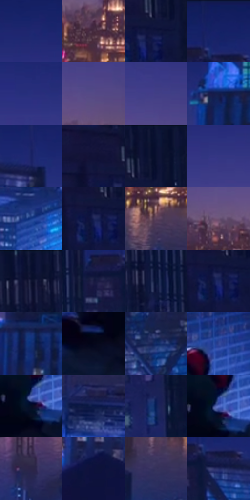

# 电影参考 591

- 状态：常规／活跃；来源世界：miles-home。
- 视角：high-angle；景别：environment-wide；场景：city。
- 时段：night-appearance（外观依据，中置信度；具体时间／晨昏未知）；光照：night-mixed。
- 材质候选：fabric, stone, metal, glass, sky（帧级，不是像素分割）。
- 明暗组：very-dark；L* P5/P50/P95：5.1943 / 17.87946 / 36.59709。
- 资格门禁：无附加门禁。
- 原截图 SHA-256：`8f33338d88a40329469aec37f6f1c064d0ea46fc41b31188791b9ea68110d64d`；尺寸：2878 × 1212。
- sRGB 像素 SHA-256：`c49925f8f0079db909ba708a9c323064b2852241e824ead8766a9918ff4fc0a2`。

## 观察与迁移

蓝冷屋顶、设备和河岸远光，楼顶物件保位且不添造。

河岸远眺：近屋顶冷蓝暗，中远城市局部青亮，河对岸暖金灯群与紫色天际；水面纵向金反射有方向不复制完整城市。

本公开版保存32个128×128原像素色卡上下文；图集格子并非原场景相邻位置。原rect、图集tile和像素SHA见 `data/palette-crops.json`。上下文不足时不得批准替色，不能以小样推断完整构图。

## 实测色卡

颜色比例分母为保留采样像素，不是材料面积；全部 32 色参与全库匹配。表内四舍五入仅用于阅读，原精度在 JSON。

| ID | HEX | Lab | 原图 xy | 像素数 | 比例 | 明度角色 |
| --- | --- | --- | --- | ---: | ---: | --- |
| 591-S01 | #1E2871 | [19.985141, 22.68761, -43.42905] | [2160, 108] | 13348 | 6.878852% | deep-shadow |
| 591-S02 | #472C3F | [21.944482, 15.927945, -6.885388] | [2124, 492] | 10894 | 5.614191% | shadow |
| 591-S03 | #11163E | [9.325575, 13.028967, -26.412733] | [144, 136] | 9758 | 5.028756% | deep-shadow |
| 591-S04 | #121E60 | [14.960524, 21.414465, -40.555306] | [788, 28] | 7935 | 4.089279% | deep-shadow |
| 591-S05 | #292F7D | [23.620212, 24.142791, -45.129589] | [1292, 176] | 7749 | 3.993424% | shadow |
| 591-S06 | #554986 | [34.837177, 20.256225, -32.526689] | [2444, 368] | 7720 | 3.978479% | shadow |
| 591-S07 | #423E86 | [30.216052, 22.360753, -39.999901] | [2380, 292] | 7461 | 3.845004% | shadow |
| 591-S08 | #141E4C | [13.223135, 13.369709, -29.871725] | [2768, 160] | 7449 | 3.838820% | deep-shadow |
| 591-S09 | #182264 | [16.786583, 20.932718, -40.199879] | [920, 116] | 7443 | 3.835728% | deep-shadow |
| 591-S10 | #141337 | [8.041144, 13.145076, -23.454998] | [44, 88] | 7232 | 3.726990% | deep-shadow |
| 591-S11 | #0B1333 | [7.007772, 9.215036, -22.242489] | [180, 28] | 6874 | 3.542496% | deep-shadow |
| 591-S12 | #343682 | [26.676304, 23.241092, -43.275532] | [2124, 220] | 6712 | 3.459009% | shadow |
| 591-S13 | #173C8C | [27.590426, 18.663498, -48.082925] | [1244, 780] | 5858 | 3.018903% | shadow |
| 591-S14 | #1B2255 | [15.657798, 15.406225, -32.032151] | [108, 152] | 5785 | 2.981283% | deep-shadow |
| 591-S15 | #593E57 | [30.052882, 16.548773, -10.300358] | [2188, 652] | 5773 | 2.975098% | shadow |
| 591-S16 | #6B5173 | [38.285041, 17.537871, -15.260575] | [1980, 436] | 5750 | 2.963245% | shadow |
| 591-S17 | #0A102E | [5.711379, 8.292544, -20.626123] | [324, 28] | 5430 | 2.798334% | deep-shadow |
| 591-S18 | #171A42 | [11.374055, 12.914405, -25.903797] | [700, 152] | 5331 | 2.747315% | deep-shadow |
| 591-S19 | #0B173A | [8.901872, 9.342415, -24.25964] | [440, 84] | 5156 | 2.657129% | deep-shadow |
| 591-S20 | #1D2761 | [18.254241, 16.921073, -35.819367] | [116, 160] | 5104 | 2.630331% | deep-shadow |
| 591-S21 | #122F75 | [21.74588, 17.854576, -43.148861] | [2772, 396] | 4624 | 2.382965% | shadow |
| 591-S22 | #05061A | [2.141409, 3.636161, -10.691745] | [876, 912] | 4559 | 2.349467% | deep-shadow |
| 591-S23 | #0E2966 | [18.531905, 15.436978, -38.686936] | [856, 448] | 4543 | 2.341222% | deep-shadow |
| 591-S24 | #364A9A | [34.011834, 18.893433, -46.179136] | [1056, 692] | 4466 | 2.301540% | shadow |
| 591-S25 | #070D24 | [4.158195, 4.600799, -15.509246] | [1004, 824] | 4456 | 2.296386% | deep-shadow |
| 591-S26 | #0A1948 | [10.758365, 13.917537, -31.136288] | [2324, 796] | 4223 | 2.176311% | deep-shadow |
| 591-S27 | #0A2056 | [14.225719, 14.770295, -35.07483] | [232, 480] | 4175 | 2.151574% | deep-shadow |
| 591-S28 | #5770C9 | [49.28907, 17.274393, -49.200273] | [1008, 804] | 4026 | 2.074787% | midtone |
| 591-S29 | #2B2548 | [17.010373, 12.633116, -20.94913] | [1728, 704] | 3932 | 2.026345% | deep-shadow |
| 591-S30 | #0D113B | [7.24531, 14.774256, -27.660695] | [2744, 692] | 3509 | 1.808353% | deep-shadow |
| 591-S31 | #36325C | [23.128424, 13.462289, -24.603384] | [1952, 700] | 3509 | 1.808353% | shadow |
| 591-S32 | #242C65 | [20.501189, 16.23999, -34.78627] | [800, 148] | 3260 | 1.680031% | shadow |

## 色阶与空间分布

- 采样 ROI：`[0.01, 0.02, 0.98, 0.94]`；步长：4；样本数：194044。
- 排除区：`[]`。
- 深暗、暗、中、亮、高光五段计数：`[115512, 73271, 4732, 505, 24]`。
- RGB 各 256 箱、L* 100 箱、13×5 色相明度表和 3×3 空间统计全部保存在 [总数据](../film-library.json)。
- [可视化档案](../../references/library.html)按需绘制直方图，不存 2,094 张重复图表图片。

## 纹理特征占比

**这是分块图像特征的面积占比，不是波点／排线／丝网／错版的精确语义覆盖率。** 窗格、发丝、织物也会产生方向或周期特征。
原图 ROI 像素 3113080；已测块覆盖 3113080（100.0000%）；未测 0。

| 特征 | 块覆盖像素 | 占已测面积 | 阈值敏感范围 |
| --- | ---: | ---: | --- |
| low-contrast | 146560 | 4.7079% | 4.7079% ~ 6.2868% |
| directional-structure | 535936 | 17.2156% | 4.2104% ~ 31.1912% |
| periodic-structure | 1878264 | 60.3346% | 55.0716% ~ 60.3346% |
| mixed-detail | 552320 | 17.7419% | 4.7367% ~ 34.4312% |

阈值敏感范围不是统计置信区间。逐块坐标、尺度、对比、方向一致性、频谱集中度、频率与角度见 [全量特征记录](../texture-features.jsonl)，以帧号定位。
四种印刷层的真实像素覆盖仍标为 `null`，不能填 0，也不能拿上表代替。不得据这些代理测量删除唯一证据。

[测量方法与保留策略](../../references/library-retention.md) · [分类索引](../archive/README.md)
