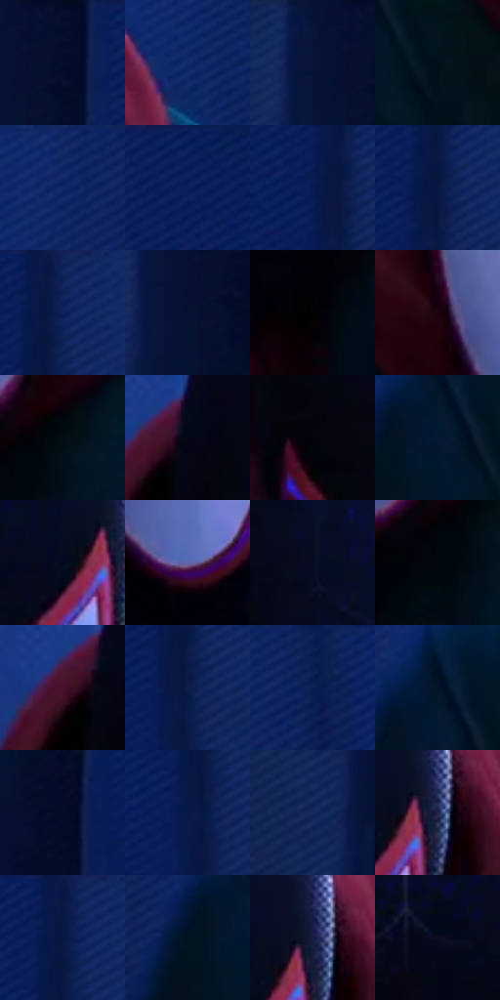

# 电影参考 592

- 状态：常规／活跃；来源世界：miles-home。
- 视角：high-angle；景别：medium；场景：city。
- 时段：night-appearance（外观依据，中置信度；具体时间／晨昏未知）；光照：night-mixed。
- 材质候选：fabric, stone, metal, glass, sky（帧级，不是像素分割）。
- 明暗组：very-dark；L* P5/P50/P95：1.01661 / 7.59903 / 22.0026。
- 资格门禁：无附加门禁。
- 原截图 SHA-256：`4466f363a5470018be4b5c07c598214d2ab1c84d0681261f57b57bf4ad2bae16`；尺寸：2878 × 1210。
- sRGB 像素 SHA-256：`677cd14b26a0c4d0b29987c0712c931fdacb7fedd69ab42974d9ebef652ee7c5`。

## 观察与迁移

蓝冷屋顶、设备和河岸远光，楼顶物件保位且不添造。

面罩近景：黑蓝细网、白紫眼片、暗红帽和蓝绿衣分层；背景墙凹槽低对比排线，强纹不抢眼片。

本公开版保存32个128×128原像素色卡上下文；图集格子并非原场景相邻位置。原rect、图集tile和像素SHA见 `data/palette-crops.json`。上下文不足时不得批准替色，不能以小样推断完整构图。

## 实测色卡

颜色比例分母为保留采样像素，不是材料面积；全部 32 色参与全库匹配。表内四舍五入仅用于阅读，原精度在 JSON。

| ID | HEX | Lab | 原图 xy | 像素数 | 比例 | 明度角色 |
| --- | --- | --- | --- | ---: | ---: | --- |
| 592-S01 | #040D2B | [4.408024, 6.801092, -20.465174] | [456, 28] | 12086 | 6.228484% | deep-shadow |
| 592-S02 | #132E6F | [20.978915, 16.15626, -40.544222] | [1956, 196] | 11553 | 5.953804% | shadow |
| 592-S03 | #071439 | [7.594433, 10.568518, -25.669112] | [384, 40] | 10844 | 5.588423% | deep-shadow |
| 592-S04 | #02101A | [4.137266, -1.582953, -7.776405] | [1080, 552] | 10089 | 5.199336% | deep-shadow |
| 592-S05 | #0D2462 | [16.64458, 17.314234, -39.134536] | [1988, 32] | 9947 | 5.126157% | deep-shadow |
| 592-S06 | #0A205B | [14.693466, 16.974748, -37.671998] | [652, 40] | 9041 | 4.659253% | deep-shadow |
| 592-S07 | #071A53 | [12.01212, 17.702135, -36.663454] | [784, 108] | 8616 | 4.440230% | deep-shadow |
| 592-S08 | #081840 | [9.600268, 10.795615, -27.41132] | [812, 108] | 7923 | 4.083095% | deep-shadow |
| 592-S09 | #0A1F55 | [13.827247, 15.08827, -35.048758] | [828, 44] | 7835 | 4.037744% | deep-shadow |
| 592-S10 | #061033 | [5.855193, 9.892212, -24.109281] | [408, 104] | 7680 | 3.957865% | deep-shadow |
| 592-S11 | #040104 | [0.50846, 1.201612, -0.858822] | [1600, 800] | 6939 | 3.575993% | deep-shadow |
| 592-S12 | #1C020D | [2.885285, 11.04694, -0.920189] | [1228, 480] | 6644 | 3.423966% | deep-shadow |
| 592-S13 | #020C14 | [2.947664, -1.124286, -5.069218] | [1760, 640] | 6349 | 3.271938% | deep-shadow |
| 592-S14 | #040615 | [1.898562, 2.077894, -7.262988] | [1204, 148] | 5950 | 3.066315% | deep-shadow |
| 592-S15 | #02030C | [0.944522, 1.005502, -3.54047] | [1248, 276] | 5700 | 2.937478% | deep-shadow |
| 592-S16 | #051932 | [8.633878, 2.855471, -18.922486] | [984, 488] | 5621 | 2.896766% | deep-shadow |
| 592-S17 | #03071B | [2.261957, 3.001325, -11.333274] | [1728, 304] | 5510 | 2.839562% | deep-shadow |
| 592-S18 | #6365AC | [45.548686, 17.752234, -38.297207] | [1376, 640] | 4982 | 2.567459% | midtone |
| 592-S19 | #060C22 | [3.767663, 4.04496, -14.569626] | [1332, 112] | 4820 | 2.483973% | deep-shadow |
| 592-S20 | #02080F | [1.996649, -0.493193, -3.480866] | [1712, 688] | 4795 | 2.471089% | deep-shadow |
| 592-S21 | #4A132C | [16.022923, 28.501492, -2.405446] | [1160, 164] | 4778 | 2.462328% | deep-shadow |
| 592-S22 | #0D1D49 | [12.254743, 11.670143, -29.390949] | [816, 144] | 4614 | 2.377811% | deep-shadow |
| 592-S23 | #071B4D | [11.719992, 14.247792, -33.03336] | [2080, 56] | 4610 | 2.375750% | deep-shadow |
| 592-S24 | #041527 | [6.400202, 0.443688, -14.320768] | [984, 436] | 4525 | 2.331945% | deep-shadow |
| 592-S25 | #030B24 | [3.486856, 4.449788, -16.565412] | [456, 304] | 4302 | 2.217023% | deep-shadow |
| 592-S26 | #091848 | [10.401587, 14.569918, -31.720297] | [796, 160] | 3557 | 1.833089% | deep-shadow |
| 592-S27 | #17295C | [18.100257, 12.375378, -32.776931] | [316, 296] | 3378 | 1.740842% | deep-shadow |
| 592-S28 | #1D224E | [15.249889, 13.068356, -27.93629] | [1792, 284] | 3054 | 1.573870% | deep-shadow |
| 592-S29 | #061744 | [9.550839, 13.141088, -30.317189] | [812, 44] | 2681 | 1.381645% | deep-shadow |
| 592-S30 | #021222 | [5.066947, -0.131764, -12.596302] | [924, 500] | 2536 | 1.306920% | deep-shadow |
| 592-S31 | #161E3F | [12.33756, 8.409151, -22.249878] | [1784, 260] | 1934 | 0.996681% | deep-shadow |
| 592-S32 | #0C0D21 | [4.29767, 4.823002, -12.951186] | [1528, 368] | 1151 | 0.593164% | deep-shadow |

## 色阶与空间分布

- 采样 ROI：`[0.01, 0.02, 0.98, 0.94]`；步长：4；样本数：194044。
- 排除区：`[]`。
- 深暗、暗、中、亮、高光五段计数：`[180979, 9419, 3430, 209, 7]`。
- RGB 各 256 箱、L* 100 箱、13×5 色相明度表和 3×3 空间统计全部保存在 [总数据](../film-library.json)。
- [可视化档案](../../references/library.html)按需绘制直方图，不存 2,094 张重复图表图片。

## 纹理特征占比

**这是分块图像特征的面积占比，不是波点／排线／丝网／错版的精确语义覆盖率。** 窗格、发丝、织物也会产生方向或周期特征。
原图 ROI 像素 3107496；已测块覆盖 3107496（100.0000%）；未测 0。

| 特征 | 块覆盖像素 | 占已测面积 | 阈值敏感范围 |
| --- | ---: | ---: | --- |
| low-contrast | 1410728 | 45.3976% | 30.9548% ~ 57.8907% |
| directional-structure | 535680 | 17.2383% | 6.6935% ~ 32.4377% |
| periodic-structure | 1079168 | 34.7279% | 32.7796% ~ 36.0802% |
| mixed-detail | 81920 | 2.6362% | 0.5272% ~ 2.6362% |

阈值敏感范围不是统计置信区间。逐块坐标、尺度、对比、方向一致性、频谱集中度、频率与角度见 [全量特征记录](../texture-features.jsonl)，以帧号定位。
四种印刷层的真实像素覆盖仍标为 `null`，不能填 0，也不能拿上表代替。不得据这些代理测量删除唯一证据。

[测量方法与保留策略](../../references/library-retention.md) · [分类索引](../archive/README.md)
