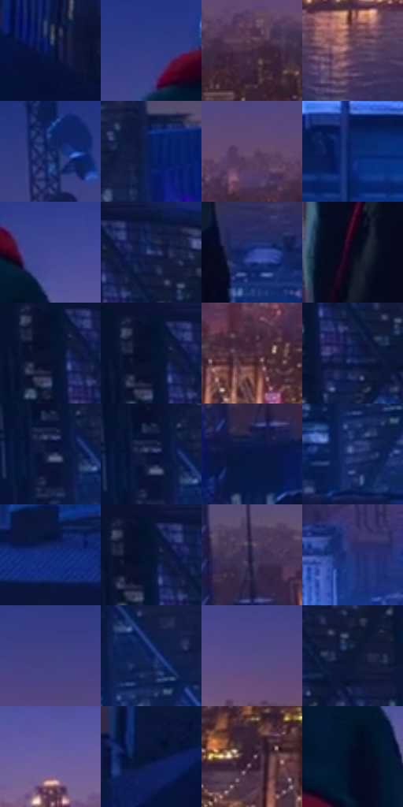

# 电影参考 593

- 状态：常规／活跃；来源世界：miles-home。
- 视角：near-level；景别：environment-wide；场景：city。
- 时段：night-appearance（外观依据，中置信度；具体时间／晨昏未知）；光照：night-mixed。
- 材质候选：fabric, stone, metal, glass, sky（帧级，不是像素分割）。
- 明暗组：very-dark；L* P5/P50/P95：3.99566 / 15.59391 / 36.95996。
- 资格门禁：无附加门禁。
- 原截图 SHA-256：`83b5808e1611537e6c6766c8343f7e2005d121e3de5103ab8e4313166a6b9ba1`；尺寸：2880 × 1214。
- sRGB 像素 SHA-256：`8d2928db8323a4e483a6b08b2675438fa0b6c2c5d6a18926538761fe5e56ca4e`。

## 观察与迁移

蓝冷屋顶、设备和河岸远光，楼顶物件保位且不添造。

背立屋顶：大暗人物居前，冷蓝近楼、暖金对岸与紫色天际形成深度分区；远城以灯群和体量概括，不强制每窗可读。

本公开版保存32个128×128原像素色卡上下文；图集格子并非原场景相邻位置。原rect、图集tile和像素SHA见 `data/palette-crops.json`。上下文不足时不得批准替色，不能以小样推断完整构图。

## 实测色卡

颜色比例分母为保留采样像素，不是材料面积；全部 32 色参与全库匹配。表内四舍五入仅用于阅读，原精度在 JSON。

| ID | HEX | Lab | 原图 xy | 像素数 | 比例 | 明度角色 |
| --- | --- | --- | --- | ---: | ---: | --- |
| 593-S01 | #07174A | [10.199536, 15.997832, -33.444971] | [2768, 672] | 9233 | 4.741145% | deep-shadow |
| 593-S02 | #303C89 | [28.552342, 20.967063, -44.610414] | [1212, 112] | 8148 | 4.183997% | shadow |
| 593-S03 | #3E2942 | [20.057674, 14.987227, -11.916677] | [2380, 328] | 8006 | 4.111080% | shadow |
| 593-S04 | #5C3F58 | [30.724373, 17.288146, -9.893313] | [1708, 540] | 7624 | 3.914923% | shadow |
| 593-S05 | #10215C | [15.330196, 17.300366, -37.290533] | [448, 124] | 7458 | 3.829682% | deep-shadow |
| 593-S06 | #071D5B | [13.702793, 18.953349, -39.297991] | [280, 348] | 7262 | 3.729036% | deep-shadow |
| 593-S07 | #654C6F | [36.14442, 17.564108, -16.112715] | [2280, 276] | 7239 | 3.717226% | shadow |
| 593-S08 | #0D2770 | [18.825333, 21.082807, -44.712211] | [1720, 852] | 7132 | 3.662281% | deep-shadow |
| 593-S09 | #424894 | [33.83732, 20.495055, -42.779094] | [1468, 152] | 7042 | 3.616066% | shadow |
| 593-S10 | #131D47 | [12.428361, 11.834891, -27.707132] | [148, 36] | 6933 | 3.560095% | deep-shadow |
| 593-S11 | #243A8D | [27.636941, 21.953912, -48.601841] | [1536, 664] | 6914 | 3.550338% | shadow |
| 593-S12 | #090A1E | [3.331918, 4.295335, -12.08727] | [1184, 468] | 6632 | 3.405531% | deep-shadow |
| 593-S13 | #0B122D | [6.261076, 6.921535, -19.00468] | [48, 80] | 6438 | 3.305912% | deep-shadow |
| 593-S14 | #060F29 | [4.881265, 5.422632, -18.201456] | [48, 64] | 6210 | 3.188834% | deep-shadow |
| 593-S15 | #503143 | [24.663407, 17.174835, -5.378554] | [2044, 380] | 5984 | 3.072783% | shadow |
| 593-S16 | #0D1D50 | [12.880183, 14.756786, -33.187721] | [128, 148] | 5910 | 3.034784% | deep-shadow |
| 593-S17 | #0A153B | [8.275389, 11.219664, -25.994778] | [44, 352] | 5897 | 3.028109% | deep-shadow |
| 593-S18 | #061238 | [6.835395, 11.312033, -26.178477] | [64, 336] | 5860 | 3.009109% | deep-shadow |
| 593-S19 | #081640 | [8.95335, 12.385654, -28.463296] | [500, 428] | 5627 | 2.889464% | deep-shadow |
| 593-S20 | #192961 | [18.606567, 14.778663, -35.25953] | [116, 492] | 5613 | 2.882275% | deep-shadow |
| 593-S21 | #163181 | [23.510222, 21.793259, -47.873808] | [356, 576] | 5566 | 2.858141% | shadow |
| 593-S22 | #061634 | [7.771423, 6.421279, -21.760644] | [76, 28] | 5136 | 2.637336% | deep-shadow |
| 593-S23 | #2F2A4F | [19.327482, 12.651228, -22.013243] | [520, 332] | 5112 | 2.625012% | deep-shadow |
| 593-S24 | #273476 | [24.305161, 17.692292, -39.58542] | [956, 640] | 5095 | 2.616282% | shadow |
| 593-S25 | #3F4184 | [30.646934, 18.998567, -38.081145] | [2488, 164] | 5089 | 2.613201% | shadow |
| 593-S26 | #081A53 | [12.054857, 17.803668, -36.591761] | [148, 404] | 5080 | 2.608580% | deep-shadow |
| 593-S27 | #554B84 | [35.260026, 18.398151, -30.627862] | [2088, 224] | 5024 | 2.579824% | shadow |
| 593-S28 | #0E1738 | [8.920872, 9.041378, -22.781705] | [196, 132] | 5012 | 2.573662% | deep-shadow |
| 593-S29 | #6A5FA0 | [43.924642, 19.944522, -33.74575] | [1688, 232] | 4967 | 2.550554% | midtone |
| 593-S30 | #051032 | [5.718087, 9.080892, -23.596098] | [2444, 600] | 4687 | 2.406774% | deep-shadow |
| 593-S31 | #301A2F | [13.061635, 15.065771, -9.493411] | [2176, 464] | 3445 | 1.769007% | deep-shadow |
| 593-S32 | #040C24 | [3.758326, 4.275829, -16.141313] | [1416, 252] | 3367 | 1.728954% | deep-shadow |

## 色阶与空间分布

- 采样 ROI：`[0.01, 0.02, 0.98, 0.94]`；步长：4；样本数：194742。
- 排除区：`[]`。
- 深暗、暗、中、亮、高光五段计数：`[117215, 70821, 6233, 439, 34]`。
- RGB 各 256 箱、L* 100 箱、13×5 色相明度表和 3×3 空间统计全部保存在 [总数据](../film-library.json)。
- [可视化档案](../../references/library.html)按需绘制直方图，不存 2,094 张重复图表图片。

## 纹理特征占比

**这是分块图像特征的面积占比，不是波点／排线／丝网／错版的精确语义覆盖率。** 窗格、发丝、织物也会产生方向或周期特征。
原图 ROI 像素 3120898；已测块覆盖 3120898（100.0000%）；未测 0。

| 特征 | 块覆盖像素 | 占已测面积 | 阈值敏感范围 |
| --- | ---: | ---: | --- |
| low-contrast | 230784 | 7.3948% | 5.0570% ~ 12.9358% |
| directional-structure | 420098 | 13.4608% | 2.0097% ~ 30.6415% |
| periodic-structure | 2030464 | 65.0602% | 59.0395% ~ 65.0602% |
| mixed-detail | 439552 | 14.0842% | 3.5846% ~ 26.0151% |

阈值敏感范围不是统计置信区间。逐块坐标、尺度、对比、方向一致性、频谱集中度、频率与角度见 [全量特征记录](../texture-features.jsonl)，以帧号定位。
四种印刷层的真实像素覆盖仍标为 `null`，不能填 0，也不能拿上表代替。不得据这些代理测量删除唯一证据。

[测量方法与保留策略](../../references/library-retention.md) · [分类索引](../archive/README.md)
