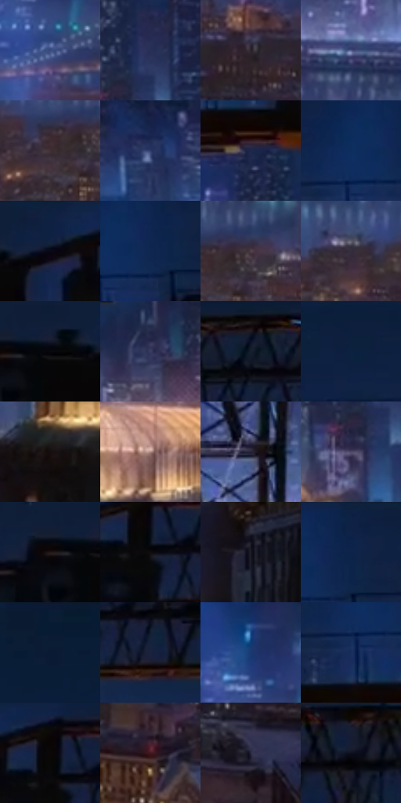

# 电影参考 594

- 状态：常规／活跃；来源世界：miles-home。
- 视角：high-angle；景别：environment-wide；场景：city。
- 时段：night-appearance（外观依据，中置信度；具体时间／晨昏未知）；光照：night-mixed。
- 材质候选：fabric, glass, stone, metal, sky（帧级，不是像素分割）。
- 明暗组：very-dark；L* P5/P50/P95：2.76203 / 17.12401 / 41.07807。
- 资格门禁：无附加门禁。
- 原截图 SHA-256：`bdcd2290246cd9809d9193686fbfdea1c3cf17973be79f1894599e16aa8765c2`；尺寸：2880 × 1202。
- sRGB 像素 SHA-256：`cd4d171dc0abbd047a8cbc381bc0c2649ad0ac1bcf881705d776181667afaaed`。

## 观察与迁移

金色楼冠、塔吊黑形与冷城，优先层级而非全图提亮。

冷蓝远城与近处深暗楼身托起局部金色拱顶；暖窗是断续点群，不把整栋楼涂金。前景吊臂为黑色实体桁架，蓝色光束属照明；屋顶肋架先于细网纹读取，远窗低对比退后。

本公开版保存32个128×128原像素色卡上下文；图集格子并非原场景相邻位置。原rect、图集tile和像素SHA见 `data/palette-crops.json`。上下文不足时不得批准替色，不能以小样推断完整构图。

## 实测色卡

颜色比例分母为保留采样像素，不是材料面积；全部 32 色参与全库匹配。表内四舍五入仅用于阅读，原精度在 JSON。

| ID | HEX | Lab | 原图 xy | 像素数 | 比例 | 明度角色 |
| --- | --- | --- | --- | ---: | ---: | --- |
| 594-S01 | #374A7E | [32.292532, 9.018548, -31.765961] | [316, 644] | 10966 | 5.692247% | shadow |
| 594-S02 | #273058 | [21.016792, 9.20218, -25.392758] | [1736, 364] | 9855 | 5.115548% | shadow |
| 594-S03 | #2A2129 | [14.059474, 6.104698, -3.723491] | [2388, 868] | 9563 | 4.963976% | deep-shadow |
| 594-S04 | #525D8B | [40.38722, 8.149444, -26.86216] | [2368, 692] | 8486 | 4.404925% | midtone |
| 594-S05 | #403036 | [21.836978, 8.433401, -1.009334] | [732, 772] | 8291 | 4.303704% | shadow |
| 594-S06 | #2D3B6A | [25.939404, 9.604764, -29.274834] | [2572, 476] | 8164 | 4.237781% | shadow |
| 594-S07 | #1E284C | [17.061316, 8.113679, -23.669302] | [1564, 240] | 7264 | 3.770608% | deep-shadow |
| 594-S08 | #0D2D5F | [19.174586, 9.313479, -33.048156] | [1512, 84] | 6957 | 3.611250% | deep-shadow |
| 594-S09 | #0F2142 | [13.122735, 5.837993, -23.121014] | [2064, 28] | 6925 | 3.594639% | deep-shadow |
| 594-S10 | #0F2750 | [16.16268, 7.438918, -27.871233] | [1572, 92] | 6476 | 3.361571% | deep-shadow |
| 594-S11 | #503F4A | [28.785891, 9.538769, -3.862876] | [792, 748] | 6359 | 3.300839% | shadow |
| 594-S12 | #332C3D | [19.400026, 7.302179, -9.60978] | [592, 740] | 6120 | 3.176778% | deep-shadow |
| 594-S13 | #08080D | [2.297463, 0.731208, -1.990181] | [1956, 72] | 5921 | 3.073481% | deep-shadow |
| 594-S14 | #393C61 | [26.633046, 9.162578, -22.321619] | [1224, 376] | 5888 | 3.056351% | shadow |
| 594-S15 | #191416 | [6.909537, 2.8188, -0.453187] | [2428, 28] | 5766 | 2.993024% | deep-shadow |
| 594-S16 | #0D1F3D | [11.972882, 4.78521, -21.454502] | [1012, 28] | 5663 | 2.939558% | deep-shadow |
| 594-S17 | #170F0F | [5.043283, 3.265956, 1.151366] | [1084, 608] | 5649 | 2.932291% | deep-shadow |
| 594-S18 | #AD8A84 | [60.541153, 12.345356, 8.266193] | [1492, 520] | 5542 | 2.876749% | light |
| 594-S19 | #212031 | [13.095964, 5.292175, -11.036221] | [2064, 584] | 5454 | 2.831070% | deep-shadow |
| 594-S20 | #514B6A | [33.609284, 9.851314, -17.051346] | [1692, 452] | 5195 | 2.696628% | shadow |
| 594-S21 | #22191A | [9.87585, 4.690168, 1.009518] | [1896, 76] | 5190 | 2.694033% | deep-shadow |
| 594-S22 | #0F0C0E | [3.578966, 1.27537, -0.556897] | [2192, 100] | 4897 | 2.541942% | deep-shadow |
| 594-S23 | #191823 | [8.834433, 3.630308, -7.41071] | [1552, 672] | 4888 | 2.537270% | deep-shadow |
| 594-S24 | #0E2349 | [14.266144, 7.216839, -26.141579] | [1596, 52] | 4726 | 2.453179% | deep-shadow |
| 594-S25 | #0B1B34 | [9.820197, 3.475944, -18.463498] | [308, 48] | 4614 | 2.395042% | deep-shadow |
| 594-S26 | #19213E | [13.483999, 6.53105, -19.706766] | [2272, 144] | 4607 | 2.391408% | deep-shadow |
| 594-S27 | #193971 | [24.716693, 9.867074, -35.771788] | [284, 524] | 4181 | 2.170279% | shadow |
| 594-S28 | #172F5D | [20.064351, 8.400423, -30.276435] | [1500, 148] | 4071 | 2.113181% | shadow |
| 594-S29 | #0C0707 | [2.217325, 1.336825, 0.4713] | [2180, 64] | 4020 | 2.086707% | deep-shadow |
| 594-S30 | #43191E | [15.395718, 20.856933, 6.63682] | [664, 1004] | 3719 | 1.930464% | deep-shadow |
| 594-S31 | #292840 | [17.268931, 7.221645, -15.050823] | [2616, 1120] | 3658 | 1.898800% | deep-shadow |
| 594-S32 | #0D101E | [4.966775, 2.576904, -9.599537] | [2776, 68] | 3573 | 1.854678% | deep-shadow |

## 色阶与空间分布

- 采样 ROI：`[0.01, 0.02, 0.98, 0.94]`；步长：4；样本数：192648。
- 排除区：`[]`。
- 深暗、暗、中、亮、高光五段计数：`[117762, 64231, 8174, 2191, 290]`。
- RGB 各 256 箱、L* 100 箱、13×5 色相明度表和 3×3 空间统计全部保存在 [总数据](../film-library.json)。
- [可视化档案](../../references/library.html)按需绘制直方图，不存 2,094 张重复图表图片。

## 纹理特征占比

**这是分块图像特征的面积占比，不是波点／排线／丝网／错版的精确语义覆盖率。** 窗格、发丝、织物也会产生方向或周期特征。
原图 ROI 像素 3087370；已测块覆盖 3087370（100.0000%）；未测 0。

| 特征 | 块覆盖像素 | 占已测面积 | 阈值敏感范围 |
| --- | ---: | ---: | --- |
| low-contrast | 245760 | 7.9602% | 5.3068% ~ 9.5522% |
| directional-structure | 193792 | 6.2769% | 5.2156% ~ 11.0530% |
| periodic-structure | 2025728 | 65.6134% | 50.2776% ~ 75.2944% |
| mixed-detail | 622090 | 20.1495% | 8.3457% ~ 34.9546% |

阈值敏感范围不是统计置信区间。逐块坐标、尺度、对比、方向一致性、频谱集中度、频率与角度见 [全量特征记录](../texture-features.jsonl)，以帧号定位。
四种印刷层的真实像素覆盖仍标为 `null`，不能填 0，也不能拿上表代替。不得据这些代理测量删除唯一证据。

[测量方法与保留策略](../../references/library-retention.md) · [分类索引](../archive/README.md)
