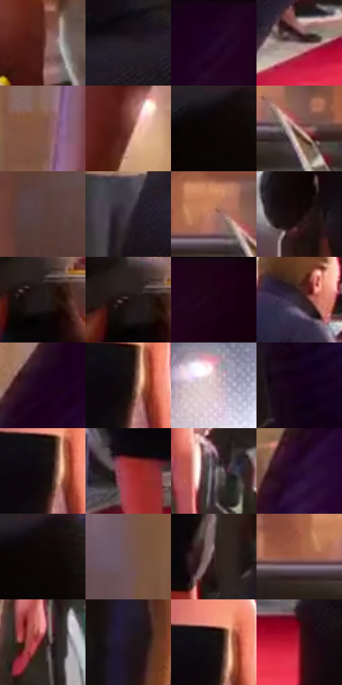

# 电影参考 595

- 状态：常规／活跃；来源世界：miles-home。
- 视角：near-level；景别：full-body；场景：street。
- 时段：night-appearance（外观依据，中置信度；具体时间／晨昏未知）；光照：night-mixed。
- 材质候选：skin, hair, fabric, stone, glass（帧级，不是像素分割）。
- 明暗组：very-dark；L* P5/P50/P95：2.24133 / 16.26791 / 65.02471。
- 资格门禁：无附加门禁。
- 原截图 SHA-256：`7e62ab58899d9a2fa23de75c39af87bdef8b7938abbaae5b253dbe622f8dfc0b`；尺寸：2880 × 1204。
- sRGB 像素 SHA-256：`ec4acd6ce5830a31249630faa0a962f5748e8c72354e8e1a7b441ac74c9da8d2`。

## 观察与迁移

暖门口人物与拍摄人群，反差突出主体。

暖肤色、黑礼服与中性暖砖墙分层，前景黑衣构成遮挡；紫色衣料有方向性细排线。相机白色闪光及周围点纹是局部强光表现，不把全场黑布或车玻璃都画成同一种亮面。

本公开版保存32个128×128原像素色卡上下文；图集格子并非原场景相邻位置。原rect、图集tile和像素SHA见 `data/palette-crops.json`。上下文不足时不得批准替色，不能以小样推断完整构图。

## 实测色卡

颜色比例分母为保留采样像素，不是材料面积；全部 32 色参与全库匹配。表内四舍五入仅用于阅读，原精度在 JSON。

| ID | HEX | Lab | 原图 xy | 像素数 | 比例 | 明度角色 |
| --- | --- | --- | --- | ---: | ---: | --- |
| 595-S01 | #542721 | [21.748808, 20.244409, 13.590308] | [2180, 676] | 8850 | 4.593871% | shadow |
| 595-S02 | #271F26 | [12.930404, 5.453448, -3.276795] | [52, 392] | 8787 | 4.561169% | deep-shadow |
| 595-S03 | #220321 | [4.652624, 19.312575, -12.197096] | [2632, 40] | 8426 | 4.373780% | deep-shadow |
| 595-S04 | #846D71 | [48.304837, 9.767691, 1.185477] | [780, 1116] | 8169 | 4.240376% | midtone |
| 595-S05 | #825748 | [41.265504, 15.861166, 15.93629] | [2028, 164] | 7859 | 4.079461% | midtone |
| 595-S06 | #723D34 | [32.176774, 22.151119, 15.785703] | [2192, 236] | 7609 | 3.949691% | shadow |
| 595-S07 | #0D0607 | [2.08814, 2.037381, 0.290685] | [88, 44] | 6844 | 3.552593% | deep-shadow |
| 595-S08 | #C2958E | [65.685561, 15.855646, 10.221673] | [1592, 428] | 6772 | 3.515219% | light |
| 595-S09 | #573F40 | [29.290368, 10.641733, 3.495638] | [1528, 152] | 6666 | 3.460197% | shadow |
| 595-S10 | #403844 | [24.751629, 6.183271, -6.112775] | [632, 752] | 6552 | 3.401022% | shadow |
| 595-S11 | #B27666 | [55.464852, 21.607805, 18.460414] | [1532, 388] | 6336 | 3.288900% | midtone |
| 595-S12 | #160708 | [3.072128, 5.220693, 1.412355] | [1672, 764] | 6283 | 3.261389% | deep-shadow |
| 595-S13 | #1F1719 | [8.775647, 4.457095, 0.114574] | [272, 208] | 6237 | 3.237511% | deep-shadow |
| 595-S14 | #1E1213 | [6.82615, 6.174051, 1.528032] | [252, 192] | 6119 | 3.176259% | deep-shadow |
| 595-S15 | #1D0215 | [3.241299, 13.219386, -5.047133] | [2776, 64] | 6032 | 3.131099% | deep-shadow |
| 595-S16 | #382A32 | [18.915873, 8.118574, -2.676839] | [856, 472] | 6022 | 3.125908% | deep-shadow |
| 595-S17 | #1C021E | [3.469274, 15.150688, -11.710237] | [2500, 148] | 5882 | 3.053237% | deep-shadow |
| 595-S18 | #160C0E | [4.202582, 4.072121, 0.42853] | [1200, 324] | 5872 | 3.048046% | deep-shadow |
| 595-S19 | #E2CACC | [83.321538, 8.719619, 2.07888] | [880, 240] | 5793 | 3.007039% | highlight |
| 595-S20 | #160117 | [2.295919, 10.436711, -7.960512] | [2340, 828] | 5707 | 2.962398% | deep-shadow |
| 595-S21 | #100A0E | [3.242446, 2.470148, -1.03897] | [1192, 316] | 5603 | 2.908413% | deep-shadow |
| 595-S22 | #A9383A | [40.526621, 46.334963, 24.624007] | [1020, 988] | 5598 | 2.905818% | midtone |
| 595-S23 | #5C515A | [35.788074, 6.357504, -3.583627] | [1320, 532] | 5502 | 2.855986% | shadow |
| 595-S24 | #260B2D | [7.595943, 20.640541, -16.694216] | [2392, 364] | 5251 | 2.725697% | deep-shadow |
| 595-S25 | #110909 | [3.019601, 2.475594, 0.872621] | [112, 44] | 5204 | 2.701300% | deep-shadow |
| 595-S26 | #705452 | [38.542436, 11.306624, 5.684174] | [1776, 148] | 4993 | 2.591774% | shadow |
| 595-S27 | #372423 | [16.481358, 8.886463, 4.2984] | [1196, 928] | 4646 | 2.411652% | deep-shadow |
| 595-S28 | #9D5E4B | [46.556128, 23.627009, 21.806168] | [1468, 412] | 4527 | 2.349882% | midtone |
| 595-S29 | #3C1514 | [12.908554, 19.131783, 10.220238] | [1296, 700] | 4037 | 2.095532% | deep-shadow |
| 595-S30 | #211722 | [9.414451, 7.596988, -5.689722] | [348, 928] | 4009 | 2.080997% | deep-shadow |
| 595-S31 | #171113 | [5.691566, 2.967533, -0.230455] | [1196, 284] | 3859 | 2.003135% | deep-shadow |
| 595-S32 | #7B1223 | [26.058146, 43.955434, 19.289568] | [1684, 1084] | 2602 | 1.350650% | shadow |

## 色阶与空间分布

- 采样 ROI：`[0.01, 0.02, 0.98, 0.94]`；步长：4；样本数：192648。
- 排除区：`[]`。
- 深暗、暗、中、亮、高光五段计数：`[105642, 45716, 28734, 9313, 3243]`。
- RGB 各 256 箱、L* 100 箱、13×5 色相明度表和 3×3 空间统计全部保存在 [总数据](../film-library.json)。
- [可视化档案](../../references/library.html)按需绘制直方图，不存 2,094 张重复图表图片。

## 纹理特征占比

**这是分块图像特征的面积占比，不是波点／排线／丝网／错版的精确语义覆盖率。** 窗格、发丝、织物也会产生方向或周期特征。
原图 ROI 像素 3092958；已测块覆盖 3092958（100.0000%）；未测 0。

| 特征 | 块覆盖像素 | 占已测面积 | 阈值敏感范围 |
| --- | ---: | ---: | --- |
| low-contrast | 514526 | 16.6354% | 13.4861% ~ 18.2246% |
| directional-structure | 593792 | 19.1982% | 12.4981% ~ 32.2549% |
| periodic-structure | 1869952 | 60.4584% | 52.3263% ~ 61.8613% |
| mixed-detail | 114688 | 3.7080% | 1.9326% ~ 7.4161% |

阈值敏感范围不是统计置信区间。逐块坐标、尺度、对比、方向一致性、频谱集中度、频率与角度见 [全量特征记录](../texture-features.jsonl)，以帧号定位。
四种印刷层的真实像素覆盖仍标为 `null`，不能填 0，也不能拿上表代替。不得据这些代理测量删除唯一证据。

[测量方法与保留策略](../../references/library-retention.md) · [分类索引](../archive/README.md)
