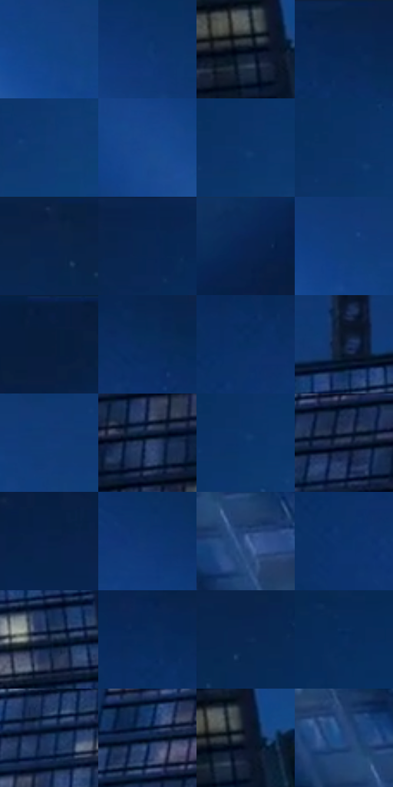

# 电影参考 596

- 状态：常规／活跃；来源世界：miles-home。
- 视角：low-angle；景别：environment-wide；场景：city。
- 时段：night-appearance（外观依据，中置信度；具体时间／晨昏未知）；光照：night-mixed。
- 材质候选：fabric, glass, stone, metal, sky（帧级，不是像素分割）。
- 明暗组：dark；L* P5/P50/P95：7.03675 / 20.28039 / 31.04417。
- 资格门禁：无附加门禁。
- 原截图 SHA-256：`c83a39af34acbeac6bf80af27bbc6354bb4d02db1aec2efd0ce0f8e6bcccc7b7`；尺寸：2880 × 1206。
- sRGB 像素 SHA-256：`f24463fade83adf8477dd37af7e84beff6332ebf6b33c6c6f3a18cba9fa7b24b`。

## 观察与迁移

金色楼冠、塔吊黑形与冷城，优先层级而非全图提亮。

大蓝色天空与暗钢架、楼体形成低照度层级，幕墙窗带仅保留低对比暖灰节奏。探照光的柔软蓝束不是速度线；吊臂三角结构和窗框是实体，不能计为印刷排线。

本公开版保存32个128×128原像素色卡上下文；图集格子并非原场景相邻位置。原rect、图集tile和像素SHA见 `data/palette-crops.json`。上下文不足时不得批准替色，不能以小样推断完整构图。

## 实测色卡

颜色比例分母为保留采样像素，不是材料面积；全部 32 色参与全库匹配。表内四舍五入仅用于阅读，原精度在 JSON。

| ID | HEX | Lab | 原图 xy | 像素数 | 比例 | 明度角色 |
| --- | --- | --- | --- | ---: | ---: | --- |
| 596-S01 | #0F4282 | [28.403283, 9.584489, -40.570882] | [2308, 604] | 11121 | 5.751865% | shadow |
| 596-S02 | #0D366E | [23.166117, 9.319247, -36.368426] | [2004, 296] | 9105 | 4.709174% | shadow |
| 596-S03 | #061021 | [4.688542, 1.697943, -12.3857] | [1740, 1004] | 9054 | 4.682797% | deep-shadow |
| 596-S04 | #0A244C | [14.667421, 7.217837, -27.5632] | [1728, 32] | 8943 | 4.625387% | deep-shadow |
| 596-S05 | #103973 | [24.555952, 9.618556, -37.321809] | [2800, 408] | 8580 | 4.437640% | shadow |
| 596-S06 | #17488D | [31.205083, 10.762665, -42.848702] | [1948, 432] | 8131 | 4.205414% | shadow |
| 596-S07 | #0D3368 | [21.7707, 8.872388, -34.746015] | [2820, 240] | 8004 | 4.139729% | shadow |
| 596-S08 | #0C3265 | [21.201562, 8.185921, -33.714393] | [2792, 224] | 7707 | 3.986118% | shadow |
| 596-S09 | #0D2347 | [14.072387, 6.167609, -25.07626] | [2004, 36] | 7701 | 3.983015% | deep-shadow |
| 596-S10 | #082651 | [15.652295, 7.7224, -29.383738] | [1460, 60] | 6759 | 3.495805% | deep-shadow |
| 596-S11 | #0A2B58 | [17.90271, 7.359954, -30.460181] | [416, 28] | 6477 | 3.349953% | deep-shadow |
| 596-S12 | #113D7B | [26.407357, 10.293024, -39.401859] | [2184, 464] | 6304 | 3.260476% | shadow |
| 596-S13 | #081E40 | [11.621748, 6.061528, -24.144817] | [676, 32] | 5941 | 3.072730% | deep-shadow |
| 596-S14 | #0A2D5D | [18.933501, 8.111787, -32.120797] | [1784, 116] | 5931 | 3.067558% | deep-shadow |
| 596-S15 | #082F61 | [19.831408, 8.229624, -33.311671] | [1672, 144] | 5670 | 2.932566% | deep-shadow |
| 596-S16 | #091930 | [8.710283, 2.815626, -17.327144] | [1480, 628] | 5613 | 2.903086% | deep-shadow |
| 596-S17 | #103B77 | [25.470648, 9.908381, -38.387875] | [2308, 468] | 5409 | 2.797575% | shadow |
| 596-S18 | #304266 | [28.070618, 4.187548, -23.329749] | [1252, 940] | 5352 | 2.768095% | shadow |
| 596-S19 | #0B356B | [22.578114, 8.552127, -35.387758] | [2820, 256] | 5332 | 2.757750% | shadow |
| 596-S20 | #202D48 | [18.590476, 3.526324, -18.520547] | [1104, 940] | 5176 | 2.677066% | deep-shadow |
| 596-S21 | #072148 | [13.233315, 7.285404, -27.12931] | [884, 88] | 4959 | 2.564832% | deep-shadow |
| 596-S22 | #0F356F | [22.981323, 10.662692, -37.305997] | [1888, 252] | 4838 | 2.502250% | shadow |
| 596-S23 | #3A5A91 | [38.296638, 5.950006, -33.879338] | [2544, 1040] | 4816 | 2.490871% | shadow |
| 596-S24 | #0A326A | [21.527066, 10.201003, -36.438992] | [1660, 212] | 4708 | 2.435013% | shadow |
| 596-S25 | #13213B | [12.871221, 3.738787, -18.591564] | [1664, 724] | 4663 | 2.411739% | deep-shadow |
| 596-S26 | #062A59 | [17.532189, 8.128567, -31.730576] | [1672, 80] | 4605 | 2.381741% | deep-shadow |
| 596-S27 | #0B2953 | [16.898843, 6.725284, -28.722312] | [2544, 92] | 4568 | 2.362604% | deep-shadow |
| 596-S28 | #092E5E | [19.307192, 7.721823, -32.18057] | [2816, 76] | 4488 | 2.321227% | deep-shadow |
| 596-S29 | #1B355F | [22.320157, 5.642625, -27.972131] | [1228, 788] | 3835 | 1.983491% | shadow |
| 596-S30 | #071B38 | [9.910327, 4.518598, -21.212161] | [1048, 844] | 3559 | 1.840741% | deep-shadow |
| 596-S31 | #13192C | [9.119795, 3.807427, -13.699337] | [1772, 992] | 3497 | 1.808675% | deep-shadow |
| 596-S32 | #1F437C | [28.798967, 8.269443, -36.160909] | [2476, 964] | 2500 | 1.293019% | shadow |

## 色阶与空间分布

- 采样 ROI：`[0.01, 0.02, 0.98, 0.94]`；步长：4；样本数：193346。
- 排除区：`[]`。
- 深暗、暗、中、亮、高光五段计数：`[93218, 99038, 1055, 32, 3]`。
- RGB 各 256 箱、L* 100 箱、13×5 色相明度表和 3×3 空间统计全部保存在 [总数据](../film-library.json)。
- [可视化档案](../../references/library.html)按需绘制直方图，不存 2,094 张重复图表图片。

## 纹理特征占比

**这是分块图像特征的面积占比，不是波点／排线／丝网／错版的精确语义覆盖率。** 窗格、发丝、织物也会产生方向或周期特征。
原图 ROI 像素 3098546；已测块覆盖 3098546（100.0000%）；未测 0。

| 特征 | 块覆盖像素 | 占已测面积 | 阈值敏感范围 |
| --- | ---: | ---: | --- |
| low-contrast | 1433088 | 46.2503% | 41.4915% ~ 49.4229% |
| directional-structure | 141824 | 4.5771% | 2.0242% ~ 8.6296% |
| periodic-structure | 1277184 | 41.2188% | 36.0179% ~ 47.2351% |
| mixed-detail | 246450 | 7.9537% | 2.6438% ~ 12.5350% |

阈值敏感范围不是统计置信区间。逐块坐标、尺度、对比、方向一致性、频谱集中度、频率与角度见 [全量特征记录](../texture-features.jsonl)，以帧号定位。
四种印刷层的真实像素覆盖仍标为 `null`，不能填 0，也不能拿上表代替。不得据这些代理测量删除唯一证据。

[测量方法与保留策略](../../references/library-retention.md) · [分类索引](../archive/README.md)
