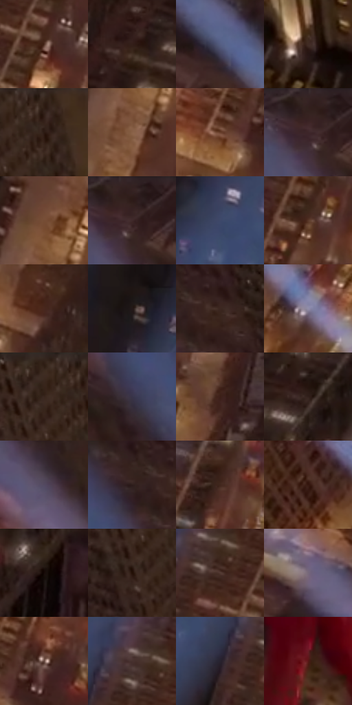

# 电影参考 597

- 状态：常规／活跃；来源世界：miles-home。
- 视角：overhead；景别：environment-wide；场景：city。
- 时段：night-appearance（外观依据，中置信度；具体时间／晨昏未知）；光照：night-mixed。
- 材质候选：fabric, glass, stone, metal, sky（帧级，不是像素分割）。
- 明暗组：very-dark；L* P5/P50/P95：7.81104 / 19.90305 / 47.58108。
- 资格门禁：无附加门禁。
- 原截图 SHA-256：`33a9ee0f8363a3a7c6127a4244e10e64e84ce469eec694898aae1135c7cab959`；尺寸：2880 × 1204。
- sRGB 像素 SHA-256：`78afb013ac5849623dd610047baf15945c990668bfa568740b4d813164016f45`。

## 观察与迁移

金色楼冠、塔吊黑形与冷城，优先层级而非全图提亮。

俯视楼体以暖灰石色和柱间奶白上照光池组织转折，暗窗组保留中断。蓝白斜光束跨越建筑而不改其几何；局部立面受光、远街灯点与石材细纹分别处理，不推断精确灯具参数。

本公开版保存32个128×128原像素色卡上下文；图集格子并非原场景相邻位置。原rect、图集tile和像素SHA见 `data/palette-crops.json`。上下文不足时不得批准替色，不能以小样推断完整构图。

## 实测色卡

颜色比例分母为保留采样像素，不是材料面积；全部 32 色参与全库匹配。表内四舍五入仅用于阅读，原精度在 JSON。

| ID | HEX | Lab | 原图 xy | 像素数 | 比例 | 明度角色 |
| --- | --- | --- | --- | ---: | ---: | --- |
| 597-S01 | #4F2E22 | [22.765388, 13.661013, 14.094875] | [2092, 432] | 11213 | 5.820460% | shadow |
| 597-S02 | #331E19 | [13.842614, 9.522873, 7.667575] | [2604, 80] | 8481 | 4.402330% | deep-shadow |
| 597-S03 | #555E82 | [40.488385, 5.783585, -21.234736] | [560, 624] | 8369 | 4.344193% | midtone |
| 597-S04 | #402B24 | [19.823607, 8.649884, 8.442631] | [1172, 488] | 8246 | 4.280346% | deep-shadow |
| 597-S05 | #2C1A12 | [11.401159, 7.789591, 8.978276] | [888, 68] | 8069 | 4.188468% | deep-shadow |
| 597-S06 | #896247 | [44.955282, 12.312095, 21.584358] | [1880, 1004] | 7498 | 3.892073% | midtone |
| 597-S07 | #673E2B | [30.64981, 15.763595, 19.15137] | [1984, 624] | 7416 | 3.849508% | shadow |
| 597-S08 | #352320 | [15.816365, 8.10786, 5.447026] | [152, 36] | 7273 | 3.775279% | deep-shadow |
| 597-S09 | #764D34 | [36.758485, 14.360854, 21.825485] | [1880, 904] | 7066 | 3.667829% | shadow |
| 597-S10 | #2C1B17 | [11.832673, 7.78267, 6.194789] | [172, 32] | 6998 | 3.632532% | deep-shadow |
| 597-S11 | #3E486A | [31.111863, 5.557449, -21.048693] | [1832, 268] | 6936 | 3.600349% | shadow |
| 597-S12 | #5A3728 | [26.904303, 13.776363, 15.872759] | [2168, 276] | 6586 | 3.418670% | shadow |
| 597-S13 | #47271D | [19.55539, 13.816269, 13.028167] | [2256, 732] | 6162 | 3.198580% | deep-shadow |
| 597-S14 | #231717 | [9.25553, 6.06553, 2.386892] | [1812, 112] | 5963 | 3.095283% | deep-shadow |
| 597-S15 | #3C2720 | [17.991605, 8.816789, 8.602448] | [628, 112] | 5934 | 3.080229% | deep-shadow |
| 597-S16 | #918CA8 | [59.528192, 7.618577, -14.063293] | [836, 896] | 5638 | 2.926581% | midtone |
| 597-S17 | #362318 | [15.760111, 7.458181, 11.010588] | [828, 52] | 5608 | 2.911009% | deep-shadow |
| 597-S18 | #373448 | [22.778804, 6.373677, -11.866338] | [400, 148] | 5544 | 2.877787% | shadow |
| 597-S19 | #3C1F17 | [15.50158, 13.078607, 11.543068] | [2372, 132] | 5472 | 2.840414% | deep-shadow |
| 597-S20 | #24150F | [8.532977, 6.731563, 6.453071] | [2748, 44] | 5417 | 2.811864% | deep-shadow |
| 597-S21 | #524A61 | [33.037126, 8.533663, -12.235101] | [244, 228] | 5286 | 2.743864% | shadow |
| 597-S22 | #2E1E1C | [13.189525, 7.473112, 4.486837] | [552, 116] | 5258 | 2.729330% | deep-shadow |
| 597-S23 | #41261C | [18.339144, 11.442436, 11.94541] | [2236, 128] | 5153 | 2.674827% | deep-shadow |
| 597-S24 | #361710 | [12.186648, 14.711473, 11.488099] | [700, 860] | 4791 | 2.486919% | deep-shadow |
| 597-S25 | #160A07 | [3.640575, 3.879968, 2.649732] | [2696, 360] | 4647 | 2.412171% | deep-shadow |
| 597-S26 | #231107 | [6.988346, 7.931591, 7.74066] | [816, 172] | 4548 | 2.360782% | deep-shadow |
| 597-S27 | #523A32 | [26.878357, 9.374682, 9.157673] | [2028, 356] | 4547 | 2.360263% | shadow |
| 597-S28 | #78697A | [46.313595, 9.252138, -7.266304] | [404, 448] | 4505 | 2.338462% | midtone |
| 597-S29 | #64473E | [33.058076, 11.067561, 10.317334] | [2068, 584] | 4284 | 2.223745% | shadow |
| 597-S30 | #47312E | [22.770826, 9.514021, 5.881058] | [2000, 316] | 4262 | 2.212325% | shadow |
| 597-S31 | #28222E | [14.357922, 5.793678, -6.886597] | [1932, 372] | 3036 | 1.575931% | deep-shadow |
| 597-S32 | #571715 | [18.773305, 29.274313, 18.084802] | [1672, 996] | 2442 | 1.267597% | deep-shadow |

## 色阶与空间分布

- 采样 ROI：`[0.01, 0.02, 0.98, 0.94]`；步长：4；样本数：192648。
- 排除区：`[]`。
- 深暗、暗、中、亮、高光五段计数：`[96988, 74046, 19264, 2257, 93]`。
- RGB 各 256 箱、L* 100 箱、13×5 色相明度表和 3×3 空间统计全部保存在 [总数据](../film-library.json)。
- [可视化档案](../../references/library.html)按需绘制直方图，不存 2,094 张重复图表图片。

## 纹理特征占比

**这是分块图像特征的面积占比，不是波点／排线／丝网／错版的精确语义覆盖率。** 窗格、发丝、织物也会产生方向或周期特征。
原图 ROI 像素 3092958；已测块覆盖 3092958（100.0000%）；未测 0。

| 特征 | 块覆盖像素 | 占已测面积 | 阈值敏感范围 |
| --- | ---: | ---: | --- |
| low-contrast | 0 | 0.0000% | 0.0000% ~ 0.0000% |
| directional-structure | 294912 | 9.5350% | 6.3566% ~ 18.1677% |
| periodic-structure | 2650590 | 85.6976% | 80.4293% ~ 85.6976% |
| mixed-detail | 147456 | 4.7675% | 0.5297% ~ 13.2140% |

阈值敏感范围不是统计置信区间。逐块坐标、尺度、对比、方向一致性、频谱集中度、频率与角度见 [全量特征记录](../texture-features.jsonl)，以帧号定位。
四种印刷层的真实像素覆盖仍标为 `null`，不能填 0，也不能拿上表代替。不得据这些代理测量删除唯一证据。

[测量方法与保留策略](../../references/library-retention.md) · [分类索引](../archive/README.md)
