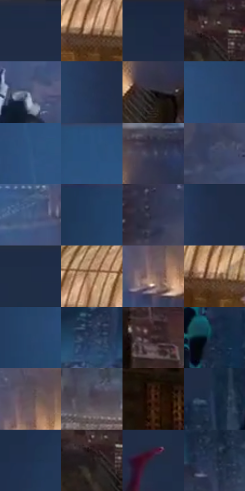

# 电影参考 598

- 状态：常规／活跃；来源世界：miles-home。
- 视角：high-angle；景别：environment-wide；场景：city。
- 时段：night-appearance（外观依据，中置信度；具体时间／晨昏未知）；光照：night-mixed。
- 材质候选：fabric, glass, stone, metal, sky（帧级，不是像素分割）。
- 明暗组：dark；L* P5/P50/P95：10.07403 / 25.22134 / 50.94625。
- 资格门禁：无附加门禁。
- 原截图 SHA-256：`befbe14c9aea7ff02e306625936a831a02e7085731d940d350c554213c1cb955`；尺寸：2880 × 1206。
- sRGB 像素 SHA-256：`3560e31f2d11ee9395f5b61afceb8d22b7b4a8c10741f5cae03d0cf6692cc583`。

## 观察与迁移

金色楼冠、塔吊黑形与冷城，优先层级而非全图提亮。

拱形金色屋盖由亮玻璃区、暗肋架和冷蓝背景分离，楼身仍为暗块。拱肋是主结构，不是排线；亮部可见暖色透光／映光外观，但静帧不足以拆解唯一成因。客串角色不等于另一个世界的原生画风。

本公开版保存32个128×128原像素色卡上下文；图集格子并非原场景相邻位置。原rect、图集tile和像素SHA见 `data/palette-crops.json`。上下文不足时不得批准替色，不能以小样推断完整构图。

## 实测色卡

颜色比例分母为保留采样像素，不是材料面积；全部 32 色参与全库匹配。表内四舍五入仅用于阅读，原精度在 JSON。

| ID | HEX | Lab | 原图 xy | 像素数 | 比例 | 明度角色 |
| --- | --- | --- | --- | ---: | ---: | --- |
| 598-S01 | #202C45 | [18.089278, 3.137907, -17.261094] | [1732, 28] | 12382 | 6.404063% | deep-shadow |
| 598-S02 | #6A442C | [32.65894, 13.560901, 21.156529] | [1160, 880] | 9325 | 4.822960% | shadow |
| 598-S03 | #1D2B43 | [17.432418, 2.24112, -16.934487] | [900, 68] | 8880 | 4.592803% | deep-shadow |
| 598-S04 | #312021 | [14.377558, 8.414956, 2.617272] | [2168, 888] | 8809 | 4.556081% | deep-shadow |
| 598-S05 | #4A5371 | [35.663174, 4.336616, -18.312276] | [448, 880] | 8175 | 4.228171% | shadow |
| 598-S06 | #243553 | [22.108166, 3.053253, -20.365743] | [740, 212] | 7533 | 3.896124% | shadow |
| 598-S07 | #141016 | [5.214127, 2.864191, -2.991684] | [2008, 808] | 7492 | 3.874919% | deep-shadow |
| 598-S08 | #2C496F | [30.514933, 1.740034, -25.226648] | [596, 168] | 7302 | 3.776649% | shadow |
| 598-S09 | #315581 | [35.46726, 1.542229, -28.626426] | [292, 292] | 6919 | 3.578559% | shadow |
| 598-S10 | #2B517E | [33.782157, 1.797904, -29.451371] | [364, 28] | 6632 | 3.430120% | shadow |
| 598-S11 | #3B3E55 | [26.822246, 4.811822, -14.218061] | [2020, 700] | 6543 | 3.384089% | shadow |
| 598-S12 | #3D4865 | [30.797946, 3.692584, -18.369874] | [220, 1132] | 6531 | 3.377882% | shadow |
| 598-S13 | #486087 | [40.39702, 2.234629, -24.478977] | [560, 676] | 6454 | 3.338057% | midtone |
| 598-S14 | #223C5E | [24.888455, 1.849678, -23.22767] | [116, 28] | 6370 | 3.294612% | shadow |
| 598-S15 | #31334A | [21.998161, 5.457897, -14.456972] | [112, 1036] | 6196 | 3.204618% | shadow |
| 598-S16 | #212E49 | [19.048077, 3.468782, -18.476339] | [784, 156] | 6115 | 3.162724% | deep-shadow |
| 598-S17 | #1F2E47 | [18.800092, 2.163327, -17.516566] | [2604, 48] | 6049 | 3.128588% | deep-shadow |
| 598-S18 | #C59F7C | [68.111744, 9.194567, 23.598882] | [1216, 816] | 6043 | 3.125485% | light |
| 598-S19 | #927768 | [52.180306, 8.14901, 12.213499] | [628, 968] | 5996 | 3.101176% | midtone |
| 598-S20 | #836046 | [43.703676, 10.733346, 20.400141] | [1300, 892] | 5835 | 3.017906% | midtone |
| 598-S21 | #26446A | [28.343996, 1.867506, -25.494226] | [152, 448] | 5452 | 2.819815% | shadow |
| 598-S22 | #2F3E5C | [26.221421, 3.158248, -19.781048] | [2188, 464] | 5256 | 2.718443% | shadow |
| 598-S23 | #433234 | [22.732293, 8.050515, 1.69871] | [2284, 1084] | 5088 | 2.631552% | shadow |
| 598-S24 | #16243D | [14.225575, 3.083537, -17.845308] | [1492, 252] | 4975 | 2.573107% | deep-shadow |
| 598-S25 | #62535A | [36.969705, 7.531347, -1.771511] | [644, 912] | 4789 | 2.476907% | shadow |
| 598-S26 | #4E4552 | [30.604951, 6.609491, -6.360343] | [1104, 588] | 4236 | 2.190891% | shadow |
| 598-S27 | #45271F | [19.289205, 13.077133, 11.26236] | [2112, 1112] | 4217 | 2.181064% | deep-shadow |
| 598-S28 | #192A46 | [17.010763, 3.040733, -19.673537] | [1344, 264] | 3871 | 2.002110% | deep-shadow |
| 598-S29 | #1E304E | [19.800849, 3.118189, -20.681819] | [2820, 76] | 3619 | 1.871774% | deep-shadow |
| 598-S30 | #241C1D | [11.235734, 4.126395, 0.782505] | [2148, 920] | 3181 | 1.645237% | deep-shadow |
| 598-S31 | #292A3F | [17.855797, 5.479594, -13.448196] | [2300, 180] | 2427 | 1.255263% | deep-shadow |
| 598-S32 | #243046 | [19.765359, 1.890418, -15.304949] | [1264, 392] | 654 | 0.338254% | deep-shadow |

## 色阶与空间分布

- 采样 ROI：`[0.01, 0.02, 0.98, 0.94]`；步长：4；样本数：193346。
- 排除区：`[]`。
- 深暗、暗、中、亮、高光五段计数：`[70347, 101850, 15643, 5202, 304]`。
- RGB 各 256 箱、L* 100 箱、13×5 色相明度表和 3×3 空间统计全部保存在 [总数据](../film-library.json)。
- [可视化档案](../../references/library.html)按需绘制直方图，不存 2,094 张重复图表图片。

## 纹理特征占比

**这是分块图像特征的面积占比，不是波点／排线／丝网／错版的精确语义覆盖率。** 窗格、发丝、织物也会产生方向或周期特征。
原图 ROI 像素 3098546；已测块覆盖 3098546（100.0000%）；未测 0。

| 特征 | 块覆盖像素 | 占已测面积 | 阈值敏感范围 |
| --- | ---: | ---: | --- |
| low-contrast | 453120 | 14.6236% | 13.6570% ~ 16.7387% |
| directional-structure | 180224 | 5.8164% | 0.5288% ~ 18.2382% |
| periodic-structure | 2151474 | 69.4350% | 62.2099% ~ 69.4350% |
| mixed-detail | 313728 | 10.1250% | 4.3995% ~ 20.5227% |

阈值敏感范围不是统计置信区间。逐块坐标、尺度、对比、方向一致性、频谱集中度、频率与角度见 [全量特征记录](../texture-features.jsonl)，以帧号定位。
四种印刷层的真实像素覆盖仍标为 `null`，不能填 0，也不能拿上表代替。不得据这些代理测量删除唯一证据。

[测量方法与保留策略](../../references/library-retention.md) · [分类索引](../archive/README.md)
