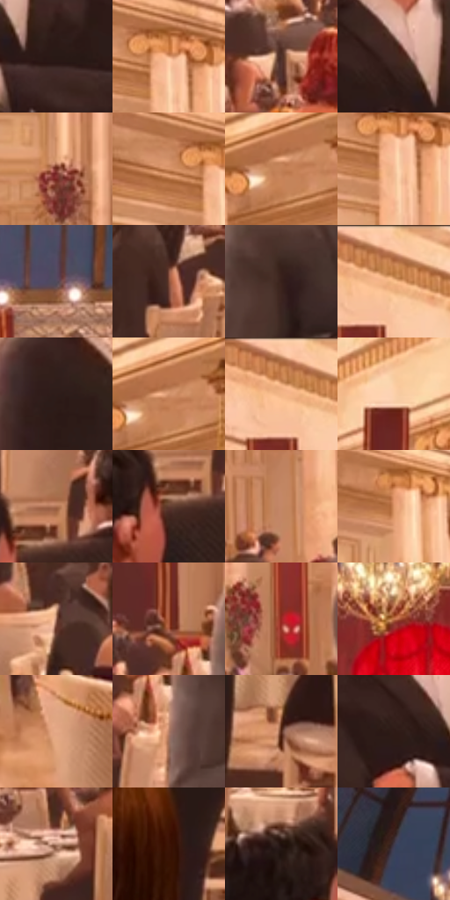

# 电影参考 599

- 状态：常规／活跃；来源世界：miles-home。
- 视角：near-level；景别：environment-wide；场景：interior。
- 时段：interior-time-unknown（外观依据，中置信度；具体时间／晨昏未知）；光照：interior-mixed。
- 材质候选：skin, hair, fabric, stone, wood, metal, glass, ceramic（帧级，不是像素分割）。
- 明暗组：middle；L* P5/P50/P95：10.91738 / 47.98067 / 81.0193。
- 资格门禁：无附加门禁。
- 原截图 SHA-256：`7e43289e67723ad83b76ffc06036ea0dbede3325f415b257a46f17a1d6cac19f`；尺寸：2880 × 1206。
- sRGB 像素 SHA-256：`ce64d07367b8b3ff79a71ec6bfd9e1a0513cbae7e6e1c17b6638777d24be05bb`。

## 观察与迁移

暖厅石柱、金属餐罩和餐具各有高光响应，白布不发塑料亮。

奶油桃色墙柱、浅色椅背桌布与淡金反光地面形成大中亮面，黑衣人物为暗锚点；红旗竖条和顶部冷蓝屋盖是次级色区。圆柱转折、柱头与檐线先于石面细纹，吊灯白金高亮保持局部。

本公开版保存32个128×128原像素色卡上下文；图集格子并非原场景相邻位置。原rect、图集tile和像素SHA见 `data/palette-crops.json`。上下文不足时不得批准替色，不能以小样推断完整构图。

## 实测色卡

颜色比例分母为保留采样像素，不是材料面积；全部 32 色参与全库匹配。表内四舍五入仅用于阅读，原精度在 JSON。

| ID | HEX | Lab | 原图 xy | 像素数 | 比例 | 明度角色 |
| --- | --- | --- | --- | ---: | ---: | --- |
| 599-S01 | #281915 | [10.561863, 6.83896, 5.773663] | [1032, 536] | 9386 | 4.854510% | deep-shadow |
| 599-S02 | #E4A178 | [71.787348, 20.142835, 31.227488] | [124, 160] | 8957 | 4.632628% | light |
| 599-S03 | #50322B | [24.198205, 12.632706, 10.058439] | [228, 612] | 8814 | 4.558667% | shadow |
| 599-S04 | #402822 | [18.899796, 10.378862, 8.552316] | [948, 472] | 8740 | 4.520393% | deep-shadow |
| 599-S05 | #732E21 | [28.667907, 29.494077, 23.359185] | [1212, 388] | 8538 | 4.415918% | shadow |
| 599-S06 | #CF8A60 | [63.581792, 21.839829, 33.117845] | [32, 160] | 8437 | 4.363680% | light |
| 599-S07 | #C38057 | [59.645187, 21.586031, 32.744063] | [2768, 108] | 7565 | 3.912675% | midtone |
| 599-S08 | #F5BD95 | [80.728288, 15.014635, 27.979714] | [120, 196] | 7498 | 3.878022% | highlight |
| 599-S09 | #524B5D | [33.170622, 6.915177, -9.495468] | [1632, 136] | 7371 | 3.812336% | shadow |
| 599-S10 | #824C38 | [38.201504, 20.675356, 21.589258] | [1476, 704] | 7121 | 3.683035% | shadow |
| 599-S11 | #37201B | [15.08626, 10.418753, 8.032799] | [1712, 564] | 6963 | 3.601316% | deep-shadow |
| 599-S12 | #AE6944 | [51.291765, 24.000179, 32.270908] | [296, 36] | 6827 | 3.530976% | midtone |
| 599-S13 | #2E1D19 | [12.79673, 7.693535, 6.114672] | [2384, 584] | 6671 | 3.450291% | deep-shadow |
| 599-S14 | #D3946D | [66.623545, 19.231269, 30.067105] | [2780, 96] | 6642 | 3.435292% | light |
| 599-S15 | #F2B185 | [77.292078, 18.477071, 31.807945] | [268, 60] | 6616 | 3.421845% | light |
| 599-S16 | #FCD0AB | [86.380398, 10.350804, 24.200281] | [2368, 156] | 6158 | 3.184964% | highlight |
| 599-S17 | #AE7251 | [53.631624, 20.049156, 27.925973] | [2768, 720] | 6071 | 3.139967% | midtone |
| 599-S18 | #643E32 | [30.364875, 15.125881, 14.287151] | [2732, 772] | 6029 | 3.118244% | shadow |
| 599-S19 | #C38766 | [61.560796, 19.117241, 26.9503] | [368, 496] | 5627 | 2.910327% | light |
| 599-S20 | #DE976A | [68.538434, 21.796584, 34.394471] | [392, 244] | 5429 | 2.807919% | light |
| 599-S21 | #956451 | [47.104569, 17.437123, 18.810655] | [596, 680] | 5100 | 2.637758% | midtone |
| 599-S22 | #A55437 | [45.106506, 30.891964, 31.809598] | [1576, 520] | 4920 | 2.544661% | midtone |
| 599-S23 | #9A2722 | [34.88036, 46.880757, 31.752872] | [672, 472] | 4909 | 2.538972% | shadow |
| 599-S24 | #C5764D | [57.430317, 27.092804, 35.502264] | [1404, 200] | 4858 | 2.512594% | midtone |
| 599-S25 | #E5AA87 | [74.291957, 17.276795, 26.512411] | [2232, 992] | 4849 | 2.507939% | light |
| 599-S26 | #B07C64 | [56.651458, 17.199753, 21.167354] | [1620, 620] | 4754 | 2.458804% | midtone |
| 599-S27 | #532615 | [21.131637, 19.42876, 20.642935] | [1128, 916] | 4321 | 2.234854% | shadow |
| 599-S28 | #2F1A16 | [11.965567, 9.873127, 7.178364] | [920, 504] | 3711 | 1.919357% | deep-shadow |
| 599-S29 | #C3947E | [65.192355, 14.66164, 18.489552] | [464, 704] | 3515 | 1.817984% | light |
| 599-S30 | #3C1405 | [12.430325, 18.66994, 16.926685] | [848, 964] | 3150 | 1.629204% | deep-shadow |
| 599-S31 | #20100C | [6.361642, 7.289755, 4.688608] | [2644, 716] | 2422 | 1.252677% | deep-shadow |
| 599-S32 | #403A48 | [25.515032, 5.829928, -7.62114] | [732, 72] | 1377 | 0.712195% | shadow |

## 色阶与空间分布

- 采样 ROI：`[0.01, 0.02, 0.98, 0.94]`；步长：4；样本数：193346。
- 排除区：`[]`。
- 深暗、暗、中、亮、高光五段计数：`[39433, 47083, 40332, 54894, 11604]`。
- RGB 各 256 箱、L* 100 箱、13×5 色相明度表和 3×3 空间统计全部保存在 [总数据](../film-library.json)。
- [可视化档案](../../references/library.html)按需绘制直方图，不存 2,094 张重复图表图片。

## 纹理特征占比

**这是分块图像特征的面积占比，不是波点／排线／丝网／错版的精确语义覆盖率。** 窗格、发丝、织物也会产生方向或周期特征。
原图 ROI 像素 3098546；已测块覆盖 3098546（100.0000%）；未测 0。

| 特征 | 块覆盖像素 | 占已测面积 | 阈值敏感范围 |
| --- | ---: | ---: | --- |
| low-contrast | 16384 | 0.5288% | 0.5288% ~ 1.0575% |
| directional-structure | 472064 | 15.2350% | 10.0383% ~ 26.3613% |
| periodic-structure | 2429874 | 78.4198% | 71.5236% ~ 78.4198% |
| mixed-detail | 180224 | 5.8164% | 1.5863% ~ 12.9506% |

阈值敏感范围不是统计置信区间。逐块坐标、尺度、对比、方向一致性、频谱集中度、频率与角度见 [全量特征记录](../texture-features.jsonl)，以帧号定位。
四种印刷层的真实像素覆盖仍标为 `null`，不能填 0，也不能拿上表代替。不得据这些代理测量删除唯一证据。

[测量方法与保留策略](../../references/library-retention.md) · [分类索引](../archive/README.md)
