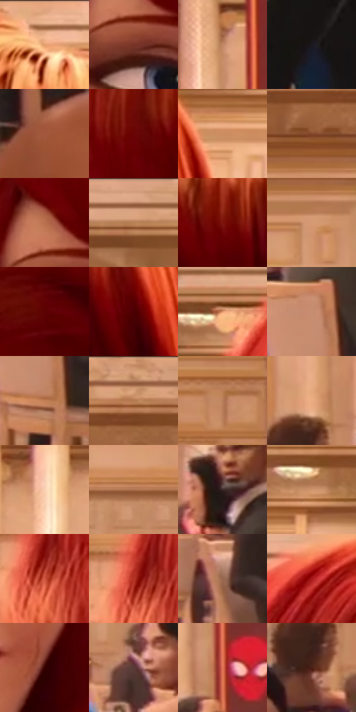

# 电影参考 600

- 状态：常规／活跃；来源世界：miles-home。
- 视角：near-level；景别：close-up；场景：interior。
- 时段：interior-time-unknown（外观依据，中置信度；具体时间／晨昏未知）；光照：interior-mixed。
- 材质候选：skin, hair, fabric, stone, wood, metal, glass, ceramic（帧级，不是像素分割）。
- 明暗组：middle；L* P5/P50/P95：11.26794 / 50.86336 / 77.84198。
- 资格门禁：无附加门禁。
- 原截图 SHA-256：`d58c1d44cfb4aa1c4f96bd84e2e2753d63eff9ac38b98772b143ad8b9674d0b2`；尺寸：2880 × 1214。
- sRGB 像素 SHA-256：`72e5761c1757627217fa8dfa865003791d26ca8960c282c15015b905bf4be0d4`。

## 观察与迁移

暖厅石柱、金属餐罩和餐具各有高光响应，白布不发塑料亮。

前景铜红发、桃色皮肤和蓝眼分开；发束以整组卷曲体积承载方向性丝线，亮橙束与暗红卷底并存。雀斑属于人物皮肤特征，不是全脸网点；后景人物按焦点层次简化，红发不等同红色布料。

本公开版保存32个128×128原像素色卡上下文；图集格子并非原场景相邻位置。原rect、图集tile和像素SHA见 `data/palette-crops.json`。上下文不足时不得批准替色，不能以小样推断完整构图。

## 实测色卡

颜色比例分母为保留采样像素，不是材料面积；全部 32 色参与全库匹配。表内四舍五入仅用于阅读，原精度在 JSON。

| ID | HEX | Lab | 原图 xy | 像素数 | 比例 | 明度角色 |
| --- | --- | --- | --- | ---: | ---: | --- |
| 600-S01 | #EBB591 | [77.731559, 14.89388, 25.893945] | [884, 32] | 9321 | 4.786333% | light |
| 600-S02 | #793427 | [31.040175, 29.120047, 22.73263] | [612, 432] | 8262 | 4.242536% | shadow |
| 600-S03 | #C18764 | [61.297033, 18.095287, 27.668603] | [2684, 216] | 8225 | 4.223537% | light |
| 600-S04 | #1D1A21 | [9.874586, 3.275489, -4.294478] | [1792, 1136] | 8187 | 4.204024% | deep-shadow |
| 600-S05 | #A2583C | [45.619276, 27.811104, 29.481073] | [2820, 1064] | 8065 | 4.141377% | midtone |
| 600-S06 | #6A0405 | [20.685118, 41.130974, 29.40855] | [656, 240] | 7729 | 3.968841% | shadow |
| 600-S07 | #CE8C61 | [63.953093, 20.428154, 33.023038] | [1120, 212] | 7557 | 3.880519% | light |
| 600-S08 | #85492F | [37.767268, 22.983438, 26.501486] | [1884, 144] | 7296 | 3.746495% | shadow |
| 600-S09 | #BA704E | [54.637172, 25.911717, 31.193514] | [596, 352] | 6954 | 3.570878% | midtone |
| 600-S10 | #DCA482 | [71.81292, 16.381866, 25.719447] | [148, 48] | 6934 | 3.560608% | light |
| 600-S11 | #7E160E | [26.855734, 42.932182, 33.196816] | [864, 224] | 6899 | 3.542636% | shadow |
| 600-S12 | #D59A73 | [68.38609, 17.38348, 29.15839] | [1904, 240] | 6817 | 3.500529% | light |
| 600-S13 | #5C0103 | [17.009639, 37.811323, 25.077958] | [364, 1076] | 6657 | 3.418369% | deep-shadow |
| 600-S14 | #4B0001 | [12.598812, 33.102975, 19.363795] | [1000, 272] | 6531 | 3.353668% | deep-shadow |
| 600-S15 | #E39C70 | [70.372558, 21.667619, 33.651185] | [336, 96] | 6364 | 3.267913% | light |
| 600-S16 | #C78E72 | [63.921716, 18.157605, 23.507706] | [2644, 792] | 6358 | 3.264832% | light |
| 600-S17 | #C27D54 | [58.769573, 22.569802, 33.259432] | [2656, 900] | 5875 | 3.016812% | midtone |
| 600-S18 | #8F573B | [42.722882, 20.209052, 25.895309] | [1952, 40] | 5795 | 2.975732% | midtone |
| 600-S19 | #B87E5C | [57.929635, 18.566918, 27.531616] | [2552, 400] | 5716 | 2.935166% | midtone |
| 600-S20 | #ECAC82 | [75.422225, 18.452562, 30.820075] | [2048, 572] | 5560 | 2.855060% | light |
| 600-S21 | #F8D0B3 | [86.169013, 9.865008, 19.654622] | [1480, 208] | 5456 | 2.801656% | highlight |
| 600-S22 | #AC704D | [52.83644, 19.970182, 29.112194] | [1812, 464] | 5351 | 2.747738% | midtone |
| 600-S23 | #3A2826 | [18.175434, 8.093459, 4.644576] | [2164, 660] | 5315 | 2.729252% | deep-shadow |
| 600-S24 | #CF936C | [65.918306, 18.04945, 29.606616] | [1232, 132] | 5177 | 2.658389% | light |
| 600-S25 | #CC553E | [51.480258, 45.830848, 36.88808] | [272, 532] | 5037 | 2.586499% | midtone |
| 600-S26 | #B33324 | [41.34575, 50.684606, 38.853755] | [256, 504] | 4417 | 2.268129% | midtone |
| 600-S27 | #99674F | [48.308874, 17.193547, 21.670013] | [2428, 788] | 4392 | 2.255292% | midtone |
| 600-S28 | #A8191B | [36.179812, 55.109979, 37.959158] | [508, 72] | 4281 | 2.198293% | shadow |
| 600-S29 | #350100 | [7.035233, 25.545323, 11.093438] | [940, 784] | 3995 | 2.051432% | deep-shadow |
| 600-S30 | #583A35 | [27.732029, 12.560734, 8.496026] | [1848, 680] | 3723 | 1.911760% | shadow |
| 600-S31 | #E47654 | [61.736491, 39.862471, 37.916869] | [2732, 540] | 3614 | 1.855789% | light |
| 600-S32 | #4A1E14 | [17.623494, 20.057605, 16.770374] | [2036, 676] | 2882 | 1.479907% | deep-shadow |

## 色阶与空间分布

- 采样 ROI：`[0.01, 0.02, 0.98, 0.94]`；步长：4；样本数：194742。
- 排除区：`[]`。
- 深暗、暗、中、亮、高光五段计数：`[33990, 38431, 50907, 64989, 6425]`。
- RGB 各 256 箱、L* 100 箱、13×5 色相明度表和 3×3 空间统计全部保存在 [总数据](../film-library.json)。
- [可视化档案](../../references/library.html)按需绘制直方图，不存 2,094 张重复图表图片。

## 纹理特征占比

**这是分块图像特征的面积占比，不是波点／排线／丝网／错版的精确语义覆盖率。** 窗格、发丝、织物也会产生方向或周期特征。
原图 ROI 像素 3120898；已测块覆盖 3120898（100.0000%）；未测 0。

| 特征 | 块覆盖像素 | 占已测面积 | 阈值敏感范围 |
| --- | ---: | ---: | --- |
| low-contrast | 72960 | 2.3378% | 1.9564% ~ 2.8628% |
| directional-structure | 1183360 | 37.9173% | 27.7951% ~ 48.5112% |
| periodic-structure | 1848194 | 59.2199% | 49.5325% ~ 68.2922% |
| mixed-detail | 16384 | 0.5250% | 0.0000% ~ 1.0500% |

阈值敏感范围不是统计置信区间。逐块坐标、尺度、对比、方向一致性、频谱集中度、频率与角度见 [全量特征记录](../texture-features.jsonl)，以帧号定位。
四种印刷层的真实像素覆盖仍标为 `null`，不能填 0，也不能拿上表代替。不得据这些代理测量删除唯一证据。

[测量方法与保留策略](../../references/library-retention.md) · [分类索引](../archive/README.md)
