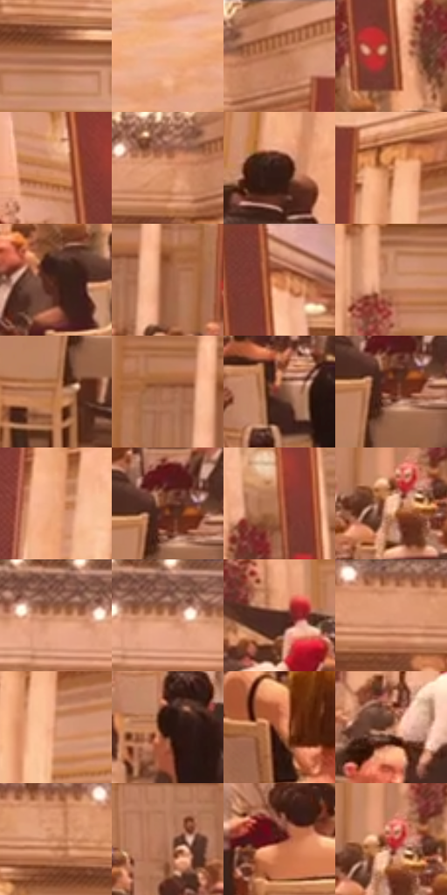

# 电影参考 601

- 状态：常规／活跃；来源世界：miles-home。
- 视角：near-level；景别：environment-wide；场景：interior。
- 时段：interior-time-unknown（外观依据，中置信度；具体时间／晨昏未知）；光照：interior-mixed。
- 材质候选：skin, hair, fabric, stone, wood, metal, glass, ceramic（帧级，不是像素分割）。
- 明暗组：middle；L* P5/P50/P95：13.84447 / 54.54776 / 76.51715。
- 资格门禁：无附加门禁。
- 原截图 SHA-256：`f9f8ef29e74b4fd8455dc3512e911c1c6afc390970174897a8d9aae27db67e5a`；尺寸：2880 × 1210。
- sRGB 像素 SHA-256：`c425b11de1295fe842cdbb656a6a0771cf08a7fd4593269c4f52107a126e7ad3`。

## 观察与迁移

暖厅石柱、金属餐罩和餐具各有高光响应，白布不发塑料亮。

象牙白桌椅重复成组，黑衣人群成为疏密暗团，红色竖旗与酒红花束少量点缀。地面反光为柔软、断续的暖白区域，不是塑料白点；柱列、墙面线脚和前后遮挡承担空间，不全景刻细节。

本公开版保存32个128×128原像素色卡上下文；图集格子并非原场景相邻位置。原rect、图集tile和像素SHA见 `data/palette-crops.json`。上下文不足时不得批准替色，不能以小样推断完整构图。

## 实测色卡

颜色比例分母为保留采样像素，不是材料面积；全部 32 色参与全库匹配。表内四舍五入仅用于阅读，原精度在 JSON。

| ID | HEX | Lab | 原图 xy | 像素数 | 比例 | 明度角色 |
| --- | --- | --- | --- | ---: | ---: | --- |
| 601-S01 | #C18464 | [60.571496, 19.750274, 26.720653] | [904, 148] | 10076 | 5.192637% | light |
| 601-S02 | #F0AE89 | [76.440477, 19.686747, 28.518555] | [264, 880] | 8193 | 4.222238% | light |
| 601-S03 | #AB6A45 | [51.149398, 22.250005, 31.452349] | [1984, 60] | 7540 | 3.885717% | midtone |
| 601-S04 | #8B412C | [36.842152, 29.804122, 27.379308] | [384, 328] | 7473 | 3.851188% | shadow |
| 601-S05 | #C27B50 | [58.24267, 23.34952, 34.781491] | [72, 152] | 7054 | 3.635258% | midtone |
| 601-S06 | #E09971 | [69.345077, 22.161062, 31.722968] | [1900, 80] | 6974 | 3.594030% | light |
| 601-S07 | #361B15 | [13.366387, 12.571397, 9.964483] | [2768, 404] | 6892 | 3.551772% | deep-shadow |
| 601-S08 | #D0855A | [62.445422, 24.4638, 34.957462] | [2304, 84] | 6816 | 3.512605% | light |
| 601-S09 | #482419 | [18.842981, 15.828725, 14.844742] | [332, 448] | 6798 | 3.503329% | deep-shadow |
| 601-S10 | #9B5F42 | [46.375844, 21.396011, 26.763642] | [1956, 308] | 6554 | 3.377584% | midtone |
| 601-S11 | #DFA080 | [71.139844, 19.504473, 25.957476] | [384, 28] | 6539 | 3.369854% | light |
| 601-S12 | #C88B6D | [63.21981, 19.673711, 25.36461] | [1532, 208] | 6517 | 3.358517% | light |
| 601-S13 | #B7754E | [55.423216, 21.902866, 32.087945] | [1812, 596] | 6476 | 3.337387% | midtone |
| 601-S14 | #AD7355 | [53.817978, 19.441765, 25.882656] | [1892, 288] | 6413 | 3.304921% | midtone |
| 601-S15 | #774432 | [34.574507, 20.009338, 20.290226] | [920, 520] | 6298 | 3.245656% | shadow |
| 601-S16 | #692B1B | [26.189422, 26.608696, 23.72742] | [1852, 512] | 6266 | 3.229165% | shadow |
| 601-S17 | #EBA57B | [73.549606, 21.088273, 32.071425] | [2604, 92] | 6093 | 3.140009% | light |
| 601-S18 | #6E3A29 | [30.645377, 21.164161, 20.607504] | [1852, 484] | 6074 | 3.130218% | shadow |
| 601-S19 | #A25633 | [45.050791, 28.314074, 33.863092] | [468, 244] | 5956 | 3.069407% | midtone |
| 601-S20 | #F8BF9C | [81.632248, 15.914831, 25.552599] | [1716, 388] | 5919 | 3.050339% | highlight |
| 601-S21 | #89523B | [40.686792, 20.496391, 23.159241] | [1708, 52] | 5913 | 3.047247% | midtone |
| 601-S22 | #BC7D5C | [58.163761, 20.783197, 27.927552] | [1732, 60] | 5749 | 2.962730% | midtone |
| 601-S23 | #522E23 | [23.235626, 15.185235, 14.133095] | [756, 340] | 5686 | 2.930263% | shadow |
| 601-S24 | #D79470 | [67.126614, 21.14009, 29.179293] | [652, 32] | 5584 | 2.877698% | light |
| 601-S25 | #D18F6B | [65.172166, 20.941654, 29.22371] | [2336, 152] | 5398 | 2.781843% | light |
| 601-S26 | #28130E | [8.556376, 10.166829, 7.086722] | [1500, 504] | 5229 | 2.694750% | deep-shadow |
| 601-S27 | #BB6A44 | [53.268675, 28.86088, 35.067297] | [2268, 592] | 4904 | 2.527262% | midtone |
| 601-S28 | #9F674D | [49.018311, 19.547457, 23.899047] | [2596, 420] | 4521 | 2.329884% | midtone |
| 601-S29 | #C6835D | [60.809368, 21.699279, 31.009978] | [828, 80] | 4109 | 2.117561% | light |
| 601-S30 | #B3795E | [56.156503, 19.477679, 23.977871] | [900, 340] | 3764 | 1.939766% | midtone |
| 601-S31 | #52150F | [17.297738, 27.95992, 19.719243] | [108, 480] | 3339 | 1.720744% | deep-shadow |
| 601-S32 | #B62726 | [40.474243, 55.789835, 37.043508] | [1728, 364] | 2927 | 1.508421% | midtone |

## 色阶与空间分布

- 采样 ROI：`[0.01, 0.02, 0.98, 0.94]`；步长：4；样本数：194044。
- 排除区：`[]`。
- 深暗、暗、中、亮、高光五段计数：`[19613, 37107, 68943, 64395, 3986]`。
- RGB 各 256 箱、L* 100 箱、13×5 色相明度表和 3×3 空间统计全部保存在 [总数据](../film-library.json)。
- [可视化档案](../../references/library.html)按需绘制直方图，不存 2,094 张重复图表图片。

## 纹理特征占比

**这是分块图像特征的面积占比，不是波点／排线／丝网／错版的精确语义覆盖率。** 窗格、发丝、织物也会产生方向或周期特征。
原图 ROI 像素 3109722；已测块覆盖 3109722（100.0000%）；未测 0。

| 特征 | 块覆盖像素 | 占已测面积 | 阈值敏感范围 |
| --- | ---: | ---: | --- |
| low-contrast | 0 | 0.0000% | 0.0000% ~ 0.0000% |
| directional-structure | 352640 | 11.3399% | 4.2149% ~ 20.6876% |
| periodic-structure | 2650202 | 85.2231% | 78.7855% ~ 87.2400% |
| mixed-detail | 106880 | 3.4370% | 0.5269% ~ 8.5451% |

阈值敏感范围不是统计置信区间。逐块坐标、尺度、对比、方向一致性、频谱集中度、频率与角度见 [全量特征记录](../texture-features.jsonl)，以帧号定位。
四种印刷层的真实像素覆盖仍标为 `null`，不能填 0，也不能拿上表代替。不得据这些代理测量删除唯一证据。

[测量方法与保留策略](../../references/library-retention.md) · [分类索引](../archive/README.md)
